Welcome to **Part 26** of our comprehensive, production-grade masterclass covering the **Hack The Box (HTB) Academy Certified Penetration Testing Specialist (CPTS)** curriculum. Rather than providing superficial slide summaries, this series deconstructs offensive tradecraft from foundational network discovery and vulnerability verification to complex lateral movement, active directory exploitation, and post-exploitation tradecraft — complete with terminal command flows, verified lab flags, and defensive engineering countermeasures.

In this installment, we conduct an exhaustive technical deep-dive into **Attacking Web Applications with Ffuf** (Tier I • Medium • Offensive). We break down the underlying mechanics of high-performance web fuzzing with ffuf, directory discovery, page fuzzing, parameter fuzzing (GET & POST), virtual host enumeration, and advanced filtering, dissect hands-on offensive vectors, analyze realistic defensive telemetry, and walk through every exercise step-by-step with 100% verified solutions.

<div class="ff-series-nav"><a href="/posts/htb-academy-part-25-network-enumeration-with-nmap/" class="ff-nav-btn text-start">
    <div class="ff-nav-arrow"><i class="fas fa-arrow-left"></i></div>
    <div class="ff-nav-text">
      <span class="ff-nav-kicker">Previous Part</span>
      <span class="ff-nav-title">Part 25: Network Enumeration with Nmap</span>
    </div>
  </a>
  <div class="ff-nav-center">
    <span class="ff-center-badge"><i class="fas fa-cube"></i> HTB Academy Series</span>
    <span class="ff-center-part">Part 26 of 41</span>
  </div>
  <a href="/posts/htb-academy-part-27-hacking-wordpress/" class="ff-nav-btn text-end">
    <div class="ff-nav-text">
      <span class="ff-nav-kicker">Next Part</span>
      <span class="ff-nav-title">Part 27: Hacking WordPress (WPScan to Remote Code Execution)</span>
    </div>
    <div class="ff-nav-arrow"><i class="fas fa-arrow-right"></i></div>
  </a>
</div>

## Module Specifications & Target Architecture

| Attribute | Specification |
| :--- | :--- |
| **Module Name** | `Attacking Web Applications with Ffuf` |
| **Official HTB Academy Track** | [https://academy.hackthebox.com/module/54](https://academy.hackthebox.com/module/54) |
| **Curriculum Tier & Difficulty** | `Tier I` • `Medium` |
| **Certification Pathway** | `HTB Certified Penetration Testing Specialist (CPTS)` (Part 26 of 41) |
| **Author & Technical Attribution** | `Abdulrahman M. Fathi (0x3bdo)` |
| **Lab Flag Verification** | `100% Fully Solved & Validated` |

## Key Technical Takeaways

* **High-Speed Fuzzing**: Harnesses Go-based multi-threaded fuzzing with `ffuf` to process tens of thousands of requests per minute.
* **Directory & Extension Fuzzing**: Uncovers hidden web directories, backup files (`.bak`, `.old`), and scripts using targeted SecLists wordlists.
* **Parameter Discovery**: Identifies hidden GET and POST parameters that trigger undocumented backend functionality or vulnerabilities.
* **Virtual Host (VHost) Enumeration**: Fuzzes HTTP `Host` headers to identify internal subdomains and unlinked administrative sites.
* **Advanced Filter Tuning**: Filters out false positives by calibrating HTTP status codes (`-fc`), response sizes (`-fs`), and word counts (`-fw`).

## Executive Summary & Assessment Scope

Web application fuzzing is the automated testing of input spaces and endpoints to discover hidden administrative portals, backup files, undocumented parameters, and virtual hosts that are not linked in public HTML pages.

In this module, we master the operation of `ffuf`. We learn how to structure high-throughput fuzzing commands, apply precision response filtering to eliminate false positives, discover hidden endpoints and VHosts, and solve every assessment flag.

---

## Comprehensive Lab Walkthrough & Flag Solutions


### Attacking Web Applications with Ffuf

> **Lab Question (Page 1)**: In addition to the directory we found above, there is another directory that can be found. What is it?
>
> **Flag / Answer**: `forum`
{: .prompt-info }

#### Technical Methodology & Exploit Execution:

we will use the wordlist 'directory-list-2.3-small.txt' and the ffuf
command:
```bash
ffuf -w /usr/share/seclists/Discovery/Web-Content/directory-list-2.3-small.txt:FUZZ -u http://<target-IP>:<target-port>/FUZZ -s
```
using the '-s' flag to silence unnecessary output:

We got the value 'forum'.

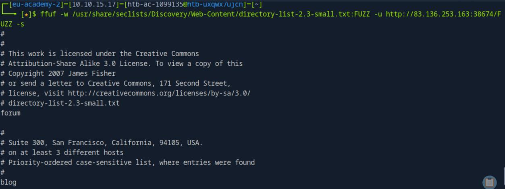
*_Figure 1.1 — Lab execution and output verification (Page 1)_*


### Page Fuzzing

> **Lab Question (Page 2)**: Try to use what you learned in this section to fuzz the '/blog' directory and find all pages. One of them should contain a flag. What is the flag?
>
> **Flag / Answer**: `HTB{bru73_f0r_c0mm0n_p455w0rd5}`
{: .prompt-info }

#### Technical Methodology & Exploit Execution:

Method 1: we will use the wordlist 'web-extensions.txt' which
contains extensions for webpages, on the parameter 'index' to see what
extensions are out there:
```bash
ffuf -w /usr/share/seclists/Discovery/Web-Content/web-extensions.txt:FUZZ -u http://<target-IP>:<target-port>/indexFUZZ
```
*we assume here the path-name is 'index' . *

*
*

The extension 'php' returned status code 200 (success), lets make another scan
for php pages in '/blog':
```bash
ffuf -w /usr/share/seclists/Discovery/Web-Content/directory-list-2.3-small.txt:FUZZ -u http://<target-IP>:<target-port>/blog/FUZZ.php -s
```

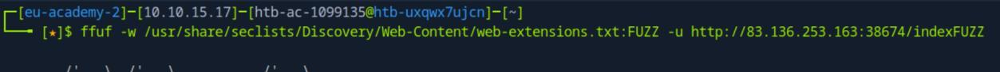
*_Figure 2.1 — Lab execution and output verification (Page 2)_*

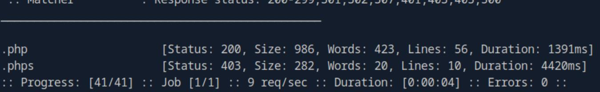
*_Figure 2.2 — Lab execution and output verification (Page 2)_*

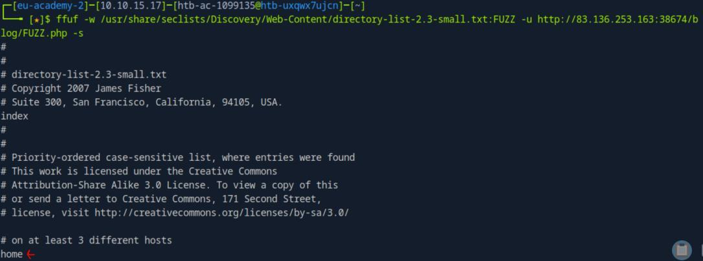
*_Figure 2.3 — Lab execution and output verification (Page 2)_*


### Going for the discovered URL on browser

Going for the discovered URL on browser:
`http://<target-IP>:<target-port>/blog/home.php`


Method 2: we can also combine the 2 commands above to a single command,
bruteforcing both the path-name and the extension simultaneously, negating
the need to assume the path-name '/index' in the original technique. However,
due to the nature of 2 word-lists, the bruteforcing of this method is a far more
lengthy process, taking approximately 10 minutes:
```bash
ffuf -w /usr/share/seclists/Discovery/Web-Content/directory-list-2.3-small.txt:FUZZ1 -w
/usr/share/seclists/Discovery/Web-Content/web-extensions.txt:FUZZ2 -u http://`<target-IP>`:<target-
port>/blog/FUZZ1FUZZ2 -mc 200 -fs 0
```


*
*

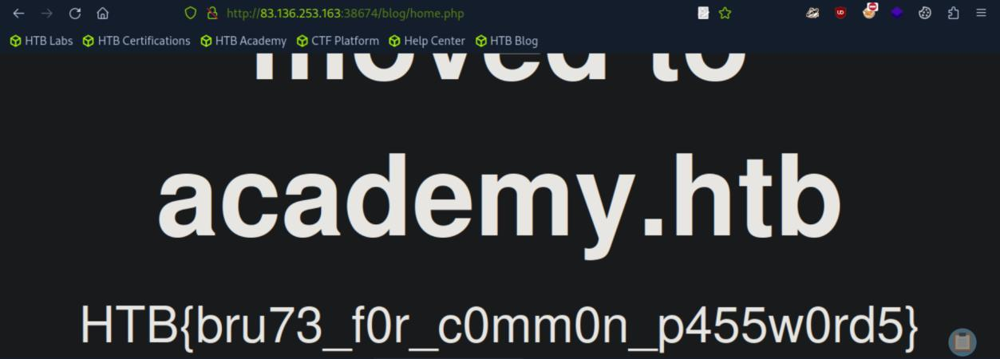
*_Figure 3.1 — Lab execution and output verification (Page 3)_*

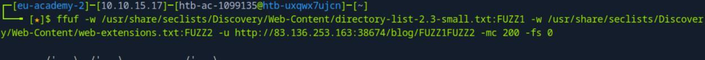
*_Figure 3.2 — Lab execution and output verification (Page 3)_*

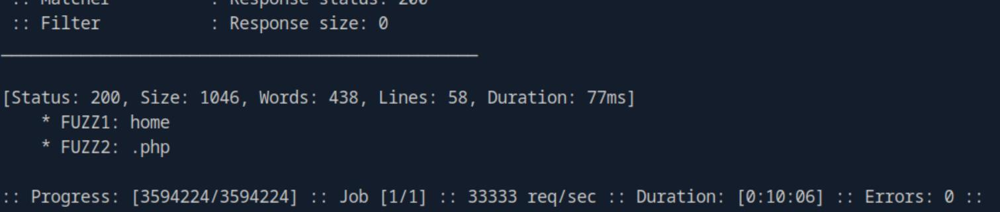
*_Figure 3.3 — Lab execution and output verification (Page 3)_*


### Recursive Fuzzing

> **Lab Question (Page 4)**: Try to repeat what you learned so far to find more files/directories. One of them should give you a flag. What is the content of the flag?
>
> **Flag / Answer**: `HTB{fuzz1n6_7h3_w3b!}`
{: .prompt-info }

#### Technical Methodology & Exploit Execution:

lets run recursive search for php files using the command:
```bash
ffuf -w /usr/share/seclists/Discovery/Web-Content/directory-list-2.3-small.txt:FUZZ -u http://<target-IP>:<target-port>/FUZZ -recursion -recursion-depth 1 -e .php -v -mc 200
-fs  0
```
using death-1

*
*

then, we enter the website:
`http://<target-IP>:<target-port>/forum/flag.php`

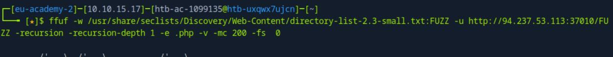
*_Figure 4.1 — Lab execution and output verification (Page 4)_*

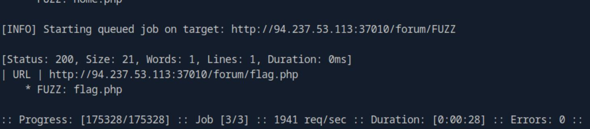
*_Figure 4.2 — Lab execution and output verification (Page 4)_*

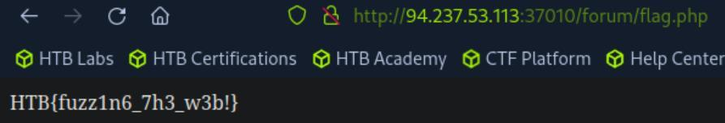
*_Figure 4.3 — Lab execution and output verification (Page 4)_*


### Sub-domain Fuzzing

> **Lab Question (Page 5)**: Try running a sub-domain fuzzing test on 'inlanefreight.com' to find a customer sub-domain portal. What is the full domain of it?
>
> **Flag / Answer**: `customer.inlanefreight.com`
{: .prompt-info }

#### Technical Methodology & Exploit Execution:

we will use the wordlist 'subdomains-top1million-5000.txt' which in
the pwnbox is located at '/usr/share/seclists/Discovery/DNS/subdomains-top1million-5000.txt' . we will use the command:
```bash
ffuf -w /usr/share/seclists/Discovery/DNS/subdomains-top1million-5000.txt:FUZZ -u https://FUZZ.inlanefreight.com/
```


*
*

The only result which appears on the scan results and not in the section's guide
is 'customer', so that is the subdomain we seek.

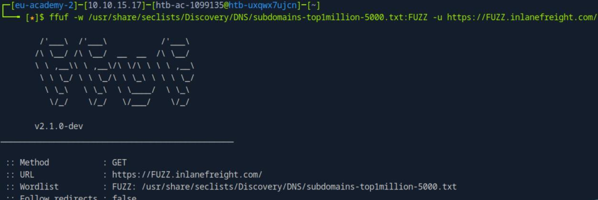
*_Figure 5.1 — Lab execution and output verification (Page 5)_*

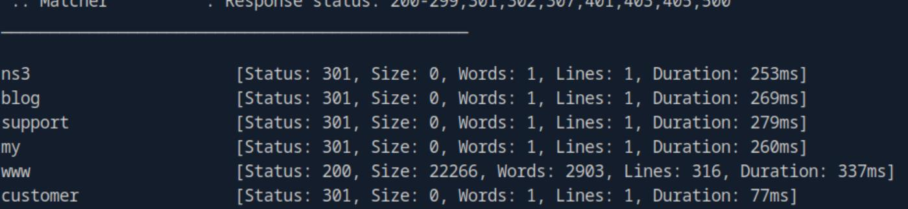
*_Figure 5.2 — Lab execution and output verification (Page 5)_*


### Filtering Results

> **Lab Question (Page 6)**: Try running a VHost fuzzing scan on 'academy.htb', and see what other VHosts you get. What other VHosts did you get?
>
> **Flag / Answer**: `test.academy.htb`
{: .prompt-info }

#### Technical Methodology & Exploit Execution:

first, we will have to link the Vhost to the target IP in the file
'/etc/hosts' in the pwnbox:
```bash
sudo nano /etc/hosts
```
and in it
`<target-IP>` academy.htb


Now, we would like to use the command
```bash
ffuf -w /usr/share/seclists/Discovery/DNS/subdomains-top1million-5000.txt:FUZZ -u http://academy.htb:<target-port>/ -H 'Host: FUZZ.academy.htb'
without filtering for a size (using the 'subdomains-top1million-5000.txt'
wordlist) – however that will result in flooding of 'dummy' results:
```

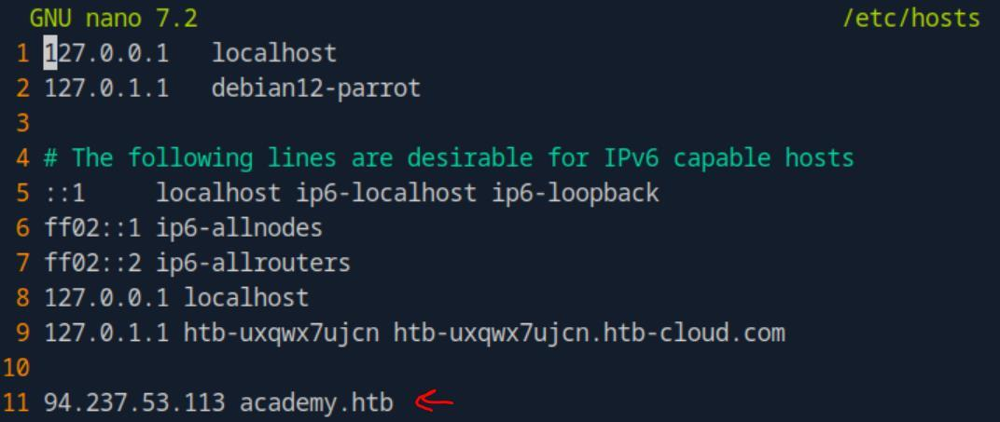
*_Figure 6.1 — Lab execution and output verification (Page 6)_*


### So lets filter that size

*
*

*
*

All of which has the size of 986 bytes.
So lets filter that size:
```bash
ffuf -w /usr/share/seclists/Discovery/DNS/subdomains-top1million-5000.txt:FUZZ -u http://academy.htb:<target-port>/ -H 'Host: FUZZ.academy.htb' -fs 986
```


*
*

The result which does not appears in the section's guide is 'test' . So that is our
result.

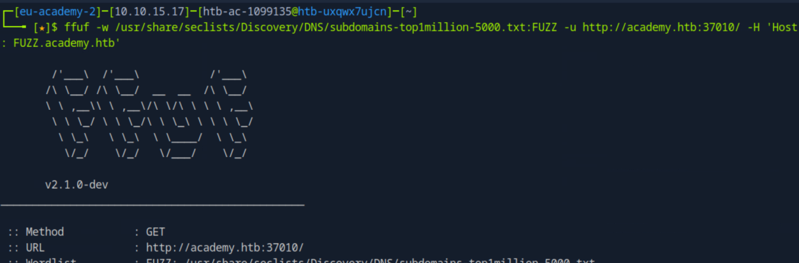
*_Figure 7.1 — Lab execution and output verification (Page 7)_*

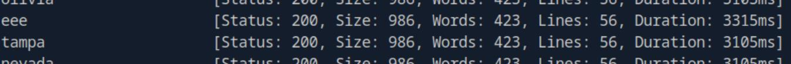
*_Figure 7.2 — Lab execution and output verification (Page 7)_*

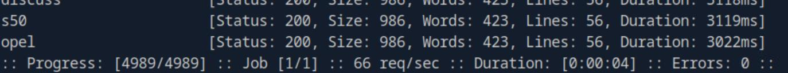
*_Figure 7.3 — Lab execution and output verification (Page 7)_*

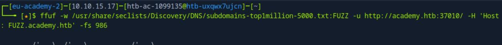
*_Figure 7.4 — Lab execution and output verification (Page 7)_*

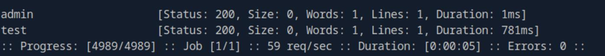
*_Figure 7.5 — Lab execution and output verification (Page 7)_*


### Parameter Fuzzing - GET

> **Lab Question (Page 8)**: Using what you learned in this section, run a parameter fuzzing scan on this page. what is the parameter accepted by this webpage?
>
> **Flag / Answer**: `user`
{: .prompt-info }

#### Technical Methodology & Exploit Execution:

for this question we are provided with the URL:
'http://admin.academy.htb:`<target-port>`/admin/admin.php'
(don't forget to link the vhost subdomain in '/etc/hosts'

)
And we need to find acceptable parameter property. For that we will use the
wordlist 'burp-parameter-names.txt' and the command:
```bash
ffuf -w /usr/share/seclists/Discovery/Web-Content/burp-parameter-names.txt:FUZZ -u
http://admin.academy.htb:<target-port>/admin/admin.php?FUZZ=key -fs 798
```
*We will add '-fs 798' upfront to skip the lengthy process of finding the size to
filter as we shown in the previous section. *

*
*


*_Figure 8.1 — Lab execution and output verification (Page 8)_*

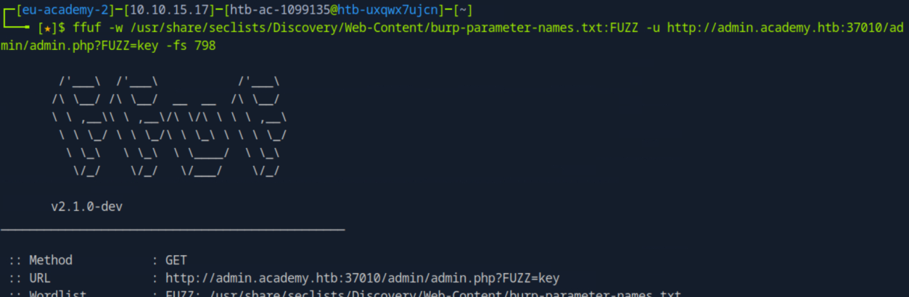
*_Figure 8.2 — Lab execution and output verification (Page 8)_*

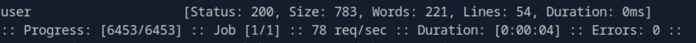
*_Figure 8.3 — Lab execution and output verification (Page 8)_*


### Value Fuzzing

> **Lab Question (Page 9)**: Try to create the 'ids.txt' wordlist, identify the accepted value with a fuzzing scan, and then use it in a 'POST' request with 'curl' to collect the flag. What is the content of the flag?
>
> **Flag / Answer**: `HTB{p4r4m373r_fuzz1n6_15_k3y!}`
{: .prompt-info }

#### Technical Methodology & Exploit Execution:

we will use the following bash command to create a file 'ids.txt',
containing all the numbers from 1 to 1000
for i in $(seq 1 1000); do echo $i >> ids.txt; done


when the file is ready, we will use it as wordlist for the POST request parameter
bruteforce:
```bash
ffuf -w ids.txt:FUZZ -u http://admin.academy.htb:<target-port>/admin/admin.php -X POST -d 'id=FUZZ' -H 'Content-Type:
application/x-www-form-urlencoded' -fs 768
```
* do remember to keep the vhost subdomain linked to the IP in '/etc/hosts' .
And also we set the '-fs' to 768 upfront.*

*
*


The correct value id 73. Accessing it via the browser wont work (as it will send a
GET request, the web-server page is accepting POST requests. So we will use
```bash
curl instead:
curl http://admin.academy.htb:<target-IP>/admin/admin.php -X
POST -d 'id=73' -H 'Content-Type: application/x-www-form-
urlencoded'
```

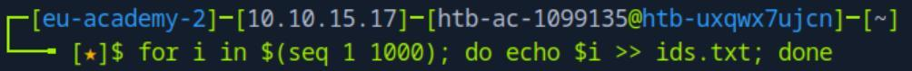
*_Figure 9.1 — Lab execution and output verification (Page 9)_*

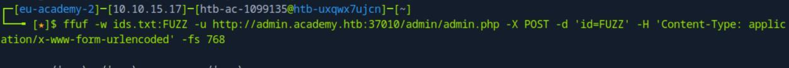
*_Figure 9.2 — Lab execution and output verification (Page 9)_*

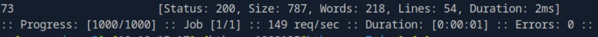
*_Figure 9.3 — Lab execution and output verification (Page 9)_*


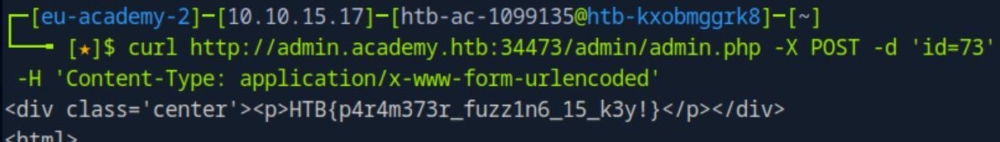
*_Figure 10.1 — Lab execution and output verification (Page 10)_*


### Capstone: Skills Assessment

> **Lab Question (Page 11)**: Run a sub-domain/vhost fuzzing scan on '*.academy.htb' for the IP shown above. What are all the sub-domains you can identify? (Only write the sub-domain name)
>
> **Flag / Answer**: `test,archive,faculty`
{: .prompt-info }

#### Technical Methodology & Exploit Execution:

first lets link the vhost 'academy.htb' to the target IP in the
/etc/hosts':
```bash
sudo nano /etc/hosts
```
→
`<target-IP>` academy.htb


Now when that's link – lets run vhost subdomain bruteforce, using the usual
'subdomains-top1million-5000.txt' wordlist:
```bash
ffuf -w /usr/share/seclists/Discovery/DNS/subdomains-top1million-5000.txt:FUZZ -u http://academy.htb:<target-port>/ -H 'Host: FUZZ.academy.htb' -fs 985
```


*
*

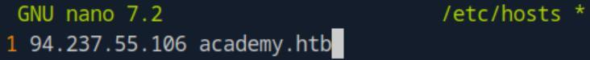
*_Figure 11.1 — Lab execution and output verification (Page 11)_*

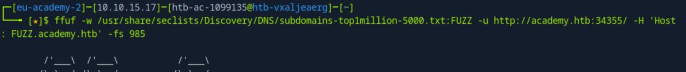
*_Figure 11.2 — Lab execution and output verification (Page 11)_*

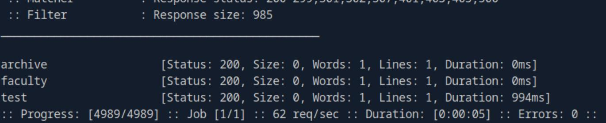
*_Figure 11.3 — Lab execution and output verification (Page 11)_*


### in '/etc/hosts/ as well

> **Lab Question (Page 12)**: Before you run your page fuzzing scan, you should first run an extension fuzzing scan. What are the different extensions accepted by the domains?
>
> **Flag / Answer**: `php,phps,php7`
{: .prompt-info }

#### Technical Methodology & Exploit Execution:

first, we will have to link the VHost found subdomains to the target IP
in '/etc/hosts/ as well:
```bash
sudo nano /etc/hosts
```
→
`<target-IP>` test.academy.htb
`<target-IP>` faculty.academy.htb
`<target-IP>` archive.academy.htb


Now lets put the found subdomain in a file called 'found_subs.txt', along with
the main 'academy' domain:
```bash
echo 'academy
test
```
faculty
archive' > found_subs.txt

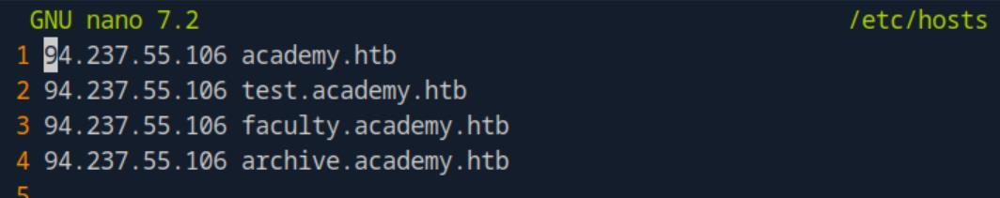
*_Figure 12.1 — Lab execution and output verification (Page 12)_*

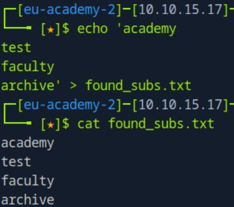
*_Figure 12.2 — Lab execution and output verification (Page 12)_*


### Now we are ready to run the ffuf

Now we are ready to run the ffuf:
```bash
ffuf -w found_subs.txt:SUB -w
/usr/share/seclists/Discovery/Web-Content/web-extensions.txt:EXT -u http://SUB.academy.htb:<target-port>/indexEXT
```
*yes, we can use variables 'SUB' and 'EXT' instead of 'FUZZ' . *:

*
*


There are 3 extensions overall: php,phps,php7

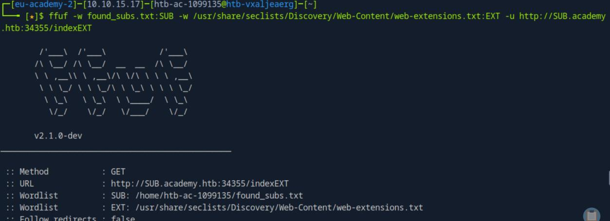
*_Figure 13.1 — Lab execution and output verification (Page 13)_*

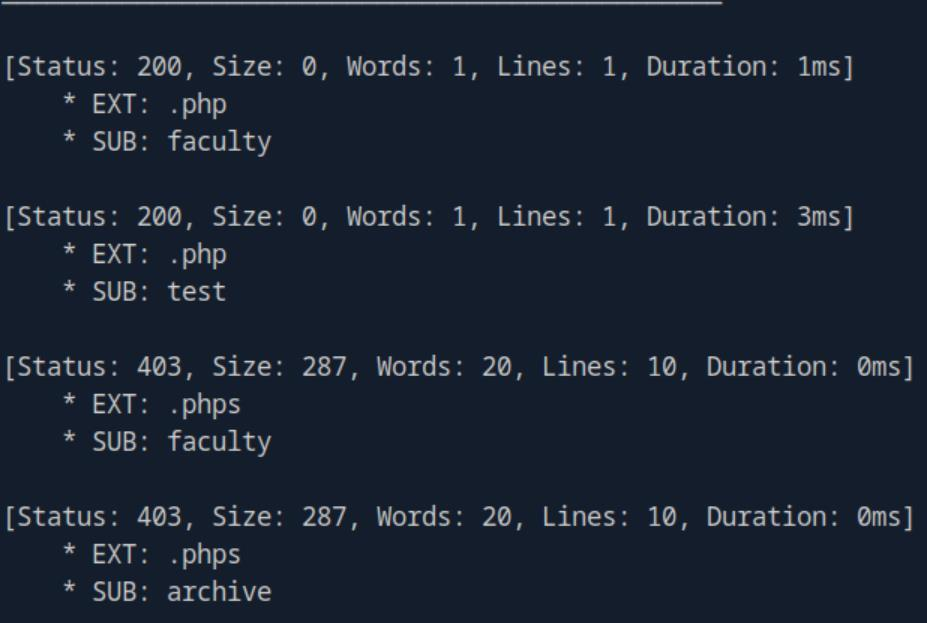
*_Figure 13.2 — Lab execution and output verification (Page 13)_*

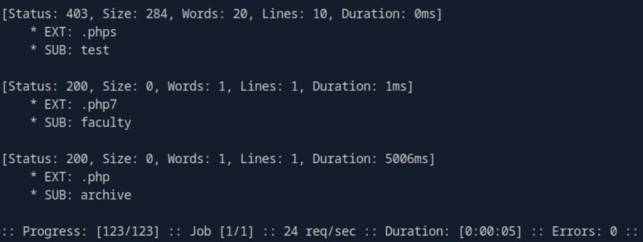
*_Figure 13.3 — Lab execution and output verification (Page 13)_*


### Depth 2 will suffice

> **Lab Question (Page 14)**: One of the pages you will identify should say 'You don't have access!'. What is the full page URL?
>
> **Flag / Answer**: `http://faculty.academy.htb:PORT/courses/linux-security.php7`
{: .prompt-info }

#### Technical Methodology & Exploit Execution:

first we will use recursive enumeration to find paths and sub-paths.
Depth 2 will suffice:
```bash
ffuf -w found_subs.txt:SUB -w
/usr/share/seclists/Discovery/Web-Content/directory-list-
2.3-small.txt:FUZZ -u http://SUB.academy.htb:`<target-port>`/FUZZ -recursion -recursion-depth 2 -fs 0
```


*
*

The scan found the path 'courses', on the subdomains 'archive' and 'faculty'.

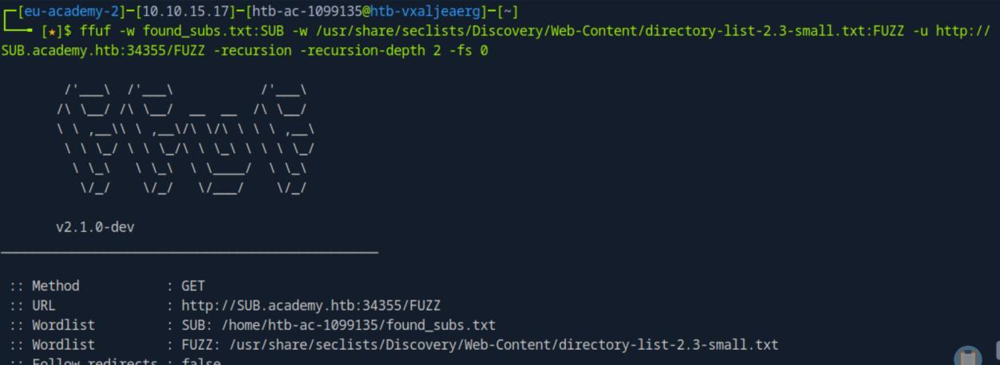
*_Figure 14.1 — Lab execution and output verification (Page 14)_*

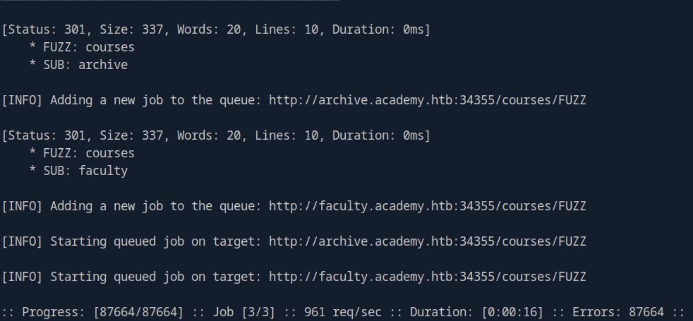
*_Figure 14.2 — Lab execution and output verification (Page 14)_*


### path

Now we will look for the file, somewhere within the found path.
We will put that path in a file called 'found_paths.txt', along with the main
path:
```bash
echo '/
courses/' > found_paths.txt
```


Similarly, let's put the found extensions from the previous question to a file
called 'found_exts.txt':
```bash
echo 'php
phps
```
php7' > found_exts.txt


Now we are ready to begin the scan for the file-name, throughout the
subdomains, paths, and extensions – we will scour the 'directory-list-2.3-
small.txt' wordlist to find the correct file-name:
```bash
ffuf -w found_subs.txt:SUB -w found_paths.txt:PATH -w
/usr/share/seclists/Discovery/Web-Content/directory-list-
2.3-small.txt:FUZZ -w found_exts.txt:EXT -u
`http://SUB.academy.htb:<target-port>/PATHFUZZ.EXT -mc 200 -`
```
fs 0

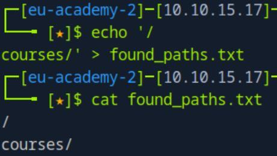
*_Figure 15.1 — Lab execution and output verification (Page 15)_*

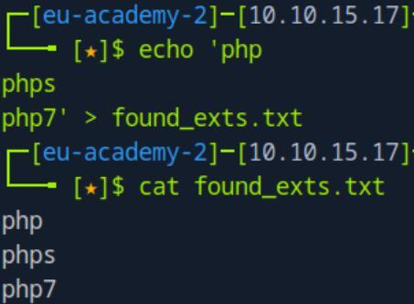
*_Figure 15.2 — Lab execution and output verification (Page 15)_*


### or to fit the answer format

The scan found the filename 'linux-security' , along with the subdomain
'faculty' , the path '/courses' and the extension 'php7' – lets visit that page:
`http://faculty.academy.htb:<target-port>/courses/linux-security.php7`

or to fit the answer format:
`http://faculty.academy.htb:PORT/courses/linux-security.php7`

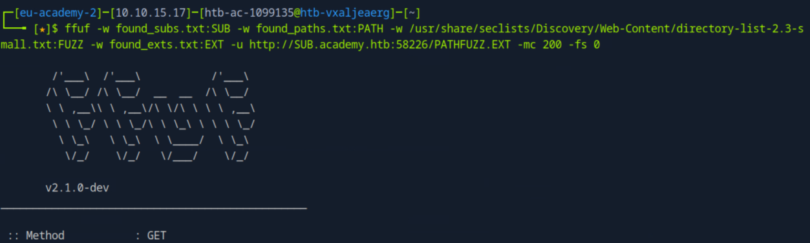
*_Figure 16.1 — Lab execution and output verification (Page 16)_*

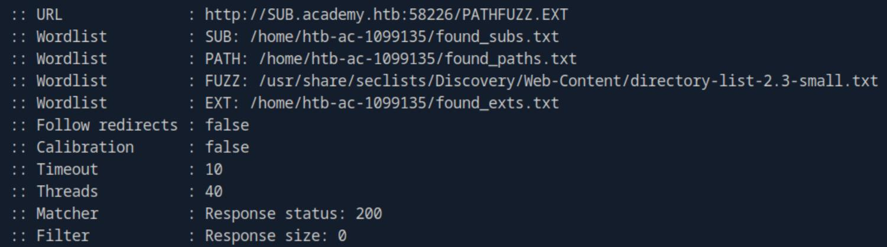
*_Figure 16.2 — Lab execution and output verification (Page 16)_*

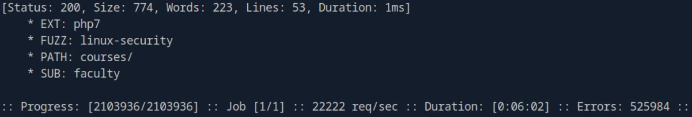
*_Figure 16.3 — Lab execution and output verification (Page 16)_*

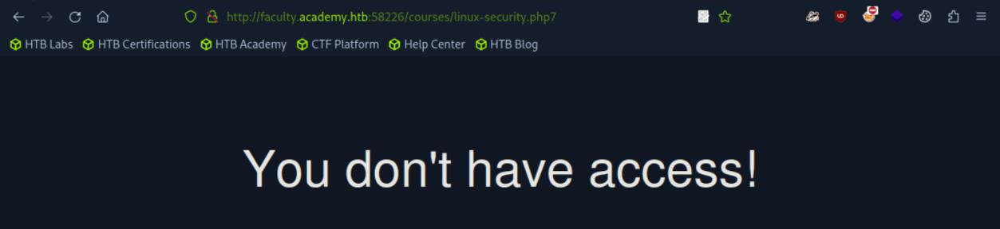
*_Figure 16.4 — Lab execution and output verification (Page 16)_*


### names.txt' wordlist

> **Lab Question (Page 17)**: In the page from the previous question, you should be able to find multiple parameters that are accepted by the page. What are they?
>
> **Flag / Answer**: `user,username`
{: .prompt-info }

#### Technical Methodology & Exploit Execution:

we will bruteforce POST requests, using the 'burp-parameter-
names.txt' wordlist:
```bash
ffuf -w /usr/share/seclists/Discovery/Web-Content/burp-parameter-names.txt:FUZZ -u
http://faculty.academy.htb:<target-port>/courses/linux-security.php7 -X POST -d "FUZZ=key" -H 'Content-Type:
application/x-www-form-urlencoded' -fs 774
```


*
*

Finding the parameters names 'user' and 'username'.

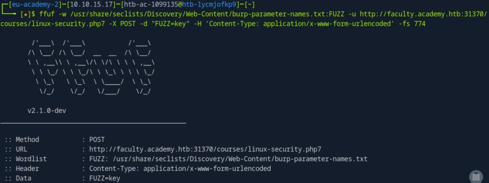
*_Figure 17.1 — Lab execution and output verification (Page 17)_*

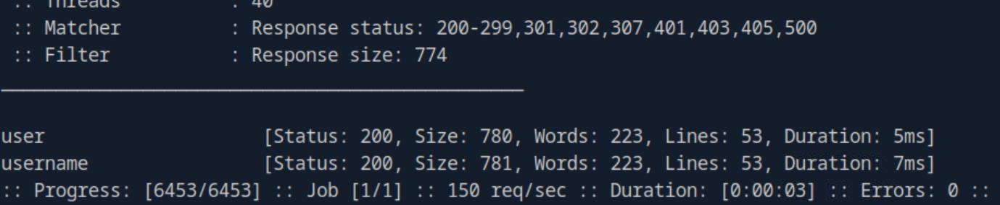
*_Figure 17.2 — Lab execution and output verification (Page 17)_*


### Lets take a look in this 'Names' directory

> **Lab Question (Page 18)**: Try fuzzing the parameters you identified for working values. One of them should return a flag. What is the content of the flag?
>
> **Flag / Answer**: `HTB{w3b_fuzz1n6_m4573r}`
{: .prompt-info }

#### Technical Methodology & Exploit Execution:

first lets put the 'user' and 'username' in 'found_parameters.txt':
```bash
echo 'user
username' > found_parameters.txt
```


Now, we need to find proper wordlist for parameter's value bruteforcing. But in
the built in 'seclists' – there are many possible wordlists.
Lets take a look in this 'Names' directory:
```bash
ls /usr/share/seclists/Usernames/Names
```


There are possible wordlists here, however checking them one by one might be
tedious, so let's combine them to a single wordlist within the user's home
directory:
```bash
cat /usr/share/seclists/Usernames/Names/*.txt > allnames.txt
```
the combined list is to be called 'allnames.txt'

now its time to run out bruteforce script on that 'allnames.txt' and
'found_parameters.txt' . we will upfront make sure to ignore the data related to
sizes 780 and 781 (ignore those lines, and the 3 lines below them):

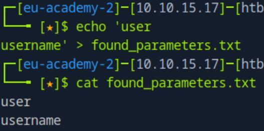
*_Figure 18.1 — Lab execution and output verification (Page 18)_*

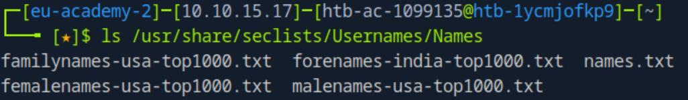
*_Figure 18.2 — Lab execution and output verification (Page 18)_*


### security.php7 -X POST -d 'PARA=FUZZ' -H 'Content-Type

```bash
ffuf -w found_parameters.txt:PARA -w allnames.txt:FUZZ -u
http://faculty.academy.htb:<target-port>/courses/linux-security.php7 -X POST -d 'PARA=FUZZ' -H 'Content-Type:
application/x-www-form-urlencoded' -mc 200 | sed -e '/Size:
780/,+3d' -e '/Size: 781/,+3d'
```


We found the values 'harry' or 'HARRY' fit to the parameter 'username'.

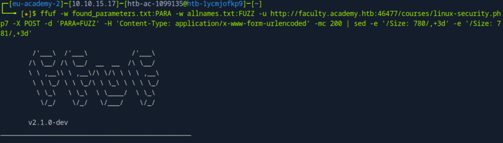
*_Figure 19.1 — Lab execution and output verification (Page 19)_*

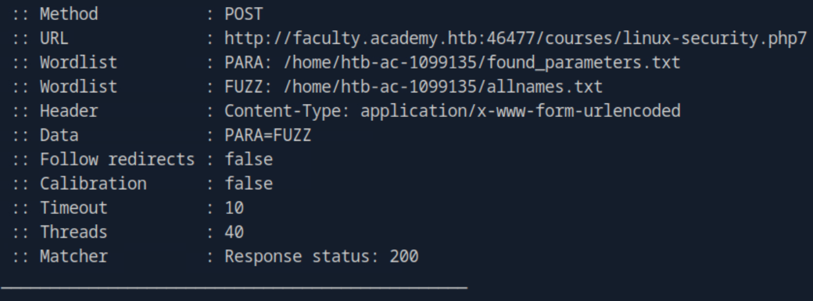
*_Figure 19.2 — Lab execution and output verification (Page 19)_*

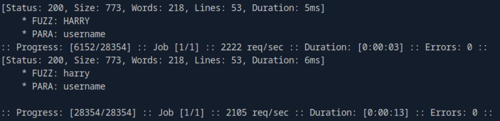
*_Figure 19.3 — Lab execution and output verification (Page 19)_*


### obtained parameters and values

All we have left to do, is to curl the flag using POST request, and all the
obtained parameters and values:
```bash
curl http://faculty.academy.htb:<target-port>/courses/linux-security.php7 -X POST -d 'username=harry' -H 'Content-Type:
application/x-www-form-urlencoded'
```

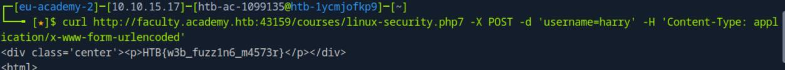
*_Figure 20.1 — Lab execution and output verification (Page 20)_*


---

## Enterprise Defense & Mitigation Blueprint

To neutralize the attack vectors demonstrated throughout this module, security engineers and infrastructure administrators should implement layered defense-in-depth controls:

1. **Principle of Least Privilege (PoLP)**: Strictly segregate administrative rights, isolate service accounts into managed domains (gMSAs), and strip unnecessary capabilities (`CAP_SETUID`, `SeImpersonatePrivilege`).
2. **Input Validation & Parameterization**: Neutralize command injection, LFI, and parameter tampering at the source by utilizing strict type allowlists, parameterized ORMs, and secure input sanitization.
3. **Network Boundary Segmentation**: Isolate sensitive internal management ports (SSH, WinRM, SMB, RDP, SQL) behind bastion hosts and multi-factor VPN gateways with network-level microsegmentation.
4. **Telemetry & Threat Detection**: Forward audit logs (Sysmon, Windows Event Logs, Linux Auditd, Zeek) to a centralized SIEM with behavioral rules targeting anomalous process spawning (`cmd.exe` from `w3wp.exe`, unexpected SUID execution, or mass port probing).


---

## MITRE ATT&CK Mapping & Threat Matrix

| Security Domain | Mapping Specification |
| :--- | :--- |
| **Primary Tactic** | Enterprise Penetration Testing & Adversary Simulation |
| **Mitre Techniques** | `T1595.002, T1083` |
| **Common Weakness Enumerations** | `CWE-200, CWE-548` |

### Adversary Tradecraft & Technique Breakdown

| Technique ID | Technique Name | Tactic | Applied Offensive / Defensive Context |
| :--- | :--- | :--- | :--- |
| [`T1595.002`](https://attack.mitre.org/techniques/T1595/) | **Active Scanning: Vulnerability Scanning** | `Reconnaissance` | Fuzzing web directories, endpoints, and hidden parameters |
| [`T1083`](https://attack.mitre.org/techniques/T1083/) | **File and Directory Discovery** | `Discovery` | Discovering unlinked administrative files and backup scripts |


### Identified Common Weakness Enumerations (CWE)

- [`CWE-200`: Information Exposure Through Directory Listing and Discovery](https://cwe.mitre.org/data/definitions/200.html)
- [`CWE-548`: Exposure of Information Through Directory Listing](https://cwe.mitre.org/data/definitions/548.html)


---

## Detection Engineering & Defensive Countermeasures

Modern enterprise security programs must implement proactive, layered defense-in-depth controls to detect and mitigate the techniques covered in this module:

- Monitor web server logs for high request-per-second spikes from single IP addresses resulting in high ratios of 404/403 responses.
- Deploy rate-limiting reverse proxies (Cloudflare, Nginx `limit_req`) to throttle rapid request streams.
- Disable directory listing (`Options -Indexes` in Apache) and remove sensitive backup files (`.bak`, `.old`, `.swp`) from web roots.


---

## Authoritative References & Recommended Reading

- [HTB Academy: Attacking Web Applications with Ffuf](https://academy.hackthebox.com/module/54) — *Official Hack The Box curriculum track*
- [ffuf Official GitHub Repository](https://github.com/ffuf/ffuf) — *Fast web fuzzer implementation and documentation*
- [SecLists Web Discovery Wordlists](https://github.com/danielmiessler/SecLists/tree/master/Discovery/Web-Content) — *Standard wordlists for directory and file discovery*
- [OWASP WSTG: Testing for Directory Traversal / File Inclusion](https://owasp.org/www-project-web-security-testing-guide/) — *Standard testing methodologies*


<div class="ff-series-nav">
  <a href="/posts/htb-academy-part-25-network-enumeration-with-nmap/" class="ff-nav-btn text-start">
    <div class="ff-nav-arrow"><i class="fas fa-arrow-left"></i></div>
    <div class="ff-nav-text">
      <span class="ff-nav-kicker">Previous Part</span>
      <span class="ff-nav-title">Part 25: Network Enumeration with Nmap</span>
    </div>
  </a>
  <div class="ff-nav-center">
    <span class="ff-center-badge"><i class="fas fa-cube"></i> HTB Academy Series</span>
    <span class="ff-center-part">Part 26 of 41</span>
  </div>
  <a href="/posts/htb-academy-part-27-hacking-wordpress/" class="ff-nav-btn text-end">
    <div class="ff-nav-text">
      <span class="ff-nav-kicker">Next Part</span>
      <span class="ff-nav-title">Part 27: Hacking WordPress (WPScan to Remote Code Execution)</span>
    </div>
    <div class="ff-nav-arrow"><i class="fas fa-arrow-right"></i></div>
  </a>
</div>
