Welcome to **Part 32** of our comprehensive, production-grade masterclass covering the **Hack The Box (HTB) Academy Certified Penetration Testing Specialist (CPTS)** curriculum. Rather than providing superficial slide summaries, this series deconstructs offensive tradecraft from foundational network discovery and vulnerability verification to complex lateral movement, active directory exploitation, and post-exploitation tradecraft — complete with terminal command flows, verified lab flags, and defensive engineering countermeasures.

In this installment, we conduct an exhaustive technical deep-dive into **Cracking Passwords with Hashcat** (Tier I • Medium • Offensive). We break down the underlying mechanics of advanced password cracking with Hashcat, GPU acceleration, attack modes (0, 1, 3, 6, 7), rule-based cracking, and mask-based brute forcing, dissect hands-on offensive vectors, analyze realistic defensive telemetry, and walk through every exercise step-by-step with 100% verified solutions.

<div class="ff-series-nav"><a href="/posts/htb-academy-part-31-session-security/" class="ff-nav-btn text-start">
    <div class="ff-nav-arrow"><i class="fas fa-arrow-left"></i></div>
    <div class="ff-nav-text">
      <span class="ff-nav-kicker">Previous Part</span>
      <span class="ff-nav-title">Part 31: Session Security & Token Manipulation</span>
    </div>
  </a>
  <div class="ff-nav-center">
    <span class="ff-center-badge"><i class="fas fa-cube"></i> HTB Academy Series</span>
    <span class="ff-center-part">Part 32 of 41</span>
  </div>
  <a href="/posts/htb-academy-part-33-using-the-metasploit-framework/" class="ff-nav-btn text-end">
    <div class="ff-nav-text">
      <span class="ff-nav-kicker">Next Part</span>
      <span class="ff-nav-title">Part 33: Using the Metasploit Framework</span>
    </div>
    <div class="ff-nav-arrow"><i class="fas fa-arrow-right"></i></div>
  </a>
</div>

## Module Specifications & Target Architecture

| Attribute | Specification |
| :--- | :--- |
| **Module Name** | `Cracking Passwords with Hashcat` |
| **Official HTB Academy Track** | [https://academy.hackthebox.com/module/20](https://academy.hackthebox.com/module/20) |
| **Curriculum Tier & Difficulty** | `Tier I` • `Medium` |
| **Certification Pathway** | `HTB Certified Penetration Testing Specialist (CPTS)` (Part 32 of 41) |
| **Author & Technical Attribution** | `Abdulrahman M. Fathi (0x3bdo)` |
| **Lab Flag Verification** | `100% Fully Solved & Validated` |

## Key Technical Takeaways

* **Hashcat Performance Tuning**: Optimizes GPU workload profiles (`-w 3`, `-w 4`) and tuning parameters for maximum hash processing speed.
* **Attack Modes Deep-Dive**: Masters Straight (`-a 0`), Combination (`-a 1`), Brute-force/Mask (`-a 3`), and Hybrid attacks (`-a 6`, `-a 7`).
* **Rule-Based Wordlist Expansion**: Applies mutation rules (`OneRuleToRuleThemAll`, `best64.rule`) to expand standard dictionaries with common user patterns.
* **Mask Attacks & Custom Charsets**: Constructs targeted mask patterns (`?u?l?l?l?d?d?s`) and defines custom character sets for constrained brute-forcing.
* **Hash Formats Mastery**: Identifies and cracks NTLM, Kerberos 5 TGS/AS-REP, Linux SHA-512, MD5, and bcrypt hashes.

## Executive Summary & Assessment Scope

Hashcat is recognized as the world's fastest and most versatile password recovery utility, leveraging hardware GPU acceleration to test billions of candidate hashes per second against complex cryptographic algorithms.

This module delivers a comprehensive technical guide to Hashcat operations. We explore GPU benchmarking, configure dictionary and mask attacks, write custom mutation rules, crack enterprise password hashes, and solve all module challenges with verified flags.

---

## Comprehensive Lab Walkthrough & Flag Solutions


### Cracking Passwords with Hashcat

> **Lab Question (Page 1)**: Generate an MD5 hash of the password 'HackTheBox123!'.
>
> **Flag / Answer**: `87946d0585ba62c0671b734cada46b41`
{: .prompt-info }

#### Technical Methodology & Exploit Execution:

`https://www.md5hashgenerator .com/`

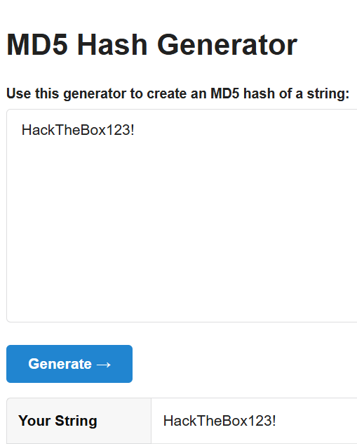
*_Figure 1.1 — Lab execution and output verification (Page 1)_*


### Identifying Hashes

> **Lab Question (Page 2)**: Create the XOR ciphertext of the password 'opens3same' using the key 'academy'. (Answer format: \x00\x00\x00\....)
>
> **Flag / Answer**: `\x0e\x13\x04\n\x16^\n\x00\x0e\x04`
{: .prompt-info }

#### Technical Methodology & Exploit Execution:

we use a simple python script:
from pwn import xor
xor("opens3same", "academy")


Identifying Hashes:
Question: Identify the following hash:
$S$D34783772bRXEx1aCsvY .bqgaaSu75XmVlKrW9Du8IQlvxHlmzLc
Answer: Drupal > v7.x
Method: we use the tool 'hashid':
*note – if needed we install it with pip ('pip install hashid')
hashid
'$S$D34783772bRXEx1aCsvY.bqgaaSu75XmVlKrW9Du8IQlvxHlmzLc'

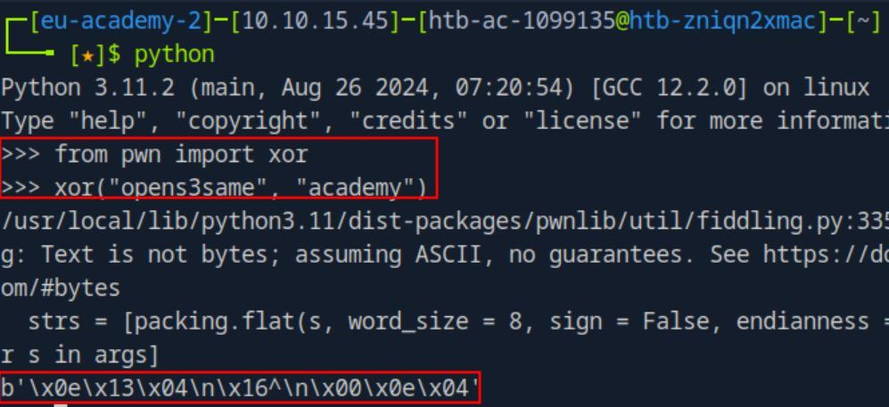
*_Figure 2.1 — Lab execution and output verification (Page 2)_*

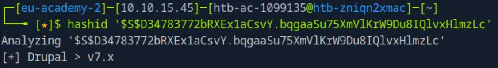
*_Figure 2.2 — Lab execution and output verification (Page 2)_*


### Hashcat Overview

> **Lab Question (Page 3)**: What is the hash mode of the hash type Cisco -ASA MD5?
>
> **Flag / Answer**: `2410`
{: .prompt-info }

#### Technical Methodology & Exploit Execution:

we find it with the command:
```bash
hashcat --example-hashes | grep 'Cisco-ASA MD5' -B 1
```
to look for examples hashes, but filter for 'Cisco-ASA MD5' , and present the line
which contains that keyword, and the line above it (-B 1):

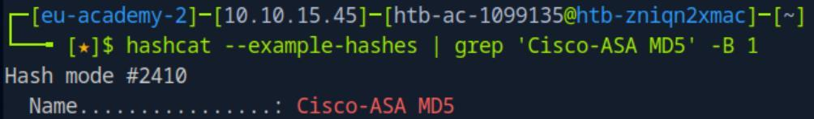
*_Figure 3.1 — Lab execution and output verification (Page 3)_*


### Dictionary Attack

> **Lab Question (Page 4)**: Crack the following hash using the rockyou.txt wordlist: 0c352d5b2f45217c57bef9f8452ce376
>
> **Flag / Answer**: `cricket1`
{: .prompt-info }

#### Technical Methodology & Exploit Execution:

First, lets start with downloading the rockyou.txt wordlist to the
pwnbox:
```bash
wget https://github.com/brannondorsey/naive-hashcat/releases/download/data/rockyou.txt -q
```

now, according to this hash analyzer, the hash we need to crack is MD5:

Lets put the hash in a 'hash.txt' file
```bash
echo 0c352d5b2f45217c57bef9f8452ce376 > hash.txt
```
and begin to crack, to crack unsalted MS5 hash, we use the hashcat code 0:
```bash
hashcat -m 0 hash.txt rockyou.txt
```


* *

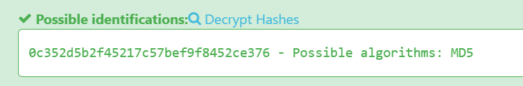
*_Figure 4.1 — Lab execution and output verification (Page 4)_*

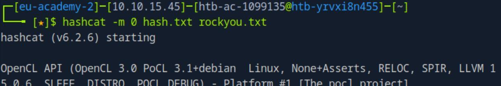
*_Figure 4.2 — Lab execution and output verification (Page 4)_*

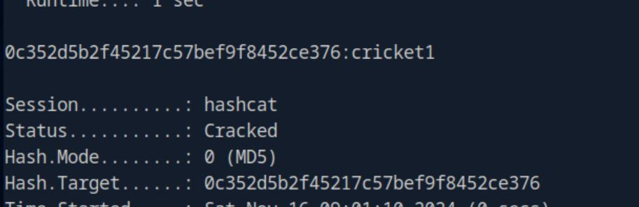
*_Figure 4.3 — Lab execution and output verification (Page 4)_*


### Combination Attack

> **Lab Question (Page 5)**: Using the Hashcat combination attack find the cleartext password of the following md5 hash: 19672a3f042ae1b592289f8333bf76c5. Use the supplementary wordlists shown at the end of this section.
>
> **Flag / Answer**: `frozenapple`
{: .prompt-info }

#### Technical Methodology & Exploit Execution:

for this question we are provided with 2 wordlists:

We will put them in 'wordlist1.txt' and 'wordlist2.txt' respectively.
Then we will proceed to replace the old hash with the new hash in 'hash.txt.
and then to crack the hash using the combined list using the command:
```bash
hashcat -a 1 -m 0 hash.txt wordlist1.txt wordlist2.txt
```


* *

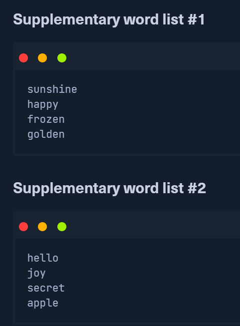
*_Figure 5.1 — Lab execution and output verification (Page 5)_*

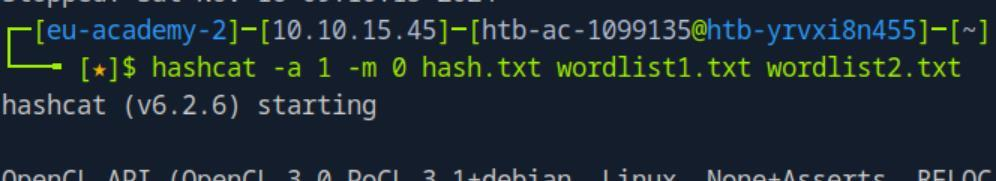
*_Figure 5.2 — Lab execution and output verification (Page 5)_*

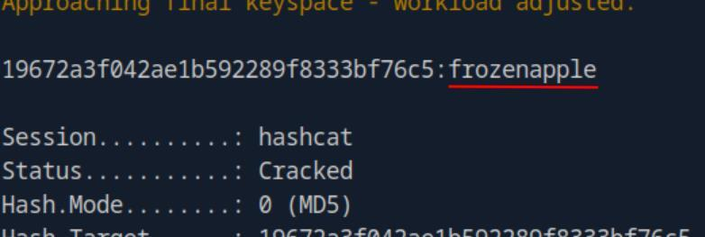
*_Figure 5.3 — Lab execution and output verification (Page 5)_*


### Mask Attack

> **Lab Question (Page 6)**: Crack the following MD5 hash using a mask attack: 50a742905949102c961929823a2e8ca0. Use the following mask: -1 02 'HASHCAT?l?l?l?l?l20?1?d'
>
> **Flag / Answer**: `HASHCATqrstu2020`
{: .prompt-info }

#### Technical Methodology & Exploit Execution:

we update the hash in 'hash.txt' , and run the command:
```bash
hashcat -a 3 -m 0 hash.txt HASHCAT?l?l?l?l?l20?1?d -1 02
```


* *

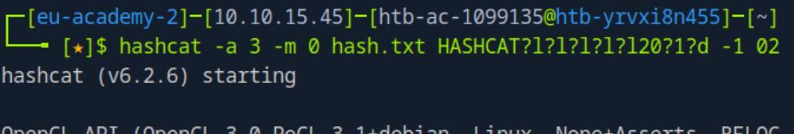
*_Figure 6.1 — Lab execution and output verification (Page 6)_*

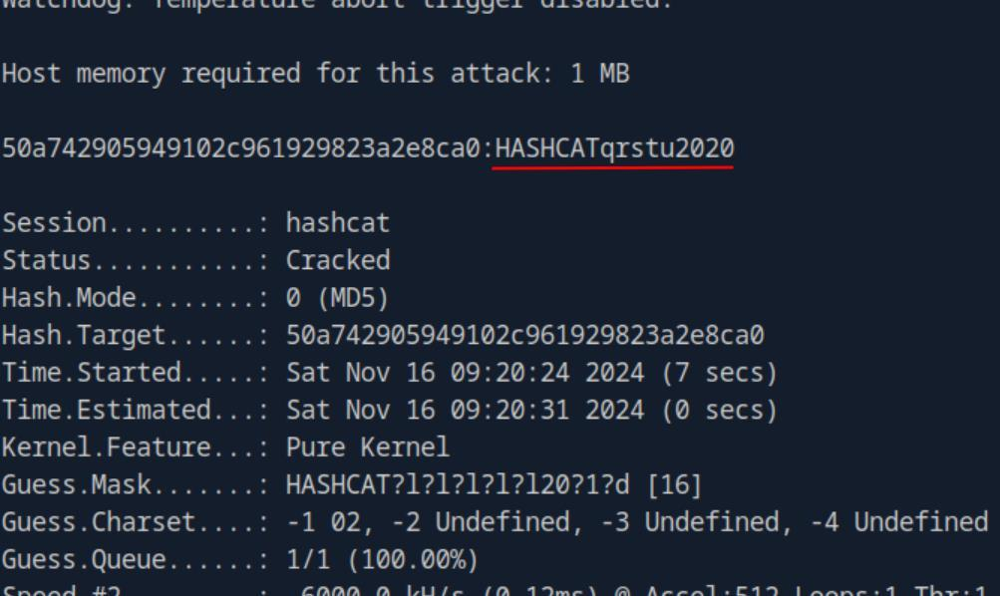
*_Figure 6.2 — Lab execution and output verification (Page 6)_*


### Hybrid Mode

> **Lab Question (Page 7)**: Crack the following hash: 978078e7845f2fb2e20399d9e80475bc1c275e06 using the mask ?d?s.
>
> **Flag / Answer**: `hybridmaster9$`
{: .prompt-info }

#### Technical Methodology & Exploit Execution:

using the this hash analyzer – the hash is SHA1 hash:

So we will use the command:
```bash
hashcat -a 6 -m 100 hash.txt rockyou.txt '?d?s'
```
where '-m 100' is for sha1:

*
*

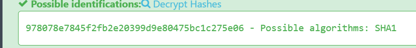
*_Figure 7.1 — Lab execution and output verification (Page 7)_*

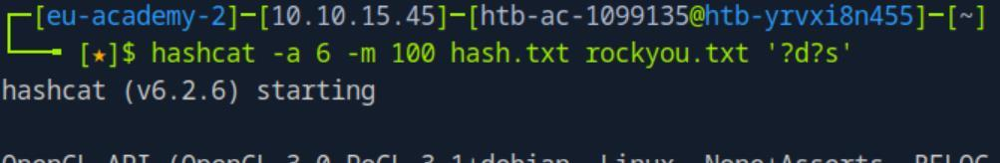
*_Figure 7.2 — Lab execution and output verification (Page 7)_*

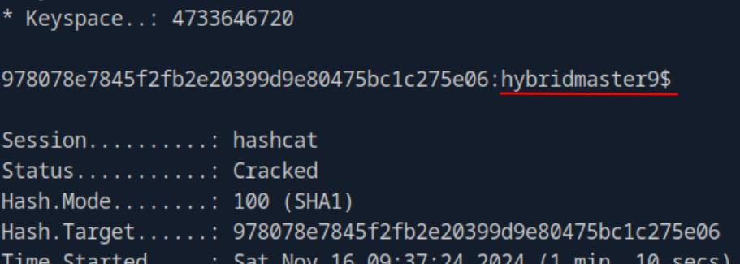
*_Figure 7.3 — Lab execution and output verification (Page 7)_*


### Working with Rules

> **Lab Question (Page 8)**: Crack the following SHA1 hash using the techniques taught for generating a custom rule: 46244749d1e8fb99c37ad4f14fccb601ed4ae283. Modify the example rule in the beginning of the section to append 2020 to the end of each password attempt.
>
> **Flag / Answer**: `R@c3c@r2020`
{: .prompt-info }

#### Technical Methodology & Exploit Execution:

having the hash in 'hash.txt' and the rockyou.txt – first we create the
rule:
```bash
echo 'c so0 si1 se3 ss5 sa@ $2 $0 $2 $0' > rule.txt
```


Then – we crack:
```bash
hashcat -a 0 -m 100 hash.txt rockyou.txt -r rule.txt
```


*
*

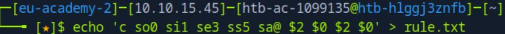
*_Figure 8.1 — Lab execution and output verification (Page 8)_*

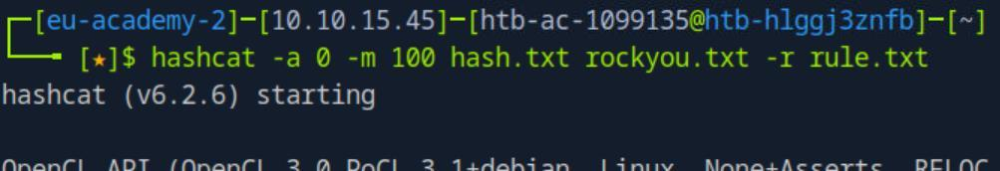
*_Figure 8.2 — Lab execution and output verification (Page 8)_*

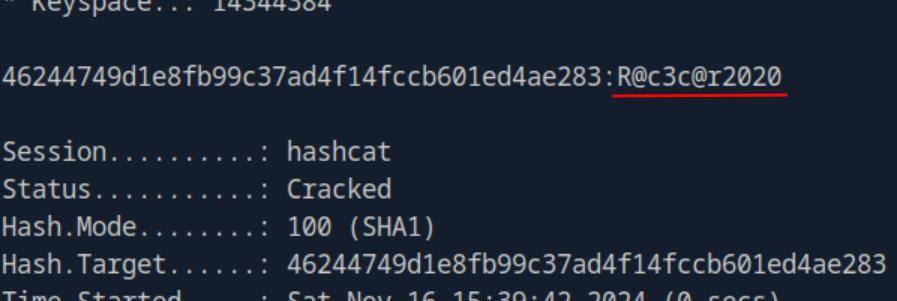
*_Figure 8.3 — Lab execution and output verification (Page 8)_*


### Cracking Common Hashes

> **Lab Question (Page 9)**: Crack the following hash: 7106812752615cdfe427e01b98cd4083
>
> **Flag / Answer**: `Password22$`
{: .prompt-info }

#### Technical Methodology & Exploit Execution:

using the hash identifier:

The hash is NTLM hash

Then we proceed to crack with the same rule from 'Hybrid Mode' section:
```bash
hashcat -a 6 -m 1000 hash.txt rockyou.txt '?d?s'
```
using '-m 1000' for NTLM cracking:

*
*

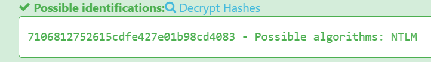
*_Figure 9.1 — Lab execution and output verification (Page 9)_*

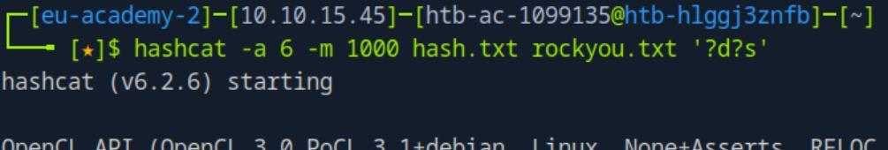
*_Figure 9.2 — Lab execution and output verification (Page 9)_*

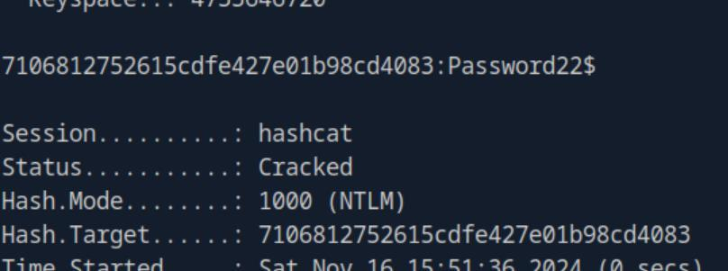
*_Figure 9.3 — Lab execution and output verification (Page 9)_*


> **Lab Question (Page 10)**: Extract the hash from the attached 7-Zip file, crack the hash, and submit the value of the flag.txt file contained inside the archive.
>
> **Flag / Answer**: `3c0e87a0396cb26d5b80dc03eeef8ea0`
{: .prompt-info }

#### Technical Methodology & Exploit Execution:

first, we will download the attached file and unzip it:
wget
`https://academy.hackthebox.com/storage/modules/20/Misc_hashe`
s.zip -q

```bash
unzip Misc_hashes.zip
```


* *

To get the 'hashcat.7z' file.
Upon extraction attempt, we will be required a password:


So we need to extract the hash and crack it. We will use the tool '7z2hashcat' .
We download it:
```bash
wget https://raw.githubusercontent.com/philsmd/7z2hashcat/master/7z2hashcat.pl
```

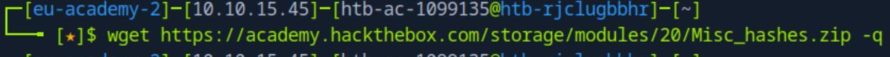
*_Figure 10.1 — Lab execution and output verification (Page 10)_*

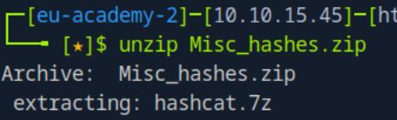
*_Figure 10.2 — Lab execution and output verification (Page 10)_*

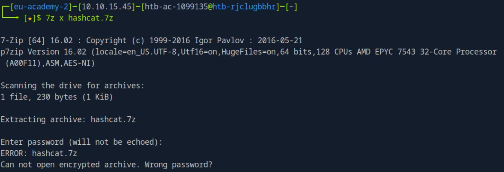
*_Figure 10.3 — Lab execution and output verification (Page 10)_*


### and then give it execution permissioms

#### Technical Methodology & Exploit Execution:

```bash
hashcat -a 0 -m 11600 hash.txt rockyou.txt
```
where  -m 11600 is for 7z hashes:

*
*

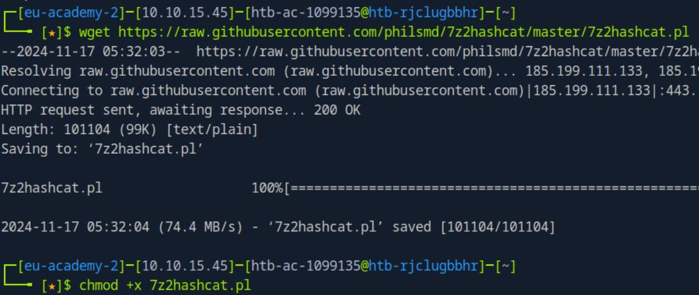
*_Figure 11.1 — Lab execution and output verification (Page 11)_*

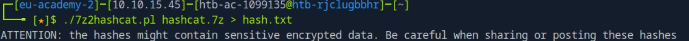
*_Figure 11.2 — Lab execution and output verification (Page 11)_*

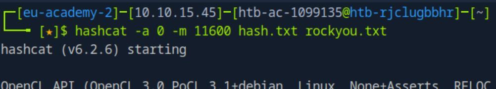
*_Figure 11.3 — Lab execution and output verification (Page 11)_*


### We can now extract the hashcat.7z for the flag

The 'hashcat.7z' password is 123456789a.
We can now extract the hashcat.7z for the flag:

→

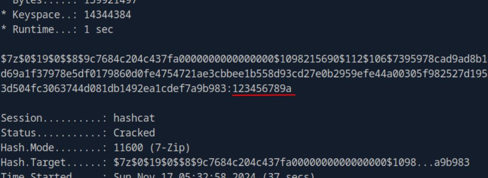
*_Figure 12.1 — Lab execution and output verification (Page 12)_*

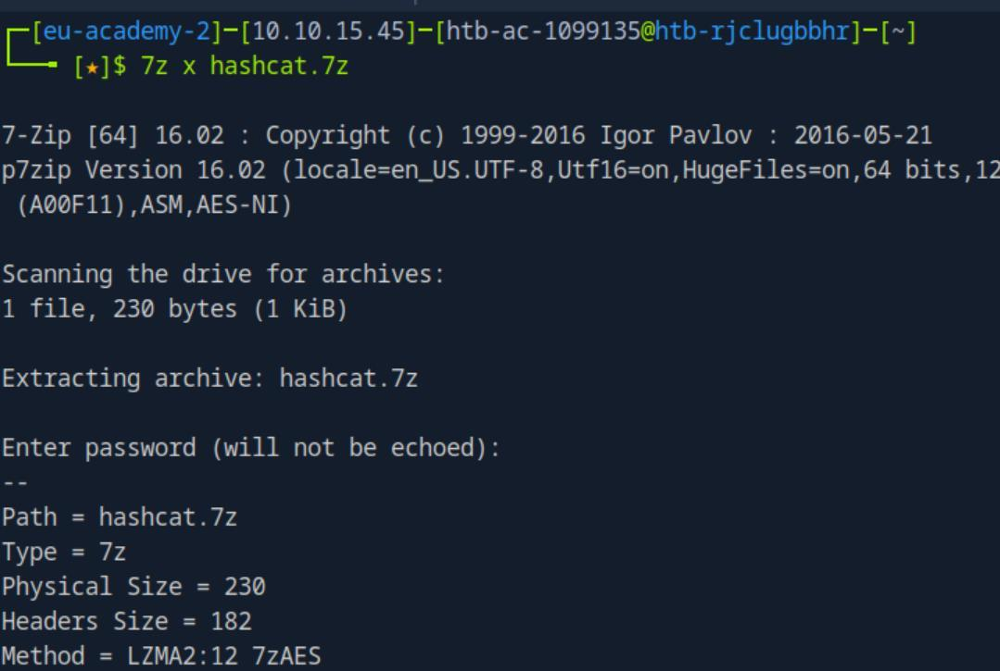
*_Figure 12.2 — Lab execution and output verification (Page 12)_*

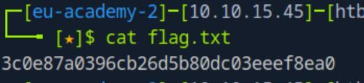
*_Figure 12.3 — Lab execution and output verification (Page 12)_*


### Cracking Wireless (WPA/WPA2) Handshakes with Hashcat

> **Lab Question (Page 13)**: Perform MIC cracking using the attached .cap file.
>
> **Flag / Answer**: `1212312121`
{: .prompt-info }

#### Technical Methodology & Exploit Execution:

First, we will download and extract the 'corp_question1-01.cap' file:
wget
`https://academy.hackthebox.com/storage/modules/20/Hashcat_wi`
reless1.zip -q

```bash
unzip Hashcat_wireless1.zip
```


Now we will compile the tool 'hcxpcapngtool' (pre installed in the pwnbox) to
extract the hash from the 'corp_question-01.cap':
hcxpcapngtool -o mic_to_crack.22000 corp_question1-01.cap


*
*

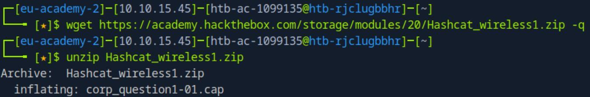
*_Figure 13.1 — Lab execution and output verification (Page 13)_*

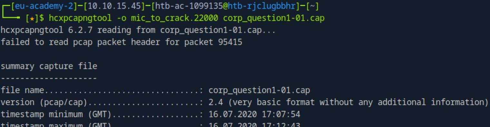
*_Figure 13.2 — Lab execution and output verification (Page 13)_*

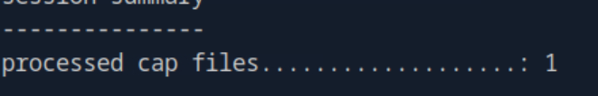
*_Figure 13.3 — Lab execution and output verification (Page 13)_*


### Now we can crack the output hash file 'mic_to_crack.22000'

> **Lab Question (Page 14)**: Extract the PMKID hash from the attached .cap file and crack it.
>
> **Flag / Answer**: `1password`
{: .prompt-info }

#### Technical Methodology & Exploit Execution:

the cracking process is identical to the previous question, only here
we use the commands:
hcxpcapngtool -o mic_to_crack2.22000
cracking_pmkid_question2.cap

```bash
hashcat -m 22000 mic_to_crack2.22000 rockyou.txt
```
(the original file is 'cracking_pmkid_question2.cap', then the hash is extracted
to 'mic_to_crack2.22000')

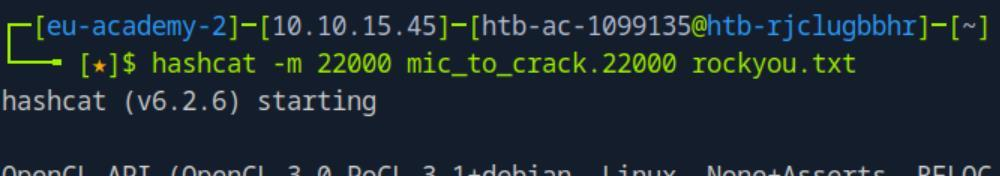
*_Figure 14.1 — Lab execution and output verification (Page 14)_*

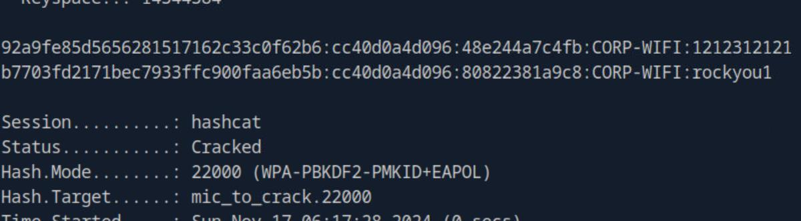
*_Figure 14.2 — Lab execution and output verification (Page 14)_*


### Capstone: Skills Assessment

> **Lab Question (Page 15)**: What type of hash did your colleague obtain from the SQL injection attack?
>
> **Flag / Answer**: `SHA-1`
{: .prompt-info }

#### Technical Methodology & Exploit Execution:

while we can use the hash identifier website, for exact answer format
we will use the tool 'hashid':
hashid 0c67ac18f50c5e6b9398bfe1dc3e156163ba10ef


Question: What is the cleartext password for the hash obtained from SQL
injection in example 1?
Answer: flower1
Method: we crack the hash with rockyou wordlist with '-m 100' hsahcat code
for sha1 hashes:
```bash
hashcat -m 100 hash.txt rockyou.txt
```
where the hash is  put in 'hash.txt':

* *

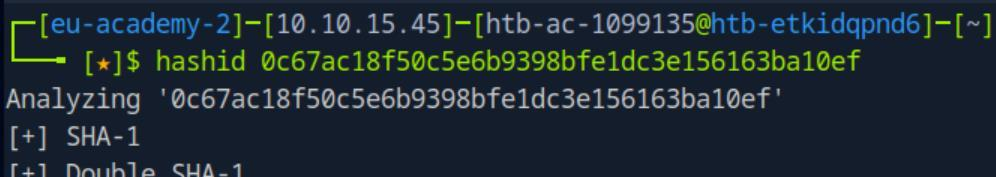
*_Figure 15.1 — Lab execution and output verification (Page 15)_*

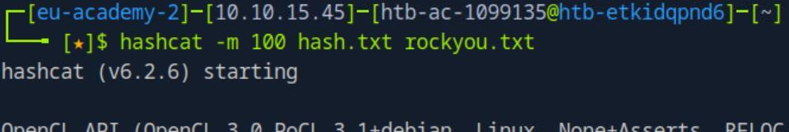
*_Figure 15.2 — Lab execution and output verification (Page 15)_*

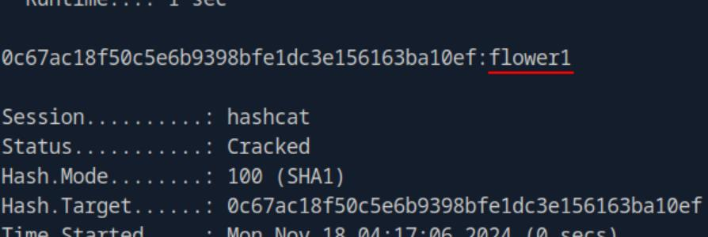
*_Figure 15.3 — Lab execution and output verification (Page 15)_*


### hashes

> **Lab Question (Page 16)**: What is the cleartext password value for the NetNTLMv2 hash?
>
> **Flag / Answer**: `bubbles1`
{: .prompt-info }

#### Technical Methodology & Exploit Execution:

we put the NTLMv2 hash in a file 'hash2.txt', and proceed the same as
the hash before it, only in here we use the hashcat code '-m 5600' for NTLMv2
hashes:
```bash
hashcat -m 1000 hash2.txt rockyou.txt
```


* *


Question: Crack the TGS ticket obtained from the Kerberoasting attack.
Answer: p@ssw0rdadmin
Method: we put the hash in 'hash3.txt' file, and run the hashcat for Kerberos
hash – '-m 13100':
```bash
hashcat -m 13100 hash3.txt rockyou.txt
```


* *

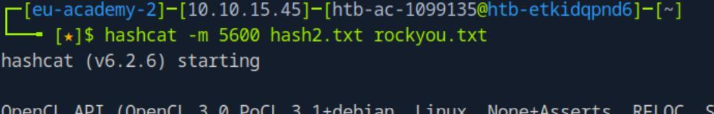
*_Figure 16.1 — Lab execution and output verification (Page 16)_*

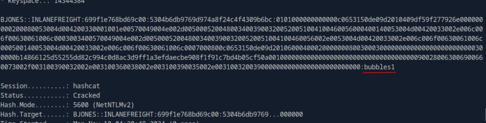
*_Figure 16.2 — Lab execution and output verification (Page 16)_*

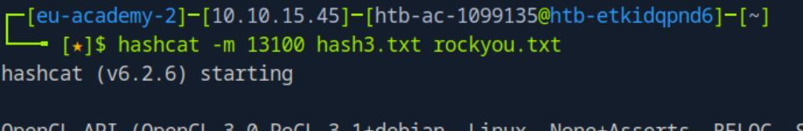
*_Figure 16.3 — Lab execution and output verification (Page 16)_*

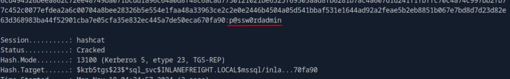
*_Figure 16.4 — Lab execution and output verification (Page 16)_*


### '-m 2100'

> **Lab Question (Page 17)**: What is the cleartext password value for the MS Cache 2 hash?
>
> **Flag / Answer**: `welcome1`
{: .prompt-info }

#### Technical Methodology & Exploit Execution:

we put the hash in 'hash4.txt' file, and run the hashcat for with code
'-m 2100':
```bash
hashcat -m 2100 hash4.txt rockyou.txt
```


* *


Question: After cracking the NTLM password hashes contained in the NTDS.dit
file, perform an analysis of the results and find out the MOST common
password in the INLANEFREIGHT .LOCAL domain.
Answer: freight1
Method: First, we will extract the 'DC01.inlanefreight.local.ntds' file from the
provided zip file they give.

In it, are the various hashes of the various domain users:

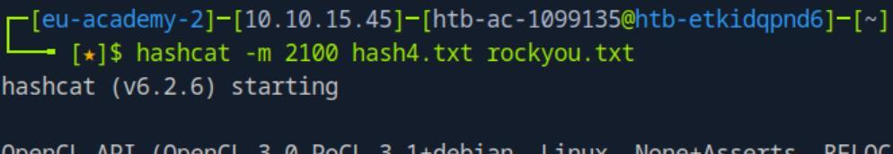
*_Figure 17.1 — Lab execution and output verification (Page 17)_*

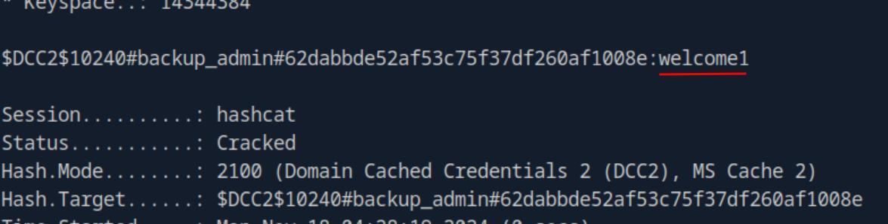
*_Figure 17.2 — Lab execution and output verification (Page 17)_*

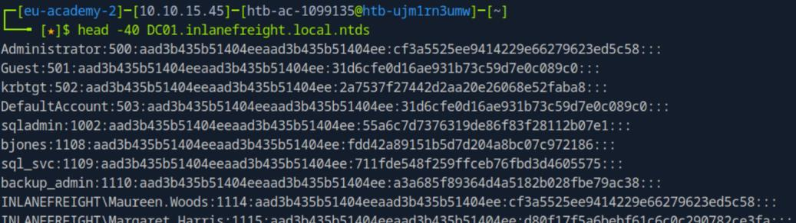
*_Figure 17.3 — Lab execution and output verification (Page 17)_*


### the most

Where the NTLM hash is the right-most hash.

We will use the following python script to determine which NTLM hash appears
the most:
from collections import Counter

# File path
file_path = 'DC01.inlanefreight.local.ntds'

# Read and process the file
with open(file_path, 'r') as file:
ntlm_hashes = []
for line in file:
parts = line.strip().split(':')
if len(parts) > 3:  # Ensure there are enough parts
ntlm_hash = parts[3]  # The NTLM hash is the 4th
field
ntlm_hashes.append(ntlm_hash)

# Count occurrences of each NTLM hash
hash_counts = Counter(ntlm_hashes)

# Find the most common NTLM hash
most_common_hash = hash_counts.most_common(1)

if most_common_hash:
print("\nMost Common NTLM Hash:")
print(f"{most_common_hash[0][0]}:
{most_common_hash[0][1]} occurrences")


### lets see this in action

lets see this in action:

The hash 'db3a9af5e74be03220d213b47ef25b53' appears the most – 43 times.

All we are left to do is to put the hash in the file 'hash.txt' and crack it:
```bash
hashcat -m 1000 hash.txt rockyou.txt
```

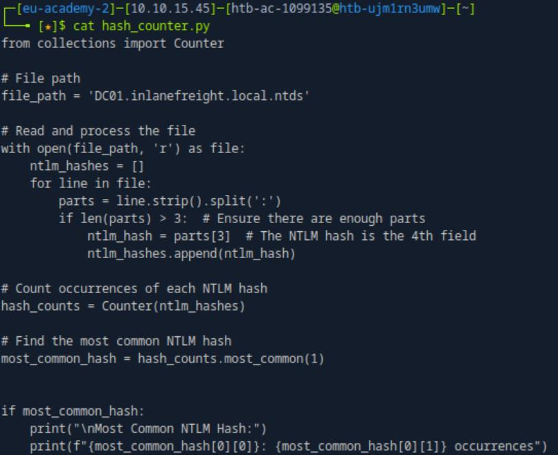
*_Figure 19.1 — Lab execution and output verification (Page 19)_*

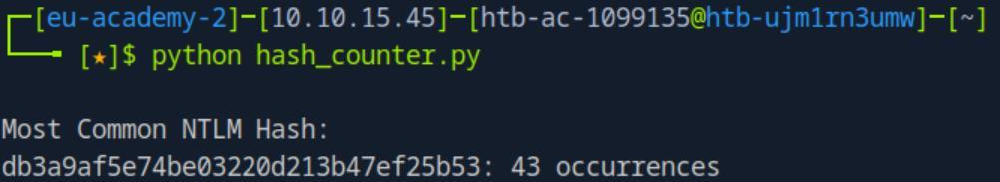
*_Figure 19.2 — Lab execution and output verification (Page 19)_*

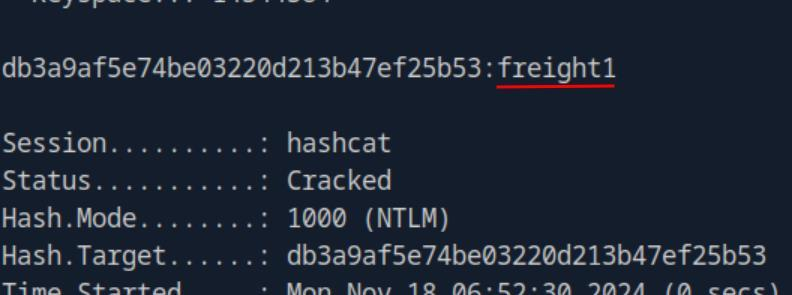
*_Figure 19.3 — Lab execution and output verification (Page 19)_*


---

## Enterprise Defense & Mitigation Blueprint

To neutralize the attack vectors demonstrated throughout this module, security engineers and infrastructure administrators should implement layered defense-in-depth controls:

1. **Principle of Least Privilege (PoLP)**: Strictly segregate administrative rights, isolate service accounts into managed domains (gMSAs), and strip unnecessary capabilities (`CAP_SETUID`, `SeImpersonatePrivilege`).
2. **Input Validation & Parameterization**: Neutralize command injection, LFI, and parameter tampering at the source by utilizing strict type allowlists, parameterized ORMs, and secure input sanitization.
3. **Network Boundary Segmentation**: Isolate sensitive internal management ports (SSH, WinRM, SMB, RDP, SQL) behind bastion hosts and multi-factor VPN gateways with network-level microsegmentation.
4. **Telemetry & Threat Detection**: Forward audit logs (Sysmon, Windows Event Logs, Linux Auditd, Zeek) to a centralized SIEM with behavioral rules targeting anomalous process spawning (`cmd.exe` from `w3wp.exe`, unexpected SUID execution, or mass port probing).


---

## MITRE ATT&CK Mapping & Threat Matrix

| Security Domain | Mapping Specification |
| :--- | :--- |
| **Primary Tactic** | Enterprise Penetration Testing & Adversary Simulation |
| **Mitre Techniques** | `T1110.002, T1555` |
| **Common Weakness Enumerations** | `CWE-522, CWE-328` |

### Adversary Tradecraft & Technique Breakdown

| Technique ID | Technique Name | Tactic | Applied Offensive / Defensive Context |
| :--- | :--- | :--- | :--- |
| [`T1110.002`](https://attack.mitre.org/techniques/T1110/) | **Brute Force: Password Cracking** | `Credential Access` | Accelerated GPU-based password hash cracking |
| [`T1555`](https://attack.mitre.org/techniques/T1555/) | **Credentials from Password Stores** | `Credential Access` | Cracking hashes dumped from Active Directory or local shadow files |


### Identified Common Weakness Enumerations (CWE)

- [`CWE-522`: Insufficiently Protected Credentials](https://cwe.mitre.org/data/definitions/522.html)
- [`CWE-328`: Use of Weak Hash](https://cwe.mitre.org/data/definitions/328.html)


---

## Detection Engineering & Defensive Countermeasures

Modern enterprise security programs must implement proactive, layered defense-in-depth controls to detect and mitigate the techniques covered in this module:

- Enforce enterprise password filters (e.g., Azure AD Password Protection) to block passwords matching known leaked dictionary entries.
- Migrate from legacy NTLM and MD5/SHA1 storage to modern slow-hashing functions (Argon2id, PBKDF2 with high iterations).
- Monitor compromised credential repositories (HaveIBeenPwned API) to continuously flag compromised internal user accounts.


---

## Authoritative References & Recommended Reading

- [HTB Academy: Cracking Passwords with Hashcat](https://academy.hackthebox.com/module/20) — *Official Hack The Box curriculum track*
- [Hashcat Official Wiki & Manual](https://hashcat.net/wiki/) — *Complete guide to attack modes (-a 0, 1, 3, 6, 7) and rule files*
- [Hashcat Example Hashes](https://hashcat.net/wiki/doku.php?id=example_hashes) — *List of supported hash modes and formats*
- [NIST SP 800-63B: Password Storage Recommendations](https://pages.nist.gov/800-63-3/sp800-63b.html) — *Standard government guidelines for hash security*


<div class="ff-series-nav">
  <a href="/posts/htb-academy-part-31-session-security/" class="ff-nav-btn text-start">
    <div class="ff-nav-arrow"><i class="fas fa-arrow-left"></i></div>
    <div class="ff-nav-text">
      <span class="ff-nav-kicker">Previous Part</span>
      <span class="ff-nav-title">Part 31: Session Security & Token Manipulation</span>
    </div>
  </a>
  <div class="ff-nav-center">
    <span class="ff-center-badge"><i class="fas fa-cube"></i> HTB Academy Series</span>
    <span class="ff-center-part">Part 32 of 41</span>
  </div>
  <a href="/posts/htb-academy-part-33-using-the-metasploit-framework/" class="ff-nav-btn text-end">
    <div class="ff-nav-text">
      <span class="ff-nav-kicker">Next Part</span>
      <span class="ff-nav-title">Part 33: Using the Metasploit Framework</span>
    </div>
    <div class="ff-nav-arrow"><i class="fas fa-arrow-right"></i></div>
  </a>
</div>
