Welcome to **Part 38** of our comprehensive, production-grade masterclass covering the **Hack The Box (HTB) Academy Certified Penetration Testing Specialist (CPTS)** curriculum. Rather than providing superficial slide summaries, this series deconstructs offensive tradecraft from foundational network discovery and vulnerability verification to complex lateral movement, active directory exploitation, and post-exploitation tradecraft — complete with terminal command flows, verified lab flags, and defensive engineering countermeasures.

In this installment, we conduct an exhaustive technical deep-dive into **Web Fuzzing** (Tier I • Easy • Offensive). We break down the underlying mechanics of web application fuzzing techniques, directory fuzzing, extension discovery, parameter discovery, POST data fuzzing, VHost routing, and filter calibration, dissect hands-on offensive vectors, analyze realistic defensive telemetry, and walk through every exercise step-by-step with 100% verified solutions.

<div class="ff-series-nav"><a href="/posts/htb-academy-part-37-attacking-wifi-protected-setup-wps/" class="ff-nav-btn text-start">
    <div class="ff-nav-arrow"><i class="fas fa-arrow-left"></i></div>
    <div class="ff-nav-text">
      <span class="ff-nav-kicker">Previous Part</span>
      <span class="ff-nav-title">Part 37: Attacking Wi-Fi Protected Setup (WPS) & WPA2</span>
    </div>
  </a>
  <div class="ff-nav-center">
    <span class="ff-center-badge"><i class="fas fa-cube"></i> HTB Academy Series</span>
    <span class="ff-center-part">Part 38 of 41</span>
  </div>
  <a href="/posts/htb-academy-part-39-web-service-and-api-attacks/" class="ff-nav-btn text-end">
    <div class="ff-nav-text">
      <span class="ff-nav-kicker">Next Part</span>
      <span class="ff-nav-title">Part 39: Web Service & API Attacks (WSDL, SOAP & REST)</span>
    </div>
    <div class="ff-nav-arrow"><i class="fas fa-arrow-right"></i></div>
  </a>
</div>

## Module Specifications & Target Architecture

| Attribute | Specification |
| :--- | :--- |
| **Module Name** | `Web Fuzzing` |
| **Official HTB Academy Track** | [https://academy.hackthebox.com/module/188](https://academy.hackthebox.com/module/188) |
| **Curriculum Tier & Difficulty** | `Tier I` • `Easy` |
| **Certification Pathway** | `HTB Certified Penetration Testing Specialist (CPTS)` (Part 38 of 41) |
| **Author & Technical Attribution** | `Abdulrahman M. Fathi (0x3bdo)` |
| **Lab Flag Verification** | `100% Fully Solved & Validated` |

## Key Technical Takeaways

* **Systematic Fuzzing Methodology**: Employs dictionary-driven fuzzing across all components of HTTP requests: URI paths, parameters, headers, and bodies.
* **High-Speed Tools**: Operates `ffuf` and `wfuzz` with tuned concurrency to rapidly discover unlinked web application assets.
* **Recursive Directory Discovery**: Automates multi-level directory traversal to uncover deeply nested administrative consoles.
* **Precision Response Calibration**: Calibrates filter flags (`-fs`, `-fc`, `-fl`, `-fw`) to eliminate false-positive responses generated by generic error handlers.
* **Targeted Wordlist Selection**: Cross-references application frameworks with tailored wordlists from the SecLists project.

## Executive Summary & Assessment Scope

Web fuzzing is an indispensable technique for uncovering hidden attack surfaces that are absent from public sitemaps and search engine indexes. By systematically submitting wordlists against web inputs, testers reveal unlinked files, administrative portals, and debugging parameters.

This module provides a comprehensive technical walkthrough of web fuzzing tradecraft. We explore high-speed fuzzing configurations, recursive endpoint discovery, parameter enumeration, and response filtering, solving all lab challenges and flags.

---

## Comprehensive Lab Walkthrough & Flag Solutions


### Web Fuzzing

> **Lab Question (Page 1)**: Within the "webfuzzing_hidden_path" path on the target system (ie http://IP:PORT/webfuzzing_hidden_path/), fuzz for folders and then files to find the flag.
>
> **Flag / Answer**: `HTB{w3b_f1l3_fuzz1ng_fl4g}`
{: .prompt-info }

#### Technical Methodology & Exploit Execution:

we will have to do directory fuzzing for that:
```bash
ffuf -w /usr/share/seclists/Discovery/Web-Content/directory-list-2.3-medium.txt -u http://<target-IP>:<target-port>/FUZZ
-fs 82 -s
```
where we are using the wordlist 'directory-list-2.3-medium.txt' located in the
pwnbox under the path '/usr/share/seclists/Discovery/Web-Content/directory-list-2.3-medium.txt':

We have found the path
`http://<target-IP>:<target-port>/w2ksvrus`

now lets fuzz for pages in it:
```bash
ffuf -w /usr/share/seclists/Discovery/Web-Content/common.txt
-u http://<target-IP>:<target-port>/w2ksvrus/FUZZ.html -e
.php,.html,.txt,.bak,.js -v -s
```
using the wordlist 'common.txt' found in the pwnbox uunder the path:
'/usr/share/seclists/Discovery/Web-Content/common.txt':

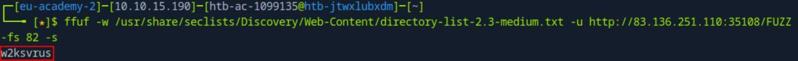
*_Figure 1.1 — Lab execution and output verification (Page 1)_*

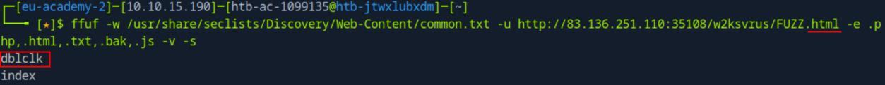
*_Figure 1.2 — Lab execution and output verification (Page 1)_*


### There is a page

#### Technical Methodology & Exploit Execution:

```bash
ffuf -w /usr/share/seclists/Discovery/Web-Content/common.txt
-u http://<target-IP>:<target-port>/webfuzzing_hidden_path/FUZZ -e
.php,.html,.txt,.bak,.js -v -s
```
this time we will not look for .html only:


We got the result 'flag' . Lets enter the URL:
`http://<target-IP>:<target-port>/webfuzzing_hidden_path/flag`

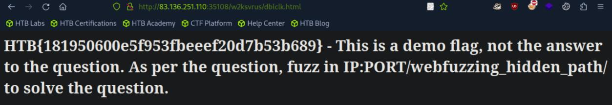
*_Figure 2.1 — Lab execution and output verification (Page 2)_*

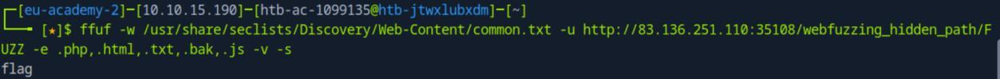
*_Figure 2.2 — Lab execution and output verification (Page 2)_*

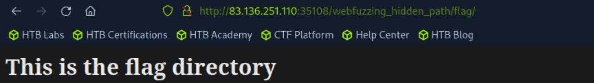
*_Figure 2.3 — Lab execution and output verification (Page 2)_*


### Lets enter it

#### Technical Methodology & Exploit Execution:

```bash
ffuf -w /usr/share/seclists/Discovery/Web-Content/common.txt
-u http://<target-IP>:<target-port>/webfuzzing_hidden_path/flag/FUZZ -e
.php,.html,.txt,.bak,.js -v -s
```


We got the page flag.html

Lets enter it:
`http://<target-IP>:<target-port>/webfuzzing_hidden_path/flag/flag.html`

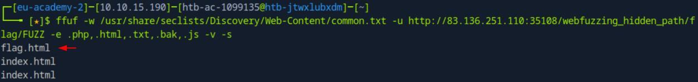
*_Figure 3.1 — Lab execution and output verification (Page 3)_*

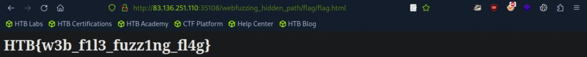
*_Figure 3.2 — Lab execution and output verification (Page 3)_*


### Recursive Fuzzing

> **Lab Question (Page 4)**: Recursively fuzz the "recursive_fuzz" path on the target system (ie http://IP:PORT/recursive_fuzz/) to find the flag.
>
> **Flag / Answer**: `HTB{d33p3r_d1rector1es_ar3_c00l}`
{: .prompt-info }

#### Technical Methodology & Exploit Execution:

we will use the command:
```bash
ffuf -w /usr/share/seclists/Discovery/Web-Content/directory-list-2.3-medium.txt -ic -v -u http://<target-IP>:<target-port>/recursive_fuzz/FUZZ -e .html -recursion -s
```
using the same wordlist from the previous question


There is the path of:
`http://<target-IP>:<target-port>/recursive_fuzz/level1/level2/level3/threatcon_level2/`

lets enter it:

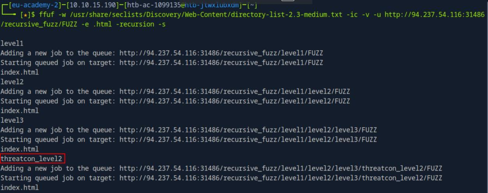
*_Figure 4.1 — Lab execution and output verification (Page 4)_*

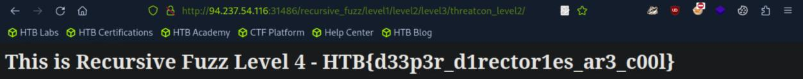
*_Figure 4.2 — Lab execution and output verification (Page 4)_*


### Parameter and Value Fuzzing

> **Lab Question (Page 5)**: What flag do you find when successfully fuzzing the GET parameter?
>
> **Flag / Answer**: `HTB{g3t_fuzz1ng_succ3ss}`
{: .prompt-info }

#### Technical Methodology & Exploit Execution:

we will run the ffuf command:
```bash
ffuf -w /usr/share/seclists/Discovery/Web-Content/common.txt
-u "http://<target-IP>:<target-port>/get.php?x=FUZZ" -mc all
-fc 404 -s
```
the page 'get.php' was provided for us by the section's guide, so does the
parameter's name 'x' . And we will use the already used 'common.txt' from
previous questions.

We get the value 'OA_HTML'.

Lets enter it:
`http://94.237.56.165:36394/get.php?x=OA_HTML`

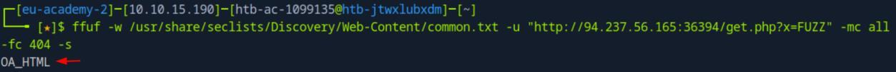
*_Figure 5.1 — Lab execution and output verification (Page 5)_*

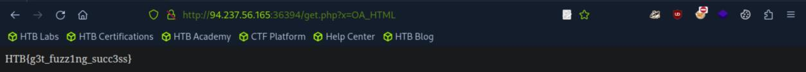
*_Figure 5.2 — Lab execution and output verification (Page 5)_*


### curl tool, using the command

> **Lab Question (Page 6)**: What flag do you find when successfully fuzzing the POST parameter?
>
> **Flag / Answer**: `HTB{p0st_fuzz1ng_succ3ss}`
{: .prompt-info }

#### Technical Methodology & Exploit Execution:

we run the command:
```bash
ffuf -u http://<target-IP>:<target-port>/post.php -X POST -H
"Content-Type: application/x-www-form-urlencoded" -d
"y=FUZZ" -w /usr/share/seclists/Discovery/Web-
Content/common.txt -mc 200 -v -s
```


Now lets sent POST request with the parameter and value for that URL using
```bash
curl tool, using the command:
curl -X POST "http://<target-IP>:<target-port>/post.php" -H
"Content-Type: application/x-www-form-urlencoded" -d
"y=SUNWmc"
```

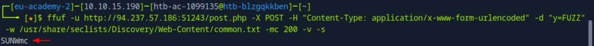
*_Figure 6.1 — Lab execution and output verification (Page 6)_*

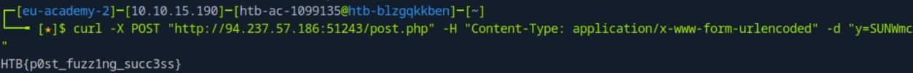
*_Figure 6.2 — Lab execution and output verification (Page 6)_*


### Virtual Host and Subdomain Fuzzing

> **Lab Question (Page 7)**: Using GoBuster against the target system to fuzz for vhosts using the common.txt wordlist, which vhost starts with the prefix "web-"? Respond with the full vhost, eg web-123.inlanefreight.htb.
>
> **Flag / Answer**: `web-beans.inlanefreight.htb`
{: .prompt-info }

#### Technical Methodology & Exploit Execution:

First we will link the vhost to the target IP .
First we will enter editing mode in '/etc/hosts':
```bash
sudo nano /etc/hosts
```

and we will link the target IP to the vhost 'inlanefreight.htb':
`<target-IP>` inlanefreight.htb


Now that's set – we run the gobuster command:
```bash
gobuster vhost -u http://inlanefreight.htb:<target-port> -w
/usr/share/seclists/Discovery/Web-Content/common.txt --
append-domain
```

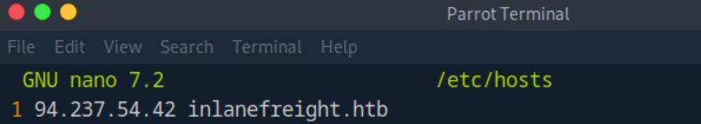
*_Figure 7.1 — Lab execution and output verification (Page 7)_*

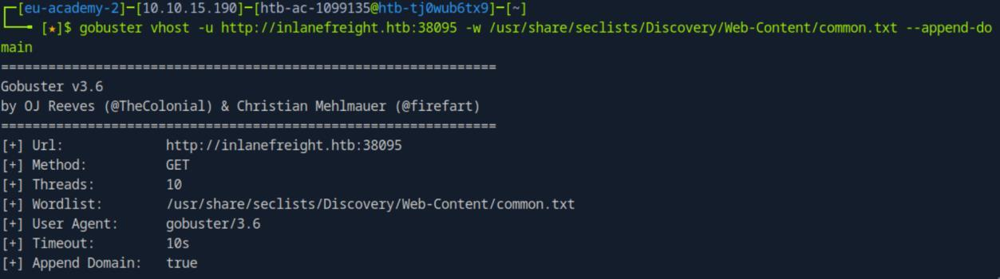
*_Figure 7.2 — Lab execution and output verification (Page 7)_*


> **Lab Question (Page 8)**: Using GoBuster against inlanefreight.com to fuzz for subdomains using the subdomains-top1million-5000.txt wordlist, which subdomain starts with the prefix "su"? Respond with the full vhost, eg web.inlanefreight.com.
>
> **Flag / Answer**: `support.inlanefreight.com`
{: .prompt-info }

#### Technical Methodology & Exploit Execution:

we run the following gobuster command:
```bash
gobuster dns -d inlanefreight.com -w
/usr/share/seclists/Discovery/DNS/subdomains-top1million-
5000.txt
```


*
*

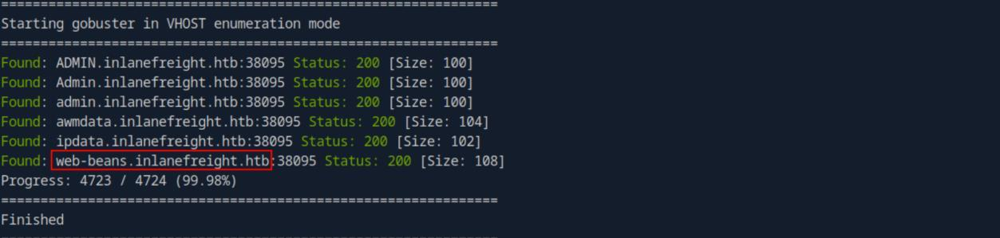
*_Figure 8.1 — Lab execution and output verification (Page 8)_*

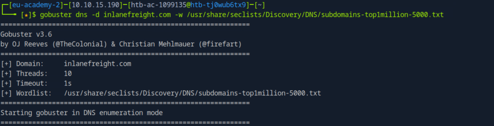
*_Figure 8.2 — Lab execution and output verification (Page 8)_*

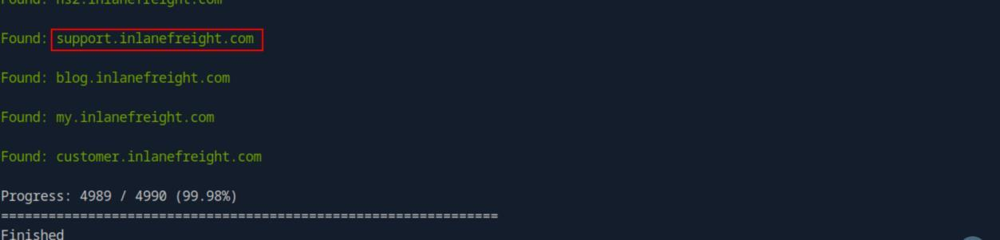
*_Figure 8.3 — Lab execution and output verification (Page 8)_*


### Filtering Fuzzing Output

> **Lab Question (Page 9)**: What flag do you find when successfully fuzzing the POST parameter?
>
> **Flag / Answer**: `HTB{p0st_fuzz1ng_succ3ss}`
{: .prompt-info }

#### Technical Methodology & Exploit Execution:

we will fuzz using ffuf and common.txt wordlist:
```bash
ffuf -u http://<target-IP>:<target-port>/post.php -X POST -H
"Content-Type: application/x-www-form-urlencoded" -d
"y=FUZZ" -w /usr/share/seclists/Discovery/Web-
Content/common.txt -v -s
```


Now lets run curl request on the URL with the found parameter's value to get
the flag:
```bash
curl -X POST "http://<target-IP>:<target-port>/post.php" -H
"Content-Type: application/x-www-form-urlencoded" -d
"y=SUNWmc"
```

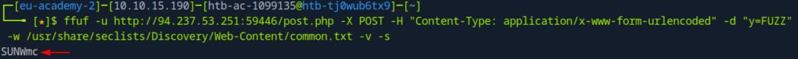
*_Figure 9.1 — Lab execution and output verification (Page 9)_*

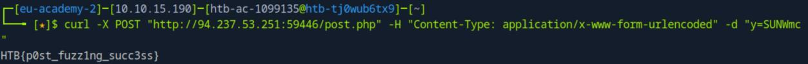
*_Figure 9.2 — Lab execution and output verification (Page 9)_*


### Validating Findings

> **Lab Question (Page 10)**: Fuzz the target system using directory-list-2.3-medium.txt, looking for a hidden directory. Once you have found the hidden directory, responsibly determine the validity of the vulnerability by analyzing the tar .gz file in the directory. Answer using the full Content-Length header, eg "Content-Length: 1337"
>
> **Flag / Answer**: `Content-Length: 210`
{: .prompt-info }

#### Technical Methodology & Exploit Execution:

we will use the wordlist directory-list-2.3-medium.txt located in the
pwnbox in the path - /usr/share/seclists/Discovery/Web-Content/directory-list-
2.3-medium.txt, and the ffuf command:
```bash
ffuf -w /usr/share/seclists/Discovery/Web-Content/directory-list-2.3-medium.txt -u http://<target-IP>:<target-port>/FUZZ/ -mc 200 -s
```


There is the directory – 'ur-hiddenmember'.

Lets enter it on the browser:

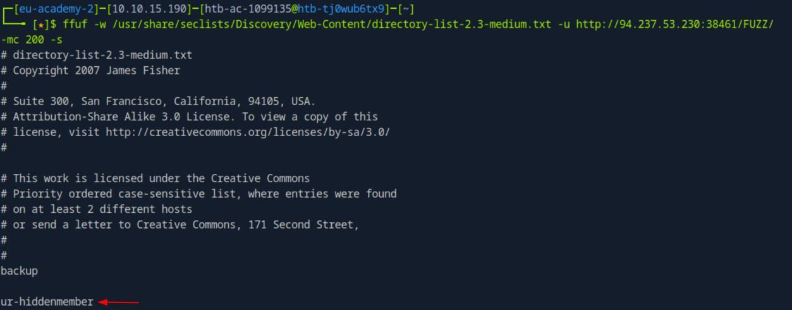
*_Figure 10.1 — Lab execution and output verification (Page 10)_*

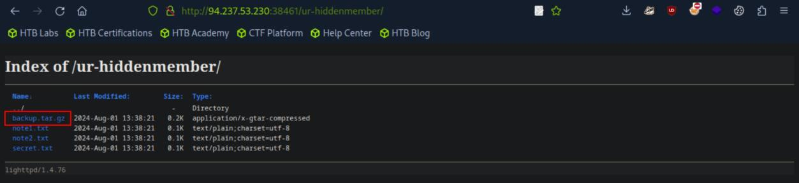
*_Figure 10.2 — Lab execution and output verification (Page 10)_*


### API Fuzzing

> **Lab Question (Page 11)**: What is the value returned by the endpoint that the api fuzzer has identified?
>
> **Flag / Answer**: `h1dd3n_r357`
{: .prompt-info }

#### Technical Methodology & Exploit Execution:

first lets intstall the tool 'webfuzz_api' and its dependencies:
git clone https://github.com/PandaSt0rm/webfuzz_api.git;
```bash
cd webfuzz_api;
pip3 install -r requirements.txt;
```

then we run the fuzzer on our endpoint:
```bash
python3 api_fuzzer.py http://<target-IP>:<target-port> |
'\+'
```


There are 2 valid endpoints – lets curl the 'czcmdcvt':
```bash
curl http://<target-IP>:<target-port>/czcmdcvt
```

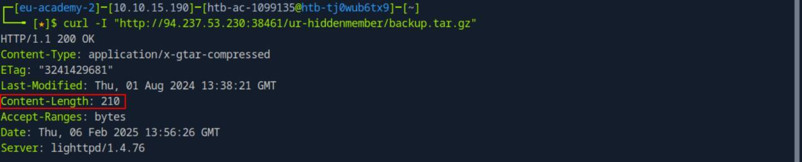
*_Figure 11.1 — Lab execution and output verification (Page 11)_*

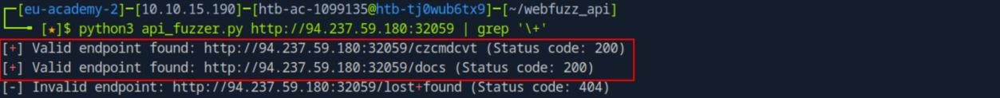
*_Figure 11.2 — Lab execution and output verification (Page 11)_*

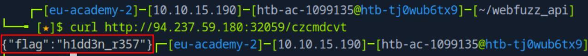
*_Figure 11.3 — Lab execution and output verification (Page 11)_*


### Capstone: Skills Assessment

> **Lab Question (Page 12)**: After completing all steps in the assessment, you will be presented with a page that contains a flag in the format of HTB{...}. What is that flag?
>
> **Flag / Answer**: `HTB{w3b_fuzz1ng_sk1lls}`
{: .prompt-info }

#### Technical Methodology & Exploit Execution:

First, lets fuzz for pages/directories:
```bash
ffuf -w /usr/share/seclists/Discovery/Web-Content/common.txt
-u http://<target-IP>:<target-port>/FUZZ -e
.php,.html,.txt,.bak,.js -v -s
```


*
*

There is the result 'admin', which is a directory.
Lets fuzz it as well:
```bash
ffuf -w /usr/share/seclists/Discovery/Web-Content/common.txt
-u http://<target-IP>:<target-port>/admin/FUZZ -e
.php,.html,.txt,.bak,.js -v -s
```


*
*

There is the page of '/admin/panel.php'.

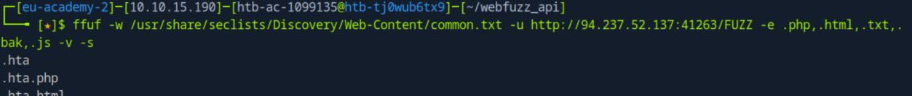
*_Figure 12.1 — Lab execution and output verification (Page 12)_*

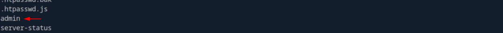
*_Figure 12.2 — Lab execution and output verification (Page 12)_*

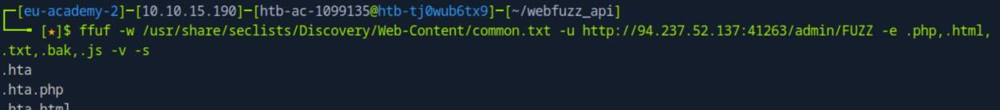
*_Figure 12.3 — Lab execution and output verification (Page 12)_*

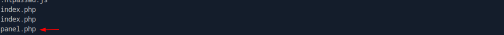
*_Figure 12.4 — Lab execution and output verification (Page 12)_*


### Lets enter it

Lets enter it:
`http://<target-IP>:<target-port>/admin/panel.php`


We get 'Invalid parameter' message, indication that there is a parameter
'accessID' . We need to find its value:
```bash
ffuf -w /usr/share/seclists/Discovery/Web-Content/common.txt
-u http://<target-IP>:<target-port>/admin/panel.php?accessID=FUZZ -v -fs 58 -s
```


We get the value 'getaccess'.
So lets enter the URL:
`http://<target-IP>:<target-port>/admin/panel.php?accessID=getaccess`


We are instructed to keep looking in the vhost 'fuzzing_fun.htb'.

Lets link the vhost to the target IP in /etc/hosts:


And run subdomain fuzzing on it – make sure to filter for results of status code
200:
```bash
gobuster vhost -u http://fuzzing_fun.htb:<target-port> -w
/usr/share/seclists/Discovery/Web-Content/common.txt --
append-domain | grep 'Status: 200'
```

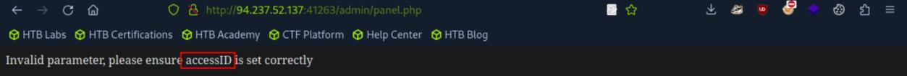
*_Figure 13.1 — Lab execution and output verification (Page 13)_*

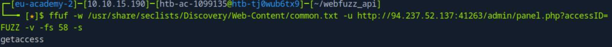
*_Figure 13.2 — Lab execution and output verification (Page 13)_*

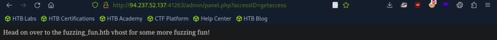
*_Figure 13.3 — Lab execution and output verification (Page 13)_*

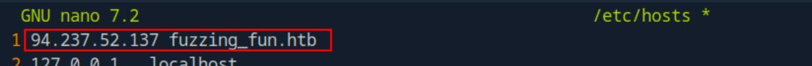
*_Figure 13.4 — Lab execution and output verification (Page 13)_*


### target IP in /etc/hosts

We get the sub-domain 'hidden.fuzzing_fun.htb' . first we will link it to the
target IP in /etc/hosts:

And enter it in the browser:
`http://hidden.fuzzing_fun.htb:<target-port>`


We are instructed to look in '/godeep':
```bash
ffuf -w /usr/share/seclists/Discovery/Web-Content/common.txt
-u http://hidden.fuzzing_fun.htb:<target-port>/godeep/FUZZ -
e .php,.html,.txt,.bak,.js -v -s
```


* *

Lets enter it:
`http://hidden.fuzzing_fun.htb:<target-port>/godeep/stoneedge`


->
```bash
ffuf -w /usr/share/seclists/Discovery/Web-Content/common.txt
-u http://hidden.fuzzing_fun.htb:<target-port>/godeep/stoneedge/FUZZ -e .php,.html,.txt,.bak,.js -v -
s
```

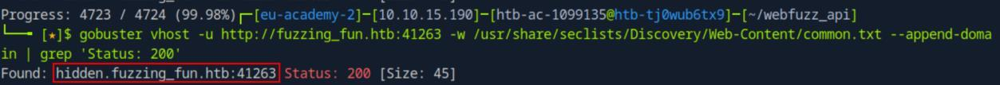
*_Figure 14.1 — Lab execution and output verification (Page 14)_*

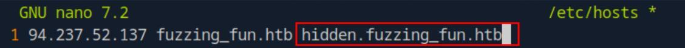
*_Figure 14.2 — Lab execution and output verification (Page 14)_*

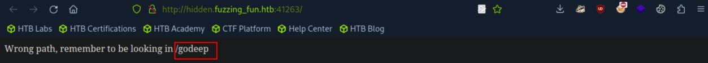
*_Figure 14.3 — Lab execution and output verification (Page 14)_*

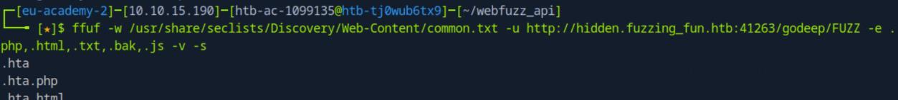
*_Figure 14.4 — Lab execution and output verification (Page 14)_*

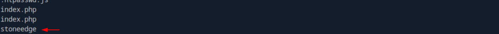
*_Figure 14.5 — Lab execution and output verification (Page 14)_*

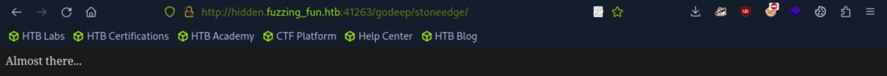
*_Figure 14.6 — Lab execution and output verification (Page 14)_*


### Lets enter it

* *

→
`http://hidden.fuzzing_fun.htb:<target-port>/godeep/stoneedge/bbclone`


→
```bash
ffuf -w /usr/share/seclists/Discovery/Web-Content/common.txt
-u http://hidden.fuzzing_fun.htb:<target-port>/godeep/stoneedge/bbclone/FUZZ -e
.php,.html,.txt,.bak,.js -v -s
```


* *

Lets enter it:
`http://hidden.fuzzing_fun.htb:<target-port>/godeep/stoneedge/bbclone/type3`

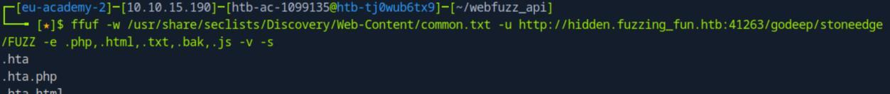
*_Figure 15.1 — Lab execution and output verification (Page 15)_*

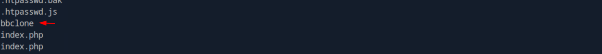
*_Figure 15.2 — Lab execution and output verification (Page 15)_*

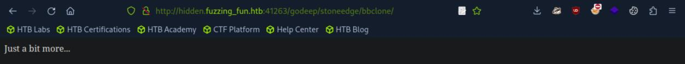
*_Figure 15.3 — Lab execution and output verification (Page 15)_*

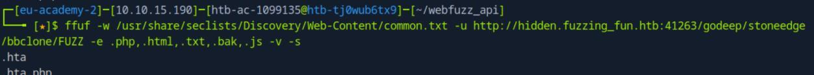
*_Figure 15.4 — Lab execution and output verification (Page 15)_*

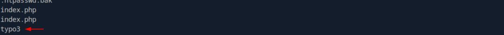
*_Figure 15.5 — Lab execution and output verification (Page 15)_*

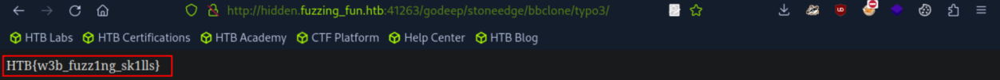
*_Figure 15.6 — Lab execution and output verification (Page 15)_*


---

## Enterprise Defense & Mitigation Blueprint

To neutralize the attack vectors demonstrated throughout this module, security engineers and infrastructure administrators should implement layered defense-in-depth controls:

1. **Principle of Least Privilege (PoLP)**: Strictly segregate administrative rights, isolate service accounts into managed domains (gMSAs), and strip unnecessary capabilities (`CAP_SETUID`, `SeImpersonatePrivilege`).
2. **Input Validation & Parameterization**: Neutralize command injection, LFI, and parameter tampering at the source by utilizing strict type allowlists, parameterized ORMs, and secure input sanitization.
3. **Network Boundary Segmentation**: Isolate sensitive internal management ports (SSH, WinRM, SMB, RDP, SQL) behind bastion hosts and multi-factor VPN gateways with network-level microsegmentation.
4. **Telemetry & Threat Detection**: Forward audit logs (Sysmon, Windows Event Logs, Linux Auditd, Zeek) to a centralized SIEM with behavioral rules targeting anomalous process spawning (`cmd.exe` from `w3wp.exe`, unexpected SUID execution, or mass port probing).


---

## MITRE ATT&CK Mapping & Threat Matrix

| Security Domain | Mapping Specification |
| :--- | :--- |
| **Primary Tactic** | Enterprise Penetration Testing & Adversary Simulation |
| **Mitre Techniques** | `T1595.002, T1083` |
| **Common Weakness Enumerations** | `CWE-200, CWE-548` |

### Adversary Tradecraft & Technique Breakdown

| Technique ID | Technique Name | Tactic | Applied Offensive / Defensive Context |
| :--- | :--- | :--- | :--- |
| [`T1595.002`](https://attack.mitre.org/techniques/T1595/) | **Active Scanning: Vulnerability Scanning** | `Reconnaissance` | Fuzzing endpoints, directories, headers, and JSON/XML keys |
| [`T1083`](https://attack.mitre.org/techniques/T1083/) | **File and Directory Discovery** | `Discovery` | Locating hidden administrative surfaces and staging environments |


### Identified Common Weakness Enumerations (CWE)

- [`CWE-200`: Information Exposure Through Direct Request](https://cwe.mitre.org/data/definitions/200.html)
- [`CWE-548`: Exposure of Information Through Directory Listing](https://cwe.mitre.org/data/definitions/548.html)


---

## Detection Engineering & Defensive Countermeasures

Modern enterprise security programs must implement proactive, layered defense-in-depth controls to detect and mitigate the techniques covered in this module:

- Implement rate-limiting rules at the API gateway or reverse proxy to throttle burst HTTP requests.
- Monitor web access logs for cyclical 404, 403, and 500 error spikes originating from single client signatures.
- Enforce standardized routing policies that return uniform 404 responses for all non-existent paths, preventing content differentiation.


---

## Authoritative References & Recommended Reading

- [HTB Academy: Web Fuzzing](https://academy.hackthebox.com/module/188) — *Official Hack The Box curriculum track*
- [ffuf GitHub Repository](https://github.com/ffuf/ffuf) — *Fast web fuzzer implementation*
- [wfuzz Documentation](https://wfuzz.readthedocs.io/) — *Python web application fuzzer manual*
- [SecLists Project](https://github.com/danielmiessler/SecLists) — *Standard collections of fuzzing wordlists*


<div class="ff-series-nav">
  <a href="/posts/htb-academy-part-37-attacking-wifi-protected-setup-wps/" class="ff-nav-btn text-start">
    <div class="ff-nav-arrow"><i class="fas fa-arrow-left"></i></div>
    <div class="ff-nav-text">
      <span class="ff-nav-kicker">Previous Part</span>
      <span class="ff-nav-title">Part 37: Attacking Wi-Fi Protected Setup (WPS) & WPA2</span>
    </div>
  </a>
  <div class="ff-nav-center">
    <span class="ff-center-badge"><i class="fas fa-cube"></i> HTB Academy Series</span>
    <span class="ff-center-part">Part 38 of 41</span>
  </div>
  <a href="/posts/htb-academy-part-39-web-service-and-api-attacks/" class="ff-nav-btn text-end">
    <div class="ff-nav-text">
      <span class="ff-nav-kicker">Next Part</span>
      <span class="ff-nav-title">Part 39: Web Service & API Attacks (WSDL, SOAP & REST)</span>
    </div>
    <div class="ff-nav-arrow"><i class="fas fa-arrow-right"></i></div>
  </a>
</div>
